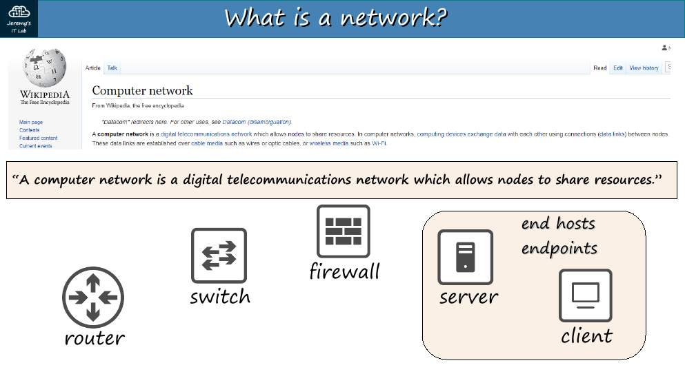
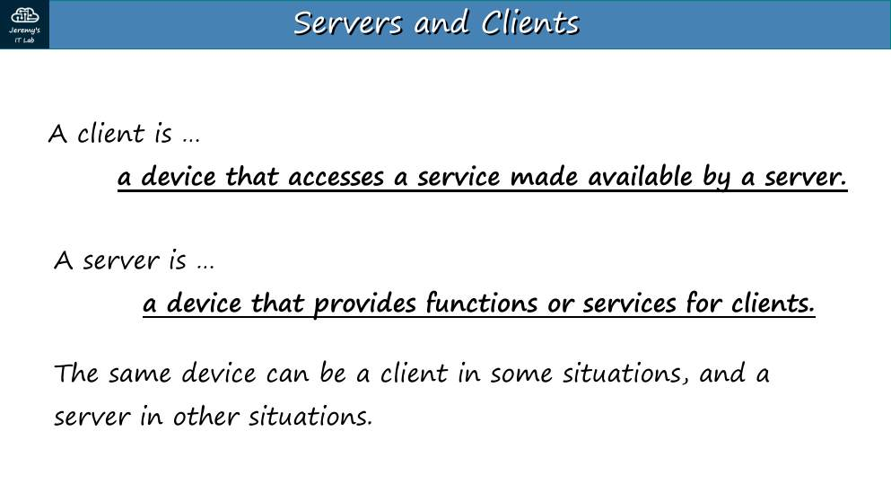
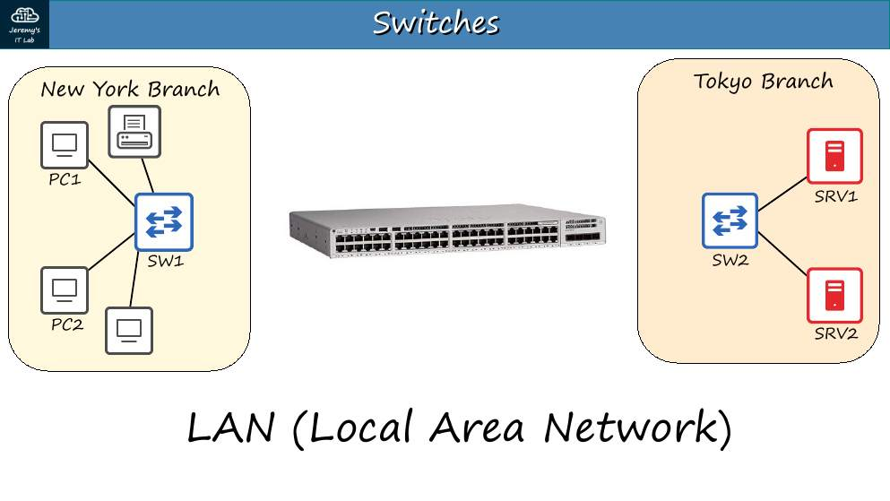
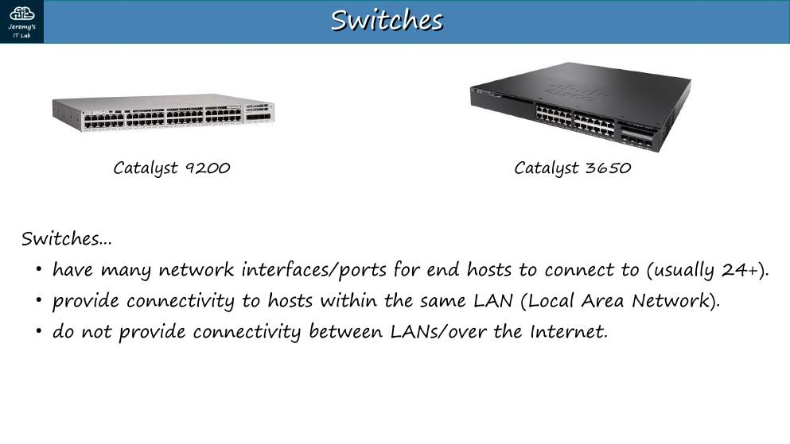
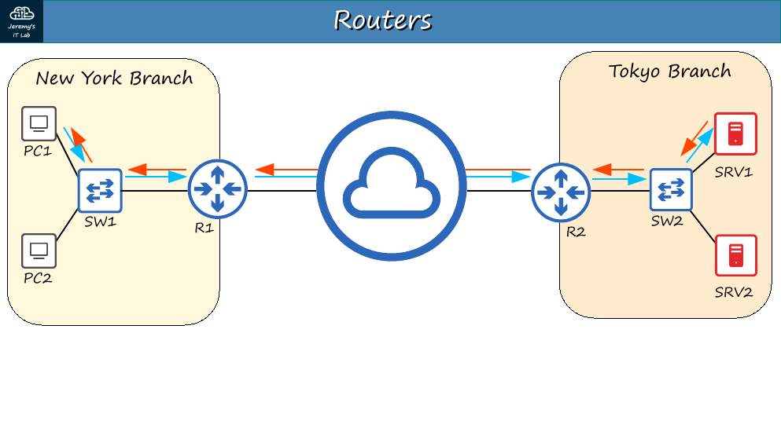
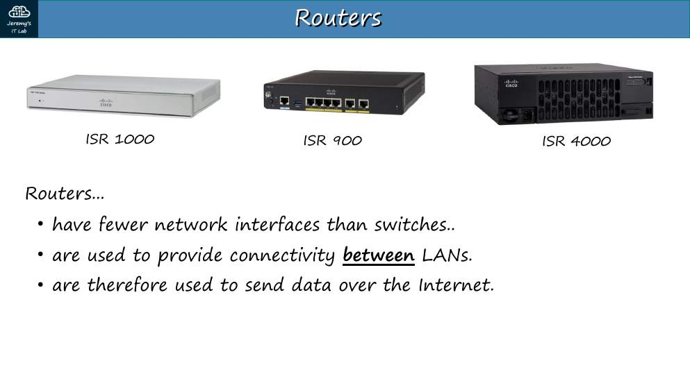
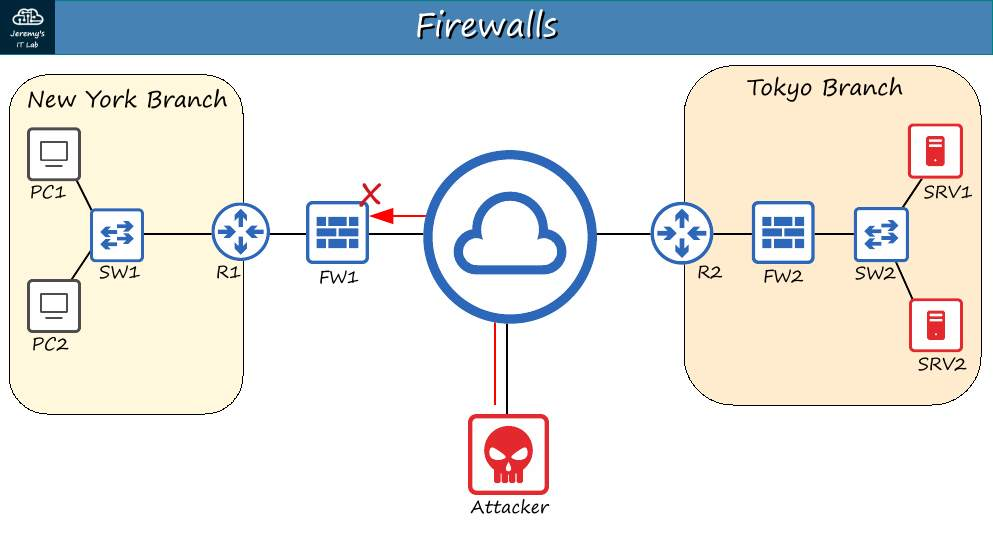
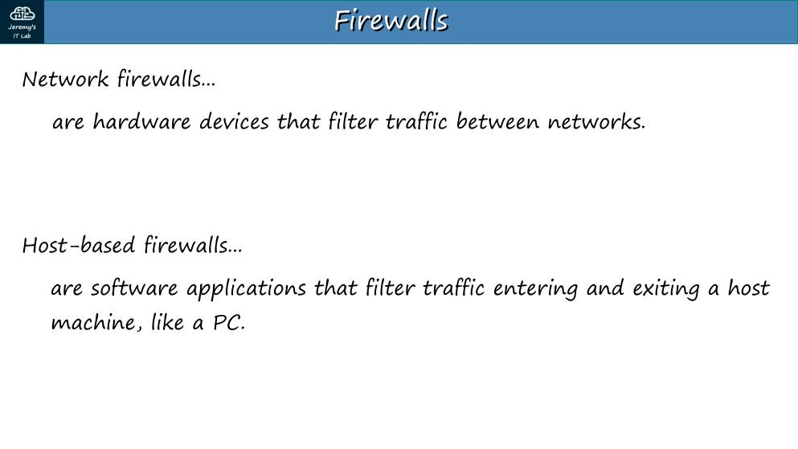

# Día 01 · Dispositivos de red

> Mis apuntes del Día 1 del curso **CCNA 200-301 de Jeremy's IT Lab**.
> Video del día: [Jeremy's IT Lab en YouTube](https://www.youtube.com/@JeremysITLab).

| | |
|---|---|
| **Estado** | ✅ Estudiado |
| **Lectura Odom 2.ª ed.** | V1 caps. 1–2 |
| **NetAcad v7** | ITN 1, 3, 4 |
| **Lab extra** | ITN: actividades PT de los módulos 1–4 |

## Diapositivas clave de Jeremy

**Day 01 Slides - Network Devices**

<table><tr><td width="50%"> p. 3</td><td width="50%"> p. 12</td></tr><tr><td width="50%"> p. 13</td><td width="50%"> p. 15</td></tr><tr><td width="50%"> p. 16</td><td width="50%"> p. 17</td></tr><tr><td width="50%"> p. 20</td><td width="50%"> p. 22</td></tr></table>

## Apuntes

**¿Qué es una red?** Un conjunto de dispositivos conectados que intercambian datos. En el CCNA distinguimos dos tipos de dispositivos:

- **Equipos finales (end hosts):** PC, laptops, servidores, teléfonos IP, impresoras. Son el **origen o el destino** del tráfico.
- **Equipos de red (intermediarios):** switches, routers y firewalls. **Reenvían** el tráfico de otros.

| Dispositivo | Capa principal | Qué hace | Detalle de examen |
|---|---|---|---|
| **Switch** | 2 (enlace) | Conecta equipos **dentro de la misma LAN**. Reenvía tramas según la MAC de destino | Muchos puertos (24/48). No sabe salir a Internet por sí solo |
| **Router** | 3 (red) | Conecta **redes distintas** (LAN↔LAN, LAN↔WAN, LAN↔Internet). Reenvía paquetes según la IP de destino | Pocos puertos. Un switch no puede mandar tráfico a otra LAN: necesita un router |
| **Firewall** | 3–7 | Filtra tráfico según reglas. Puede ir **delante** o **detrás** del router | Un **NGFW** (next-generation firewall) añade IPS, control de aplicaciones y filtrado por URL |
| **Servidor** | — | Ofrece un servicio a los **clientes** (web, correo, DNS, archivos) | Cliente/servidor es un *rol*: un mismo PC puede ser las dos cosas |

**Firewall de red vs. firewall de host.** El de red es un equipo dedicado (por ejemplo Cisco ASA o Firepower) que protege toda la red. El de host es software dentro del propio PC (el firewall de Windows). Se recomiendan **los dos**.

**Cómo leer un diagrama de Jeremy.** El icono redondo con flechas es el router; el cuadrado con flechas es el switch; la "pared de ladrillos" es el firewall; la nube es Internet o la WAN.

## Trampas de examen

1. "¿Qué dispositivo conecta redes distintas?" → **router**, no switch.
2. Un switch de capa 2 **no** lee la IP; usa la MAC.
3. NGFW ≠ firewall clásico: el NGFW inspecciona hasta la capa 7 (aplicación) e incluye IPS.

## Laboratorio · Introducción a Packet Tracer

No tiene pantallazo porque es un recorrido guiado. Hazlo en este orden:

1. **Abre el `.pkt` del Día 1** y ubica las dos vistas: **Logical** (diagrama) y **Physical** (racks y edificios).
2. **Coloca equipos:** abajo a la izquierda elige *Network Devices → Routers* (2911) y *Switches* (2960); en *End Devices* elige un PC.
3. **Conecta con cables:** el rayo naranja (*Connections*). Prueba "Automatically choose" y luego elige a mano *Copper Straight-Through* para PC–switch.
4. **Entra a la CLI:** clic en el router → pestaña **CLI**. Escribe `enable` y `show version`.
5. **Configura un PC:** clic en el PC → **Desktop → IP Configuration**. Pon una IP, máscara y gateway.
6. **Prueba:** **Desktop → Command Prompt** → `ping` a otro PC.
7. **Modo simulación:** abajo a la derecha, *Realtime ↔ Simulation*. Pulsa *Play* y abre un sobre (PDU) para ver las capas.
8. **Guarda** el archivo con otro nombre (Ctrl+Shift+S) para no pisar el original.

---

## Repaso rápido

Intenta responder antes de abrir cada pregunta.

¿Qué dispositivo conecta redes distintas?

El router (capa 3), usando la IP de destino.

¿Qué hace un switch y en qué capa trabaja?

Conecta equipos de la misma LAN; capa 2, reenvía por MAC de destino.

¿Qué añade un NGFW a un firewall clásico?

Inspección hasta capa 7: IPS, control de aplicaciones y filtrado de URL.

Firewall de red vs. firewall de host

El de red es un equipo que protege toda la red; el de host es software en el propio equipo. Se recomiendan ambos.

¿Cliente y servidor son tipos de equipo?

No: son roles. Un mismo PC puede ser cliente de un servicio y servidor de otro.

---

[⬅ Índice del curso](../../README.md)
