# Día 02 · Interfaces y cables

> Mis apuntes del Día 2 del curso **CCNA 200-301 de Jeremy's IT Lab**.
> Video del día: [Jeremy's IT Lab en YouTube](https://www.youtube.com/@JeremysITLab).

| | |
|---|---|
| **Estado** | ✅ Estudiado |
| **Lectura Odom 2.ª ed.** | V1 caps. 1–2 |
| **NetAcad v7** | ITN 1, 3, 4 |
| **Lab extra** | ITN: actividades PT de los módulos 1–4 |

## Diapositivas clave de Jeremy

**Day 02 Slides - Interfaces and Cables**

<table><tr><td width="50%">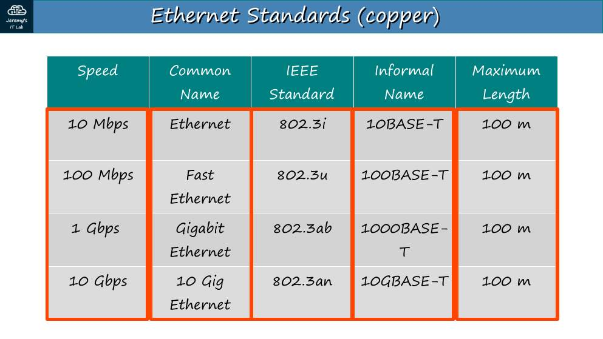 p. 12</td><td width="50%">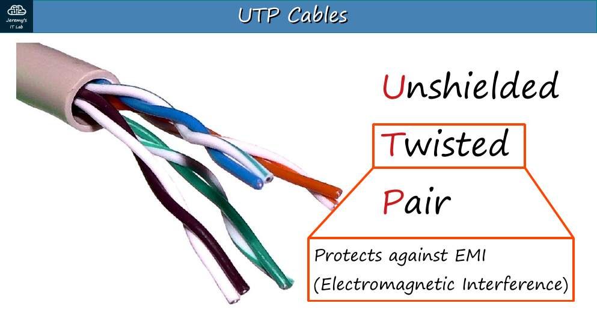 p. 13</td></tr><tr><td width="50%">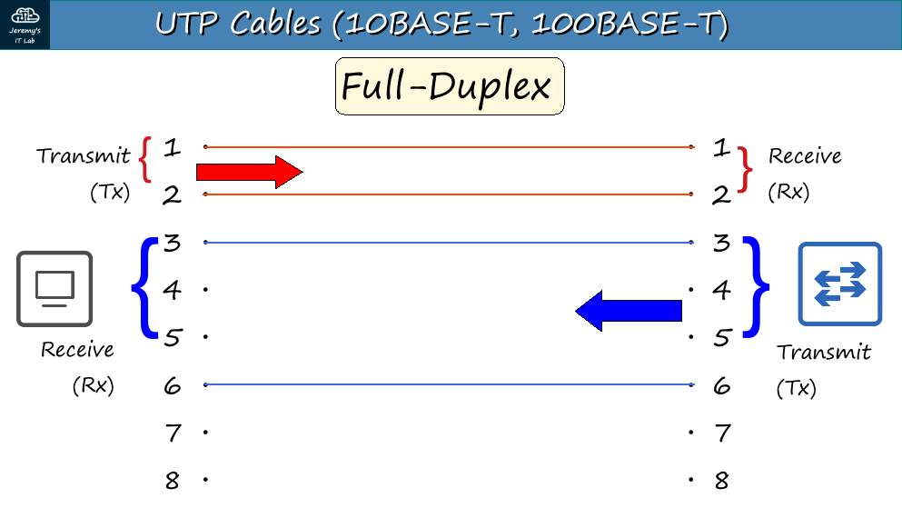 p. 15</td><td width="50%">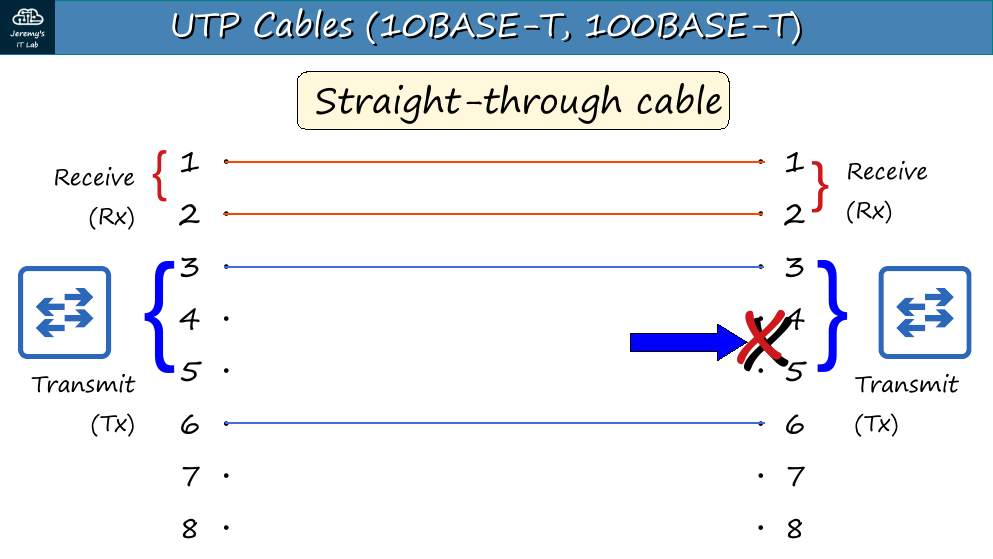 p. 18</td></tr><tr><td width="50%">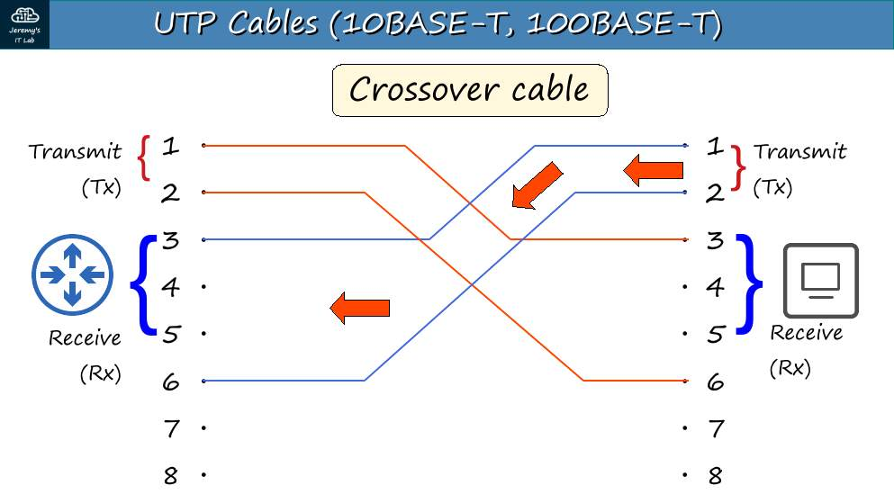 p. 20</td><td width="50%">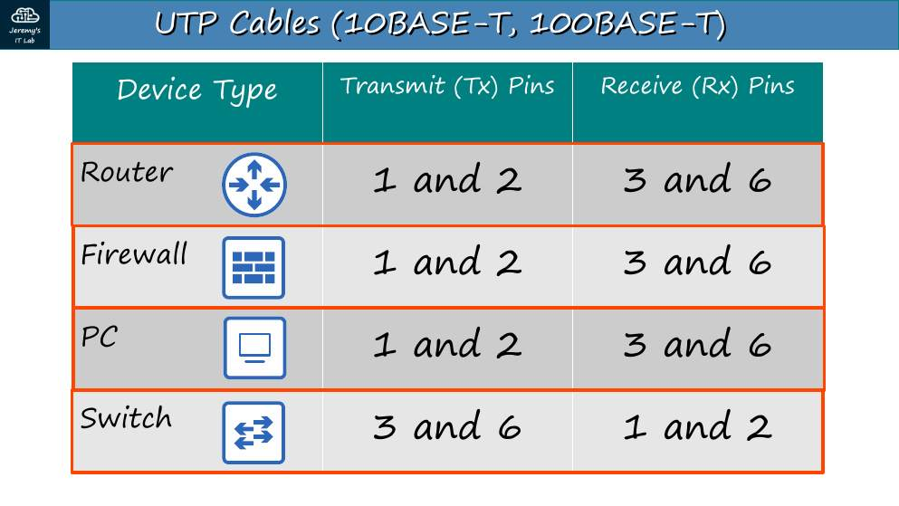 p. 21</td></tr><tr><td width="50%">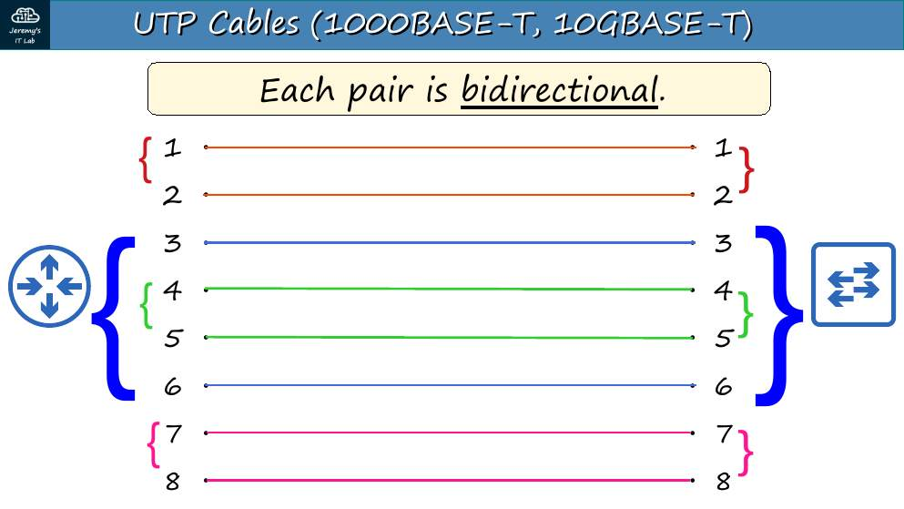 p. 23</td><td width="50%">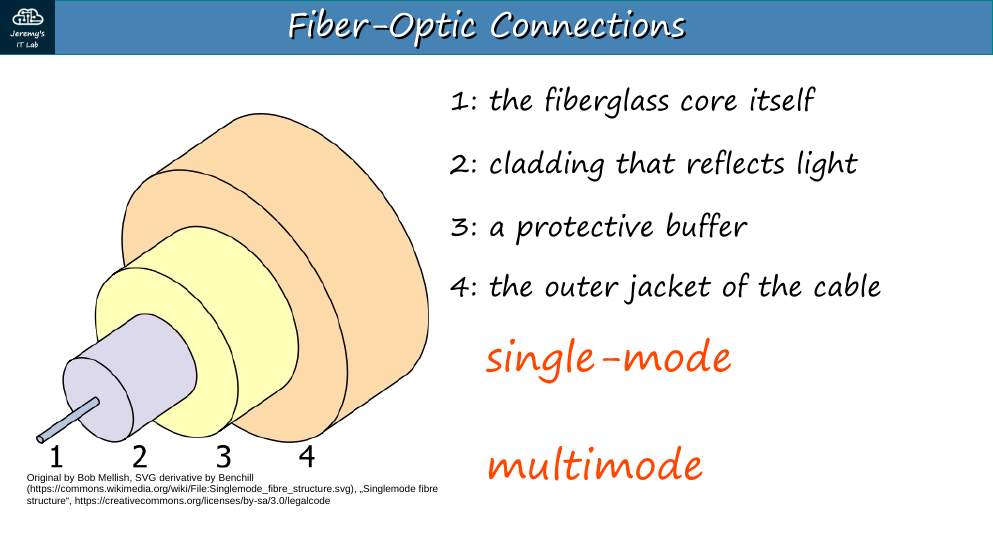 p. 28</td></tr><tr><td width="50%">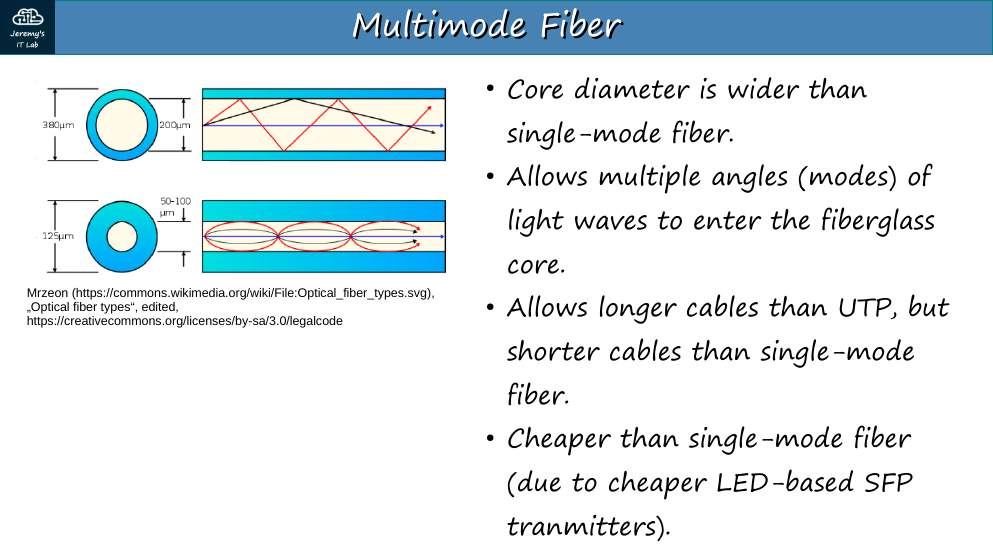 p. 29</td><td width="50%">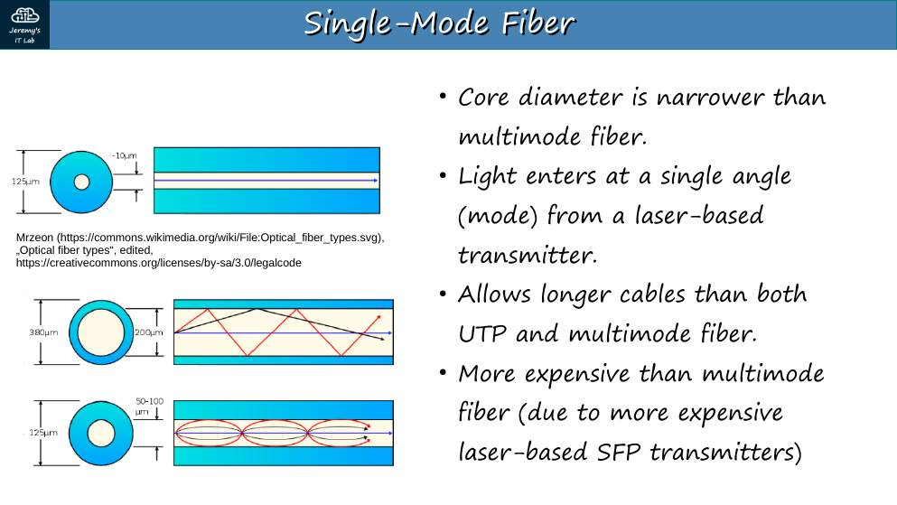 p. 30</td></tr><tr><td width="50%">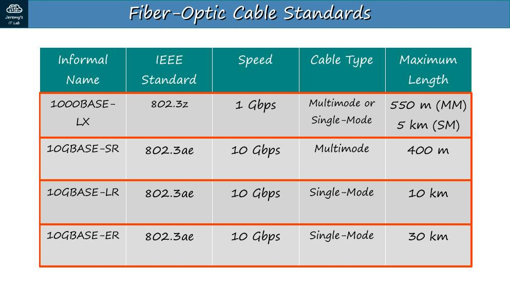 p. 31</td><td width="50%">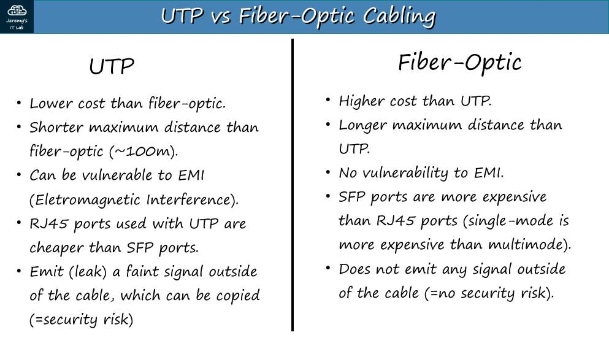 p. 32</td></tr></table>

## Apuntes

**LAN (Local Area Network):** red en un área pequeña (casa, oficina, edificio). Las interfaces Ethernet son las que vamos a usar todo el curso.

**Velocidad y bits.** 1 byte = 8 bits. La velocidad se mide en **bits por segundo**: kbps, Mbps, Gbps (×1000 cada salto).

| Velocidad | Nombre común | Estándar IEEE | Nombre informal | Cable | Distancia máx. |
|---|---|---|---|---|---|
| 10 Mbps | Ethernet | 802.3i | 10BASE-T | UTP | 100 m |
| 100 Mbps | Fast Ethernet | 802.3u | 100BASE-T | UTP | 100 m |
| 1 Gbps | Gigabit Ethernet | 802.3ab | 1000BASE-T | UTP | 100 m |
| 10 Gbps | 10 Gig Ethernet | 802.3an | 10GBASE-T | UTP | 100 m |

"BASE" = señal en banda base; "T" = par trenzado (*twisted pair*).

**UTP (Unshielded Twisted Pair).** 8 hilos en 4 pares trenzados. El trenzado reduce la interferencia electromagnética (EMI). No tiene blindaje metálico.

**Pines y cables (10/100 Mbps usan 2 pares):**

| Equipo | Transmite (Tx) | Recibe (Rx) |
|---|---|---|
| Router, firewall, PC | pines **1 y 2** | pines **3 y 6** |
| Switch | pines **3 y 6** | pines **1 y 2** |

- **Cable directo (straight-through):** el pin 1 va al pin 1. Se usa entre equipos **de distinto grupo** (PC–switch, router–switch).
- **Cable cruzado (crossover):** el 1-2 se cruza con el 3-6. Se usa entre equipos **del mismo grupo**: switch–switch, router–router, PC–PC y también **router–PC** (los dos transmiten por 1-2).
- **Auto MDI-X:** el equipo detecta qué cable hay y ajusta sus pines. Lo traen los equipos modernos, pero el examen igual pregunta el cable "correcto".
- **1000BASE-T y 10GBASE-T** usan los **4 pares** y cada par es bidireccional.

**Fibra óptica.** El equipo necesita un **transceptor SFP** (Small Form-factor Pluggable) que convierte la señal eléctrica en luz. Se usan **dos fibras**: una para transmitir y otra para recibir. Capas: núcleo (vidrio) → revestimiento (*cladding*, refleja la luz) → recubrimiento protector → chaqueta exterior.

| | Monomodo (single-mode) | Multimodo (multimode) |
|---|---|---|
| Núcleo | Muy fino (~8–10 µm), un solo modo de luz | Más ancho (~50–62.5 µm), varios ángulos de luz |
| Distancia | **Largas** (kilómetros) | **Más cortas** (cientos de metros), pero más que el UTP |
| Fuente de luz | Láser (SFP más caro) | LED o VCSEL (más barato) |

| Estándar | Velocidad | Tipo de fibra | Distancia |
|---|---|---|---|
| 1000BASE-LX | 1 Gbps | Multimodo o monomodo | 550 m (MM) / 5 km (SM) |
| 10GBASE-SR | 10 Gbps | Multimodo | ~400 m |
| 10GBASE-LR | 10 Gbps | Monomodo | 10 km |
| 10GBASE-ER | 10 Gbps | Monomodo | **40 km** (la diapositiva de Jeremy dice 30 km; el estándar IEEE dice 40 km) |

| UTP | Fibra |
|---|---|
| Más barato; puertos RJ-45 baratos | Más cara; requiere SFP |
| Máximo 100 m | Distancias mucho mayores |
| Vulnerable a EMI | **Inmune a EMI** |
| Emite una señal débil que se puede interceptar | No emite señal: más segura |

## Trampas de examen

1. "Conectas dos switches sin Auto MDI-X" → **cruzado**. "Router a PC" → **cruzado** (sorpresa típica).
2. Cuál es más barato: UTP. Cuál llega más lejos: fibra **monomodo**.
3. La fibra multimodo llega **más lejos que el UTP** pero menos que la monomodo.
4. 1000BASE-T usa **4 pares**; 100BASE-T usa **2**.

## Laboratorio · Conectar dispositivos

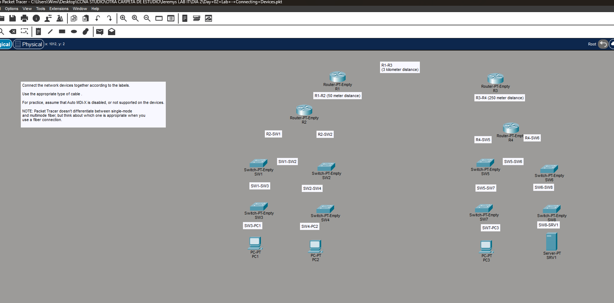 Pantallazo del laboratorio (enunciado original de Jeremy)

Los equipos vienen **vacíos** (Router-PT-Empty, Switch-PT-Empty). El enunciado (cuadro de instrucciones del .pkt) pide:

1. **Conectar los equipos según las etiquetas** (R1-R2, R1-R3, R3-R4, R2-SW1, …).
2. **Usar el tipo de cable adecuado.**
3. **Suponer que Auto MDI-X está desactivado** (así que el directo/cruzado importa).
4. **Elegir bien la fibra:** Packet Tracer no distingue monomodo de multimodo, pero tú debes saber cuál corresponde.

**Antes de conectar, agrega módulos.** Clic en el equipo → **Physical** → apágalo (botón) → arrastra el módulo → enciéndelo:

- Routers: `PT-ROUTER-NM-1CGE` o `1CFE` (cobre) y `PT-ROUTER-NM-1FGE` o `1FFE` (fibra).
- Switches: `PT-SWITCH-NM-1CGE`/`1CFE` (cobre) y `PT-SWITCH-NM-1FGE`/`1FFE` (fibra).

**Solución, enlace por enlace:**

| Enlace | Cable | Motivo |
|---|---|---|
| R1–R3 (3 km) | **Fibra monomodo** | Solo la monomodo llega a kilómetros |
| R1–R2 (50 m) | **UTP cruzado** | Router–router: mismo grupo |
| R3–R4 (250 m) | **Fibra multimodo** | Más de 100 m (no sirve UTP), pero la multimodo basta |
| R2–SW1, R2–SW2, R4–SW5, R4–SW6 | **UTP directo** | Router–switch: grupos distintos |
| SW1–SW2, SW1–SW3, SW2–SW4, SW5–SW6, SW5–SW7, SW6–SW8 | **UTP cruzado** | Switch–switch |
| SW3–PC1, SW4–PC2, SW7–PC3, SW8–SRV1 | **UTP directo** | Switch–host |

**Verificación.** Los puntos del enlace se ponen verdes (o naranjas unos segundos mientras STP converge en los switches). Un punto **rojo** indica cable incorrecto o interfaz apagada.

---

## Rómpelo y arréglalo (48 h después del lab)

| # | Rompe esto | Síntoma | Te delata | Arreglo |
|---|---|---|---|---|
| 1 | Cambia SW1–SW2 por un cable **directo** | Punto rojo en el enlace (sin Auto MDI-X) | Vista lógica: luz roja; `show interfaces f0/x` → down/down | Cable cruzado |
| 2 | Conecta R1–R3 (3 km) con **cobre** | No hay puerto de cobre libre o enlace inviable por distancia | Pregunta teórica: UTP llega a 100 m | Fibra monomodo |
| 3 | Pon un módulo de fibra solo en un lado | No puedes conectar el cable de fibra | *Physical*: módulos distintos | Mismo tipo de módulo en ambos extremos |

## Repaso rápido

Intenta responder antes de abrir cada pregunta.

Velocidad y nombre IEEE de 10BASE-T, 100BASE-T, 1000BASE-T y 10GBASE-T

802.3i (10 Mbps), 802.3u (100 Mbps), 802.3ab (1 Gbps), 802.3an (10 Gbps). Todas hasta 100 m en UTP.

¿Por qué pines transmite un PC/router y por cuáles un switch (10/100)?

PC/router: Tx 1-2, Rx 3-6. Switch: Tx 3-6, Rx 1-2.

¿Cable directo o cruzado entre router y PC?

Cruzado: ambos transmiten por 1-2.

¿Cable entre dos switches sin Auto MDI-X?

Cruzado (mismo tipo de equipo).

¿Cuántos pares usa 1000BASE-T?

Los 4 pares, cada uno bidireccional.

Fibra monomodo vs multimodo

Monomodo: núcleo fino, láser, kilómetros, SFP más caro. Multimodo: núcleo ancho, LED/VCSEL, cientos de metros (más que UTP).

Alcance de 10GBASE-SR, LR y ER

SR ~400 m (multimodo), LR 10 km y ER 40 km (monomodo).

Dos ventajas de la fibra frente al UTP

Mayor distancia e inmunidad a EMI (además, no emite señal interceptable).

---

[⬅ Índice del curso](../../README.md)
