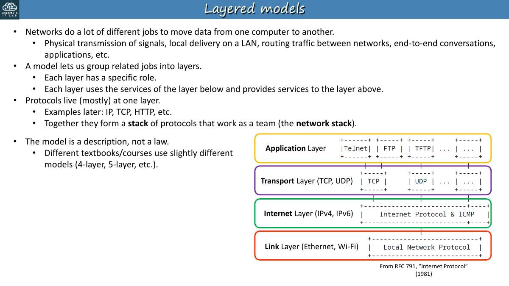
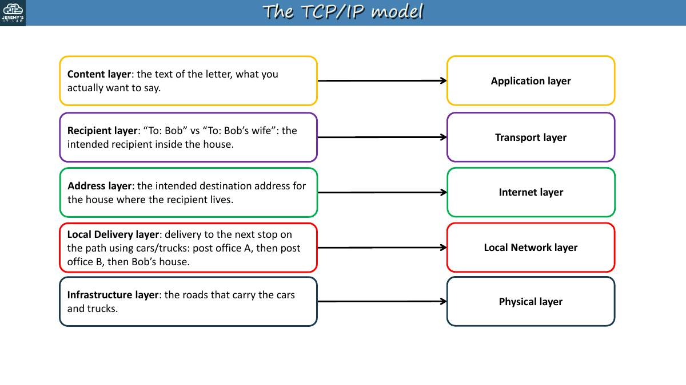
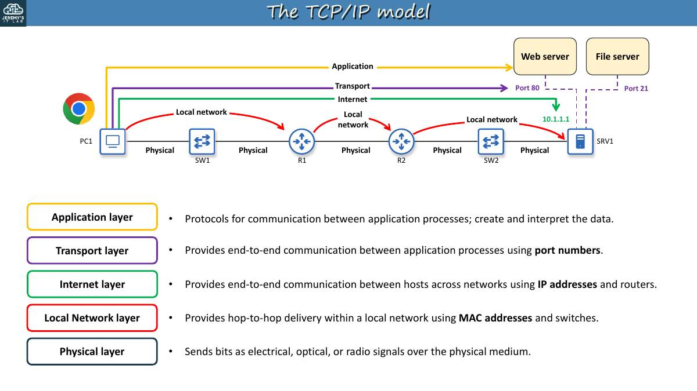
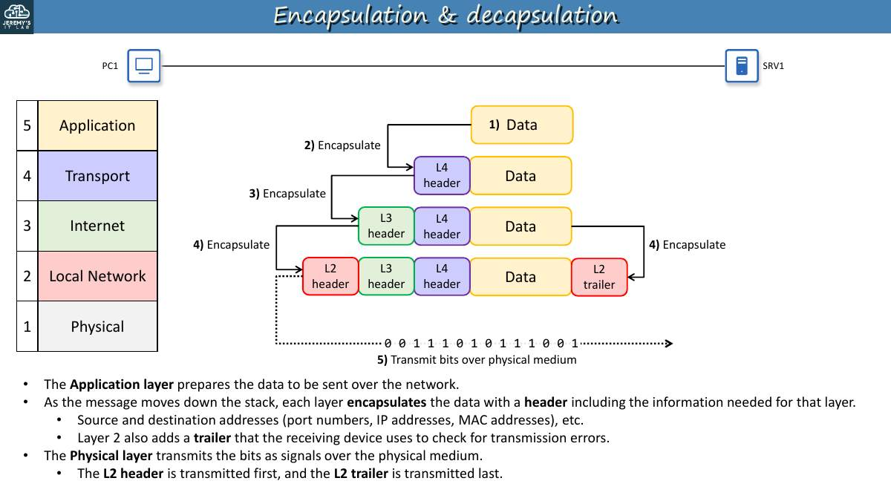
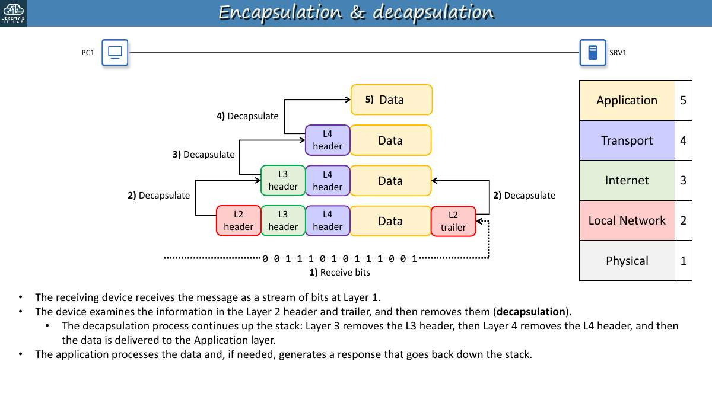
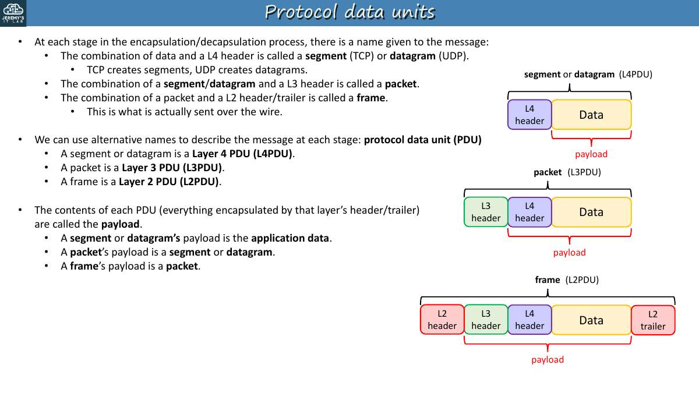
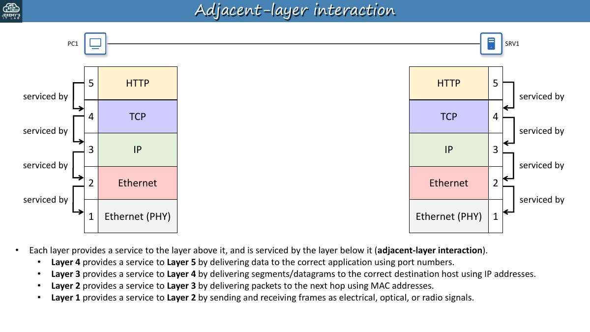
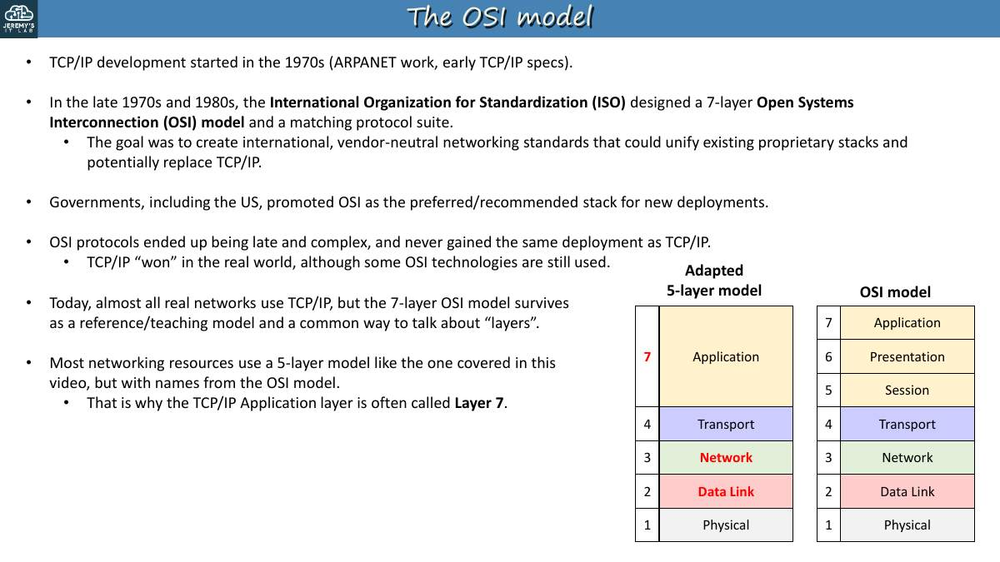
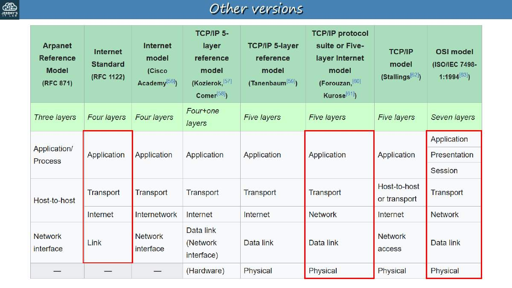
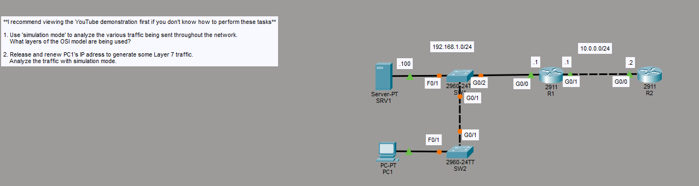

# Día 03 · Modelo OSI y TCP/IP

> Mis apuntes del Día 3 del curso **CCNA 200-301 de Jeremy's IT Lab**.
> Video del día: [Jeremy's IT Lab en YouTube](https://www.youtube.com/@JeremysITLab).

| | |
|---|---|
| **Estado** | ✅ Estudiado |
| **Lectura Odom 2.ª ed.** | V1 caps. 1–2; V1 cap. 4 |
| **NetAcad v7** | ITN 1, 3, 4; ITN 2 |
| **Lab extra** | ITN: actividades PT de los módulos 1–4; LG 04 The IOS Operating System |

## Diapositivas clave de Jeremy

**03-1 Slides - TCP-IP**

<table><tr><td width="50%"><br><sub>p. 4</sub></td><td width="50%"><br><sub>p. 8</sub></td></tr><tr><td width="50%"><br><sub>p. 9</sub></td><td width="50%"><br><sub>p. 15</sub></td></tr><tr><td width="50%"><br><sub>p. 16</sub></td><td width="50%"><br><sub>p. 18</sub></td></tr><tr><td width="50%"><br><sub>p. 19</sub></td><td width="50%"><br><sub>p. 22</sub></td></tr><tr><td width="50%"><br><sub>p. 23</sub></td></tr></table>


## Apuntes

**¿Para qué sirven los modelos?** Dividen la comunicación en capas con funciones claras, de modo que fabricantes distintos puedan interoperar. Hoy se **usa** TCP/IP, pero el vocabulario del OSI ("switch de capa 2", "capa 4") se usa a diario.

| # | Capa OSI | Función | PDU | Ejemplos |
|---|---|---|---|---|
| 7 | Aplicación | Interfaz con las aplicaciones de red | Datos | HTTP, HTTPS, DNS, FTP, SMTP |
| 6 | Presentación | Formato, conversión y **cifrado** de datos | Datos | JPEG, ASCII, TLS (cifrado) |
| 5 | Sesión | Abre, mantiene y cierra sesiones | Datos | — |
| 4 | Transporte | Segmenta, entrega extremo a extremo, **puertos** | **Segmento** (TCP) / datagrama (UDP) | TCP, UDP |
| 3 | Red | Direccionamiento lógico y **enrutamiento** | **Paquete** | IP, ICMP, OSPF — router |
| 2 | Enlace de datos | Entrega salto a salto, direccionamiento **MAC** | **Trama** | Ethernet, 802.11 — switch |
| 1 | Física | Bits, voltajes, luz, conectores | **Bits** | Cables, hubs |

Frase para memorizarlas de abajo arriba: **"Please Do Not Throw Sausage Pizza Away"** (Physical, Data link, Network, Transport, Session, Presentation, Application).

**Encapsulación:** al bajar por las capas, cada una añade su encabezado (la capa 2 añade además un *trailer*, el FCS). **Desencapsulación:** al subir, cada capa quita el suyo.

- **Interacción entre capas adyacentes** (*adjacent-layer*): una capa da servicio a la de arriba.
- **Interacción entre la misma capa** (*same-layer*): la capa 4 del emisor "habla" con la capa 4 del receptor mediante su encabezado.

**Modelo TCP/IP (4 capas):** Aplicación (= OSI 5-6-7), Transporte (4), Internet (3), Enlace (= OSI 1-2). Algunos libros usan una versión de 5 capas que separa Enlace y Física.

## Trampas de examen

1. PDU por capa: **segmento** (4), **paquete** (3), **trama** (2), **bits** (1).
2. El cifrado pertenece a la capa de **presentación** (6) en OSI.
3. El switch trabaja en **capa 2**; el router en **capa 3**.
4. TCP/IP: la capa "Internet" corresponde a la capa 3 del OSI.

## Laboratorio · Modelo OSI (simulación)


<p align="center"><br><sub>Pantallazo del laboratorio (enunciado original de Jeremy)</sub></p>


**Topología:** SRV1 (.100) en SW1 F0/1; SW1 G0/2 → R1 G0/0 (.1) en 192.168.1.0/24; SW1 G0/1 → SW2 G0/1; PC1 en SW2 F0/1; R1 G0/1 (.1) → R2 G0/0 (.2) en 10.0.0.0/24.

**Tarea 1 · Ver las capas en modo simulación.** Cambia a **Simulation**, pulsa *Play* y abre cualquier sobre. La pestaña *OSI Model* muestra las capas que procesa cada equipo:

- **Switch:** capas 1 y 2 (lee la trama, no la IP).
- **Router:** capas 1, 2 y 3.
- **PC/servidor:** hasta la 7 si es tráfico de aplicación (DHCP, DNS, HTTP); hasta la 3 si es un ping (ICMP).

**Tarea 2 · Analizar DHCP.** En PC1 → *Command Prompt*:

```
C:\> ipconfig /release
C:\> ipconfig /renew
```

Verás **DHCP Discover → Offer → Request → Ack**. DHCP es un protocolo de **capa 7** que va sobre **UDP** (cliente 68, servidor 67). Abre el Discover: destino MAC `FFFF.FFFF.FFFF` y destino IP `255.255.255.255` (broadcast), origen IP `0.0.0.0`.

**Pregunta de repaso:** ¿el switch abre el encabezado IP? **No**, solo la trama Ethernet.

---

## Rómpelo y arréglalo (48 h después del lab)

| # | Rompe esto | Síntoma | Te delata | Arreglo |
|---|---|---|---|---|
| 1 | Desactiva el servicio DHCP del servidor (*Services → DHCP → Off*) | `ipconfig /renew` → APIPA 169.254.x.x | En simulación solo ves Discover, sin Offer | Activar DHCP |
| 2 | Quita el gateway de PC1 | PC1 llega a SRV1 pero no a R2 | `ipconfig` → Default Gateway 0.0.0.0 | Poner gateway |
| 3 | Apaga SW1 G0/1 | PC1 no llega a nada | `show interfaces status` → disabled | `no shutdown` |

## Repaso rápido

Intenta responder antes de abrir cada pregunta.

<details><summary>PDU de las capas 4, 3, 2 y 1</summary>

Segmento, paquete, trama y bits.

</details>

<details><summary>¿En qué capa OSI está el cifrado?</summary>

Capa 6, presentación.

</details>

<details><summary>Capas del modelo TCP/IP</summary>

Aplicación (OSI 5-7), Transporte, Internet (3) y Enlace (1-2).

</details>

<details><summary>¿Qué es encapsulación?</summary>

Cada capa añade su encabezado al bajar (la capa 2 añade también el trailer FCS).

</details>

<details><summary>Puertos UDP de DHCP</summary>

Servidor 67, cliente 68.

</details>


---

[⬅ Índice del curso](../../README.md)
