# Día 04 · Introducción a la CLI

> Mis apuntes del Día 4 del curso **CCNA 200-301 de Jeremy's IT Lab**.
> Video del día: [Jeremy's IT Lab en YouTube](https://www.youtube.com/@JeremysITLab).

| | |
|---|---|
| **Estado** | ✅ Estudiado |
| **Lectura Odom 2.ª ed.** | V1 caps. 1–2; V1 cap. 4 |
| **NetAcad v7** | ITN 1, 3, 4; ITN 2 |
| **Lab extra** | ITN: actividades PT de los módulos 1–4; LG 04 The IOS Operating System |

## Diapositivas clave de Jeremy

**Day 04 Slides - Intro to the CLI**

<table><tr><td width="50%">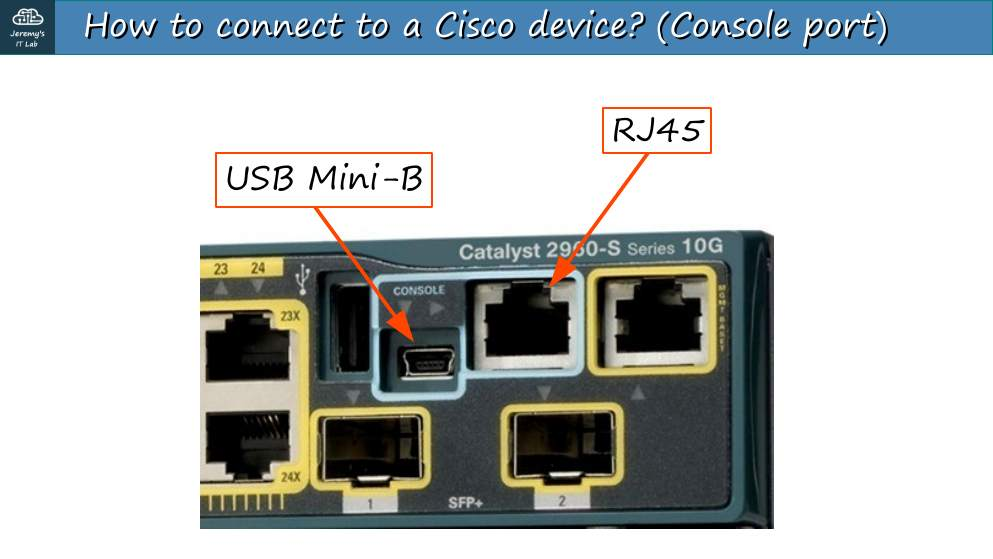<br><sub>p. 3</sub></td><td width="50%">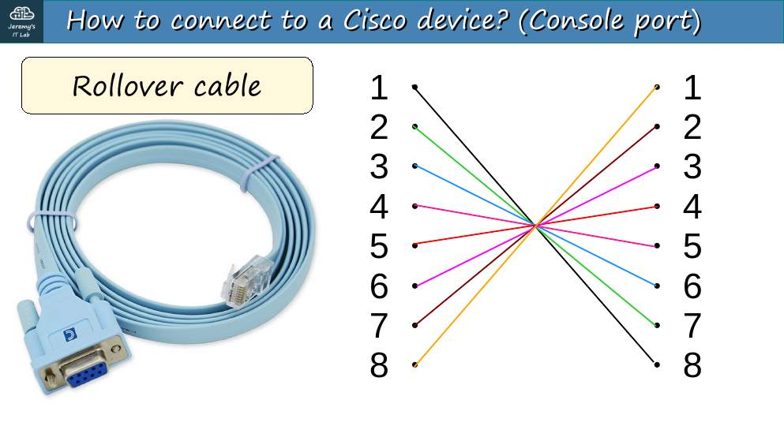<br><sub>p. 5</sub></td></tr><tr><td width="50%">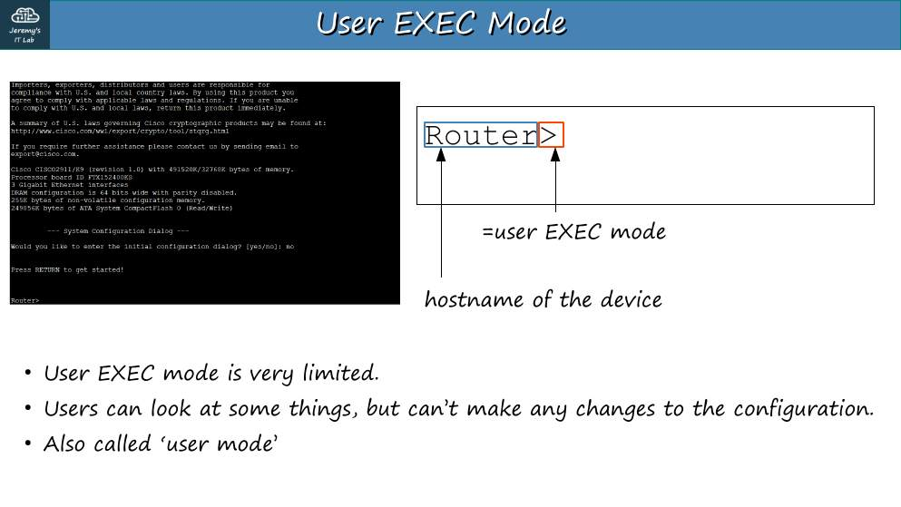<br><sub>p. 8</sub></td><td width="50%">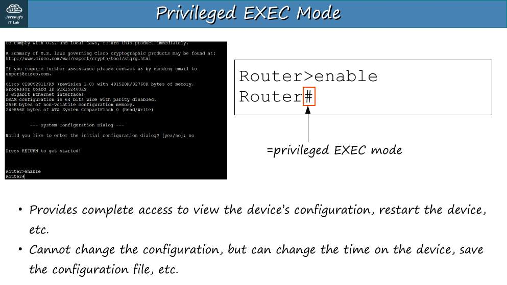<br><sub>p. 9</sub></td></tr><tr><td width="50%">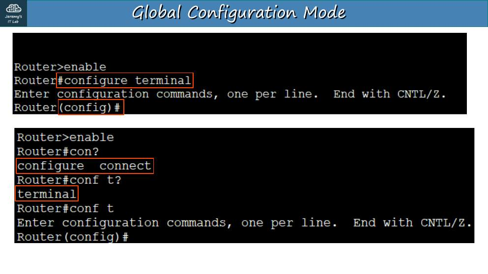<br><sub>p. 13</sub></td><td width="50%">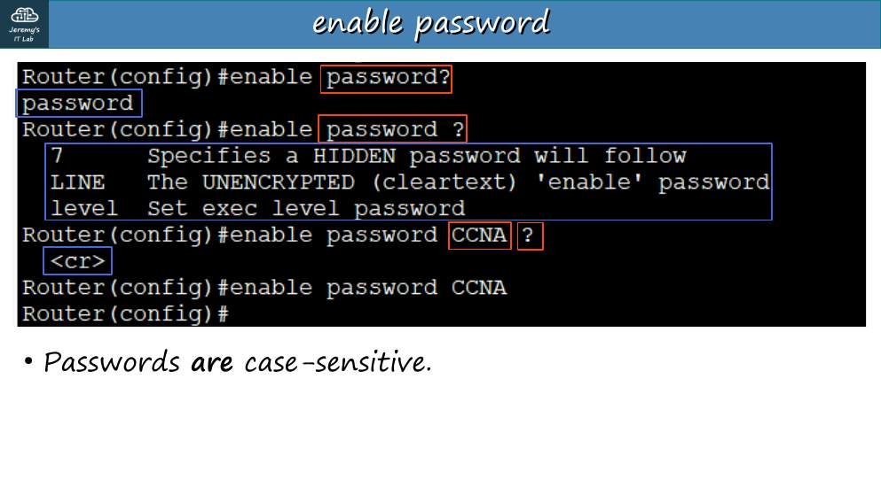<br><sub>p. 14</sub></td></tr><tr><td width="50%">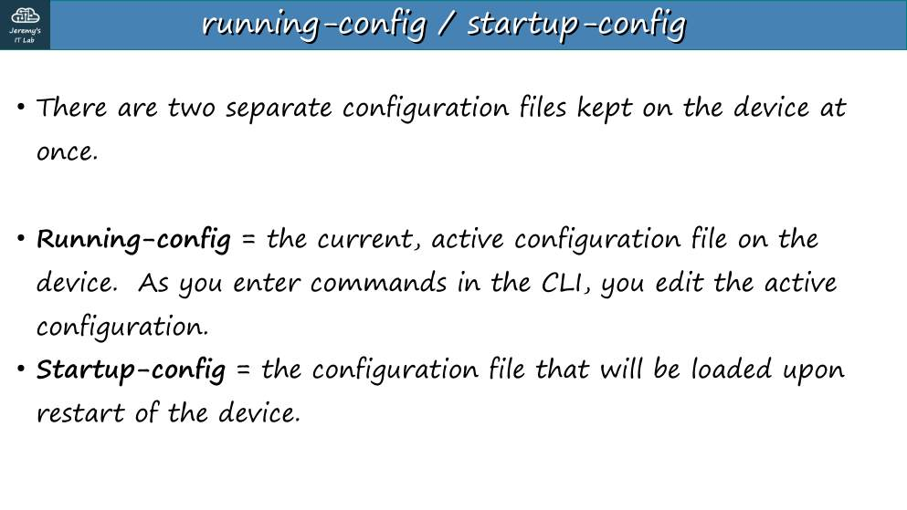<br><sub>p. 18</sub></td><td width="50%">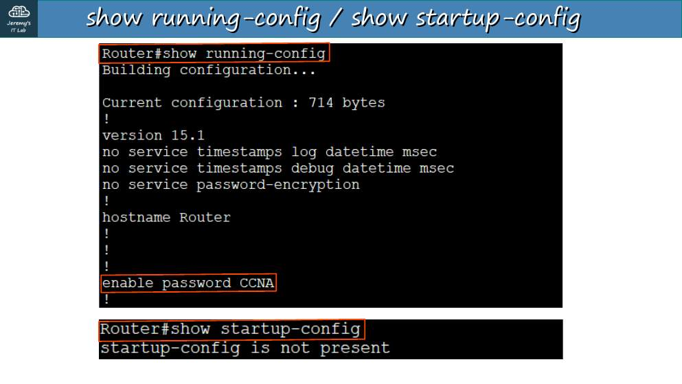<br><sub>p. 19</sub></td></tr><tr><td width="50%">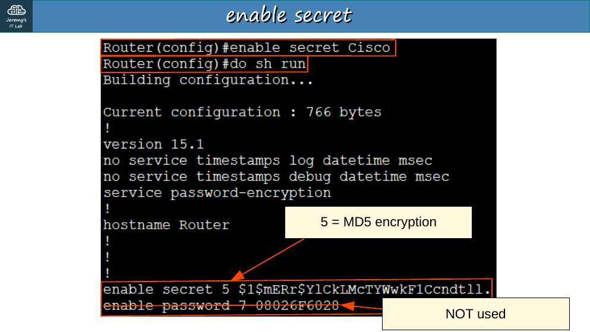<br><sub>p. 24</sub></td><td width="50%">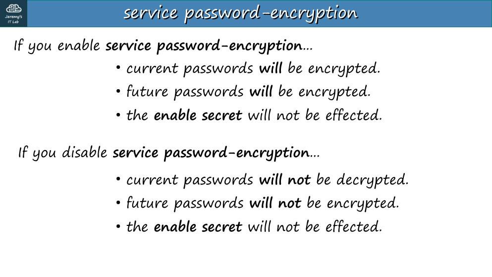<br><sub>p. 26</sub></td></tr></table>


## Apuntes

**Acceso a la CLI:** al principio, por el **puerto de consola** (RJ-45 o USB) con un cable *rollover* (consola) y un emulador de terminal (PuTTY). Parámetros por defecto: **9600 baudios, 8 bits de datos, sin paridad, 1 bit de parada, sin control de flujo** (9600 8-N-1).

| Prompt | Modo | Cómo entrar | Qué permite |
|---|---|---|---|
| `R1>` | EXEC de usuario | Al conectarse | Ver poco, no cambia nada |
| `R1#` | EXEC privilegiado | `enable` | Ver todo (`show`), guardar, reiniciar |
| `R1(config)#` | Configuración global | `configure terminal` | Cambiar la configuración |
| `R1(config-if)#` | Configuración de interfaz | `interface g0/0` | Configurar una interfaz |

**Ayudas:** `?` lista comandos; Tab completa; los comandos se pueden abreviar (`conf t`, `sh run`). `do show …` ejecuta un comando EXEC desde el modo de configuración.

**Contraseñas del modo privilegiado:**

```
R1(config)# enable password CCNA        ← texto plano
R1(config)# service password-encryption ← cifra las claves en texto plano (tipo 7, reversible)
R1(config)# enable secret Cisco         ← hash (tipo 5 MD5; IOS moderno usa tipo 8/9)
```

- Si existen **enable password** y **enable secret**, el router pide **enable secret**.
- `enable secret` **siempre** se guarda como hash, con o sin service password-encryption.
- Si después quitas `service password-encryption`, las claves ya cifradas **siguen cifradas**; las nuevas quedan en texto plano.

**Archivos de configuración:**

| | running-config | startup-config |
|---|---|---|
| Dónde | RAM | NVRAM |
| Cuándo se usa | Configuración activa | Se carga al arrancar |
| Ver | `show running-config` | `show startup-config` |

Guardar: `write`, `write memory` o `copy running-config startup-config`. Cancelar un comando: anteponer **`no`**.

## Trampas de examen

1. Tipo **7** = cifrado débil de `service password-encryption`. Tipo **5** = MD5 de `enable secret`.
2. Sin guardar, un `reload` borra todo lo que no esté en startup-config.
3. El puerto de consola **no** usa red: funciona aunque el equipo no tenga IP.

## Laboratorio · Seguridad básica del dispositivo


<p align="center">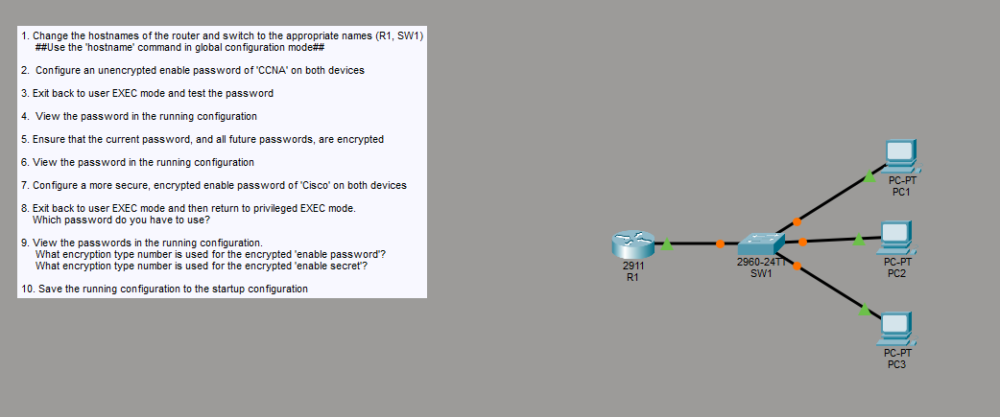<br><sub>Pantallazo del laboratorio (enunciado original de Jeremy)</sub></p>


Aplica cada tarea en **R1 y en SW1**.

**Tarea 1 · Hostnames.**

```
Router(config)# hostname R1
Switch(config)# hostname SW1
```

**Tarea 2 · Enable password sin cifrar `CCNA`.**

```
R1(config)# enable password CCNA
```

**Tarea 3 · Salir a EXEC de usuario y probar.** `end` → `disable` (o `exit` y Enter) → `enable` → escribe `CCNA`.

**Tarea 4 · Ver la clave en la running-config.**

```
R1# show running-config | include enable
enable password CCNA          ← se ve en texto plano
```

**Tarea 5 · Cifrar la clave actual y las futuras.**

```
R1(config)# service password-encryption
```

**Tarea 6 · Ver de nuevo.** `show running-config | include enable` → `enable password 7 <cadena cifrada>` (tipo 7: ya no se lee "CCNA").

**Tarea 7 · Clave más segura `Cisco`.**

```
R1(config)# enable secret Cisco
```

**Tarea 8 · ¿Qué clave pide ahora?** Sal a EXEC de usuario y vuelve con `enable`: pide **`Cisco`**, porque `enable secret` tiene prioridad sobre `enable password`.

**Tarea 9 · Tipos de cifrado.** En la running-config: `enable secret 5 $1$...` y `enable password 7 ...`. Respuesta: **enable password cifrada = tipo 7; enable secret = tipo 5** (en Packet Tracer, MD5).

**Tarea 10 · Guardar.**

```
R1# copy running-config startup-config      (o: write memory)
```

---

## Rómpelo y arréglalo (48 h después del lab)

| # | Rompe esto | Síntoma | Te delata | Arreglo |
|---|---|---|---|---|
| 1 | Configura `enable password CCNA` y `enable secret Cisco`, y entra con `CCNA` | Acceso denegado | `show run \| include enable`: existe secret | Usar `Cisco`: secret siempre gana |
| 2 | Quita `service password-encryption` | Las claves **nuevas** salen en texto plano; las viejas siguen cifradas | `show run \| include password` | Volver a activarlo |
| 3 | No guardes y recarga (`reload`) | Se pierde todo | `show startup-config` vacío | `copy run start` antes de recargar |

## Repaso rápido

Intenta responder antes de abrir cada pregunta.

<details><summary>Parámetros por defecto del puerto de consola</summary>

9600 baudios, 8 bits de datos, sin paridad, 1 bit de parada (9600 8-N-1).

</details>

<details><summary>Si existen enable password y enable secret, ¿cuál se usa?</summary>

enable secret.

</details>

<details><summary>¿Qué tipo de cifrado aplica service password-encryption?</summary>

Tipo 7 (débil y reversible).

</details>

<details><summary>¿Qué hash usa enable secret por defecto en IOS clásico?</summary>

Tipo 5 (MD5); IOS moderno admite 8 y 9 (scrypt).

</details>

<details><summary>running-config vs startup-config</summary>

running: RAM, la activa. startup: NVRAM, se carga al arrancar.

</details>

<details><summary>¿Cómo guardas la configuración?</summary>

copy running-config startup-config (o write memory).

</details>

<details><summary>¿Para qué sirve el prefijo "do" en modo configuración?</summary>

Para ejecutar un comando EXEC (como show) sin salir del modo de configuración.

</details>


---

[⬅ Índice del curso](../../README.md)
