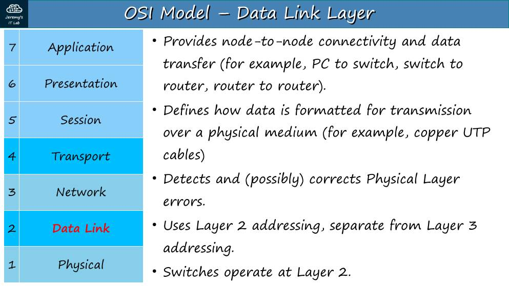
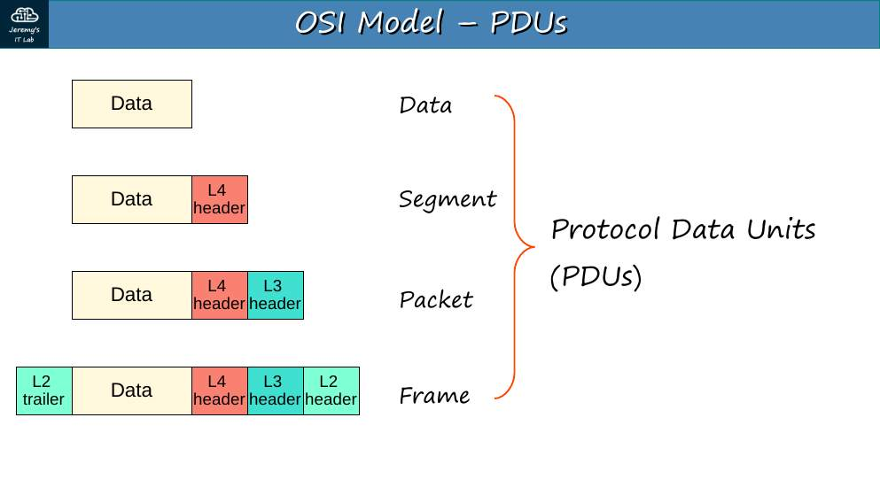
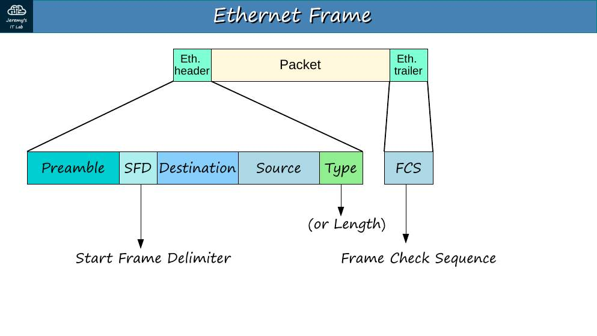
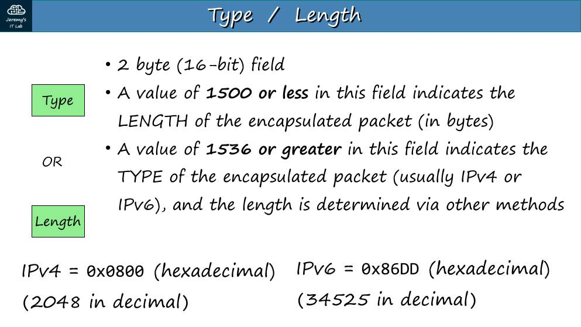
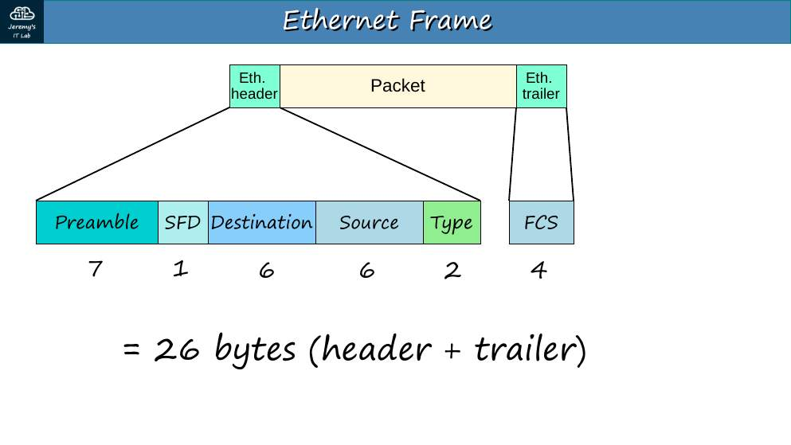
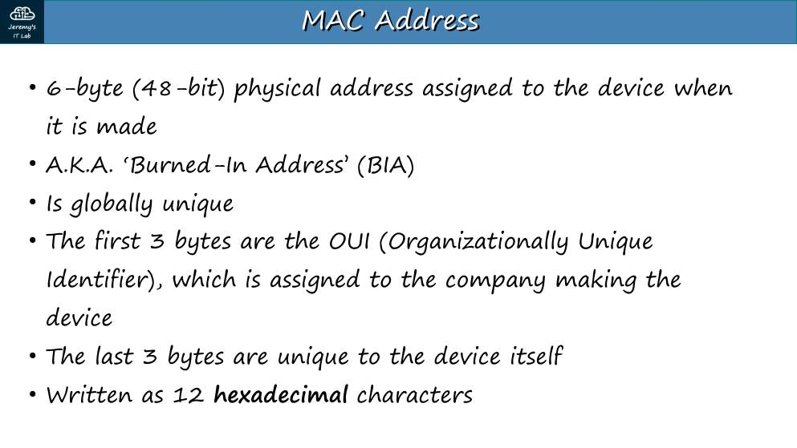
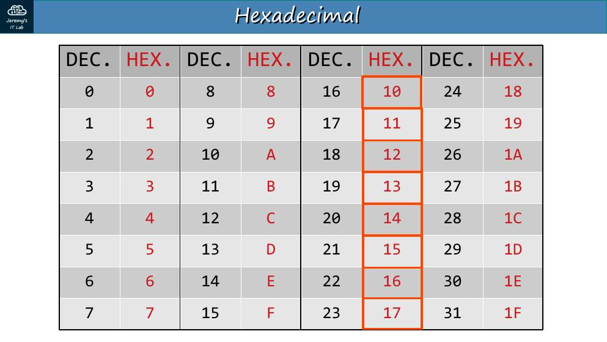
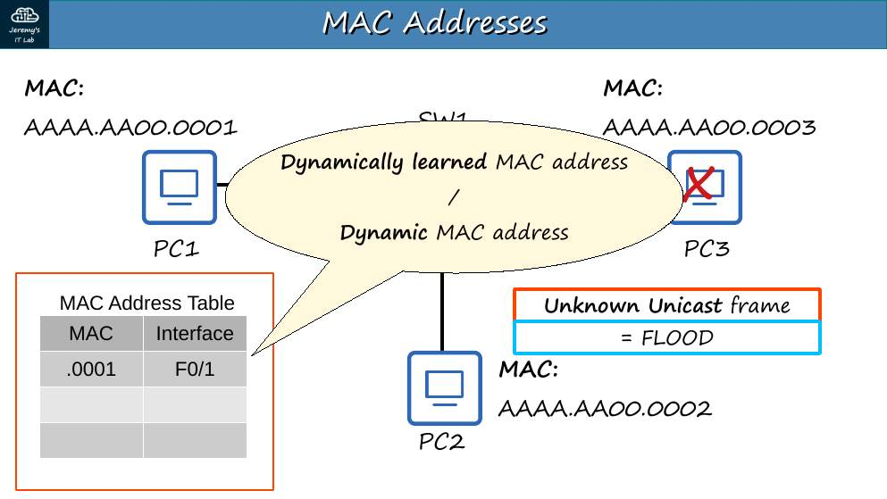
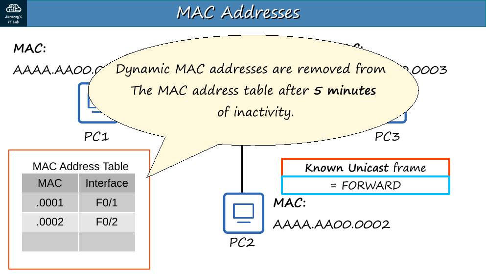
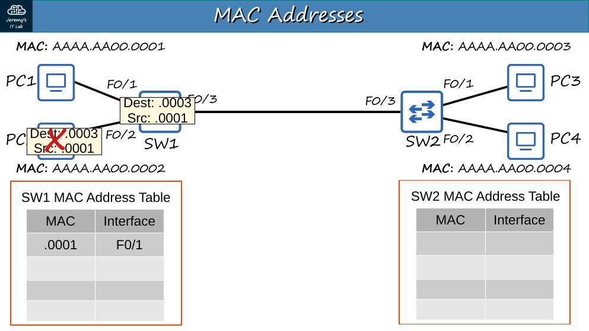

# Día 05 · Ethernet LAN Switching (parte 1)

> Mis apuntes del Día 5 del curso **CCNA 200-301 de Jeremy's IT Lab**.
> Video del día: [Jeremy's IT Lab en YouTube](https://www.youtube.com/@JeremysITLab).

| | |
|---|---|
| **Estado** | ✅ Estudiado |
| **Lectura Odom 2.ª ed.** | V1 caps. 2, 5 |
| **NetAcad v7** | ITN 6, 7, 9 |
| **Lab extra** | LG 11 Cisco Device Functions |

## Diapositivas clave de Jeremy

**Day 05 Slides - Ethernet LAN Switching (Part 1)**

<table><tr><td width="50%"><br><sub>p. 3</sub></td><td width="50%"><br><sub>p. 5</sub></td></tr><tr><td width="50%"><br><sub>p. 6</sub></td><td width="50%"><br><sub>p. 9</sub></td></tr><tr><td width="50%"><br><sub>p. 12</sub></td><td width="50%"><br><sub>p. 13</sub></td></tr><tr><td width="50%"><br><sub>p. 16</sub></td><td width="50%"><br><sub>p. 18</sub></td></tr><tr><td width="50%"><br><sub>p. 23</sub></td><td width="50%"><br><sub>p. 26</sub></td></tr></table>


## Apuntes

**LAN** = grupo de equipos en una ubicación pequeña conectados por switches. Un router separa LANs.

**Trama Ethernet (802.3):**

```
| Preámbulo 7 | SFD 1 | MAC destino 6 | MAC origen 6 | Tipo/Longitud 2 | Datos 46–1500 | FCS 4 |
         ← encabezado (sin contar preámbulo/SFD: 14 B) →                          ← trailer →
```

- **Preámbulo** (7 B, `10101010` repetido): sincroniza relojes. **SFD** (1 B, `10101011`): marca el inicio de la trama.
- **Tipo/Longitud:** valor **≤ 1500** = longitud; valor **≥ 1536** = tipo de protocolo: **0x0800 IPv4, 0x86DD IPv6, 0x0806 ARP**.
- **FCS** (4 B): CRC que **detecta** errores (no los corrige).
- Encabezado + trailer = **26 bytes** contando preámbulo y SFD.
- **Trama mínima = 64 bytes** (sin preámbulo/SFD), por eso **los datos mínimos son 46 bytes**; si hay menos, se rellena (*padding*). Máximo de datos: 1500 B (MTU).

**Direcciones MAC.** 48 bits = 6 bytes = **12 dígitos hexadecimales** (por ejemplo `E8BA.7011.2874`). Los primeros 3 bytes son el **OUI** (identificador del fabricante); los 3 últimos son únicos del equipo. Es una dirección "quemada" (*burned-in address*, BIA).

**Cómo aprende y reenvía el switch:**

1. **Aprende** la MAC **de origen** de cada trama y la asocia al puerto de entrada → la tabla MAC (dinámica).
2. Si conoce la MAC de destino, **reenvía** (*forward*) solo por ese puerto.
3. Si no la conoce (**unicast desconocido**), **inunda** (*flood*) por todos los puertos excepto el de entrada.
4. Las entradas dinámicas caducan a los **5 minutos** (300 s) sin actividad.

Un switch puede tener varios equipos en el mismo puerto (por ejemplo, otro switch detrás) → varias MAC en la misma interfaz.

## Trampas de examen

1. El switch aprende la MAC de **origen**, nunca la de destino.
2. Unicast **desconocido** → flood; unicast **conocido** → forward.
3. "Tamaño mínimo de la trama Ethernet" = **64 B**; "datos mínimos" = **46 B**.
4. Hexadecimal: cada dígito = 4 bits; `F` = 15 = `1111`.

*(Este día no tiene laboratorio.)*

## Repaso rápido

Intenta responder antes de abrir cada pregunta.

<details><summary>Tamaño mínimo y máximo de una trama Ethernet</summary>

64 a 1518 bytes (1522 con 802.1Q), sin contar preámbulo/SFD.

</details>

<details><summary>¿Cuántos bytes de datos mínimos lleva una trama Ethernet?</summary>

46 (se rellena si hay menos).

</details>

<details><summary>Valores del campo Tipo para IPv4, IPv6 y ARP</summary>

0x0800, 0x86DD y 0x0806.

</details>

<details><summary>¿Qué hace el FCS?</summary>

Detecta errores con CRC; no los corrige.

</details>

<details><summary>¿Qué MAC aprende el switch?</summary>

La MAC de ORIGEN de cada trama.

</details>

<details><summary>¿Qué hace el switch con un unicast desconocido?</summary>

Lo inunda por todos los puertos de la VLAN menos el de entrada.

</details>

<details><summary>Tiempo de vida por defecto de una MAC dinámica</summary>

300 segundos (5 minutos).

</details>

<details><summary>¿Qué es el OUI?</summary>

Los primeros 24 bits de la MAC: identifican al fabricante.

</details>


---

[⬅ Índice del curso](../../README.md)
