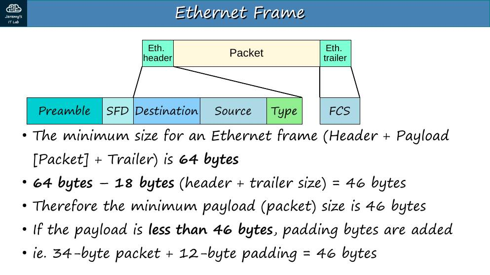
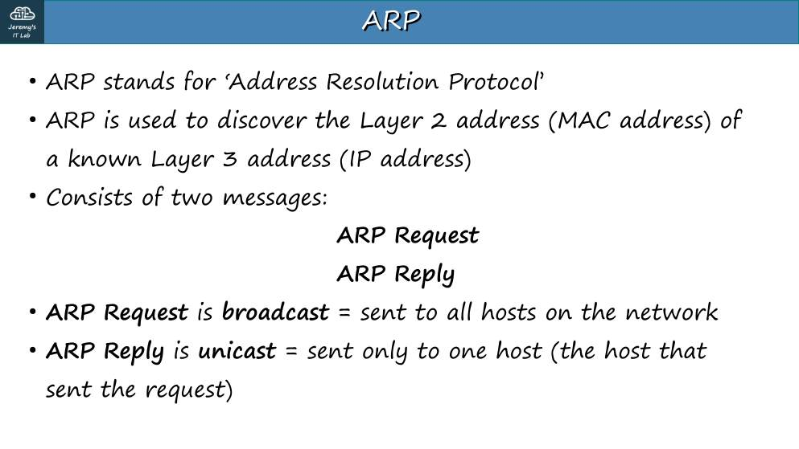
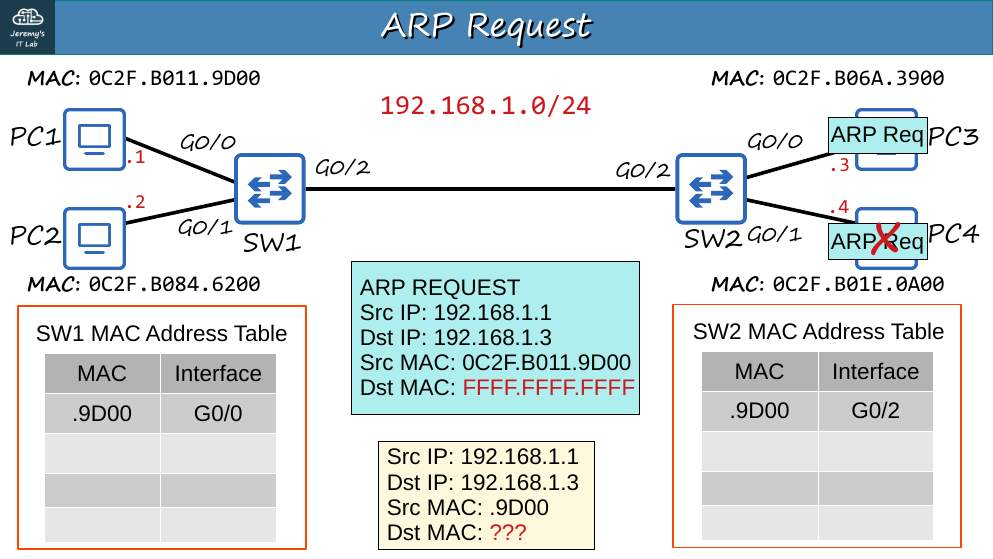
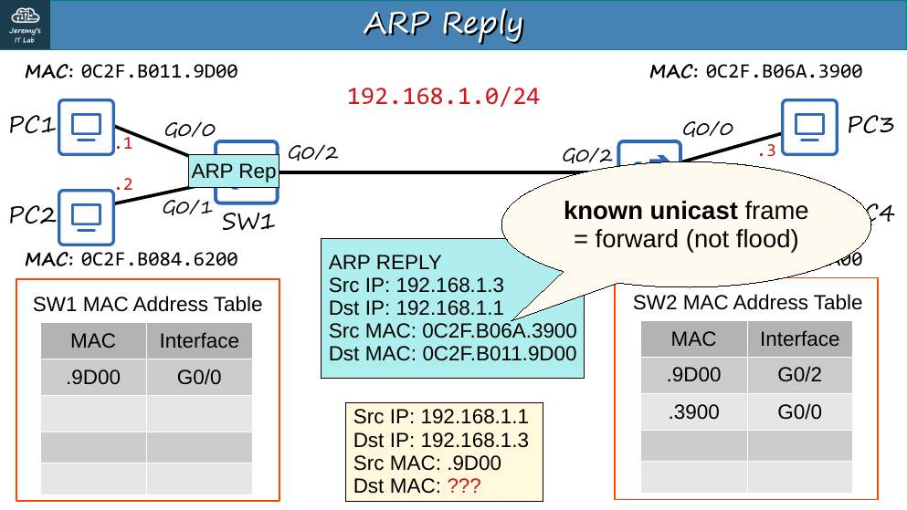
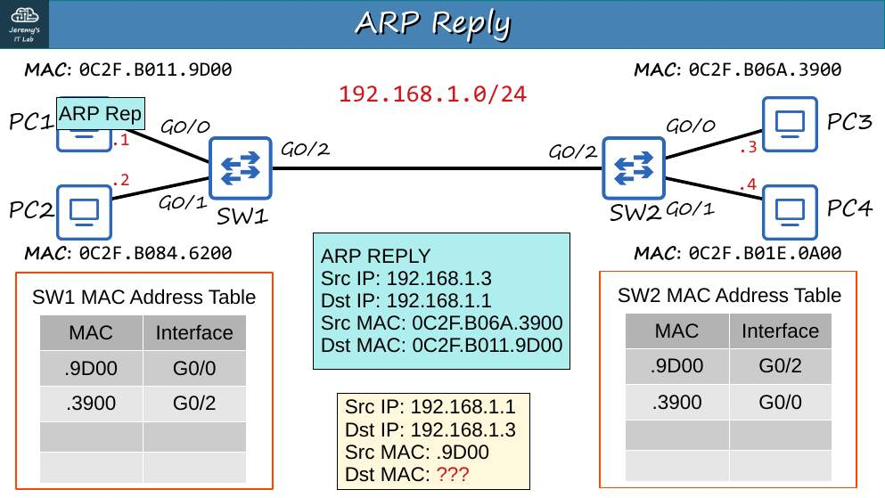
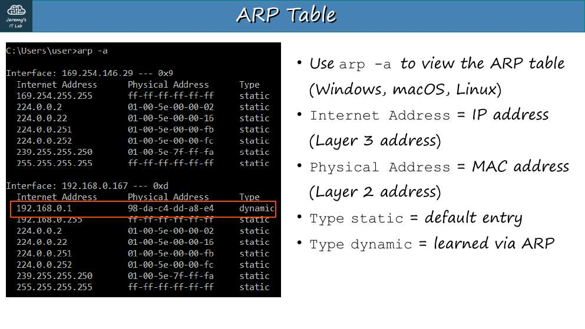
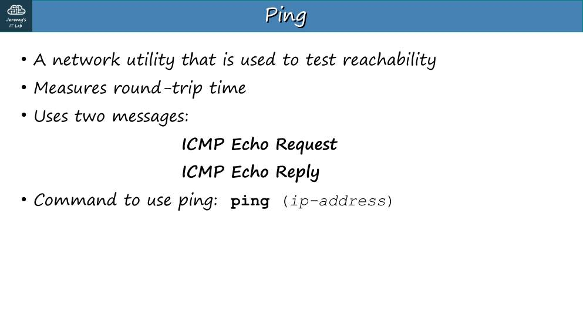
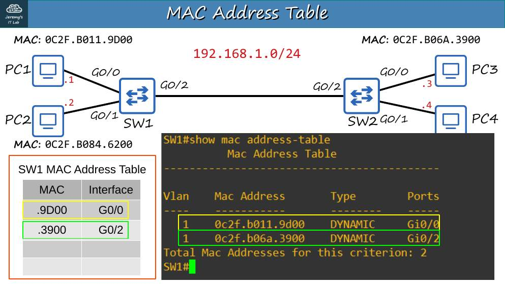
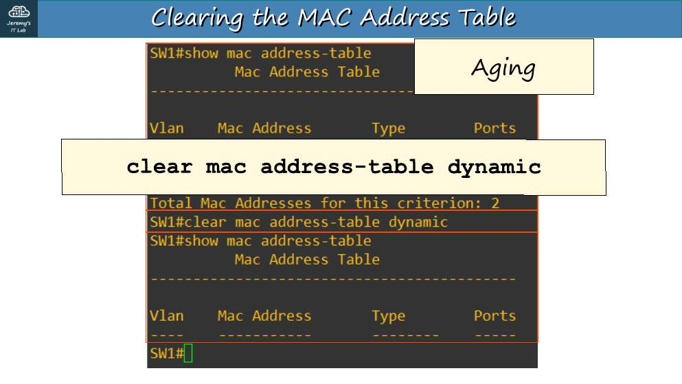
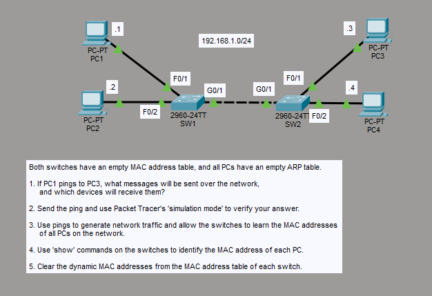

# Día 06 · Ethernet LAN Switching (parte 2)

> Mis apuntes del Día 6 del curso **CCNA 200-301 de Jeremy's IT Lab**.
> Video del día: [Jeremy's IT Lab en YouTube](https://www.youtube.com/@JeremysITLab).

| | |
|---|---|
| **Estado** | ✅ Estudiado |
| **Lectura Odom 2.ª ed.** | V1 caps. 2, 5 |
| **NetAcad v7** | ITN 6, 7, 9 |
| **Lab extra** | LG 11 Cisco Device Functions |

## Diapositivas clave de Jeremy

**Day 06 Slides - Ethernet LAN Switching (Part 2)**

<table><tr><td width="50%"><br><sub>p. 3</sub></td><td width="50%"><br><sub>p. 6</sub></td></tr><tr><td width="50%"><br><sub>p. 9</sub></td><td width="50%"><br><sub>p. 11</sub></td></tr><tr><td width="50%"><br><sub>p. 12</sub></td><td width="50%"><br><sub>p. 13</sub></td></tr><tr><td width="50%"><br><sub>p. 18</sub></td><td width="50%"><br><sub>p. 22</sub></td></tr><tr><td width="50%"><br><sub>p. 23</sub></td></tr></table>


## Apuntes

**ARP (Address Resolution Protocol).** Sirve para averiguar la **MAC** que corresponde a una **IP conocida** dentro de la misma red.

| Mensaje | Destino | Contenido |
|---|---|---|
| **ARP Request** | **Broadcast** (`FFFF.FFFF.FFFF`) — lo reciben todos los equipos de la LAN | "¿Quién tiene 192.168.1.3? Díselo a 192.168.1.1" |
| **ARP Reply** | **Unicast** al que preguntó | "192.168.1.3 está en la MAC xxxx" |

- El que recibe el Request también aprende la MAC del que pregunta (así no necesita preguntar de vuelta).
- **Tipo Ethernet de ARP = 0x0806.**
- Si el destino está **en otra red**, el PC hace ARP por la **IP del gateway**, no por la del destino final.
- Ver la tabla: `arp -a` (Windows) y `show arp` / `show ip arp` (Cisco).

**Ping (ICMP).** `ping` envía **ICMP Echo Request** y espera **Echo Reply**. En Cisco: `!` = respuesta, `.` = sin respuesta. Un primer ping con `.!!!!` es normal: el primer paquete se pierde mientras se resuelve el ARP.

**Tabla MAC del switch:**

```
SW1# show mac address-table
          Mac Address Table
Vlan    Mac Address       Type        Ports
   1    000a.4183.6b01    DYNAMIC     Fa0/1
SW1# clear mac address-table dynamic                 ← borra todo lo dinámico
SW1# clear mac address-table dynamic interface f0/1  ← solo un puerto
SW1# clear mac address-table dynamic address 000a.4183.6b01
```

**Tipos de tráfico en capa 2:** unicast (a un equipo), broadcast (a todos los de la LAN), y unicast desconocido (se comporta como broadcast porque se inunda).

## Trampas de examen

1. ARP Request = broadcast; ARP Reply = **unicast**.
2. Para salir a otra red, la MAC de destino de la trama es la del **gateway**.
3. Primer ping `.!!!!` → el punto es por ARP, no es una falla.

## Laboratorio · Ethernet LAN Switching


<p align="center"><br><sub>Pantallazo del laboratorio (enunciado original de Jeremy)</sub></p>


**Topología:** 192.168.1.0/24. PC1 (.1) SW1 F0/1, PC2 (.2) SW1 F0/2, SW1 G0/1–SW2 G0/1, PC3 (.3) SW2 F0/1, PC4 (.4) SW2 F0/2. Las tablas MAC y ARP empiezan vacías.

**Tarea 1 · Si PC1 hace ping a PC3, ¿qué mensajes viajan y quién los recibe?**

1. PC1 no conoce la MAC de PC3 → **ARP Request en broadcast**.
   - SW1 aprende la MAC de PC1 en F0/1 e **inunda** por F0/2 y G0/1.
   - SW2 aprende la MAC de PC1 en G0/1 e inunda por F0/1 y F0/2.
   - **Lo reciben PC2, PC3 y PC4**; solo PC3 responde.
2. **ARP Reply unicast** PC3 → PC1. Los switches ya conocen la MAC de PC1, así que no inundan; además aprenden la MAC de PC3.
3. **ICMP Echo Request** y **Echo Reply**, ambos en unicast.

**Tarea 2 · Verificar en modo simulación.** Pasa a *Simulation*, filtra por ARP e ICMP, lanza el ping y sigue los sobres con *Capture/Forward*.

**Tarea 3 · Generar tráfico para que los switches aprendan todas las MAC.** Desde PC1 haz ping a .2, .3 y .4 (o desde cada PC a otro).

**Tarea 4 · Identificar la MAC de cada PC con `show`.**

```
SW1# show mac address-table   ← PC1 en Fa0/1, PC2 en Fa0/2, PC3 y PC4 en Gi0/1
SW2# show mac address-table   ← PC3 en Fa0/1, PC4 en Fa0/2, PC1 y PC2 en Gi0/1
```

Confirma con `ipconfig /all` en cada PC.

**Tarea 5 · Borrar las MAC dinámicas.**

```
SW1# clear mac address-table dynamic
SW2# clear mac address-table dynamic
```

---

## Rómpelo y arréglalo (48 h después del lab)

| # | Rompe esto | Síntoma | Te delata | Arreglo |
|---|---|---|---|---|
| 1 | Cambia la máscara de PC3 a /30 | PC1 → PC3 falla (PC3 cree que PC1 está en otra red) | `ipconfig` en PC3 | Máscara /24 |
| 2 | Apaga SW1 G0/1 | PC1/PC2 no ven a PC3/PC4 | `show mac address-table` sin MAC remotas | `no shutdown` |
| 3 | Pon a PC4 la misma IP que PC3 | Pings intermitentes a .3 | `arp -a` muestra la MAC cambiando | IP única |

## Repaso rápido

Intenta responder antes de abrir cada pregunta.

<details><summary>ARP Request y ARP Reply: ¿broadcast o unicast?</summary>

Request en broadcast (FFFF.FFFF.FFFF); Reply en unicast.

</details>

<details><summary>PC1 quiere llegar a otra red: ¿por qué IP hace ARP?</summary>

Por la IP de su gateway.

</details>

<details><summary>¿Por qué el primer ping suele mostrar .!!!!?</summary>

El primer paquete se pierde mientras se resuelve ARP.

</details>

<details><summary>Comando para borrar las MAC dinámicas de un switch</summary>

clear mac address-table dynamic

</details>


---

[⬅ Índice del curso](../../README.md)
