# Día 07 · Direcciones IPv4 (parte 1)

> Mis apuntes del Día 7 del curso **CCNA 200-301 de Jeremy's IT Lab**.
> Video del día: [Jeremy's IT Lab en YouTube](https://www.youtube.com/@JeremysITLab).

| | |
|---|---|
| **Estado** | ✅ Estudiado |
| **Lectura Odom 2.ª ed.** | V1 caps. 3, 11–12 |
| **NetAcad v7** | ITN 5, 8, 11 |
| **Lab extra** | ITN 11: actividades de direccionamiento |

## Diapositivas clave de Jeremy

**Day 07 Slides - IPv4 Addressing (Part 1)**

<table><tr><td width="50%">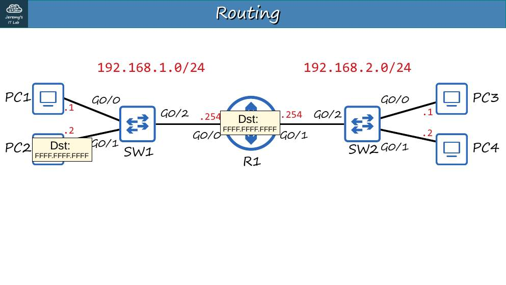 p. 8</td><td width="50%">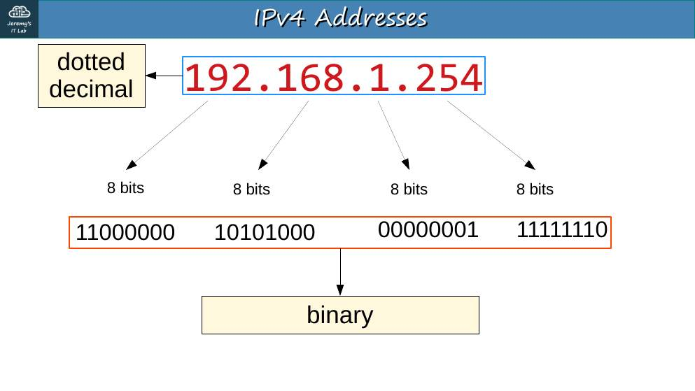 p. 10</td></tr><tr><td width="50%">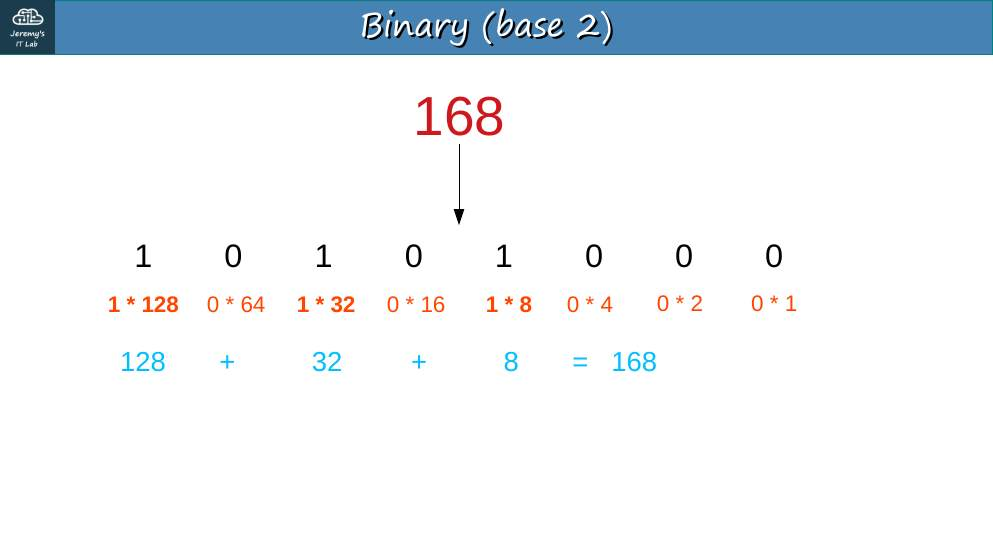 p. 15</td><td width="50%">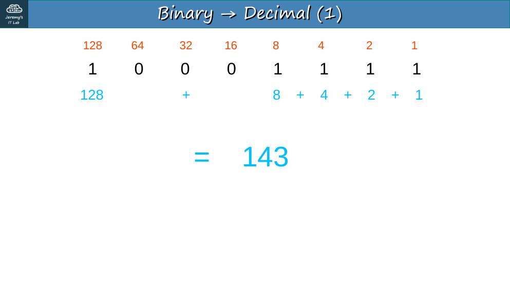 p. 21</td></tr><tr><td width="50%">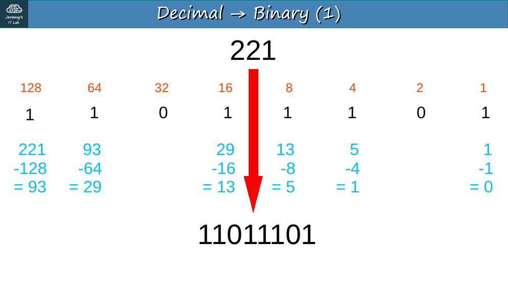 p. 24</td><td width="50%">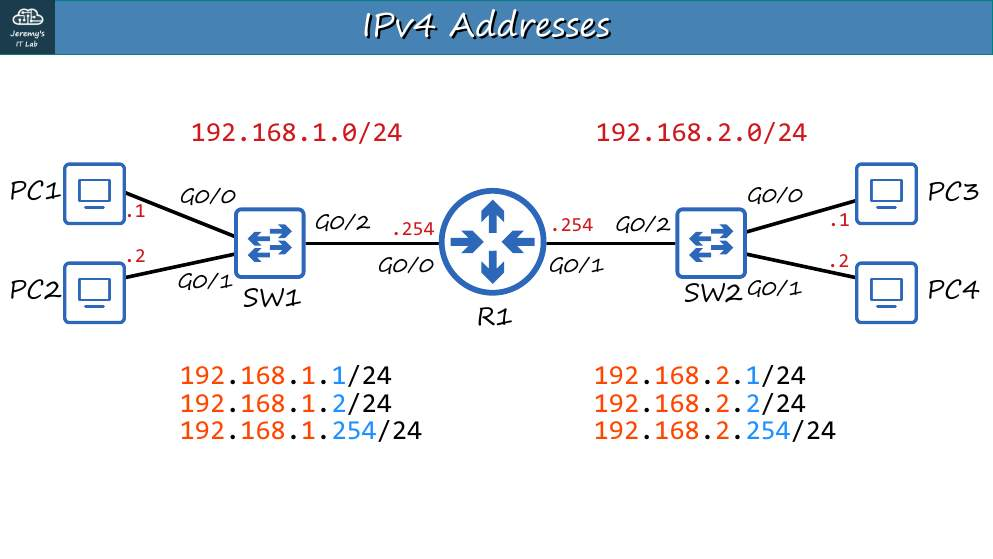 p. 31</td></tr><tr><td width="50%">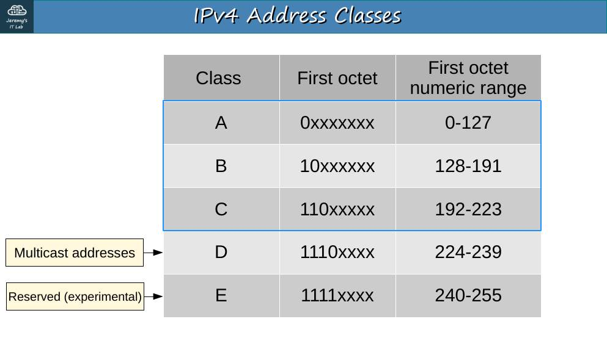 p. 39</td><td width="50%">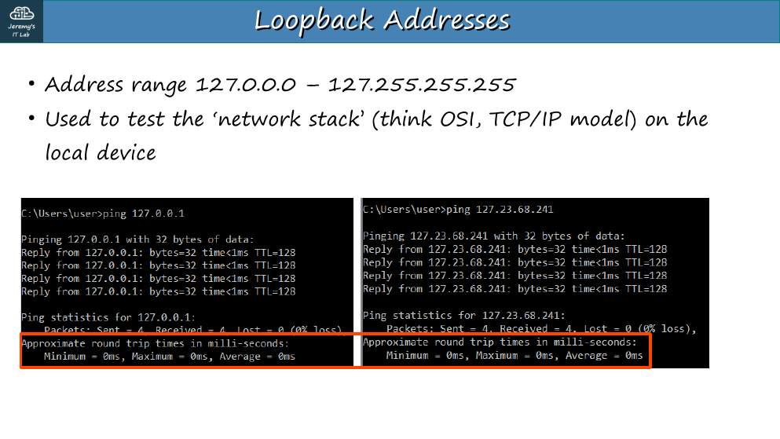 p. 40</td></tr><tr><td width="50%">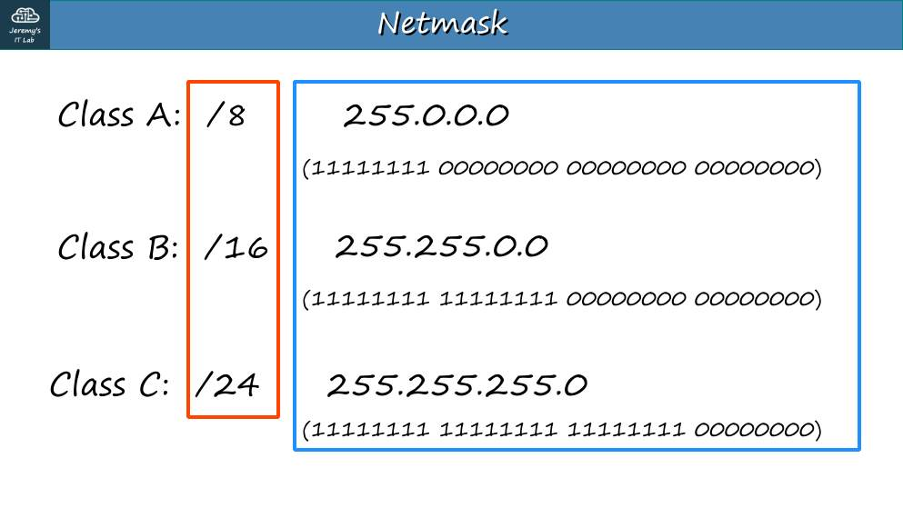 p. 44</td><td width="50%">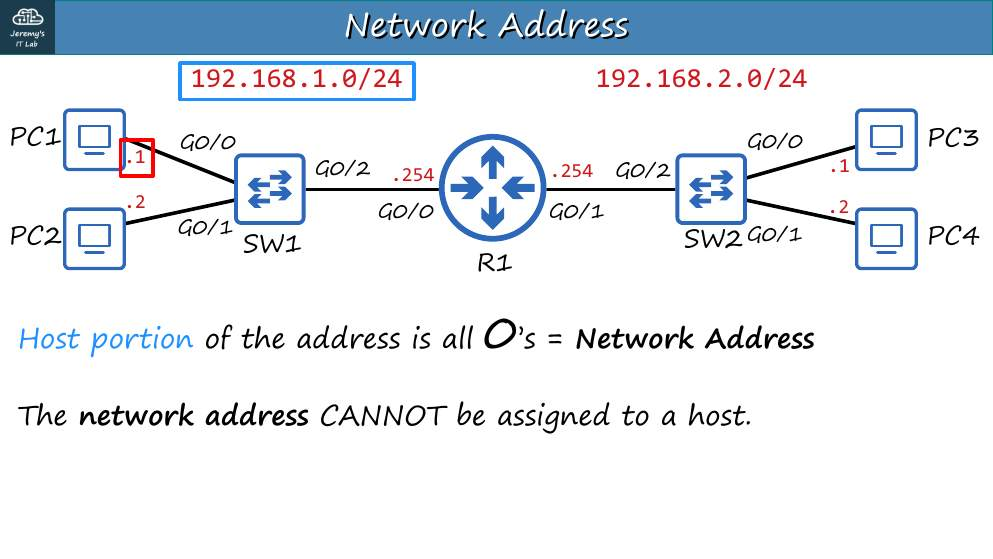 p. 45</td></tr><tr><td width="50%">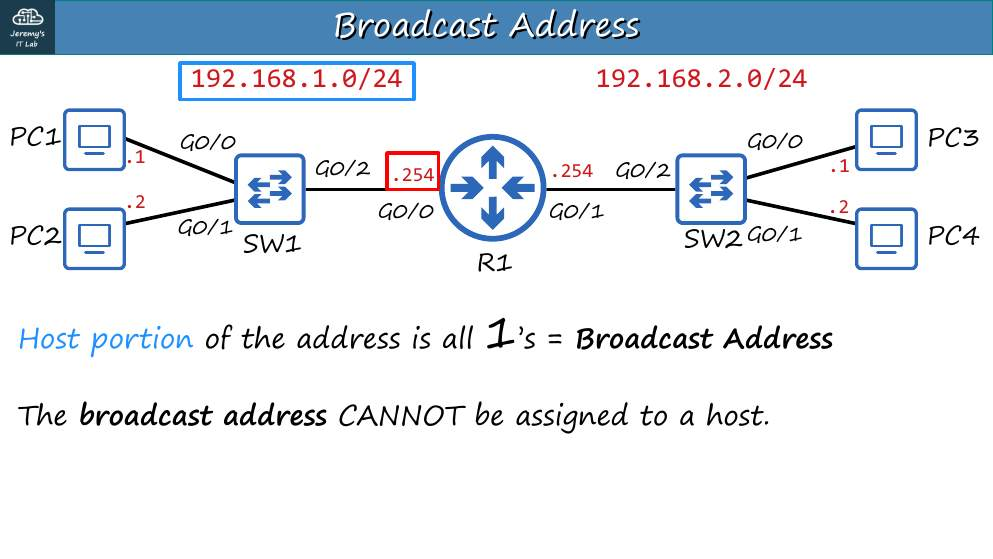 p. 46</td></tr></table>

## Apuntes

**Binario y decimal.** Cada octeto tiene 8 bits con valores **128 64 32 16 8 4 2 1**. Una IPv4 tiene **32 bits = 4 octetos**.

| Decimal → binario (ejemplo 221) | 128 | 64 | 32 | 16 | 8 | 4 | 2 | 1 |
|---|---|---|---|---|---|---|---|---|
| 221 = 128+64+16+8+4+1 | 1 | 1 | 0 | 1 | 1 | 1 | 0 | 1 |

Método: resta de izquierda a derecha el valor más grande que quepa.

**Red y host.** La **máscara** (o el prefijo /n) indica cuántos bits son de **red**; el resto son de **host**. `/24` = 255.255.255.0.

**Clases (direccionamiento *classful*):**

| Clase | Primer bit(s) | Primer octeto | Prefijo por defecto | Uso |
|---|---|---|---|---|
| A | 0 | 1–126 | /8 | Unicast |
| B | 10 | 128–191 | /16 | Unicast |
| C | 110 | 192–223 | /24 | Unicast |
| D | 1110 | 224–239 | — | **Multicast** |
| E | 1111 | 240–255 | — | Reservado/experimental |

- **127.0.0.0/8** es **loopback** (127.0.0.1 = "yo mismo"); por eso la clase A termina en 126.
- Redes por clase: A = 128 redes (126 utilizables) de 16 777 214 hosts; B = 16 384 redes de 65 534 hosts; C = 2 097 152 redes de 254 hosts.

**Dirección de red y de broadcast:**

- **Dirección de red:** todos los bits de host en **0**. No se asigna a un equipo.
- **Broadcast:** todos los bits de host en **1**. Llega a todos los equipos de la red.
- **Hosts utilizables = 2^h − 2** (h = bits de host).

## Trampas de examen

1. 127.x.x.x **no** es clase A utilizable: es loopback.
2. Una IP con todos los bits de host en 0 o en 1 no se puede asignar a un PC.
3. /16 da **65 534** hosts (no 65 536).

*(Este día no tiene laboratorio. Practica conversiones binario↔decimal 10 minutos.)*

---

## Repaso rápido

Intenta responder antes de abrir cada pregunta.

Clases A, B y C por primer octeto

A 1-126, B 128-191, C 192-223 (D 224-239 multicast, E 240-255).

¿Qué es 127.0.0.0/8?

Loopback (127.0.0.1 = el propio equipo).

Fórmula de hosts utilizables

2^h − 2 (h = bits de host).

Hosts utilizables en una /16

65 534.

¿Qué son la dirección de red y la de broadcast?

Red: bits de host en 0. Broadcast: bits de host en 1. No se asignan a hosts.

---

[⬅ Índice del curso](../../README.md)
