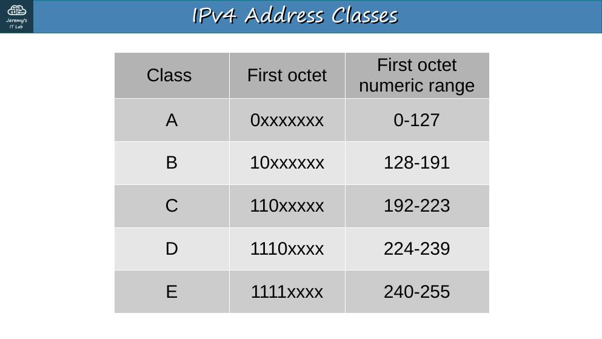
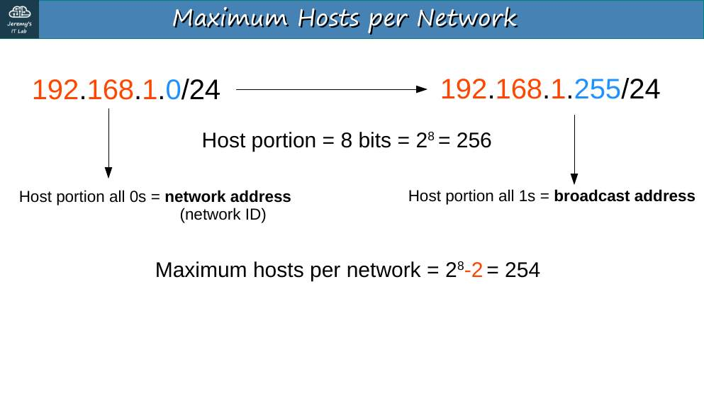
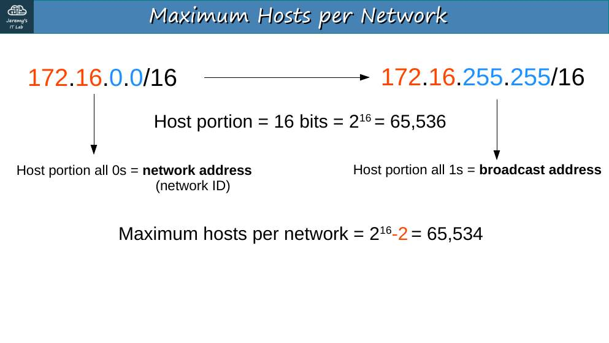
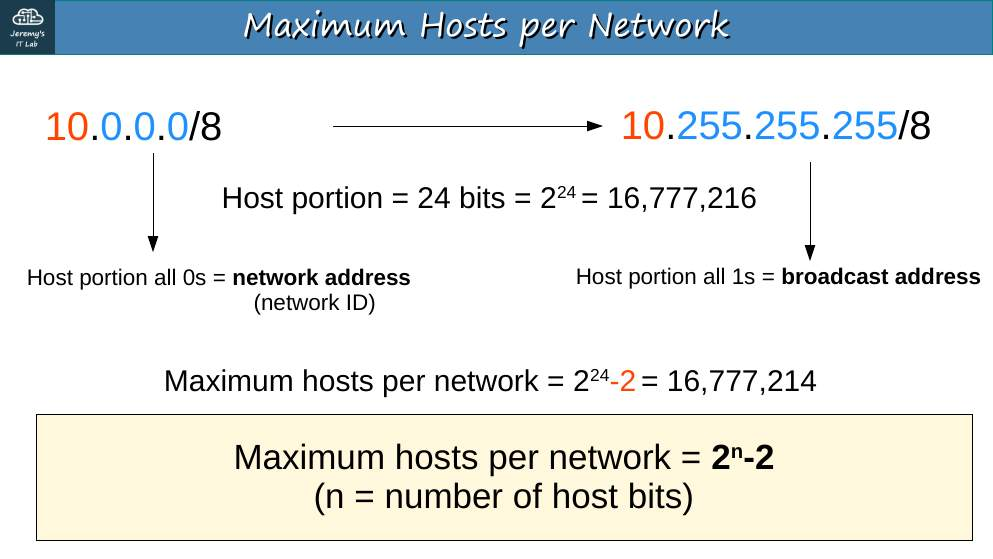
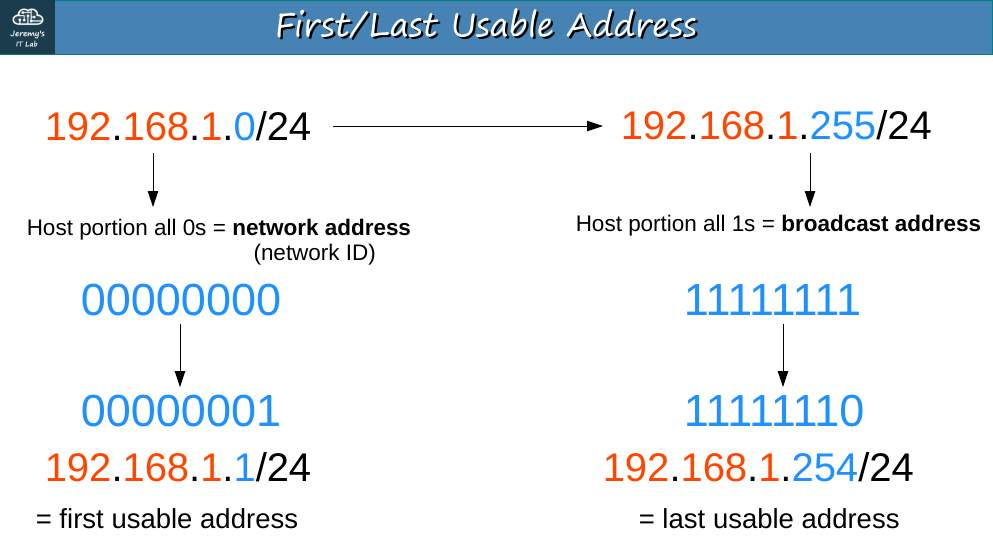
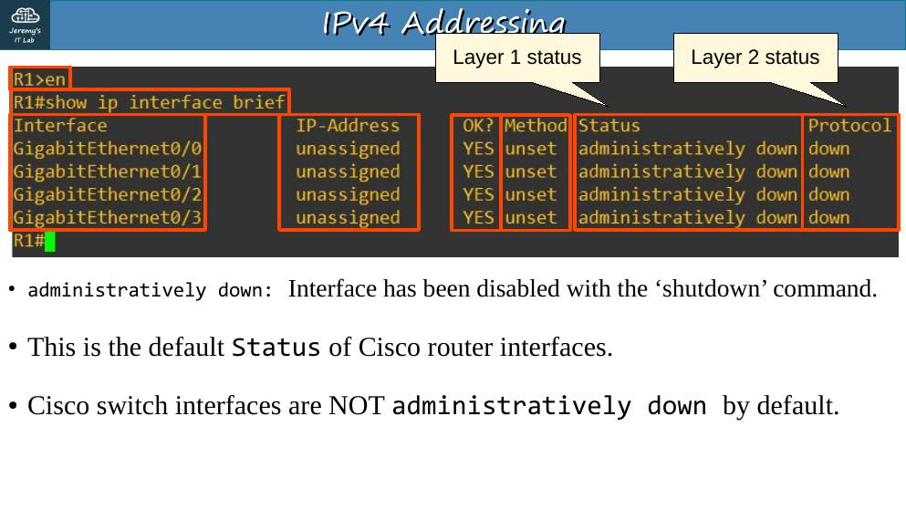
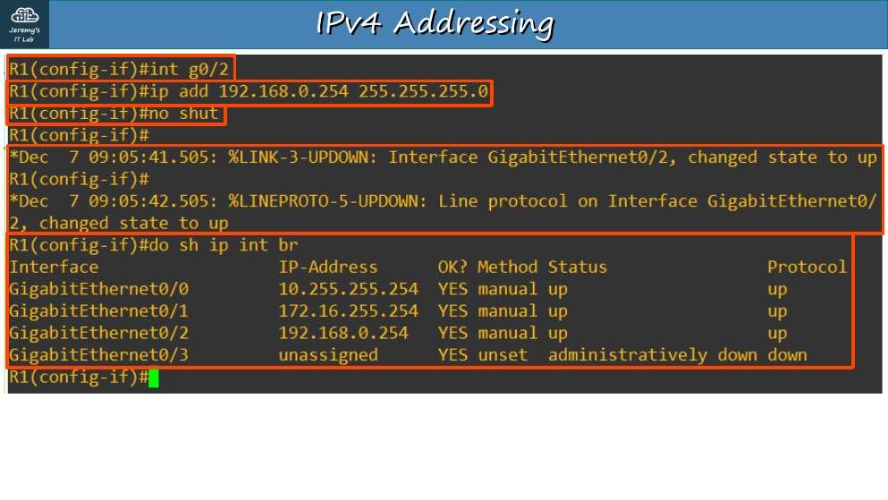
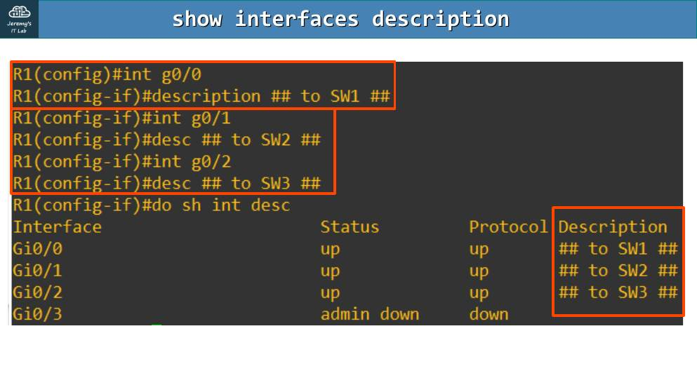
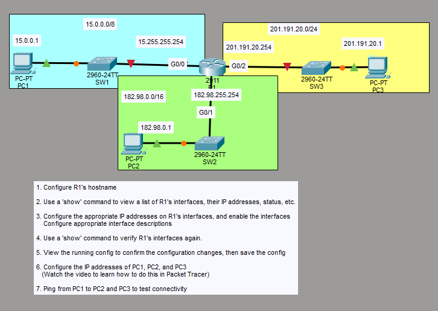

# Día 08 · Direcciones IPv4 (parte 2)

> Mis apuntes del Día 8 del curso **CCNA 200-301 de Jeremy's IT Lab**.
> Video del día: [Jeremy's IT Lab en YouTube](https://www.youtube.com/@JeremysITLab).

| | |
|---|---|
| **Estado** | ✅ Estudiado |
| **Lectura Odom 2.ª ed.** | V1 caps. 3, 11–12 |
| **NetAcad v7** | ITN 5, 8, 11 |
| **Lab extra** | ITN 11: actividades de direccionamiento |

## Diapositivas clave de Jeremy

**Day 08 Slides - IPv4 Addressing (Part 2)**

<table><tr><td width="50%"><br><sub>p. 3</sub></td><td width="50%"><br><sub>p. 5</sub></td></tr><tr><td width="50%"><br><sub>p. 6</sub></td><td width="50%"><br><sub>p. 7</sub></td></tr><tr><td width="50%"><br><sub>p. 8</sub></td><td width="50%"><br><sub>p. 12</sub></td></tr><tr><td width="50%"><br><sub>p. 18</sub></td><td width="50%"><br><sub>p. 21</sub></td></tr></table>


## Apuntes

**Calcular red, broadcast y rango** (ejemplo 172.16.20.55/16):

- Bits de red: los 16 primeros → red **172.16.0.0**.
- Broadcast: bits de host en 1 → **172.16.255.255**.
- Primer host 172.16.0.1, último 172.16.255.254, hosts 2¹⁶−2 = 65 534.

**Configurar IP en una interfaz de router:**

```
R1# show ip interface brief
Interface              IP-Address      OK? Method Status                Protocol
GigabitEthernet0/0     unassigned      YES unset  administratively down down
R1(config)# interface g0/0
R1(config-if)# ip address 10.255.255.254 255.0.0.0
R1(config-if)# no shutdown
R1(config-if)# description ## to SW1 ##
```

- Las interfaces del **router** están con `shutdown` por defecto → *administratively down*. Las del **switch** no.
- `show ip interface brief`: **Status** = capa 1 (`up`, `down` o `administratively down`); **Protocol** = capa 2 (`up` o `down`).
- `show interfaces g0/0` → detalle (MAC, MTU, errores). `show interfaces description` → descripciones.

**Configurar un PC en Packet Tracer:** *Desktop → IP Configuration* → IP, máscara y **gateway por defecto** (la IP del router en esa LAN).

## Trampas de examen

1. Status `administratively down` = alguien puso `shutdown` (o es el estado por defecto del router).
2. `up/down` → problema de capa 2 (por ejemplo, encapsulación o keepalives); `down/down` → capa 1 (cable).
3. Sin gateway, un PC solo llega a su propia red.

## Laboratorio · Direcciones IPv4


<p align="center"><br><sub>Pantallazo del laboratorio (enunciado original de Jeremy)</sub></p>


**Topología:** R1 (2911) G0/0 → SW1 → PC1 (15.0.0.0/8); G0/1 → SW2 → PC2 (182.98.0.0/16); G0/2 → SW3 → PC3 (201.191.20.0/24).

**Tarea 1 · Hostname de R1.**

```
Router(config)# hostname R1
```

**Tarea 2 · Ver interfaces, IP y estado.**

```
R1# show ip interface brief    ← todas "unassigned" y "administratively down"
```

**Tarea 3 · IP, encender y descripciones.**

```
R1(config)# interface g0/0
R1(config-if)# ip address 15.255.255.254 255.0.0.0
R1(config-if)# description ## to SW1 ##
R1(config-if)# no shutdown
R1(config-if)# interface g0/1
R1(config-if)# ip address 182.98.255.254 255.255.0.0
R1(config-if)# description ## to SW2 ##
R1(config-if)# no shutdown
R1(config-if)# interface g0/2
R1(config-if)# ip address 201.191.20.254 255.255.255.0
R1(config-if)# description ## to SW3 ##
R1(config-if)# no shutdown
```

**Tarea 4 · Verificar de nuevo.** `show ip interface brief` → las tres `up / up` con su IP.

**Tarea 5 · Ver la running-config y guardar.**

```
R1# show running-config
R1# write memory
```

**Tarea 6 · IP de los PC** (*Desktop → IP Configuration*):

| PC | IP | Máscara | Gateway |
|---|---|---|---|
| PC1 | 15.0.0.1 | 255.0.0.0 | 15.255.255.254 |
| PC2 | 182.98.0.1 | 255.255.0.0 | 182.98.255.254 |
| PC3 | 201.191.20.1 | 255.255.255.0 | 201.191.20.254 |

**Tarea 7 · Ping de PC1 a PC2 y PC3.** Debe funcionar sin rutas adicionales: las tres redes están **conectadas directamente** a R1.

---

## Rómpelo y arréglalo (48 h después del lab)

| # | Rompe esto | Síntoma | Te delata | Arreglo |
|---|---|---|---|---|
| 1 | `shutdown` en R1 G0/1 | PC2 no llega a nadie | `show ip int brief` → administratively down | `no shutdown` |
| 2 | Gateway de PC3 = 201.191.20.1 (él mismo) | PC3 solo llega a su red | `ipconfig` | Gateway .254 |
| 3 | R1 G0/0 con máscara 255.255.0.0 | PC1 (15.0.0.1) no está en la red de R1 | `show ip int brief` / `show run int g0/0` | Máscara /8 |

## Repaso rápido

Intenta responder antes de abrir cada pregunta.

<details><summary>Estado por defecto de las interfaces del router y del switch</summary>

Router: shutdown (administratively down). Switch: encendidas.

</details>

<details><summary>En show ip interface brief, ¿qué indican Status y Protocol?</summary>

Status = capa 1; Protocol = capa 2.

</details>

<details><summary>up/down vs down/down</summary>

up/down: problema de capa 2. down/down: capa 1 (cable/puerto).

</details>

<details><summary>Red y broadcast de 172.16.20.55/16</summary>

Red 172.16.0.0; broadcast 172.16.255.255.

</details>


---

[⬅ Índice del curso](../../README.md)
