# Día 09 · Interfaces del switch

> Mis apuntes del Día 9 del curso **CCNA 200-301 de Jeremy's IT Lab**.
> Video del día: [Jeremy's IT Lab en YouTube](https://www.youtube.com/@JeremysITLab).

| | |
|---|---|
| **Estado** | ✅ Estudiado |
| **Lectura Odom 2.ª ed.** | V1 caps. 6–7; V2 cap. 5 |
| **NetAcad v7** | SRWE 1; ITN 14 |
| **Lab extra** | LG 14 Router and Switch Basics; Captura del handshake TCP en Wireshark |

## Diapositivas clave de Jeremy

**Day 09 Slides - Switch Interfaces**

<table><tr><td width="50%">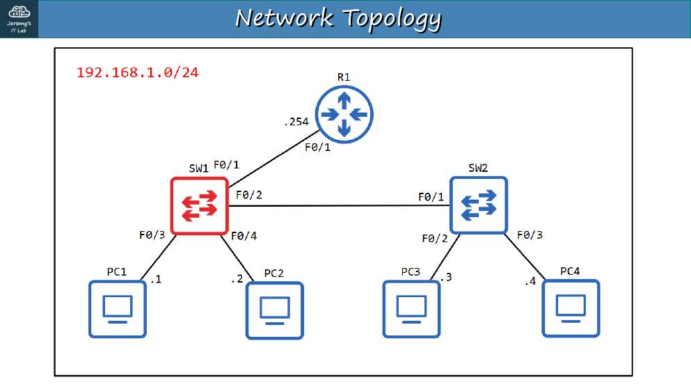<br><sub>p. 4</sub></td><td width="50%">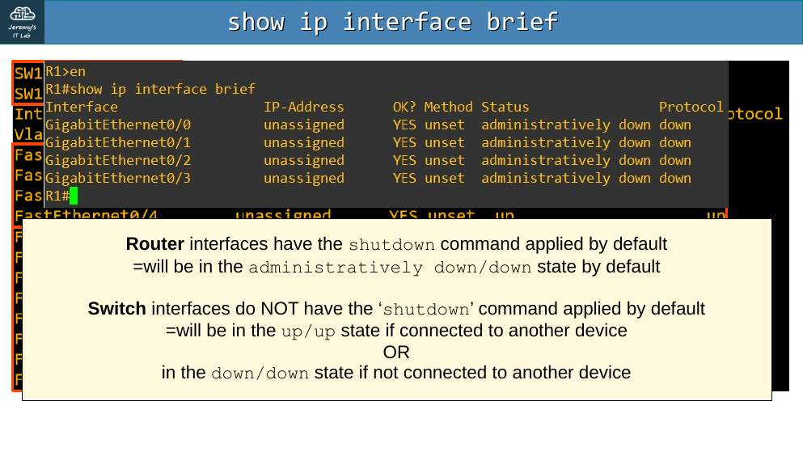<br><sub>p. 6</sub></td></tr><tr><td width="50%">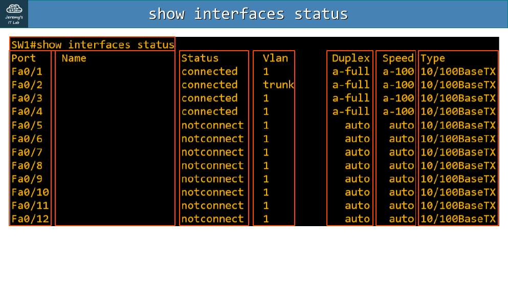<br><sub>p. 7</sub></td><td width="50%">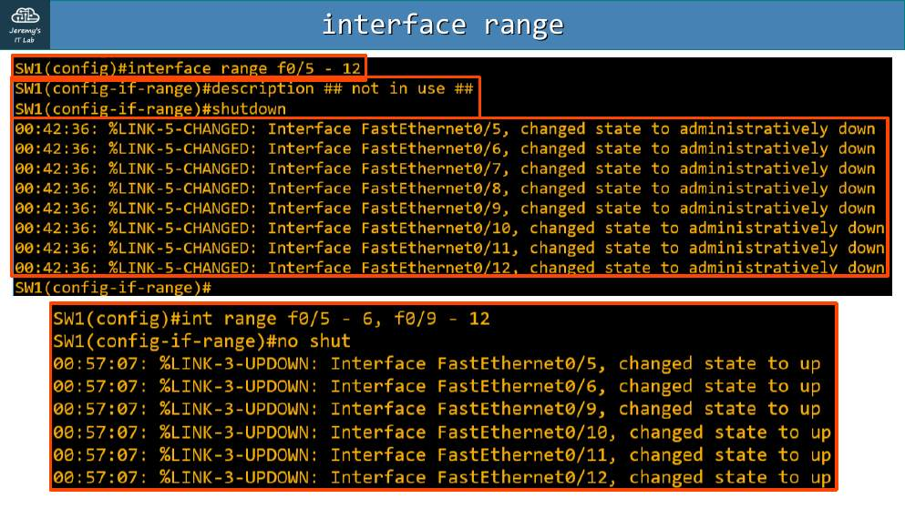<br><sub>p. 11</sub></td></tr><tr><td width="50%">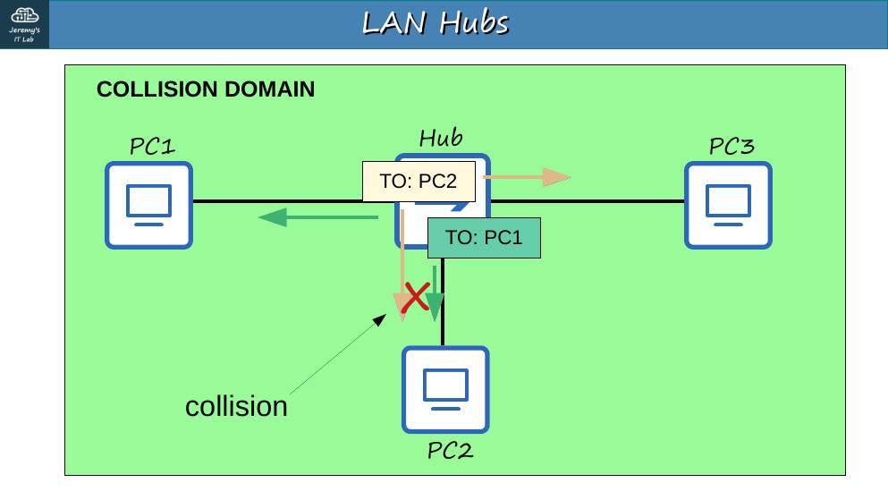<br><sub>p. 17</sub></td><td width="50%">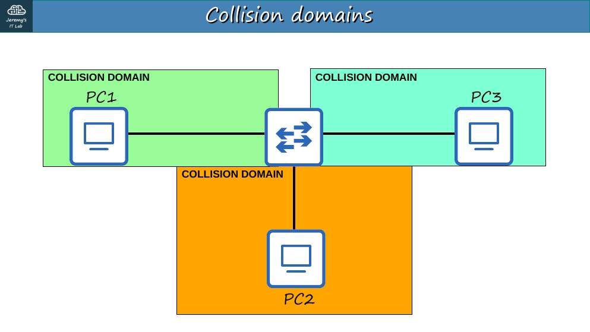<br><sub>p. 19</sub></td></tr><tr><td width="50%">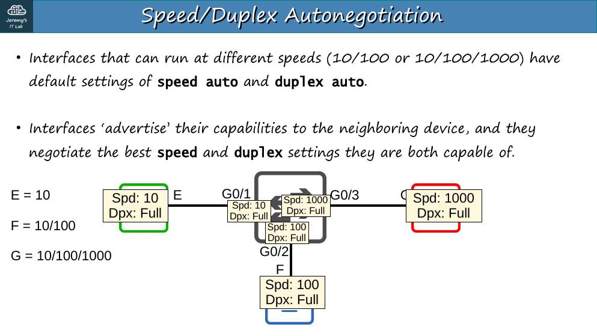<br><sub>p. 21</sub></td><td width="50%">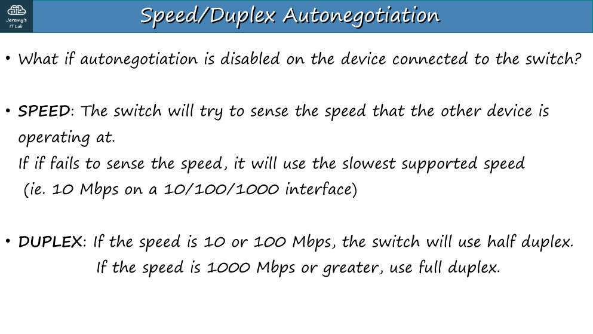<br><sub>p. 22</sub></td></tr><tr><td width="50%">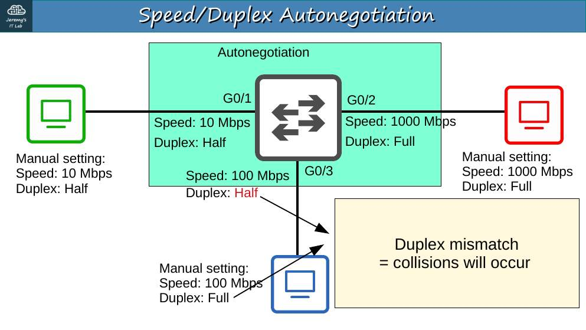<br><sub>p. 23</sub></td><td width="50%">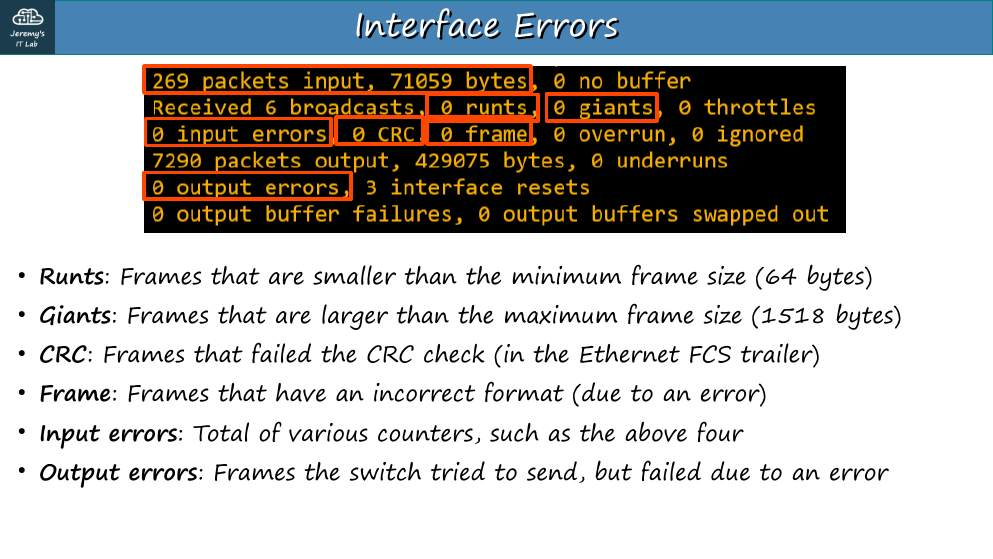<br><sub>p. 25</sub></td></tr></table>


## Apuntes

```
SW1# show ip interface brief       ← los puertos sin cable aparecen "down/down"
SW1# show interfaces status        ← Name, Status, Vlan, Duplex, Speed, Type
Port   Name          Status      Vlan  Duplex  Speed  Type
Fa0/1  ## to PC1 ##  connected   1     a-full  a-100  10/100BaseTX
```

- `a-full` / `a-100` = valores **negociados automáticamente**. Sin la "a-" = configurados a mano.
- Configuración de varias interfaces a la vez: `interface range f0/5 - 12` o `interface range f0/5 - 6, f0/9 - 12`.
- Buena práctica: **apagar los puertos que no se usan** (`shutdown`).

**Velocidad y dúplex:**

```
SW1(config-if)# speed 100
SW1(config-if)# duplex full
SW1(config-if)# description ## to R1 ##
```

- **Half duplex:** no se puede enviar y recibir a la vez (hubs, CSMA/CD). **Full duplex:** sí (switches).
- **Dominio de colisión:** un hub = un solo dominio; cada puerto del switch = su propio dominio.
- **CSMA/CD:** escuchar antes de transmitir; si hay colisión, señal *jam* y espera aleatoria (*backoff*).

**Autonegociación (IEEE 802.3u).** Si un lado la tiene apagada:

- **Velocidad:** el otro lado la **detecta** (si puede).
- **Dúplex:** si la velocidad es **10 o 100 Mbps → half**; si es **1000 Mbps o más → full**.
- **Duplex mismatch** → colisiones y errores; el lado half registra *late collisions*.

**Contadores de error de `show interfaces`:**

| Contador | Significado |
|---|---|
| **Runts** | Tramas de menos de 64 bytes |
| **Giants** | Tramas de más de 1518 bytes |
| **CRC** | Falló el FCS (cable dañado, interferencia, duplex mismatch) |
| **Frame** | Formato incorrecto (no termina en byte completo) |
| **Input errors** | Suma de los anteriores |
| **Output errors** | Tramas que no se pudieron enviar (p. ej. colisiones) |

## Trampas de examen

1. Un lado fijo en 100/full y el otro en auto → el auto detecta 100 pero elige **half** → mismatch.
2. Runts < 64 B; giants > 1518 B.
3. *Late collisions* = típicamente duplex mismatch.

## Laboratorio · Configuración de interfaces


<p align="center">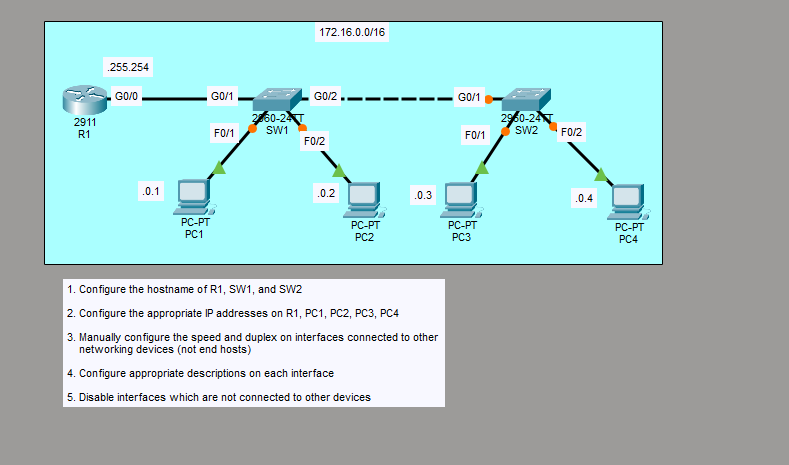<br><sub>Pantallazo del laboratorio (enunciado original de Jeremy)</sub></p>


**Topología:** 172.16.0.0/16. R1 G0/0 (.255.254) → SW1 G0/1; SW1 F0/1 PC1 (.0.1), F0/2 PC2 (.0.2); SW1 G0/2 → SW2 G0/1; SW2 F0/1 PC3 (.0.3), F0/2 PC4 (.0.4).

**Tarea 1 · Hostnames de R1, SW1 y SW2.** `hostname R1`, `hostname SW1`, `hostname SW2`.

**Tarea 2 · IP de R1 y de los PC.**

```
R1(config)# interface g0/0
R1(config-if)# ip address 172.16.255.254 255.255.0.0
R1(config-if)# no shutdown
```

PC1 172.16.0.1, PC2 .0.2, PC3 .0.3, PC4 .0.4 — máscara 255.255.0.0, gateway 172.16.255.254.

**Tarea 3 · Velocidad y dúplex manuales en las interfaces hacia equipos de red** (no hacia PC):

```
R1(config)# interface g0/0
R1(config-if)# speed 1000
R1(config-if)# duplex full
SW1(config)# interface range g0/1 - 2
SW1(config-if-range)# speed 1000
SW1(config-if-range)# duplex full
SW2(config)# interface g0/1
SW2(config-if)# speed 1000
SW2(config-if)# duplex full
```

**Tarea 4 · Descripciones en cada interfaz.**

```
R1(config)# interface g0/0
R1(config-if)# description ## to SW1 ##
SW1(config)# interface g0/1
SW1(config-if)# description ## to R1 ##
SW1(config)# interface g0/2
SW1(config-if)# description ## to SW2 ##
SW1(config)# interface range f0/1 - 2
SW1(config-if-range)# description ## to end hosts ##
SW2(config)# interface g0/1
SW2(config-if)# description ## to SW1 ##
SW2(config)# interface range f0/1 - 2
SW2(config-if-range)# description ## to end hosts ##
```

**Tarea 5 · Apagar las interfaces que no están conectadas.**

```
R1(config)# interface range g0/1 - 2
R1(config-if-range)# shutdown          ← (ya vienen apagadas en el router; confírmalo)
SW1(config)# interface range f0/3 - 24
SW1(config-if-range)# shutdown
SW2(config)# interface range f0/3 - 24 , g0/2
SW2(config-if-range)# shutdown
```

**Verificación:** `show interfaces status` (Speed/Duplex sin "a-" en los enlaces de red; puertos libres en `disabled`) y `show interfaces description`.

---

## Rómpelo y arréglalo (48 h después del lab)

| # | Rompe esto | Síntoma | Te delata | Arreglo |
|---|---|---|---|---|
| 1 | SW1 G0/2 `duplex half`, SW2 G0/1 `duplex full` | Lentitud, errores | `show interfaces g0/2` → late collisions; CDP avisa *duplex mismatch* | Mismo dúplex |
| 2 | SW1 G0/2 `speed 100` y SW2 G0/1 `speed 1000` | Enlace caído | `show interfaces status` → notconnect | Misma velocidad o auto |
| 3 | Por error apaga F0/1 de SW1 | PC1 sin red | `show interfaces status` → disabled | `no shutdown` |

## Repaso rápido

Intenta responder antes de abrir cada pregunta.

<details><summary>Si un lado tiene la autonegociación apagada a 100 Mbps, ¿qué dúplex elige el otro?</summary>

Half (10/100 → half; 1000+ → full).

</details>

<details><summary>Síntoma típico de un duplex mismatch</summary>

Late collisions en el lado half; errores CRC en el lado full.

</details>

<details><summary>Runts y giants</summary>

Runts: tramas < 64 bytes. Giants: > 1518 bytes.

</details>

<details><summary>¿Qué significa a-full / a-100 en show interfaces status?</summary>

Valores negociados automáticamente.

</details>

<details><summary>¿Qué hace CSMA/CD?</summary>

En half duplex: escuchar antes de transmitir; si hay colisión, jam y espera aleatoria.

</details>


---

[⬅ Índice del curso](../../README.md)
