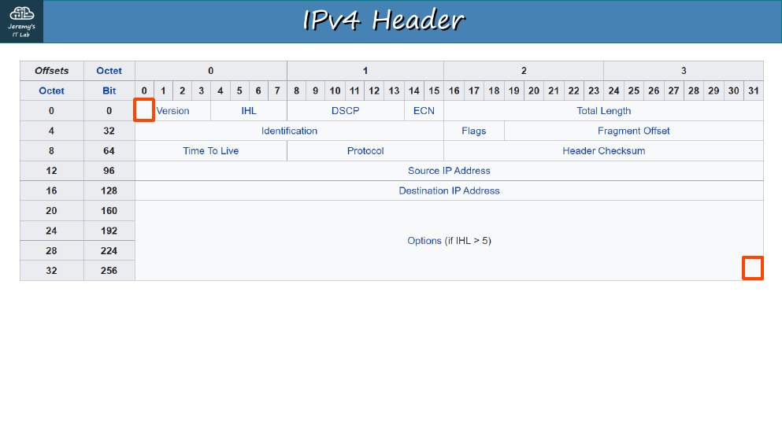
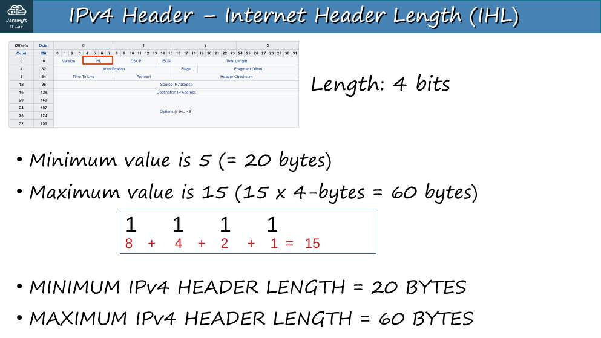
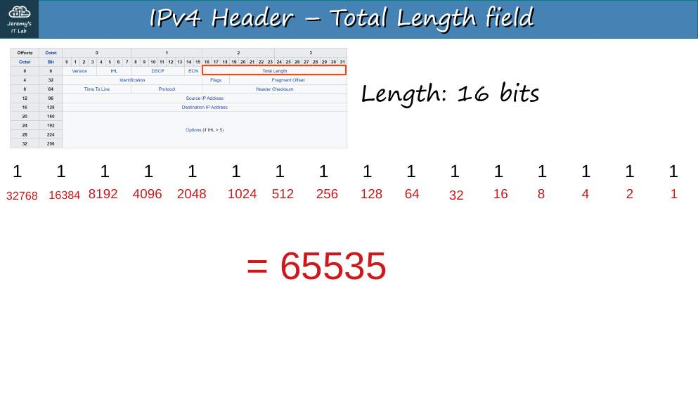
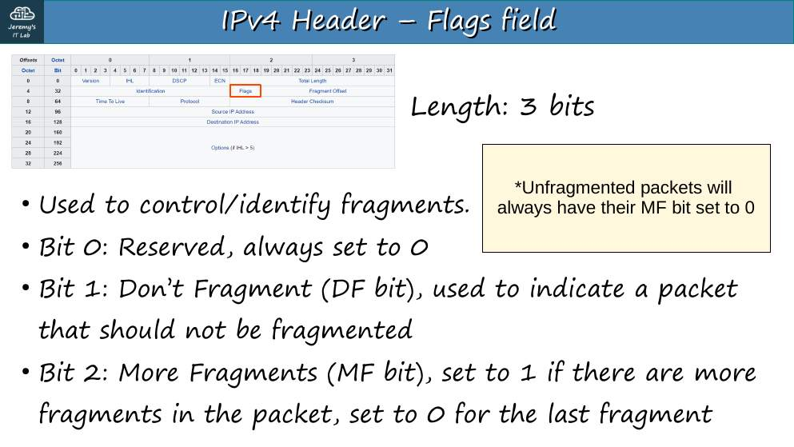
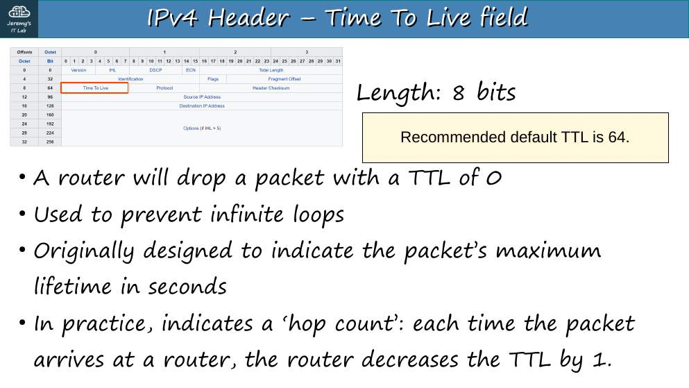
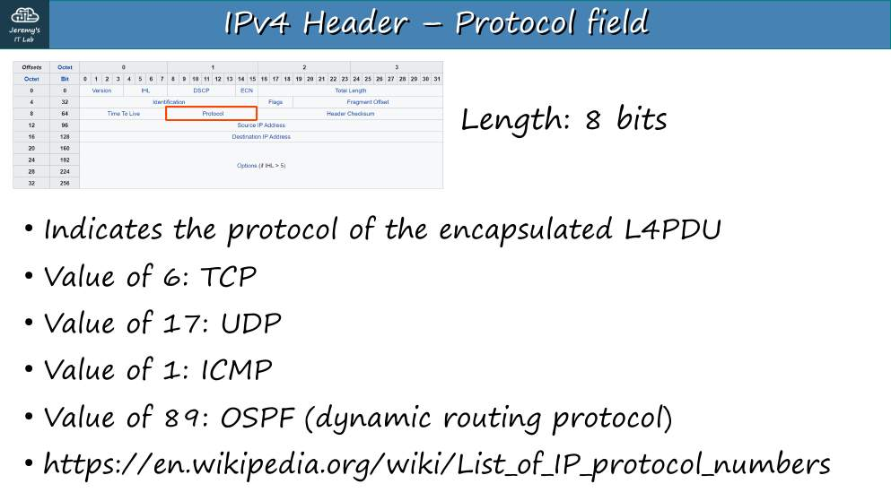
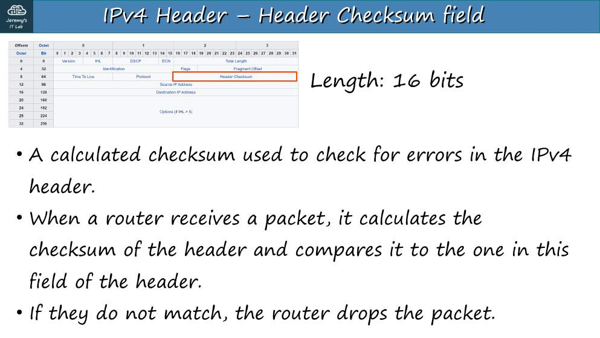
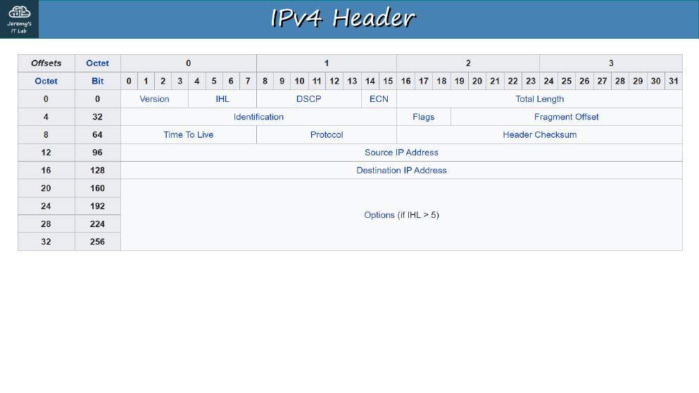
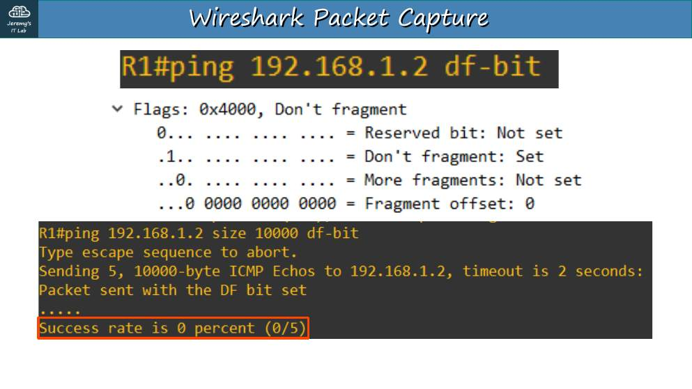

# Día 10 · Encabezado IPv4

> Mis apuntes del Día 10 del curso **CCNA 200-301 de Jeremy's IT Lab**.
> Video del día: [Jeremy's IT Lab en YouTube](https://www.youtube.com/@JeremysITLab).

| | |
|---|---|
| **Estado** | ✅ Estudiado |
| **Lectura Odom 2.ª ed.** | V1 caps. 3, 11–12; V1 caps. 11–15 |
| **NetAcad v7** | ITN 5, 8, 11; ITN 11 |
| **Lab extra** | ITN 11: actividades de direccionamiento; Apéndices de práctica del Odom + sprint de la app |

## Diapositivas clave de Jeremy

**Day 10 Slides - IPv4 Header**

<table><tr><td width="50%"> p. 4</td><td width="50%"> p. 7</td></tr><tr><td width="50%"> p. 11</td><td width="50%"> p. 14</td></tr><tr><td width="50%"> p. 16</td><td width="50%"> p. 17</td></tr><tr><td width="50%"> p. 18</td><td width="50%"> p. 22</td></tr><tr><td width="50%"> p. 30</td></tr></table>

## Apuntes

El encabezado IPv4 mide **20 bytes** (sin opciones) y hasta **60 bytes**.

| Campo | Bits | Qué hace |
|---|---|---|
| **Version** | 4 | `4` (en IPv6 vale 6) |
| **IHL** (Internet Header Length) | 4 | Longitud del encabezado en bloques de **4 bytes**. Mín. **5** (20 B), máx. **15** (60 B) |
| **DSCP** | 6 | Marcado de QoS (Día 47) |
| **ECN** | 2 | Notifica congestión sin descartar paquetes |
| **Total Length** | 16 | Encabezado + datos. Mín. 20, máx. **65 535** |
| **Identification** | 16 | Igual en todos los fragmentos de un mismo paquete |
| **Flags** | 3 | Bit 0 reservado; **DF** (Don't Fragment); **MF** (More Fragments: 1 en todos los fragmentos menos el último) |
| **Fragment Offset** | 13 | Posición del fragmento en el paquete original (en bloques de 8 B) |
| **TTL** | 8 | Cada router le resta 1; en **0** se descarta (evita bucles). Por defecto: Linux 64, Windows 128, Cisco 255 |
| **Protocol** | 8 | Qué lleva dentro: **1 ICMP, 6 TCP, 17 UDP, 88 EIGRP, 89 OSPF** |
| **Header Checksum** | 16 | Comprueba errores **solo del encabezado** |
| **Source / Destination** | 32 + 32 | IP de origen y destino |
| **Options** | 0–320 | Rara vez se usa |

**Fragmentación.** Si el paquete supera la MTU (1500 B en Ethernet), el router lo divide (salvo que tenga **DF = 1**). IPv6 no fragmenta en los routers.

## Trampas de examen

1. IHL mínimo = **5** (no 20): se cuenta en palabras de 4 bytes.
2. Protocol **6 = TCP, 17 = UDP, 1 = ICMP, 89 = OSPF**.
3. El checksum IPv4 cubre **solo el encabezado**.
4. TTL lo decrementa cada **router**, no cada switch.

*(Este día no tiene laboratorio.)*

## Repaso rápido

Intenta responder antes de abrir cada pregunta.

Tamaño mínimo y máximo del encabezado IPv4

20 y 60 bytes (IHL de 5 a 15).

Valores del campo Protocol para ICMP, TCP, UDP, EIGRP y OSPF

1, 6, 17, 88 y 89.

¿Qué cubre el Header Checksum de IPv4?

Solo el encabezado.

¿Quién decrementa el TTL?

Cada router (no los switches). Si llega a 0, descarta el paquete.

¿Qué indican DF y MF?

DF: no fragmentar. MF: hay más fragmentos detrás.

---

[⬅ Índice del curso](../../README.md)
