# Día 11 · Fundamentos de enrutamiento y rutas estáticas

> Mis apuntes del Día 11 del curso **CCNA 200-301 de Jeremy's IT Lab**.
> Video del día: [Jeremy's IT Lab en YouTube](https://www.youtube.com/@JeremysITLab).

| | |
|---|---|
| **Estado** | ✅ Estudiado |
| **Lectura Odom 2.ª ed.** | V1 caps. 16–18 |
| **NetAcad v7** | SRWE 14–16 |
| **Lab extra** | LG 12 y LG 16 |

## Diapositivas clave de Jeremy

**Day 11 (part 1) Slides - Routing Fundamentals**

<table><tr><td width="50%">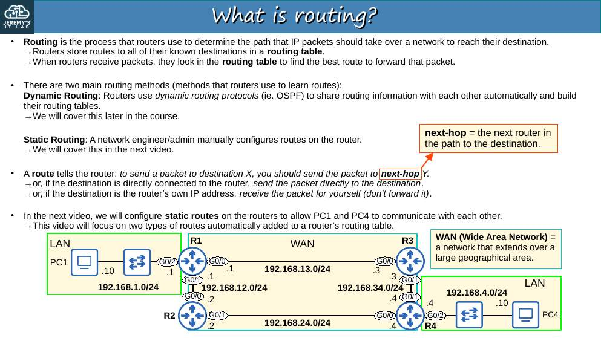<br><sub>p. 3</sub></td><td width="50%">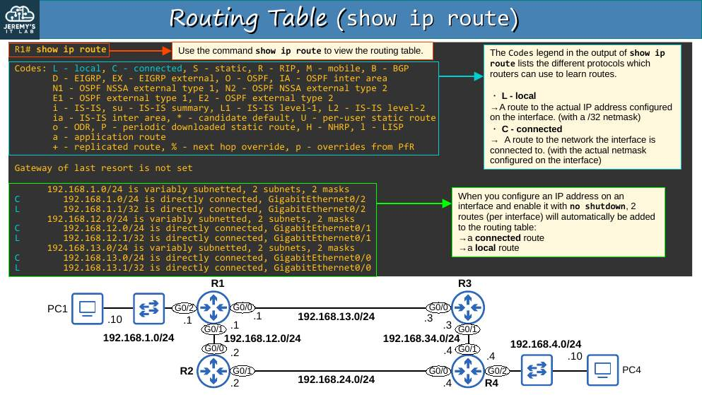<br><sub>p. 5</sub></td></tr><tr><td width="50%">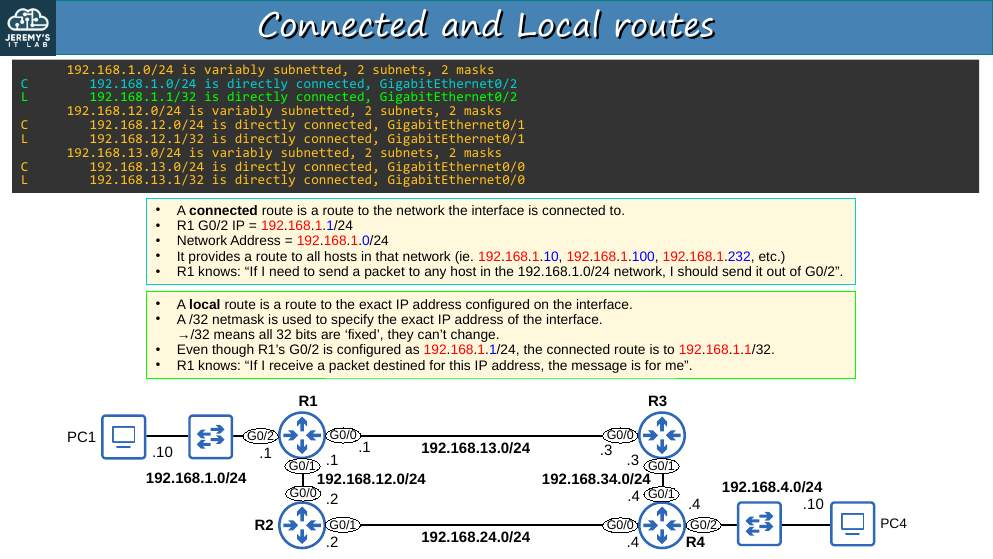<br><sub>p. 6</sub></td><td width="50%">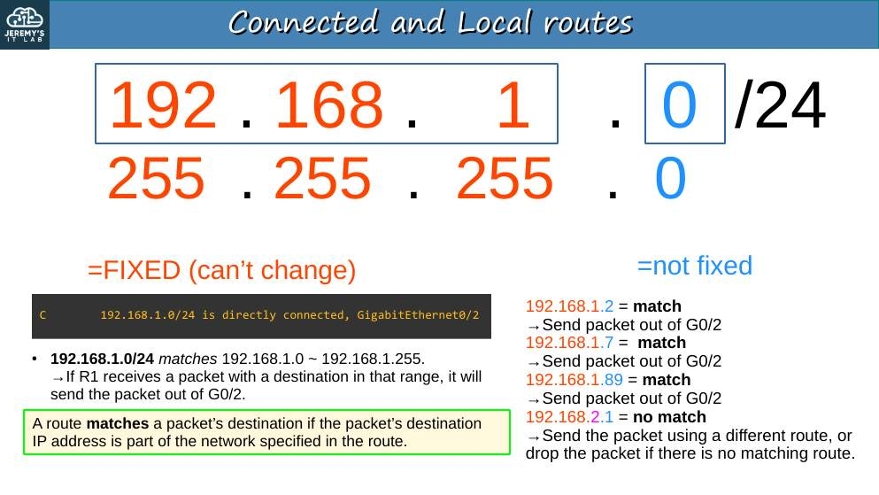<br><sub>p. 7</sub></td></tr><tr><td width="50%">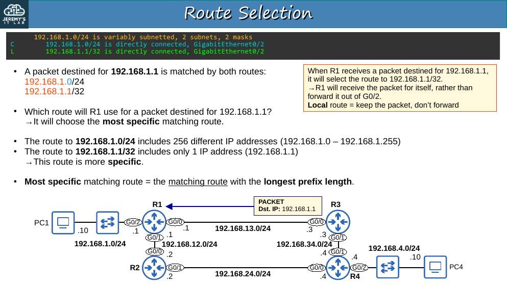<br><sub>p. 9</sub></td><td width="50%">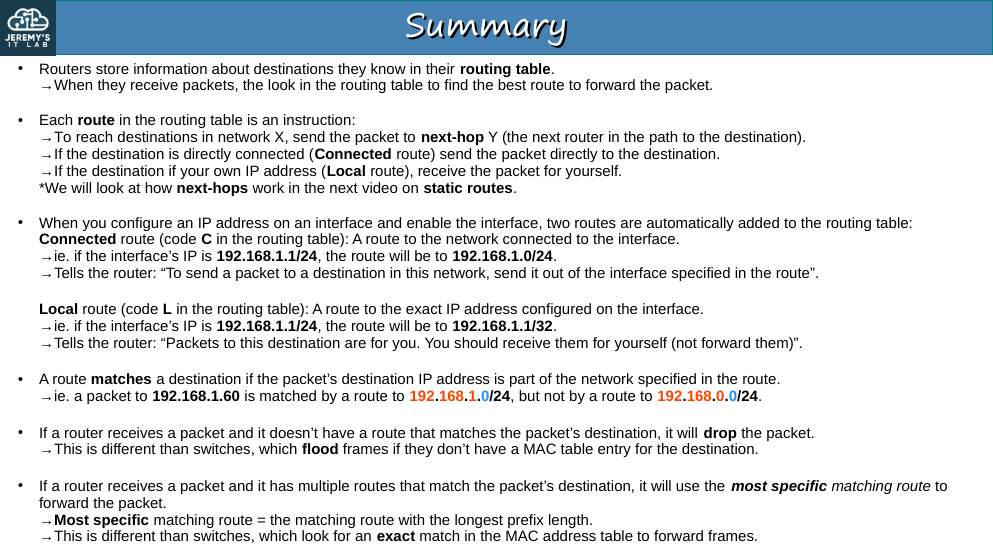<br><sub>p. 16</sub></td></tr></table>

**Day 11 (part 2) Slides - Static Routing**

<table><tr><td width="50%">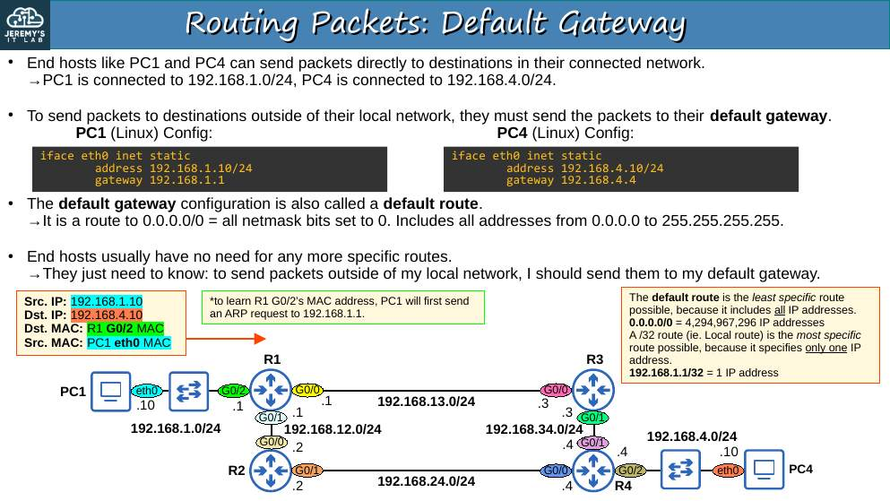<br><sub>p. 6</sub></td><td width="50%">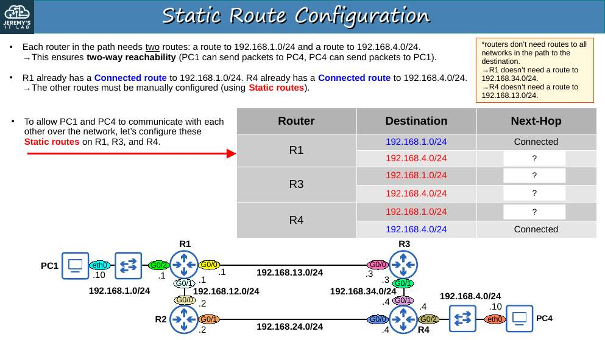<br><sub>p. 8</sub></td></tr><tr><td width="50%">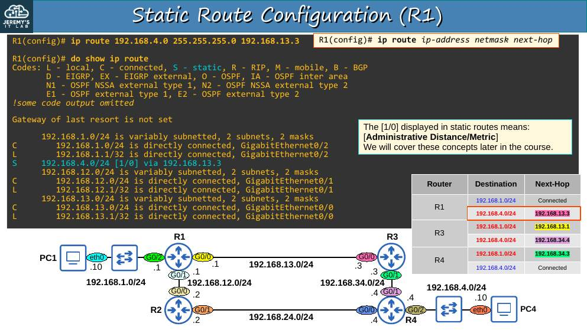<br><sub>p. 9</sub></td><td width="50%">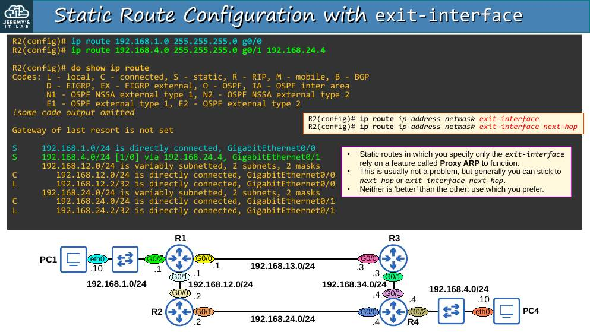<br><sub>p. 13</sub></td></tr><tr><td width="50%">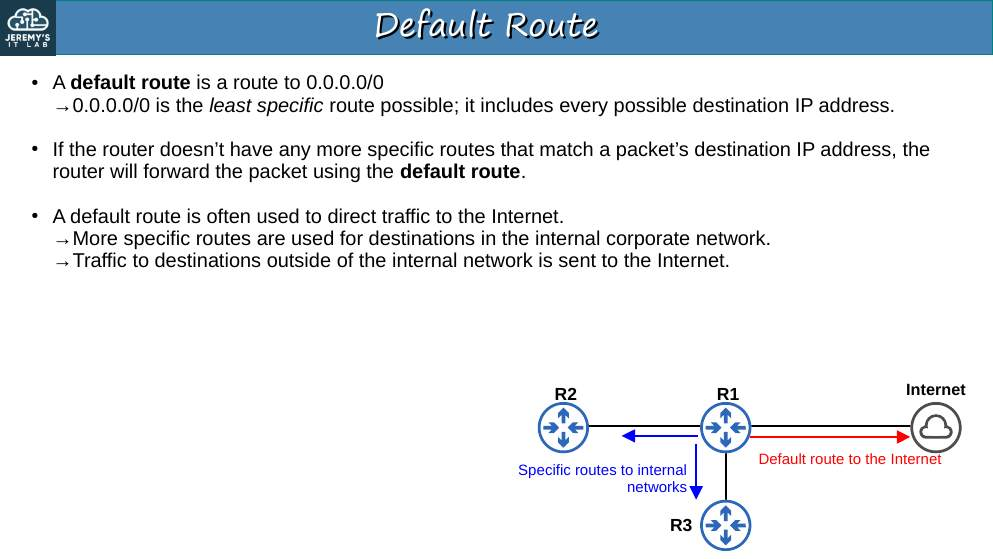<br><sub>p. 14</sub></td><td width="50%">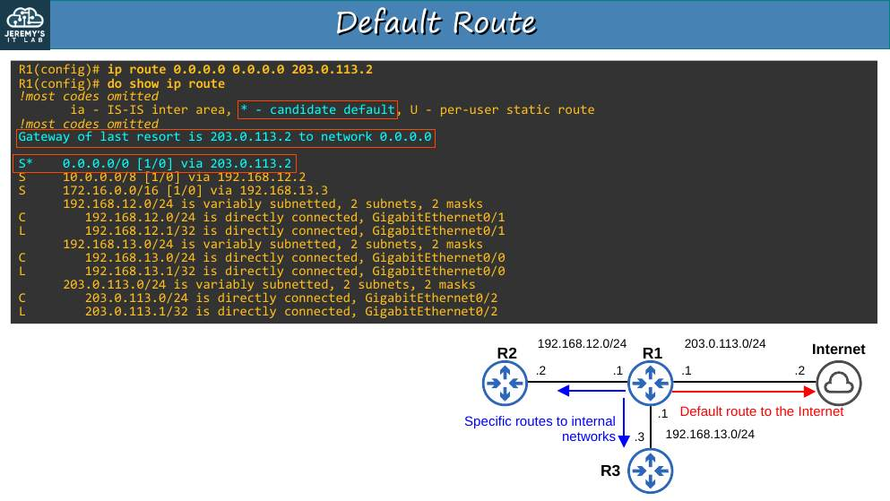<br><sub>p. 16</sub></td></tr></table>


## Apuntes

**Enrutamiento** = decidir por qué interfaz sale un paquete y a qué **siguiente salto** se envía. El router consulta su **tabla de rutas** (`show ip route`).

**Rutas que aparecen solas** al configurar `ip address` + `no shutdown`:

| Código | Tipo | Ejemplo |
|---|---|---|
| **C** | Connected: la red de la interfaz | `C 192.168.1.0/24 is directly connected, GigabitEthernet0/1` |
| **L** | Local: la **IP exacta** de la interfaz, como /32 | `L 192.168.1.254/32 is directly connected, GigabitEthernet0/1` |
| **S** | Static: configurada a mano | `S 192.168.3.0/24 [1/0] via 192.168.12.2` |
| **S\*** | Ruta estática por defecto | `S* 0.0.0.0/0 [1/0] via 203.0.113.1` |

**Coincidencia más específica (longest prefix match).** Si varias rutas coinciden con el destino, gana la de **prefijo más largo**. Ejemplo: para 192.168.1.1 coinciden `192.168.1.0/24` y `192.168.1.1/32` → gana la /32 (ruta local: el paquete es para el propio router).

**Configurar rutas estáticas:**

```
R1(config)# ip route 192.168.3.0 255.255.255.0 192.168.12.2          ← por siguiente salto
R1(config)# ip route 192.168.3.0 255.255.255.0 g0/0                  ← por interfaz de salida (ruta "connected")
R1(config)# ip route 192.168.3.0 255.255.255.0 g0/0 192.168.12.2     ← interfaz + siguiente salto
R1(config)# ip route 0.0.0.0 0.0.0.0 203.0.113.1                     ← ruta por defecto (gateway of last resort)
```

- **Las rutas son en ambas direcciones**: la ida no sirve si el destino no tiene ruta de vuelta.
- Con solo la interfaz de salida en Ethernet, el router depende de **Proxy ARP** del vecino: evítalo.
- Ruta por defecto `0.0.0.0/0` = la **menos específica**: se usa solo si nada más coincide. En `show ip route` aparece "Gateway of last resort is …".
- `[1/0]` = **[distancia administrativa / métrica]**. Estática = AD 1.

## Trampas de examen

1. La ruta **L** es /32 de la IP de la interfaz; la **C** es la red completa.
2. Ante dos rutas coincidentes, gana el **prefijo más largo**, no la AD (la AD solo compara rutas al **mismo** prefijo).
3. La ruta por defecto se escribe `0.0.0.0 0.0.0.0`.

## Laboratorio 1 · Configurar rutas estáticas


<p align="center">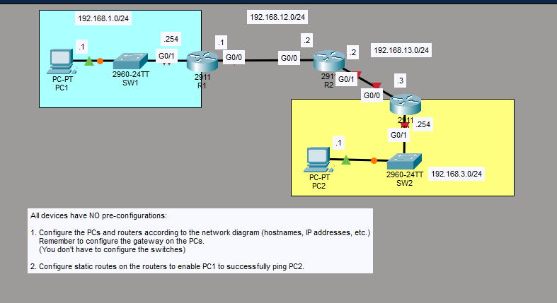<br><sub>Pantallazo del laboratorio (enunciado original de Jeremy)</sub></p>


**Topología:** PC1 (.1) – SW1 – R1 G0/1 (.254) en 192.168.1.0/24; R1 G0/0 (.1) – R2 G0/0 (.2) en 192.168.12.0/24; R2 G0/1 (.2) – R3 G0/0 (.3) en 192.168.13.0/24; R3 G0/1 (.254) – SW2 – PC2 (.1) en 192.168.3.0/24. Nada viene preconfigurado.

**Tarea 1 · Configurar PCs y routers (hostname, IP, gateway). No hace falta configurar los switches.**

```
Router(config)# hostname R1
R1(config)# interface g0/1
R1(config-if)# ip address 192.168.1.254 255.255.255.0
R1(config-if)# no shutdown
R1(config-if)# interface g0/0
R1(config-if)# ip address 192.168.12.1 255.255.255.0
R1(config-if)# no shutdown

Router(config)# hostname R2
R2(config)# interface g0/0
R2(config-if)# ip address 192.168.12.2 255.255.255.0
R2(config-if)# no shutdown
R2(config-if)# interface g0/1
R2(config-if)# ip address 192.168.13.2 255.255.255.0
R2(config-if)# no shutdown

Router(config)# hostname R3
R3(config)# interface g0/0
R3(config-if)# ip address 192.168.13.3 255.255.255.0
R3(config-if)# no shutdown
R3(config-if)# interface g0/1
R3(config-if)# ip address 192.168.3.254 255.255.255.0
R3(config-if)# no shutdown
```

PC1: 192.168.1.1/24, gateway 192.168.1.254. PC2: 192.168.3.1/24, gateway 192.168.3.254.

**Tarea 2 · Rutas estáticas para que PC1 haga ping a PC2.**

```
R1(config)# ip route 192.168.3.0 255.255.255.0 192.168.12.2
R2(config)# ip route 192.168.1.0 255.255.255.0 192.168.12.1
R2(config)# ip route 192.168.3.0 255.255.255.0 192.168.13.3
R3(config)# ip route 192.168.1.0 255.255.255.0 192.168.13.2
```

(Opcional para pings router–router: R1 → 192.168.13.0/24 vía .12.2 y R3 → 192.168.12.0/24 vía .13.2.)

**Verificación:** `show ip route static`, ping PC1 → 192.168.3.1 y `tracert 192.168.3.1` (3 saltos: .254, .12.2, .13.3).

## Laboratorio 2 · Diagnosticar rutas estáticas


<p align="center">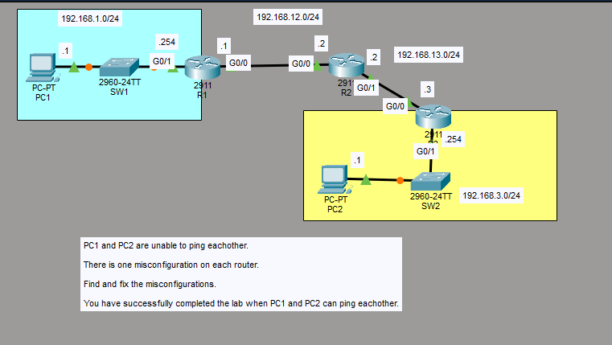<br><sub>Pantallazo del laboratorio (enunciado original de Jeremy)</sub></p>


**Enunciado:** PC1 y PC2 no se hacen ping; **hay una mala configuración en cada router** (R1, R2 y R3). El lab termina cuando PC1 y PC2 se hacen ping.

**Tarea 1 · Revisar R1.**

```
R1# show ip interface brief         ← ¿IP correctas? ¿up/up?
R1# show ip route
R1# show running-config | include ip route
```

Lo correcto en R1: G0/1 192.168.1.254/24, G0/0 192.168.12.1/24 y `ip route 192.168.3.0 255.255.255.0 192.168.12.2`.

**Tarea 2 · Revisar R2.** Correcto: G0/0 192.168.12.2, G0/1 192.168.13.2, rutas a 192.168.1.0/24 vía .12.1 y a 192.168.3.0/24 vía .13.3.

**Tarea 3 · Revisar R3.** Correcto: G0/0 192.168.13.3, G0/1 192.168.3.254, ruta a 192.168.1.0/24 vía .13.2.

**Qué buscar en cada router** (los tres errores son de este tipo):

- red de destino o máscara mal escritas (p. ej. `192.168.3.0 255.255.255.128`);
- **siguiente salto que no es un vecino directo** (p. ej. R1 apuntando a 192.168.13.3);
- IP de interfaz equivocada o interfaz en `shutdown`.

**Tarea 4 · Corregir y probar.** `no ip route <ruta mala>` → `ip route <ruta buena>` (o corrige la IP / `no shutdown`). Prueba salto a salto con `ping` y al final `tracert` desde PC1.

---

## Rómpelo y arréglalo (48 h después del lab)

| # | Rompe esto | Síntoma | Te delata | Arreglo |
|---|---|---|---|---|
| 1 | Borra en R3 la ruta a 192.168.1.0/24 | El ping PC1→PC2 falla (la ida llega, la vuelta no) | `show ip route` en R3; `tracert` desde PC2 muere en R3 | Ruta de vuelta |
| 2 | En R1 pon siguiente salto 192.168.13.3 | R1 no instala la ruta (siguiente salto no alcanzable) | `show ip route static` vacío | Siguiente salto 192.168.12.2 |
| 3 | En R2 escribe 192.168.3.0 255.255.255.128 | PC2 (.1) sí llega, pero un host .200 no | `show ip route` → /25 | Máscara /24 |

## Repaso rápido

Intenta responder antes de abrir cada pregunta.

<details><summary>Ruta C vs ruta L</summary>

C: la red conectada. L: la IP exacta de la interfaz como /32.

</details>

<details><summary>¿Qué ruta gana si coinciden 192.168.1.0/24 y 192.168.1.0/26?</summary>

La /26: gana el prefijo más largo.

</details>

<details><summary>Sintaxis de una ruta estática por siguiente salto</summary>

ip route RED MÁSCARA SIGUIENTE-SALTO

</details>

<details><summary>Sintaxis de la ruta por defecto</summary>

ip route 0.0.0.0 0.0.0.0 SIGUIENTE-SALTO

</details>

<details><summary>¿Qué significa [1/0] en una ruta?</summary>

[distancia administrativa / métrica]. Estática = AD 1.

</details>

<details><summary>Error típico con rutas estáticas en una cadena de routers</summary>

Olvidar la ruta de vuelta.

</details>


---

[⬅ Índice del curso](../../README.md)
