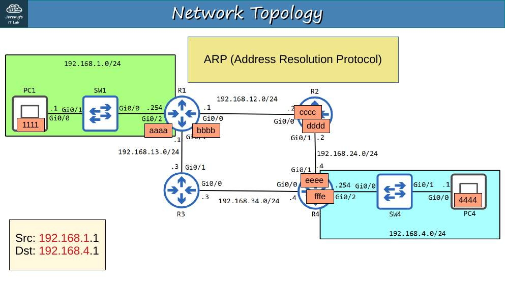
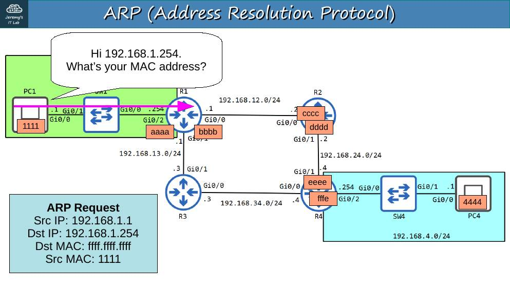
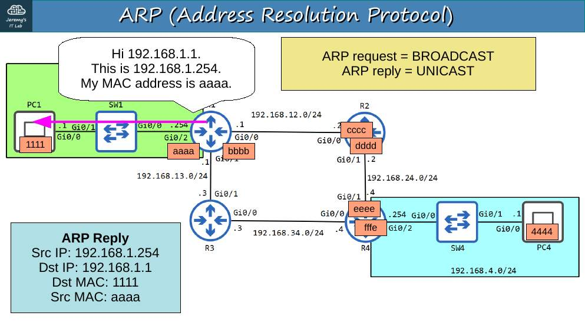
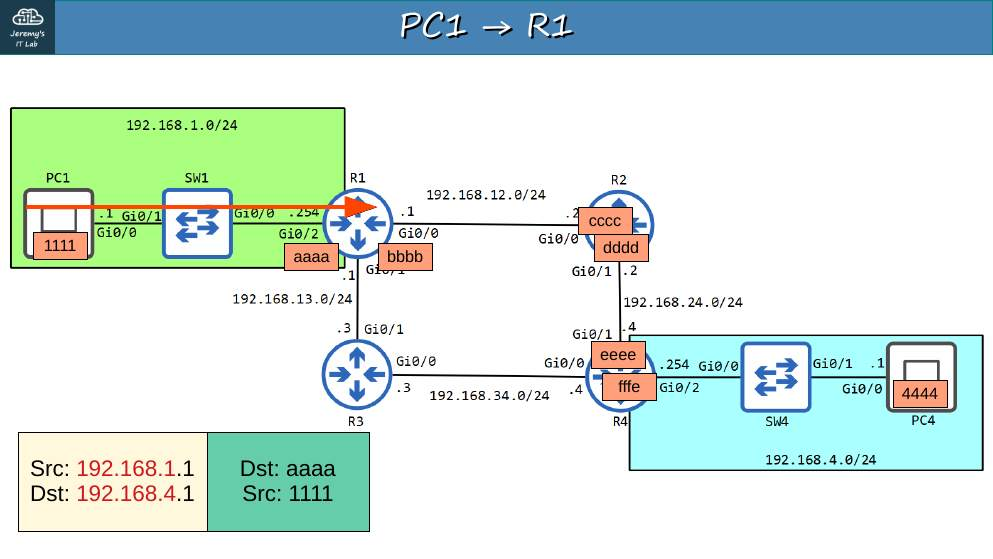
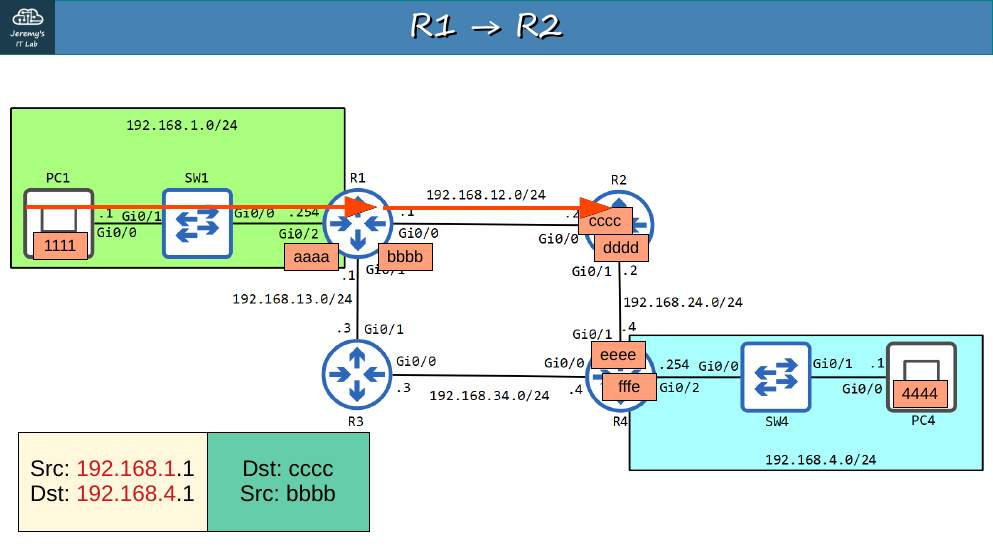
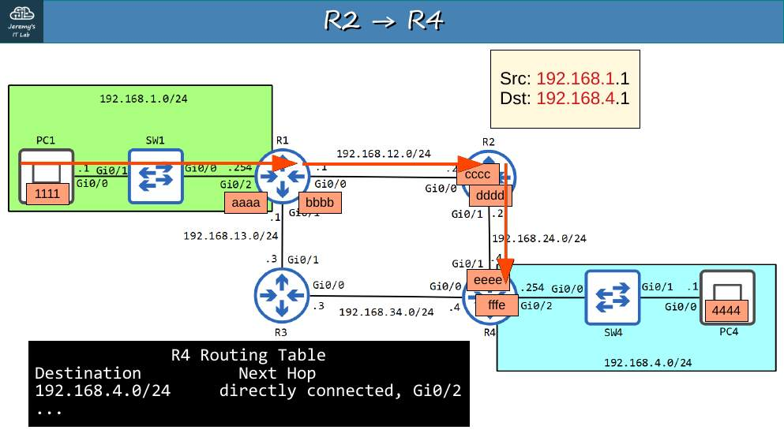
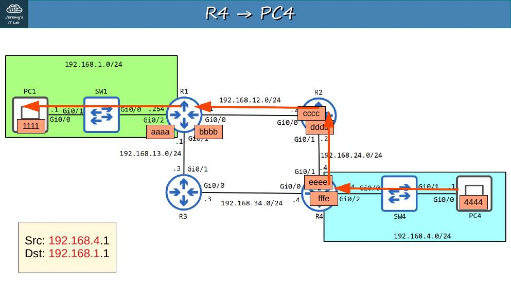
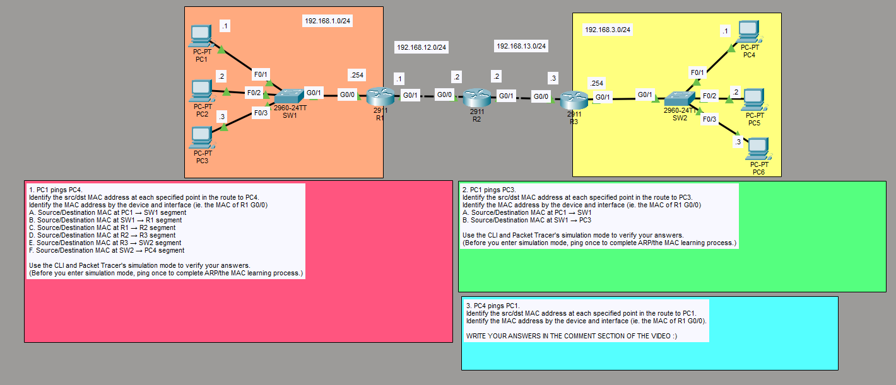

# Día 12 · La vida de un paquete

> Mis apuntes del Día 12 del curso **CCNA 200-301 de Jeremy's IT Lab**.
> Video del día: [Jeremy's IT Lab en YouTube](https://www.youtube.com/@JeremysITLab).

| | |
|---|---|
| **Estado** | ✅ Estudiado |
| **Lectura Odom 2.ª ed.** | V1 caps. 16–18 |
| **NetAcad v7** | SRWE 14–16 |
| **Lab extra** | LG 12 y LG 16 |

## Diapositivas clave de Jeremy

**Day 12 Slides - The Life of a Packet**

<table><tr><td width="50%"> p. 4</td><td width="50%"> p. 5</td></tr><tr><td width="50%"> p. 6</td><td width="50%"> p. 7</td></tr><tr><td width="50%"> p. 11</td><td width="50%"> p. 16</td></tr><tr><td width="50%"> p. 20</td></tr></table>

## Apuntes

Este día une todo lo anterior. Cuando PC1 envía un paquete a un equipo **en otra red**:

1. PC1 compara la IP de destino con su máscara → está fuera → la envía al **gateway**.
2. Si no conoce la MAC del gateway, hace **ARP** (broadcast) y recibe la respuesta (unicast).
3. Arma la trama: **MAC origen = PC1, MAC destino = gateway**; IP origen = PC1, IP destino = destino final.
4. El router recibe, quita la trama, consulta la **tabla de rutas** (prefijo más largo) y elige interfaz/siguiente salto.
5. Si no conoce la MAC del siguiente salto → ARP en ese segmento.
6. **Reescribe la trama**: MAC origen = su interfaz de salida, MAC destino = siguiente salto. Resta 1 al TTL y recalcula el checksum.
7. Se repite en cada router hasta la red de destino; el último router hace ARP por el **host final**.

> **Regla de oro:** las **IP no cambian** de extremo a extremo (sin NAT); las **MAC cambian en cada salto**. Los switches no cambian ninguna de las dos.

## Trampas de examen

1. "¿Qué MAC de destino lleva la trama que sale de PC1 hacia Internet?" → la del **gateway**.
2. El switch no reescribe MACs.
3. Cada router decrementa el TTL.

## Laboratorio · La vida de un paquete

 Pantallazo del laboratorio (enunciado original de Jeremy)

**Topología:** 192.168.1.0/24 — PC1 (.1) F0/1, PC2 (.2) F0/2, PC3 (.3) F0/3 de SW1; SW1 G0/1 – R1 G0/0 (.254). R1 G0/1 (.1) – R2 G0/0 (.2) en 192.168.12.0/24. R2 G0/1 (.2) – R3 G0/0 (.3) en 192.168.13.0/24. R3 G0/1 (.254) – SW2 G0/1; SW2 F0/1 PC4 (.1), F0/2 PC5 (.2), F0/3 PC6 (.3) en 192.168.3.0/24.

Antes de usar el modo simulación, **haz un ping** para que se complete ARP y el aprendizaje de MAC.

**Tarea 1 · PC1 hace ping a PC4: MAC de origen/destino en cada tramo.**

| Tramo | MAC origen | MAC destino |
|---|---|---|
| A. PC1 → SW1 | PC1 | R1 G0/0 |
| B. SW1 → R1 | PC1 | R1 G0/0 |
| C. R1 → R2 | R1 G0/1 | R2 G0/0 |
| D. R2 → R3 | R2 G0/1 | R3 G0/0 |
| E. R3 → SW2 | R3 G0/1 | PC4 |
| F. SW2 → PC4 | R3 G0/1 | PC4 |

**Tarea 2 · PC1 hace ping a PC3** (misma red, no interviene el router):

| Tramo | MAC origen | MAC destino |
|---|---|---|
| A. PC1 → SW1 | PC1 | PC3 |
| B. SW1 → PC3 | PC1 | PC3 |

**Tarea 3 · PC4 hace ping a PC1** (el camino inverso):

| Tramo | MAC origen | MAC destino |
|---|---|---|
| PC4 → SW2 | PC4 | R3 G0/1 |
| SW2 → R3 | PC4 | R3 G0/1 |
| R3 → R2 | R3 G0/0 | R2 G0/1 |
| R2 → R1 | R2 G0/0 | R1 G0/1 |
| R1 → SW1 | R1 G0/0 | PC1 |
| SW1 → PC1 | R1 G0/0 | PC1 |

**Ver las MAC reales:** `show interfaces g0/0 | include address` (routers), `ipconfig /all` (PC), y en simulación la pestaña *Inbound/Outbound PDU Details*.

---

## Rómpelo y arréglalo (48 h después del lab)

| # | Rompe esto | Síntoma | Te delata | Arreglo |
|---|---|---|---|---|
| 1 | Quita el gateway de PC1 | PC1 → PC3 funciona; PC1 → PC4 no | `ipconfig`; en simulación no aparece ARP al router | Gateway .254 |
| 2 | Borra en R2 la ruta a 192.168.3.0/24 | PC1 → PC4 muere en R2 (*Destination host unreachable*) | `tracert` desde PC1; `show ip route` en R2 | Ruta vía 192.168.13.3 |
| 3 | Cambia R3 G0/1 a 192.168.3.253 | PC4 no sale de su red | `show ip int brief` vs gateway de PC4 | IP .254 |

## Repaso rápido

Intenta responder antes de abrir cada pregunta.

En cada salto, ¿qué cambia: IP o MAC?

Cambian las MAC (origen = interfaz que envía, destino = siguiente salto). Las IP no (sin NAT).

¿Qué MAC de destino lleva la trama que sale de un PC hacia otra red?

La del gateway.

¿El switch reescribe direcciones?

No: no cambia MAC ni IP.

---

[⬅ Índice del curso](../../README.md)
