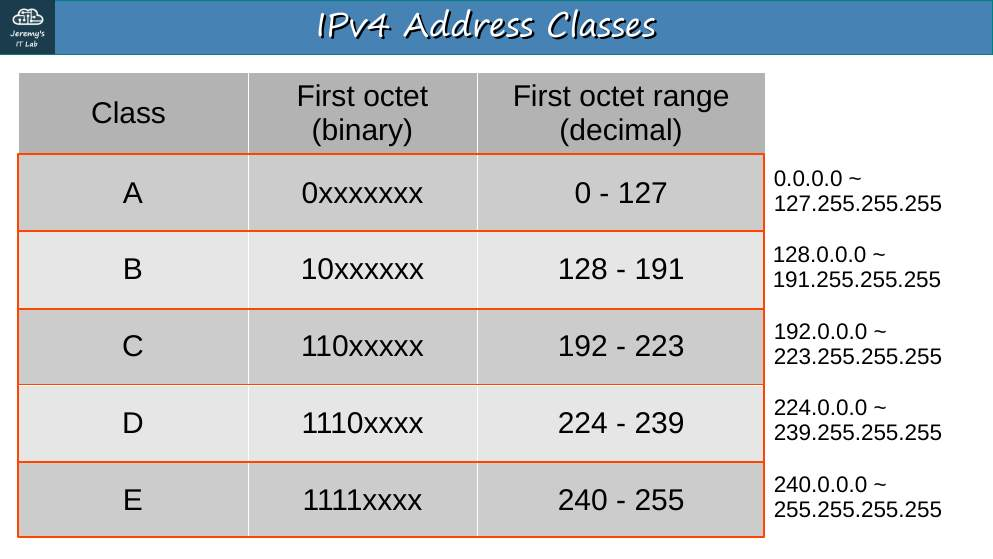
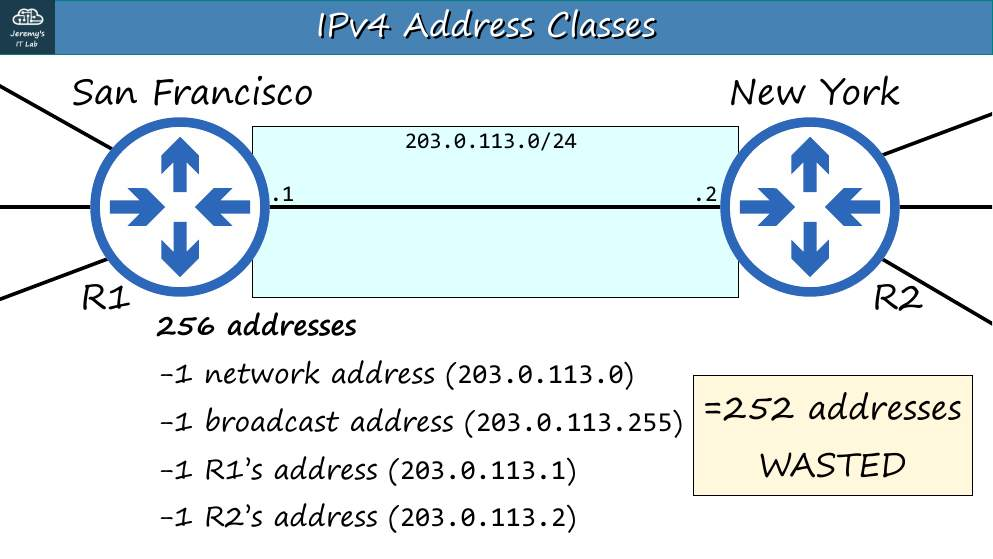
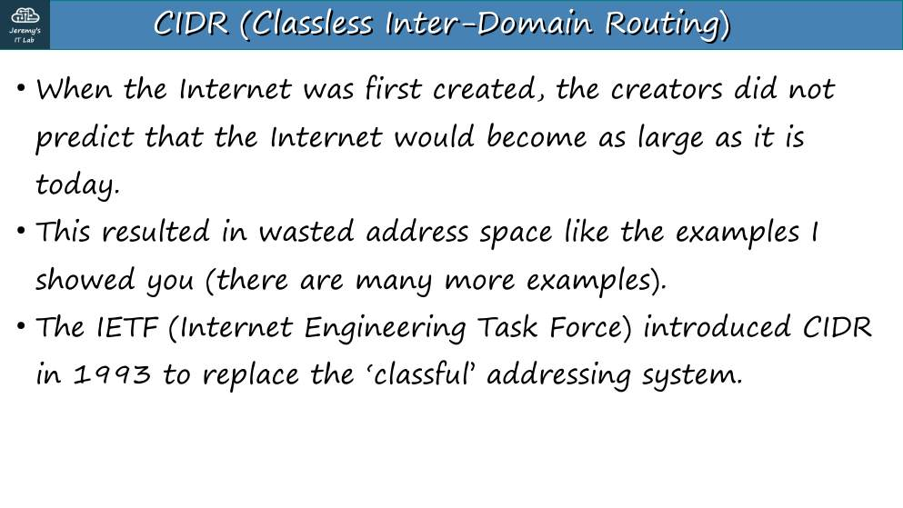
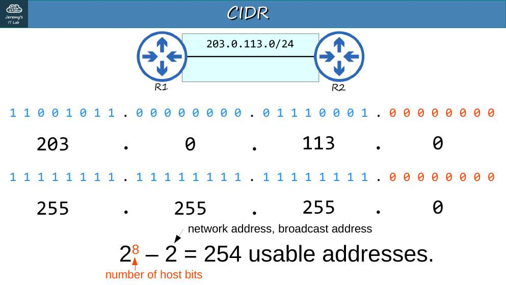
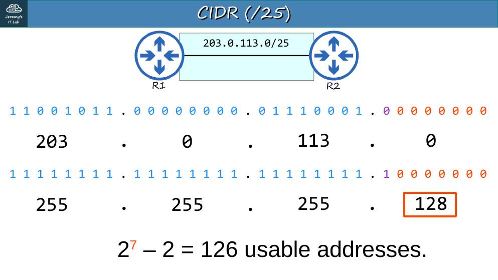
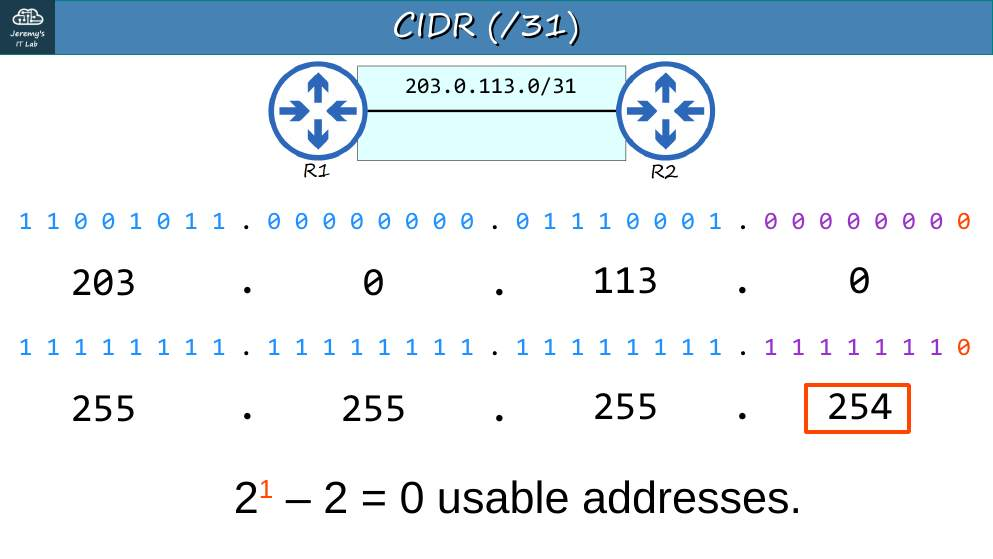
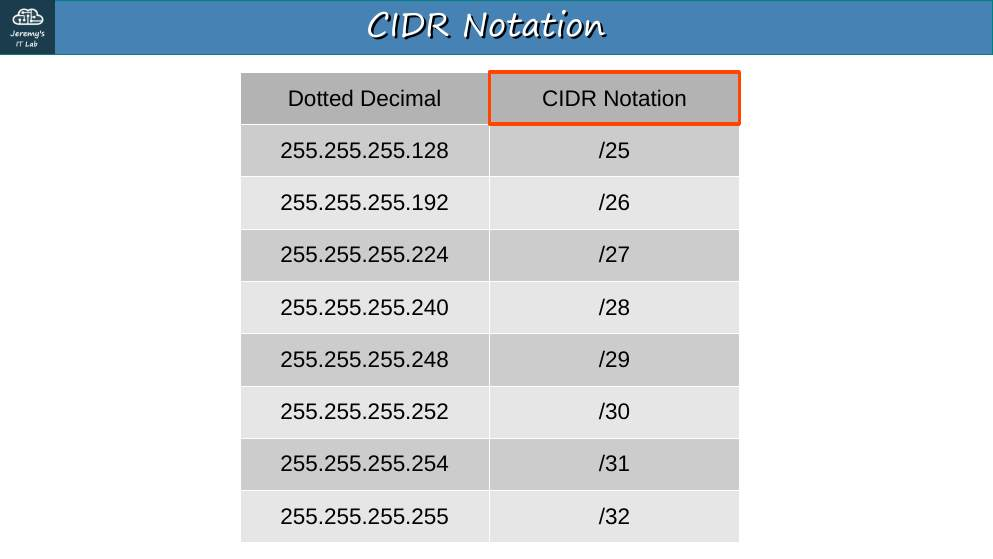
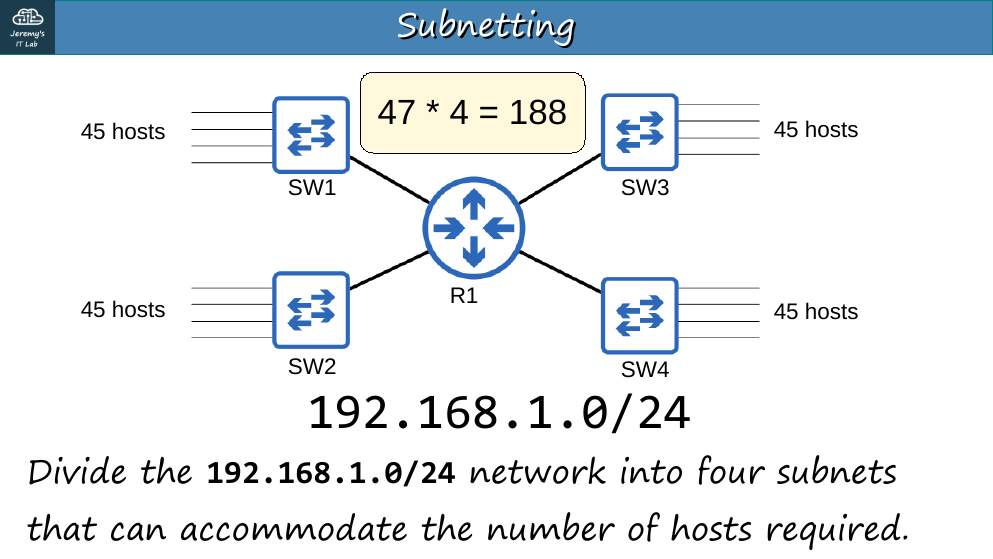
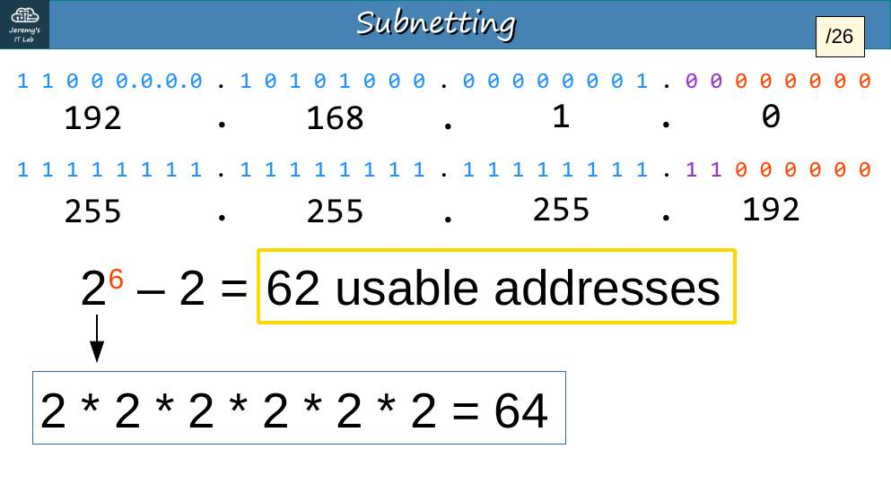

# Día 13 · Subnetting (parte 1)

> Mis apuntes del Día 13 del curso **CCNA 200-301 de Jeremy's IT Lab**.
> Video del día: [Jeremy's IT Lab en YouTube](https://www.youtube.com/@JeremysITLab).

| | |
|---|---|
| **Estado** | ✅ Estudiado |
| **Lectura Odom 2.ª ed.** | V1 caps. 3, 11–12; V1 caps. 11–15 |
| **NetAcad v7** | ITN 5, 8, 11; ITN 11 |
| **Lab extra** | ITN 11: actividades de direccionamiento; Apéndices de práctica del Odom + sprint de la app |

## Diapositivas clave de Jeremy

**Day 13 Slides - Subnetting (Part 1)**

<table><tr><td width="50%"> p. 3</td><td width="50%"> p. 8</td></tr><tr><td width="50%"> p. 10</td><td width="50%"> p. 12</td></tr><tr><td width="50%"> p. 14</td><td width="50%"> p. 19</td></tr><tr><td width="50%"> p. 21</td><td width="50%"> p. 24</td></tr><tr><td width="50%"> p. 26</td><td width="50%"> p. 31</td></tr></table>

## Apuntes

**¿Por qué dividir en subredes?** Las clases desperdician direcciones: un enlace punto a punto con una /24 usa 2 de 254 IP. Con **CIDR** (*Classless Inter-Domain Routing*) cualquier prefijo es válido.

**Método del salto (*block size*):**

1. Busca el **octeto interesante** (donde la máscara no es 255 ni 0).
2. **Salto = 256 − valor de la máscara en ese octeto.**
3. Red = múltiplo del salto ≤ valor del octeto. Broadcast = red siguiente − 1.

| Prefijo | Máscara | Salto | Subredes en una /24 | Hosts |
|---|---|---|---|---|
| /25 | 255.255.255.128 | 128 | 2 | 126 |
| /26 | .192 | 64 | 4 | 62 |
| /27 | .224 | 32 | 8 | 30 |
| /28 | .240 | 16 | 16 | 14 |
| /29 | .248 | 8 | 32 | 6 |
| /30 | .252 | 4 | 64 | 2 |
| /31 | .254 | 2 | 128 | 2 (punto a punto, RFC 3021, sin red ni broadcast) |
| /32 | .255 | 1 | 256 | 1 (ruta a un host) |

**Ejemplo resuelto 1.** Dividir 192.168.255.0/24 en 5 subredes iguales: 2² = 4 no alcanza → 3 bits (8 subredes) → **/27**, salto 32: .0, .32, .64 (broadcast **.95**), .96, .128, .160, .192, .224 (broadcast **.255**).

**Ejemplo resuelto 2.** ¿Red de 192.168.5.57/27? Salto 32 → múltiplo ≤ 57 = **32** → red 192.168.5.32, broadcast .63, hosts .33–.62.

**Ejemplo resuelto 3.** ¿Red de 192.168.29.219/29? Salto 8 → **216** → red .216, broadcast .223.

**Ejemplo resuelto 4.** ¿Primer host de 192.168.3.147/26? Salto 64 → red .128 → **primer host .129**, último .190, broadcast .191.

## Trampas de examen

1. **/31** tiene 2 direcciones utilizables (excepción a 2^h − 2).
2. "Necesito 5 subredes" → 3 bits, no 2.
3. Contar hosts: 2^h − **2** (red y broadcast).

*(Este día no tiene laboratorio. Usa el sprint de subnetting de tu app 10 minutos.)*

---

## Repaso rápido

Intenta responder antes de abrir cada pregunta.

Salto (block size) de una /27, /28 y /29

32, 16 y 8.

Red y broadcast de 192.168.5.57/27

Red .32, broadcast .63.

Primer host de 192.168.3.147/26

192.168.3.129 (red .128).

¿Cuántas direcciones utilizables tiene una /31?

2 (enlaces punto a punto, RFC 3021).

Para 5 subredes iguales de una /24, ¿qué prefijo?

/27 (3 bits = 8 subredes).

---

[⬅ Índice del curso](../../README.md)
