# Día 14 · Subnetting (parte 2): clases B y A

> Mis apuntes del Día 14 del curso **CCNA 200-301 de Jeremy's IT Lab**.
> Video del día: [Jeremy's IT Lab en YouTube](https://www.youtube.com/@JeremysITLab).

| | |
|---|---|
| **Estado** | ✅ Estudiado |
| **Lectura Odom 2.ª ed.** | V1 caps. 11–15 |
| **NetAcad v7** | ITN 11 |
| **Lab extra** | Apéndices de práctica del Odom + sprint de la app |

## Diapositivas clave de Jeremy

**Day 14 Slides - Subnetting (Part 2)**

<table><tr><td width="50%">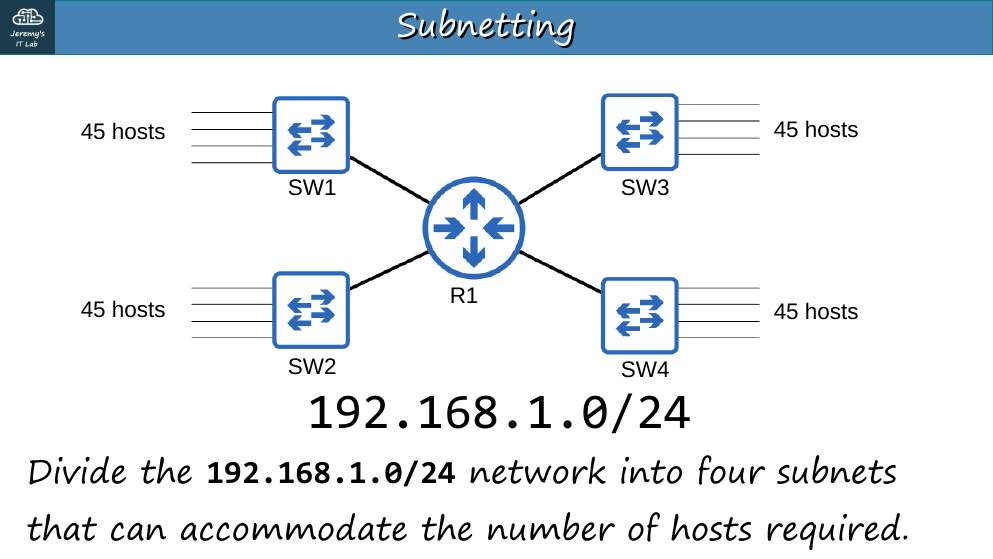 p. 3</td><td width="50%">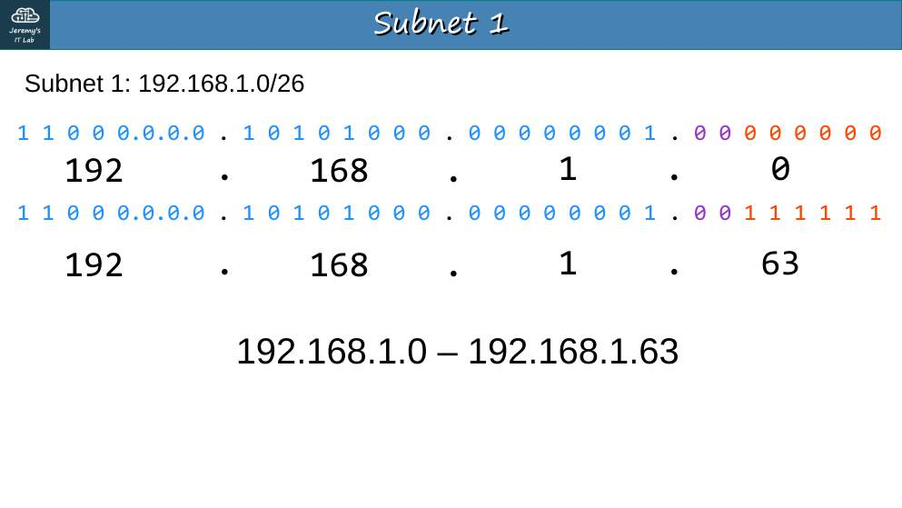 p. 5</td></tr><tr><td width="50%">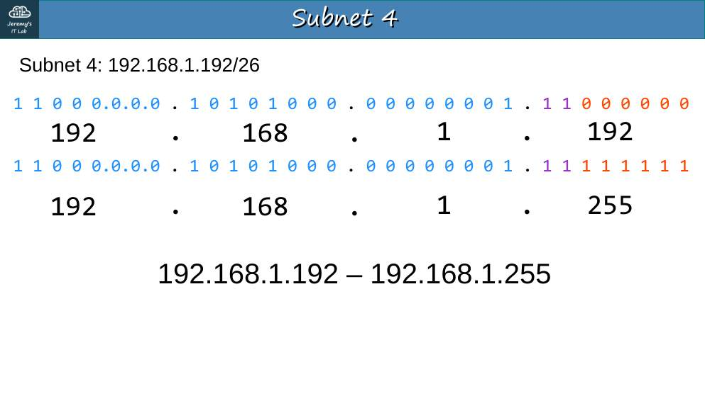 p. 8</td><td width="50%">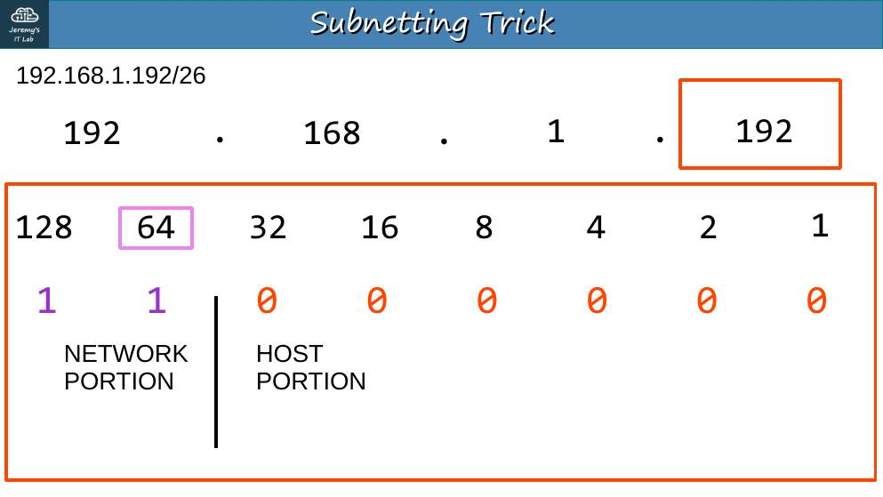 p. 14</td></tr><tr><td width="50%">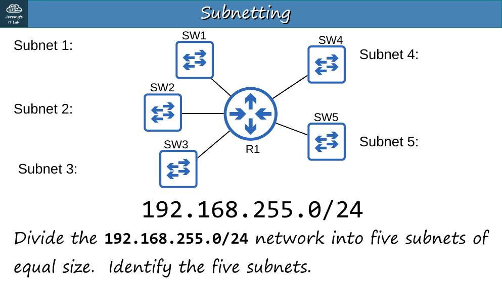 p. 16</td><td width="50%">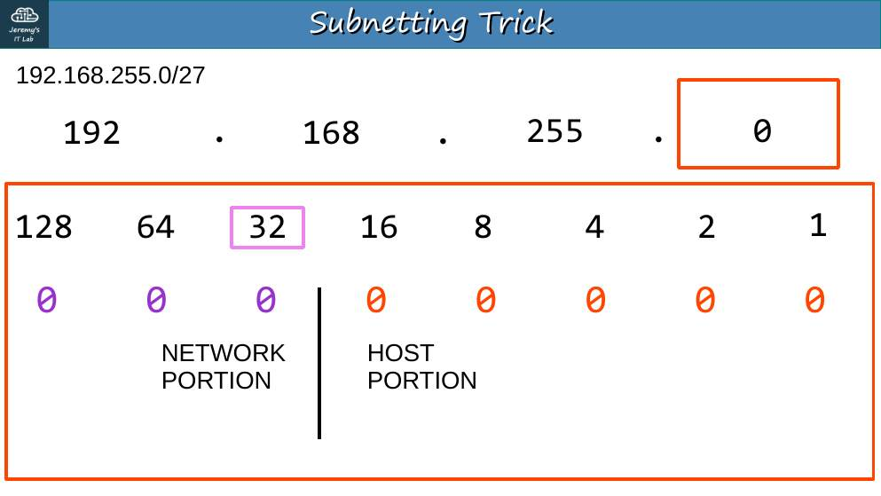 p. 22</td></tr><tr><td width="50%">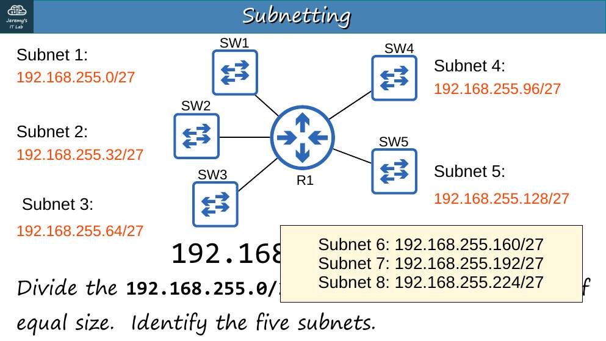 p. 23</td><td width="50%">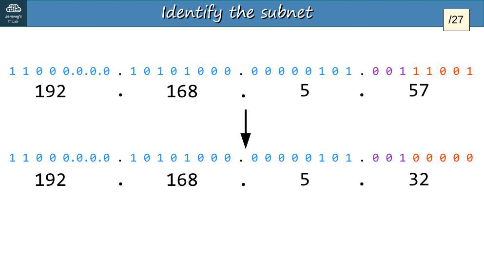 p. 26</td></tr><tr><td width="50%">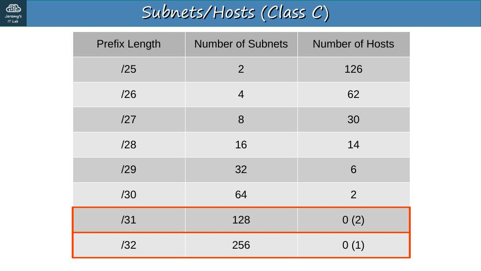 p. 32</td><td width="50%">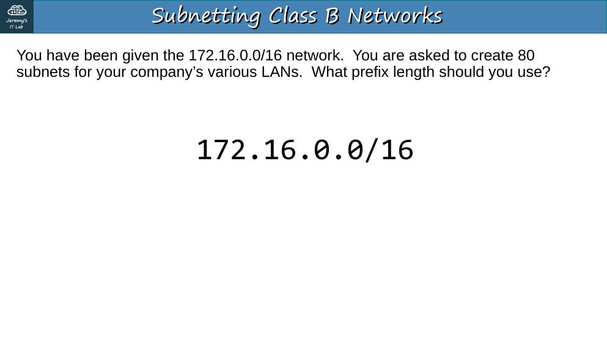 p. 34</td></tr><tr><td width="50%">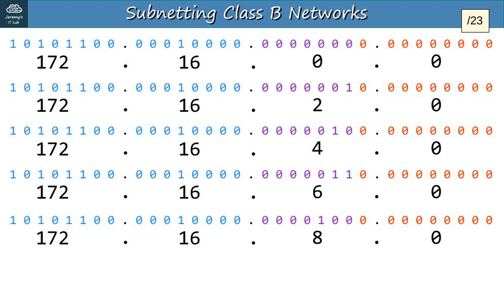 p. 43</td><td width="50%">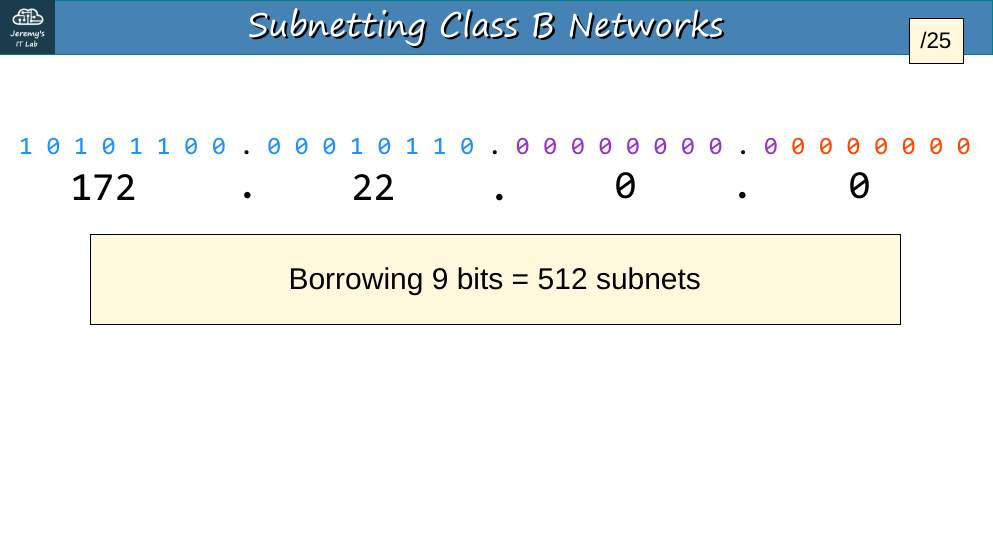 p. 45</td></tr><tr><td width="50%">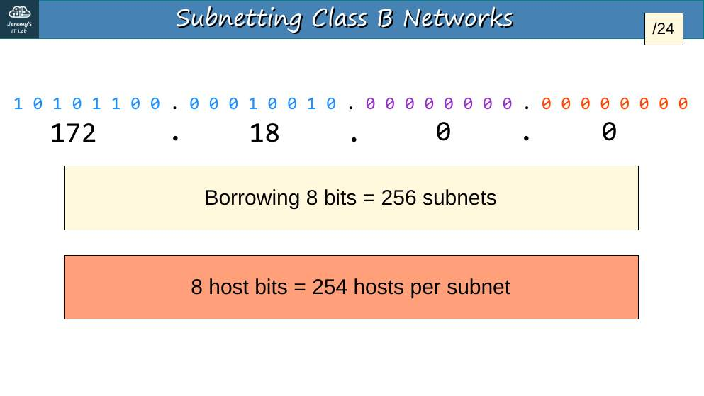 p. 47</td><td width="50%">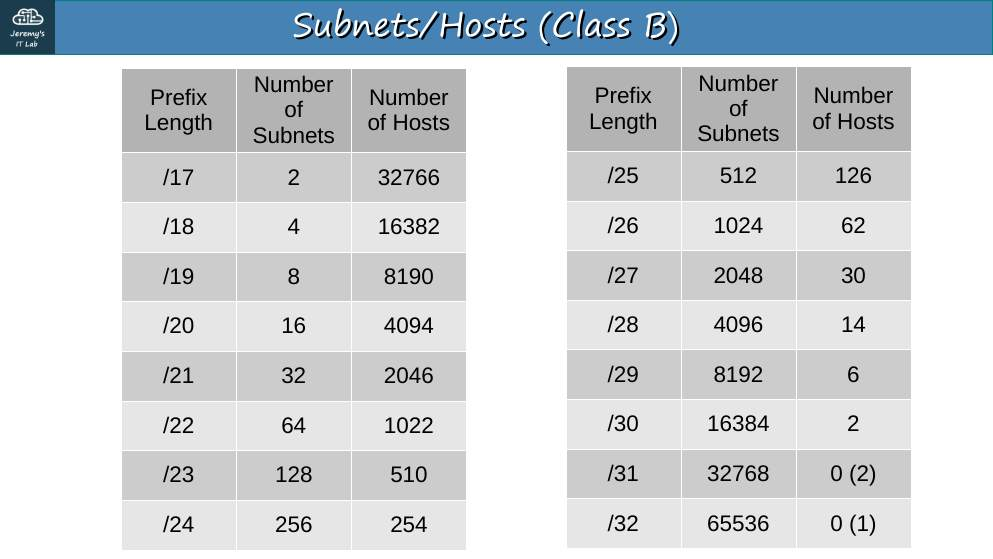 p. 51</td></tr></table>

## Apuntes

El método es el mismo, pero el octeto interesante puede ser el **tercero** (prefijos /17–/23) o el **segundo** (/9–/15).

**Ejemplo 1 · 172.21.111.201/20.** Máscara 255.255.**240**.0 → salto 16 en el 3.er octeto → múltiplo ≤ 111 = **96** → red **172.21.96.0/20**, broadcast **172.21.111.255**, hosts 172.21.96.1 – 172.21.111.254 (2¹²−2 = 4094).

**Ejemplo 2 · 250 subredes a partir de 172.18.0.0/16.** 2⁸ = 256 ≥ 250 → 8 bits → **/24** (254 hosts). *(Variante: si fueran 500 subredes → 9 bits → /25, 126 hosts.)*

**Ejemplo 3 · 172.16.0.0/16 en 4 subredes; ¿cuál es la segunda?** 2 bits → /18 (255.255.192.0), salto 64 → segunda subred **172.16.64.0 – 172.16.127.255** (16 382 hosts).

**Ejemplo 4 · Subredes de 1000 hosts en 172.30.0.0/16.** 2¹⁰−2 = 1022 → 10 bits de host → **/22** → quedan 6 bits de subred = **64 subredes**.

**Ejemplo 5 · Clase A: 10.217.182.223/11.** Máscara 255.**224**.0.0 → salto 32 en el 2.º octeto → **192** → red **10.192.0.0**, broadcast **10.223.255.255**, primer host 10.192.0.1, último **10.223.255.254**, hosts 2²¹−2 = 2 097 150.

**Diseño "necesito X":**

| Pide | Cálculo | Respuesta |
|---|---|---|
| 10 subredes de hasta 3800 hosts (de un /16) | 2¹²−2 = 4094 | **/20** |
| 3500 subredes de hasta 9 hosts | 12 bits de subred, 4 de host (14) | **/28** |
| 80 subredes de hasta 300 hosts | 9 bits de host (510), 7 de subred (128) | **/23** |

## Trampas de examen

1. En /17–/23 el **cuarto octeto** del broadcast es 255 y el de la red es 0.
2. No confundas "bits de subred" (para contar subredes) con "bits de host".
3. Revisa si piden subredes **o** hosts: la respuesta cambia de dirección.

*(Este día no tiene laboratorio.)*

---

## Repaso rápido

Intenta responder antes de abrir cada pregunta.

Red de 172.21.111.201/20

172.21.96.0/20; broadcast 172.21.111.255.

Prefijo para subredes de 1000 hosts

/22 (1022 hosts).

Broadcast de 10.217.182.223/11

10.223.255.255 (red 10.192.0.0).

Máscara de un /20 en decimal

255.255.240.0.

---

[⬅ Índice del curso](../../README.md)
