# Día 15 · Subnetting (parte 3): VLSM

> Mis apuntes del Día 15 del curso **CCNA 200-301 de Jeremy's IT Lab**.
> Video del día: [Jeremy's IT Lab en YouTube](https://www.youtube.com/@JeremysITLab).

| | |
|---|---|
| **Estado** | ✅ Estudiado |
| **Lectura Odom 2.ª ed.** | V1 caps. 11–15 |
| **NetAcad v7** | ITN 11 |
| **Lab extra** | Apéndices de práctica del Odom + sprint de la app |

## Diapositivas clave de Jeremy

**Day 15 Slides - Subnetting (Part 3)**

<table><tr><td width="50%">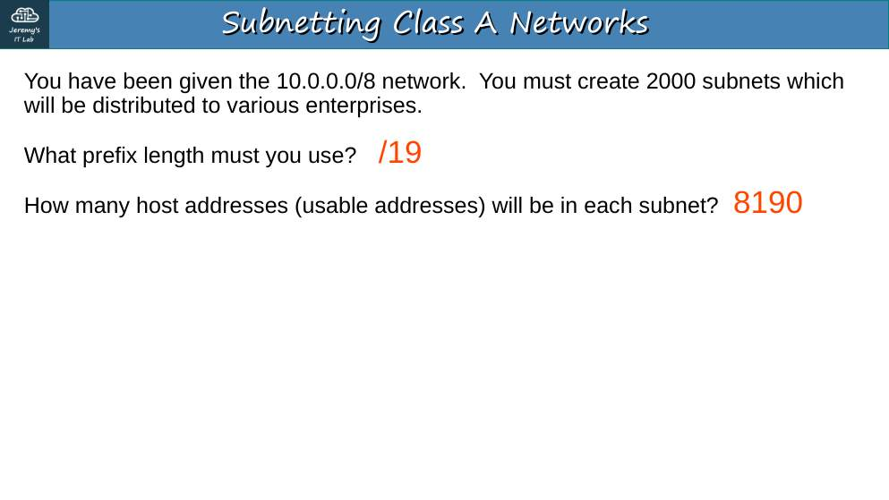<br><sub>p. 21</sub></td><td width="50%">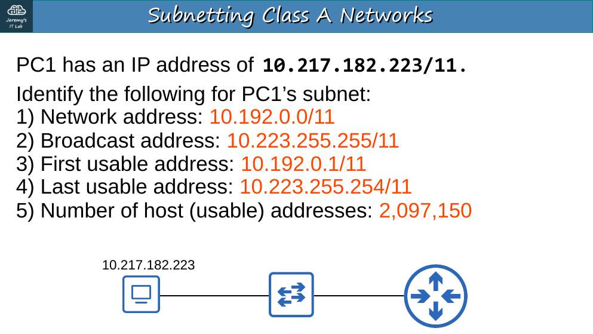<br><sub>p. 29</sub></td></tr><tr><td width="50%">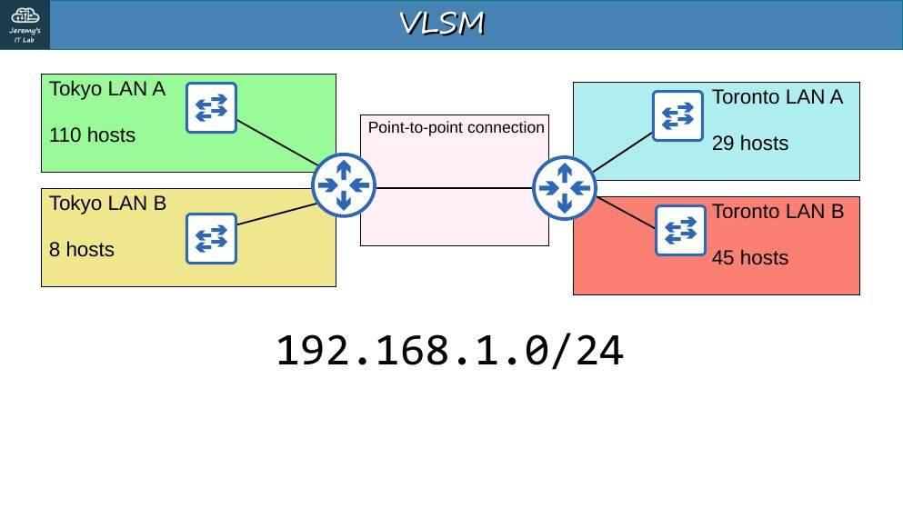<br><sub>p. 31</sub></td><td width="50%">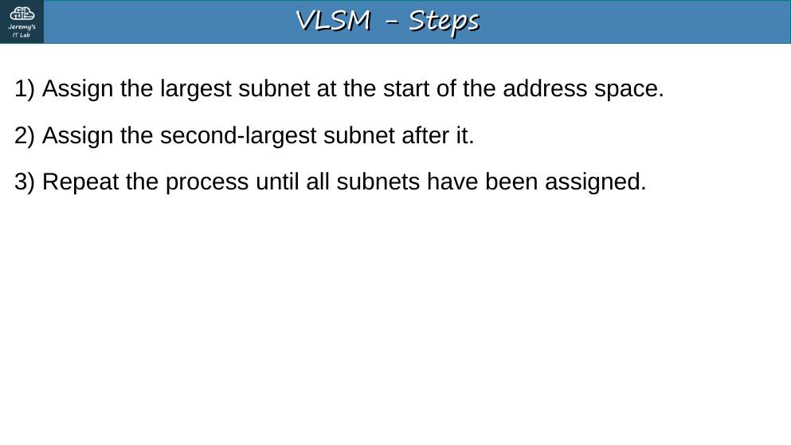<br><sub>p. 32</sub></td></tr><tr><td width="50%">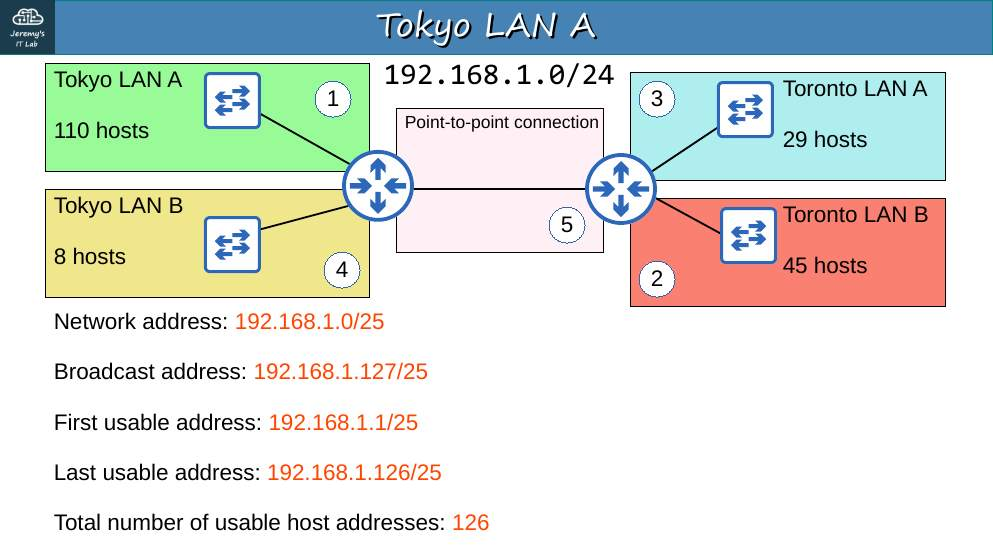<br><sub>p. 36</sub></td><td width="50%">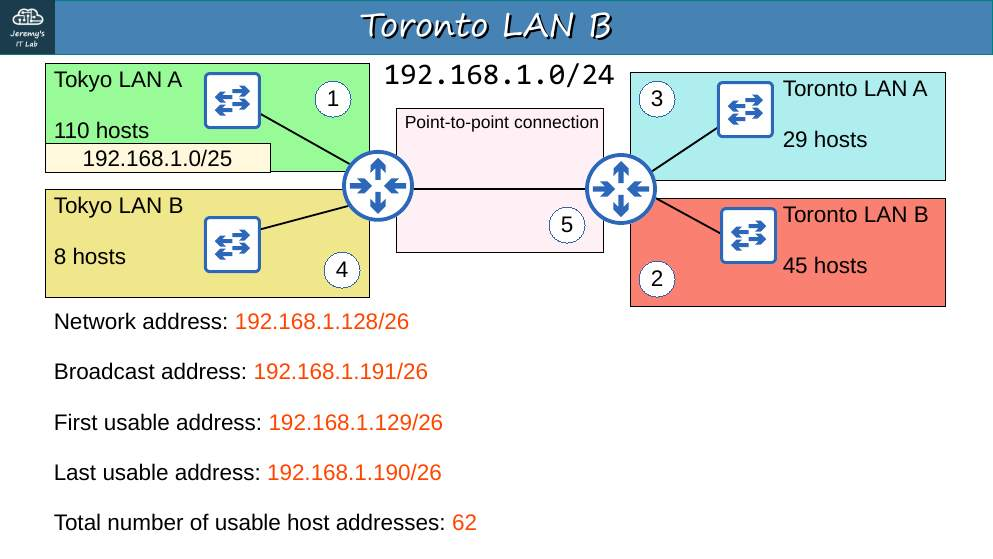<br><sub>p. 40</sub></td></tr><tr><td width="50%">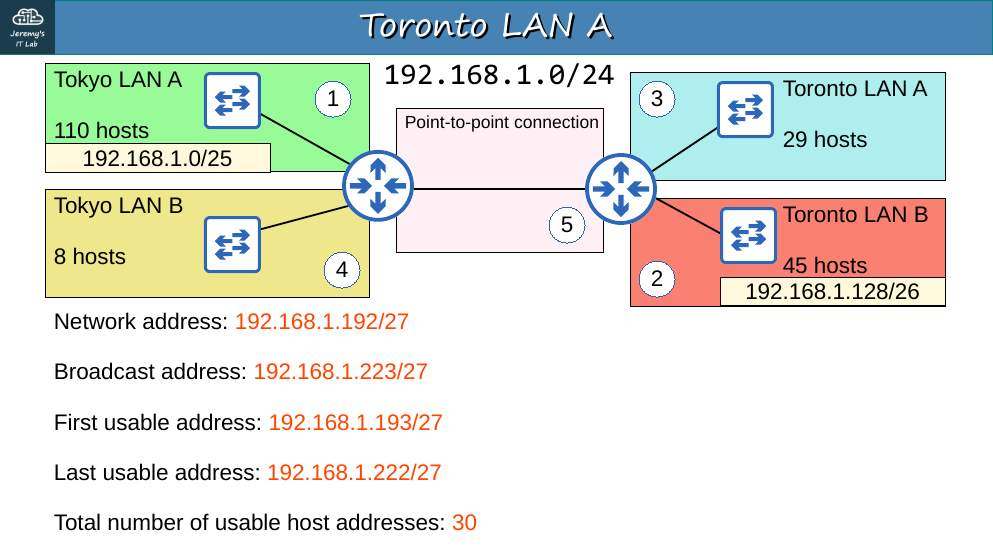<br><sub>p. 44</sub></td><td width="50%">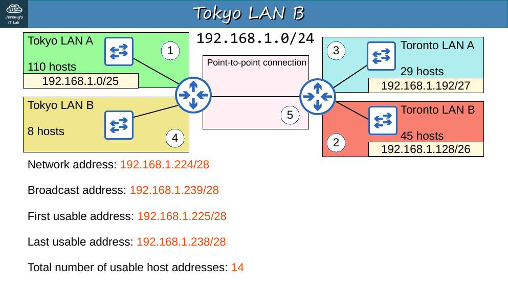<br><sub>p. 48</sub></td></tr><tr><td width="50%">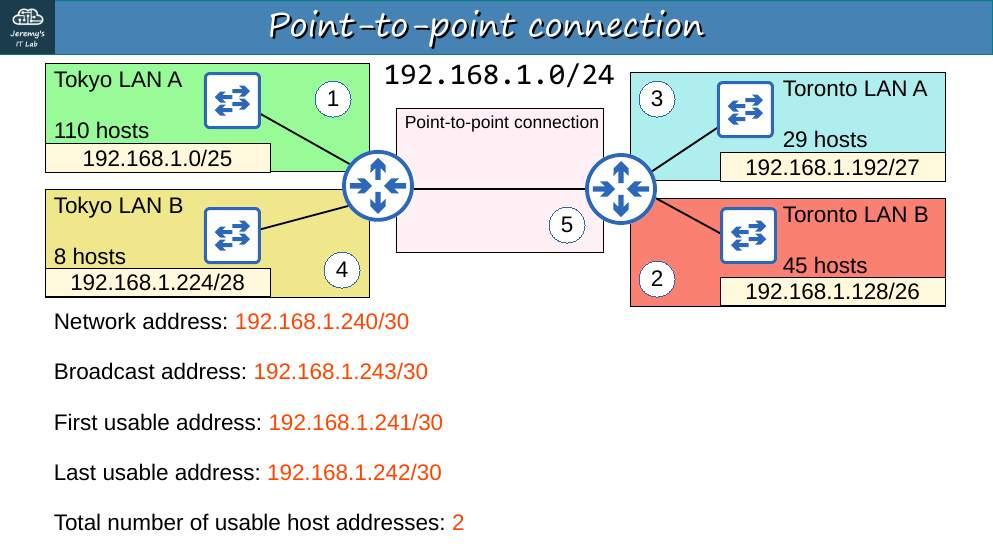<br><sub>p. 52</sub></td><td width="50%">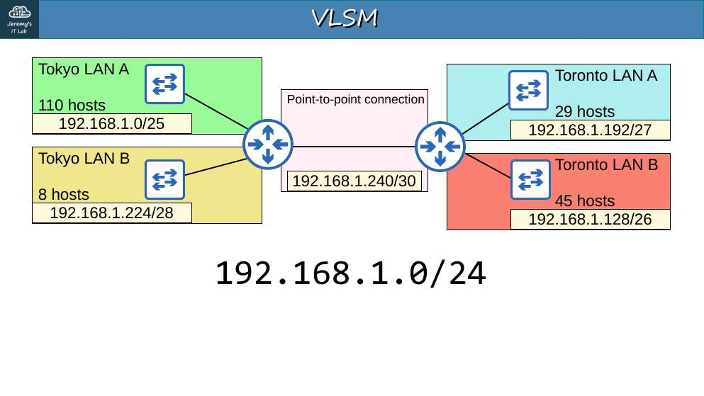<br><sub>p. 53</sub></td></tr></table>


## Apuntes

**VLSM (Variable-Length Subnet Masks):** cada subred usa la máscara que necesita. Reglas:

1. Ordena las LAN de **mayor a menor** número de hosts.
2. Asigna la más grande al **principio** del espacio libre; la siguiente justo después, etc.
3. Para cada una, el menor prefijo cuyo 2^h − 2 ≥ hosts.
4. Comprueba que **no se solapen**.

**Ejemplo resuelto de las diapositivas (192.168.1.0/24):**

| Orden | LAN | Hosts | Prefijo | Red | Rango útil | Broadcast |
|---|---|---|---|---|---|---|
| 1 | Tokyo LAN A | 110 | /25 | 192.168.1.0 | .1 – .126 | .127 |
| 2 | Toronto LAN B | 45 | /26 | 192.168.1.128 | .129 – .190 | .191 |
| 3 | Toronto LAN A | 29 | /27 | 192.168.1.192 | .193 – .222 | .223 |
| 4 | Tokyo LAN B | 8 | /28 | 192.168.1.224 | .225 – .238 | .239 |
| 5 | Enlace punto a punto | 2 | /30 | 192.168.1.240 | .241 – .242 | .243 |

Ojo: 8 hosts **no** caben en /29 (solo 6). 29 hosts sí caben en /27 (30).

## Trampas de examen

1. Siempre de **mayor a menor**; si no, quedan huecos y solapes.
2. 64 hosts **no** caben en /26 (62).
3. Un enlace punto a punto = /30 (o /31).

## Laboratorio · VLSM


<p align="center">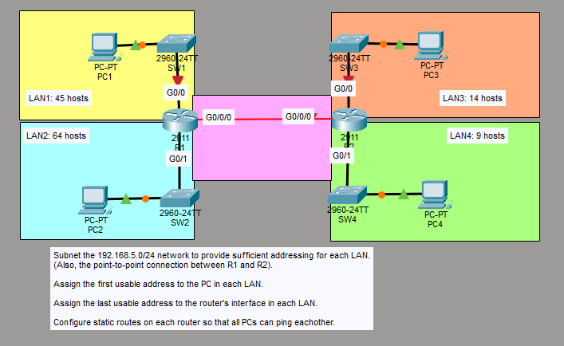<br><sub>Pantallazo del laboratorio (enunciado original de Jeremy)</sub></p>


**Enunciado:**

1. Divide **192.168.5.0/24** para dar direcciones suficientes a cada LAN y al enlace R1–R2.
2. Asigna la **primera** dirección utilizable al **PC** de cada LAN.
3. Asigna la **última** dirección utilizable a la **interfaz del router** en cada LAN.
4. Configura **rutas estáticas** para que todos los PC se hagan ping.

**Tarea 1 · Diseño VLSM** (LAN2 64 hosts, LAN1 45, LAN3 14, LAN4 9, enlace 2):

| LAN | Hosts | Red | Primer host | Último host | Broadcast |
|---|---|---|---|---|---|
| LAN2 (R1 G0/1) | 64 | **192.168.5.0/25** | .1 | .126 | .127 |
| LAN1 (R1 G0/0) | 45 | **192.168.5.128/26** | .129 | .190 | .191 |
| LAN3 (R2 G0/0) | 14 | **192.168.5.192/28** | .193 | .206 | .207 |
| LAN4 (R2 G0/1) | 9 | **192.168.5.208/28** | .209 | .222 | .223 |
| R1–R2 (G0/0/0) | 2 | **192.168.5.224/30** | .225 (R1) | .226 (R2) | .227 |

**Tarea 2 · Primera IP utilizable en los PC:** PC2 192.168.5.1/25 (gw .126); PC1 .129/26 (gw .190); PC3 .193/28 (gw .206); PC4 .209/28 (gw .222).

**Tarea 3 · Última IP utilizable en los routers:**

```
R1(config)# interface g0/1
R1(config-if)# ip address 192.168.5.126 255.255.255.128
R1(config-if)# no shutdown
R1(config-if)# interface g0/0
R1(config-if)# ip address 192.168.5.190 255.255.255.192
R1(config-if)# no shutdown
R1(config-if)# interface g0/0/0
R1(config-if)# ip address 192.168.5.225 255.255.255.252
R1(config-if)# no shutdown

R2(config)# interface g0/0
R2(config-if)# ip address 192.168.5.206 255.255.255.240
R2(config-if)# no shutdown
R2(config-if)# interface g0/1
R2(config-if)# ip address 192.168.5.222 255.255.255.240
R2(config-if)# no shutdown
R2(config-if)# interface g0/0/0
R2(config-if)# ip address 192.168.5.226 255.255.255.252
R2(config-if)# no shutdown
```

**Tarea 4 · Rutas estáticas.**

```
R1(config)# ip route 192.168.5.192 255.255.255.240 192.168.5.226
R1(config)# ip route 192.168.5.208 255.255.255.240 192.168.5.226
R2(config)# ip route 192.168.5.0 255.255.255.128 192.168.5.225
R2(config)# ip route 192.168.5.128 255.255.255.192 192.168.5.225
```

*(Resumen opcional: en R1 basta `ip route 192.168.5.192 255.255.255.224 192.168.5.226`, porque .192/28 + .208/28 = .192/27.)*

**Verificación:** los 4 PC se hacen ping; `show ip route` en ambos routers.

## Rómpelo y arréglalo (48 h después del lab)

| # | Rompe esto | Síntoma | Te delata | Arreglo |
|---|---|---|---|---|
| 1 | Pon LAN2 en /26 (192.168.5.0/26) | Solo caben 62 hosts; PC con IP > .62 fuera de red | Cálculo: 64 hosts no caben | /25 |
| 2 | Borra en R2 la ruta a 192.168.5.128/26 | PC3/PC4 llegan a PC2 pero no a PC1 | `show ip route` en R2; `tracert` desde PC3 | Ruta a .128/26 vía .225 |
| 3 | Solapa LAN3 (192.168.5.192/27) con LAN4 | R2 rechaza la IP: *overlaps with G0/0* | Mensaje de IOS | Respetar los rangos |

---

## Repaso rápido

Intenta responder antes de abrir cada pregunta.

<details><summary>Regla de oro del VLSM</summary>

Asignar de la subred más grande a la más pequeña, sin solaparse.

</details>

<details><summary>¿Caben 64 hosts en una /26?</summary>

No: una /26 da 62. Hace falta /25.

</details>

<details><summary>¿Qué prefijo para un enlace punto a punto?</summary>

/30 (o /31).

</details>

<details><summary>¿Caben 8 hosts en una /29?</summary>

No: /29 da 6. Hace falta /28.

</details>


---

[⬅ Índice del curso](../../README.md)
