# Día 16 · VLAN (parte 1)

> Mis apuntes del Día 16 del curso **CCNA 200-301 de Jeremy's IT Lab**.
> Video del día: [Jeremy's IT Lab en YouTube](https://www.youtube.com/@JeremysITLab).

| | |
|---|---|
| **Estado** | ✅ Estudiado |
| **Lectura Odom 2.ª ed.** | V1 cap. 8 (+18 inter-VLAN) |
| **NetAcad v7** | SRWE 3–4 |
| **Lab extra** | LG 22-1 VLAN and Inter-VLAN |

## Diapositivas clave de Jeremy

**Day 16 Slides - VLANs (Part 1)**

<table><tr><td width="50%">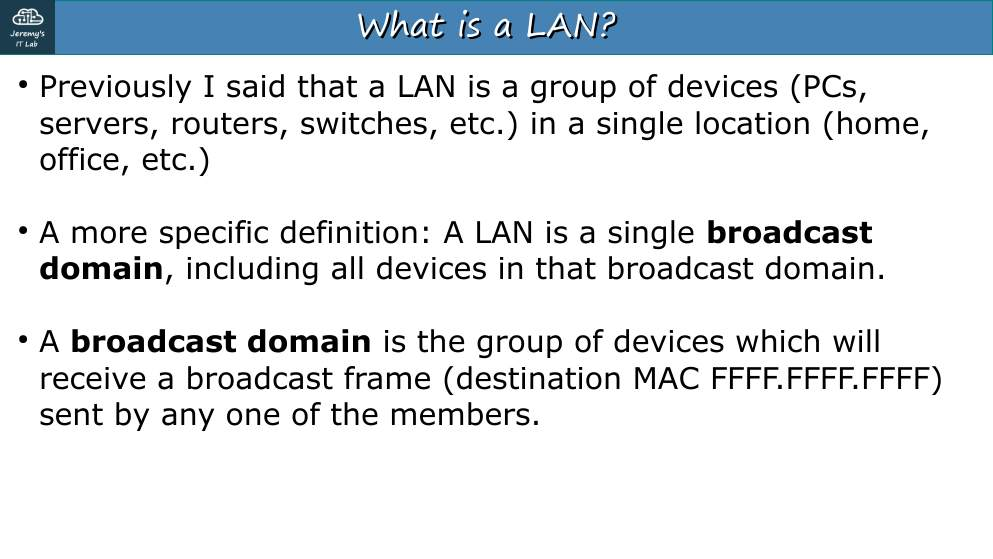<br><sub>p. 3</sub></td><td width="50%">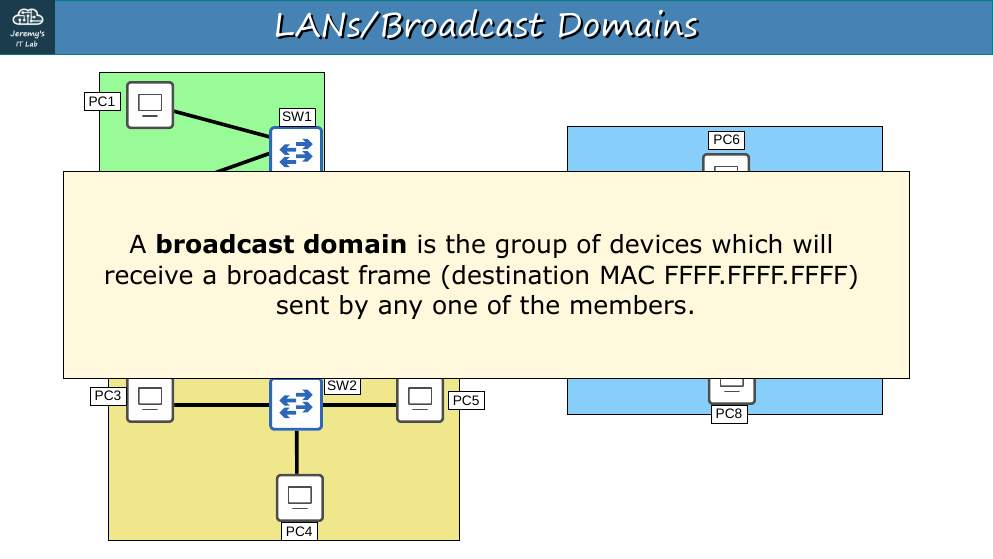<br><sub>p. 8</sub></td></tr><tr><td width="50%">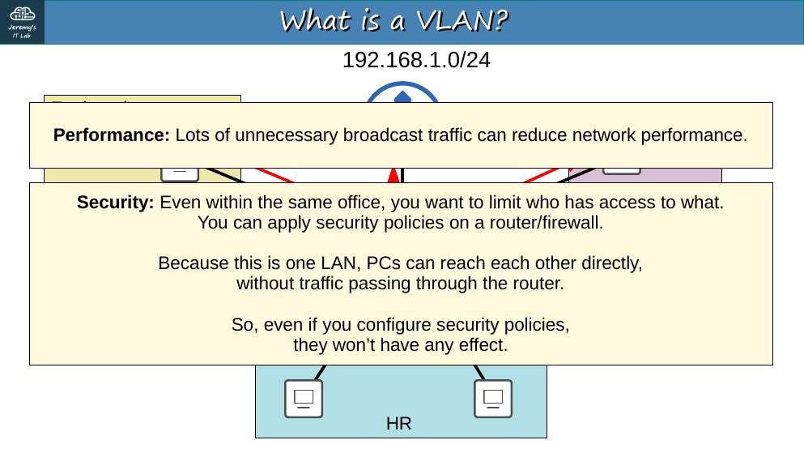<br><sub>p. 10</sub></td><td width="50%">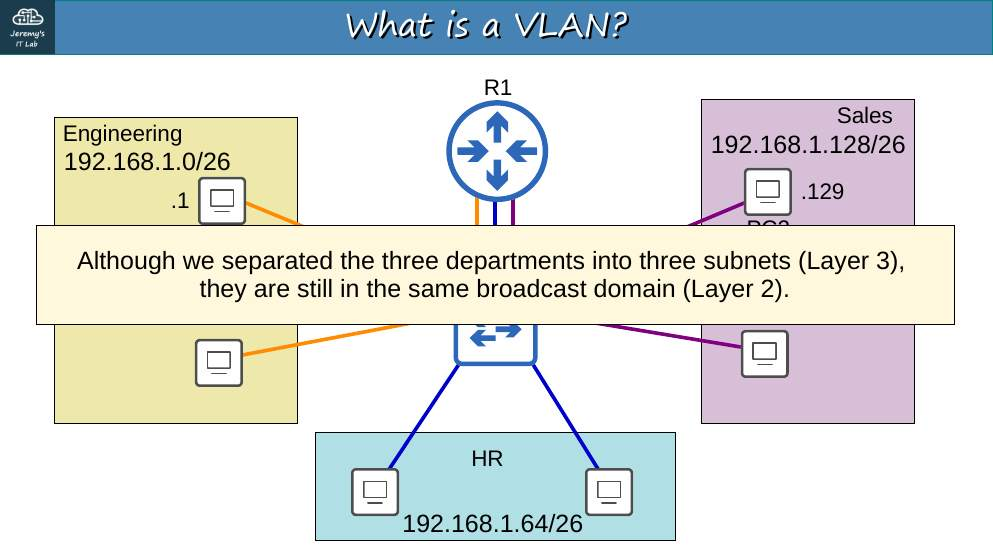<br><sub>p. 13</sub></td></tr><tr><td width="50%">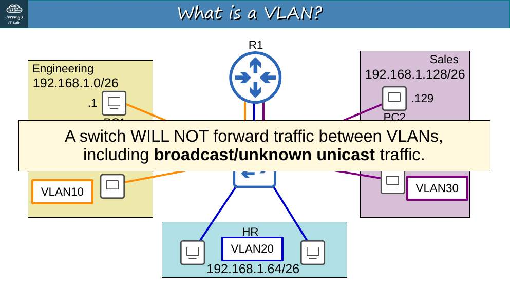<br><sub>p. 14</sub></td><td width="50%">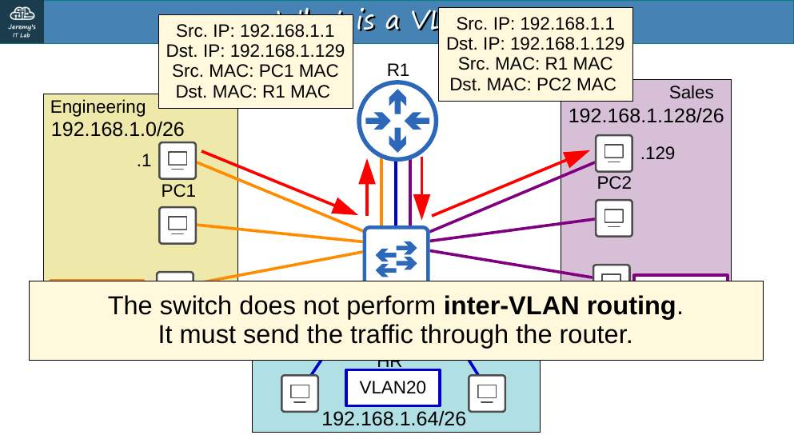<br><sub>p. 16</sub></td></tr><tr><td width="50%">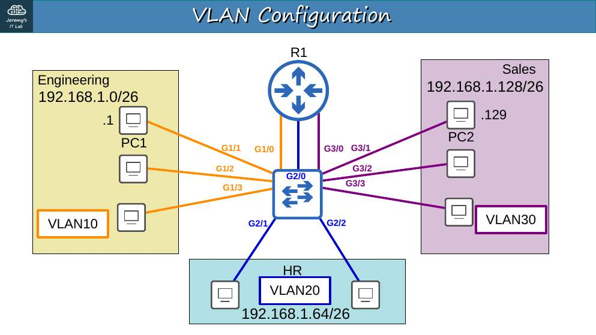<br><sub>p. 20</sub></td><td width="50%">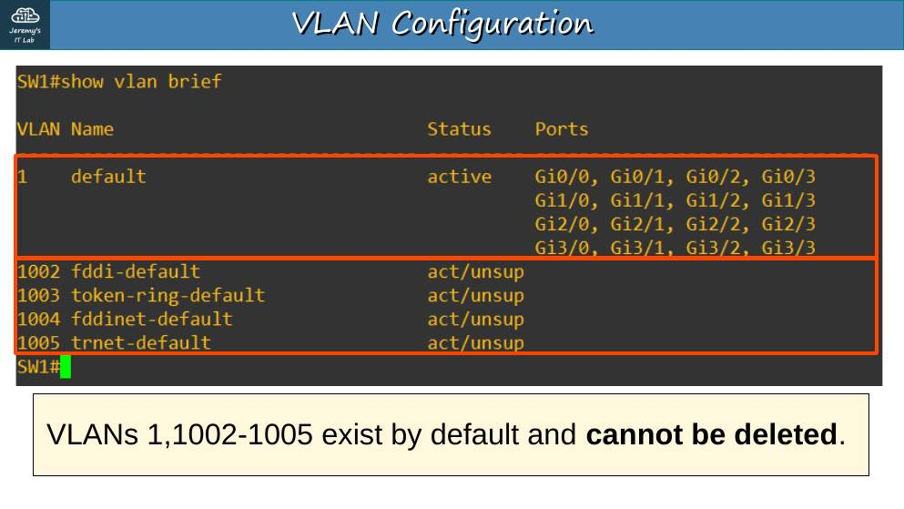<br><sub>p. 21</sub></td></tr><tr><td width="50%">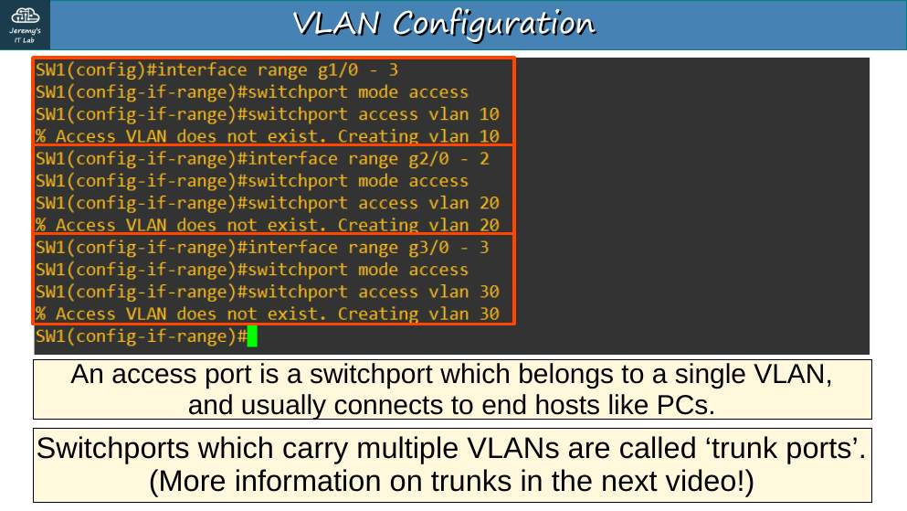<br><sub>p. 22</sub></td><td width="50%">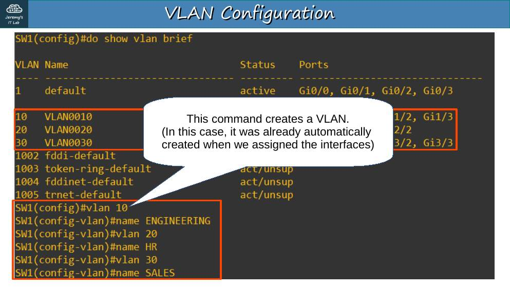<br><sub>p. 23</sub></td></tr></table>


## Apuntes

**LAN = dominio de broadcast**: todos los equipos que reciben un broadcast. Un switch, por defecto, tiene un solo dominio de broadcast (VLAN 1). El router **corta** los broadcasts.

**¿Por qué VLAN?** Separar departamentos en capa 2 **sin** comprar un switch para cada uno:

- **Rendimiento:** menos broadcasts innecesarios.
- **Seguridad:** el tráfico entre VLAN tiene que pasar por un router o firewall, donde se puede filtrar.

**Una VLAN = una subred = un dominio de broadcast.** El switch **no reenvía** tráfico entre VLAN; para eso se necesita **enrutamiento** (router o switch multicapa).

```
SW1# show vlan brief                      ← VLAN 1, 1002–1005 existen por defecto
SW1(config)# vlan 10
SW1(config-vlan)# name ENGINEERING
SW1(config)# interface range g1/0/1 - 4
SW1(config-if-range)# switchport mode access
SW1(config-if-range)# switchport access vlan 10
```

- **Puerto de acceso (access):** pertenece a **una sola VLAN**; normalmente conecta un PC, impresora o servidor.
- VLAN 1 = VLAN por defecto. **1002–1005** están reservadas (tecnologías antiguas: Token Ring, FDDI) y no se pueden borrar.
- Rango normal 1–1005; rango extendido 1006–4094.

## Trampas de examen

1. VLAN distintas **no** se comunican sin un router/L3.
2. Un puerto de acceso transporta tráfico **sin etiqueta**.
3. `show vlan brief` **no** muestra los puertos trunk.

## Laboratorio · VLAN (parte 1)


<p align="center">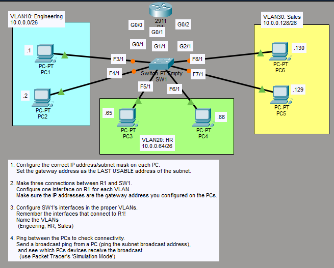<br><sub>Pantallazo del laboratorio (enunciado original de Jeremy)</sub></p>


**Topología:** R1 (2911) G0/0, G0/1, G0/2 hacia SW1 (Switch-PT-Empty) G0/1, G1/1, G2/1. VLAN10 *Engineering* 10.0.0.0/26: PC1 .1 (F3/1), PC2 .2 (F4/1). VLAN20 *HR* 10.0.0.64/26: PC3 .65 (F5/1), PC4 .66 (F6/1). VLAN30 *Sales* 10.0.0.128/26: PC5 .129 (F7/1), PC6 .130 (F8/1).

**Tarea 1 · IP y máscara en cada PC; gateway = última IP utilizable de la subred.**

| VLAN | Red | Gateway | PC |
|---|---|---|---|
| 10 | 10.0.0.0/26 (255.255.255.192) | **10.0.0.62** | PC1 .1, PC2 .2 |
| 20 | 10.0.0.64/26 | **10.0.0.126** | PC3 .65, PC4 .66 |
| 30 | 10.0.0.128/26 | **10.0.0.190** | PC5 .129, PC6 .130 |

**Tarea 2 · Tres conexiones R1–SW1, una interfaz por VLAN, con la IP del gateway.**

```
R1(config)# interface g0/0
R1(config-if)# ip address 10.0.0.62 255.255.255.192
R1(config-if)# no shutdown
R1(config-if)# interface g0/1
R1(config-if)# ip address 10.0.0.126 255.255.255.192
R1(config-if)# no shutdown
R1(config-if)# interface g0/2
R1(config-if)# ip address 10.0.0.190 255.255.255.192
R1(config-if)# no shutdown
```

**Tarea 3 · Puertos de SW1 en su VLAN (incluidos los que van a R1) y nombres de VLAN.**

```
SW1(config)# vlan 10
SW1(config-vlan)# name Engineering
SW1(config-vlan)# vlan 20
SW1(config-vlan)# name HR
SW1(config-vlan)# vlan 30
SW1(config-vlan)# name Sales
SW1(config)# interface range f3/1 , f4/1 , g0/1
SW1(config-if-range)# switchport mode access
SW1(config-if-range)# switchport access vlan 10
SW1(config)# interface range f5/1 , f6/1 , g1/1
SW1(config-if-range)# switchport mode access
SW1(config-if-range)# switchport access vlan 20
SW1(config)# interface range f7/1 , f8/1 , g2/1
SW1(config-if-range)# switchport mode access
SW1(config-if-range)# switchport access vlan 30
SW1# show vlan brief
```

(Si cableaste R1 a otros puertos, confirma con `show cdp neighbors` y ajusta.)

**Tarea 4 · Ping entre PC y ping de broadcast.** Todos los PC se alcanzan a través de R1. Luego, desde PC1, `ping 10.0.0.63` (broadcast de la VLAN 10) en modo simulación: el broadcast **solo llega a PC2 y a R1 G0/0**. Los PC de las VLAN 20 y 30 no lo reciben → cada VLAN es su propio dominio de broadcast.

---

## Rómpelo y arréglalo (48 h después del lab)

| # | Rompe esto | Síntoma | Te delata | Arreglo |
|---|---|---|---|---|
| 1 | Pon F4/1 (PC2) en la VLAN 20 | PC2 no llega a su gateway | `show vlan brief` | VLAN 10 |
| 2 | Borra la VLAN 30 (`no vlan 30`) | PC5/PC6 sin red; puertos inactivos | `show vlan brief` (puertos desaparecen); `show interfaces switchport` → *inactive* | Crear de nuevo la VLAN 30 |
| 3 | Pon el puerto de R1 de la VLAN 10 en la VLAN 20 | VLAN 10 sin gateway | `show cdp neighbors` + `show vlan brief` | Puerto correcto |

## Repaso rápido

Intenta responder antes de abrir cada pregunta.

<details><summary>¿Qué es una VLAN?</summary>

Un dominio de broadcast lógico en capa 2: una VLAN = una subred.

</details>

<details><summary>¿Puede un switch L2 pasar tráfico entre VLAN?</summary>

No: hace falta un router o un switch multicapa.

</details>

<details><summary>VLAN reservadas que existen por defecto</summary>

1 y 1002–1005.

</details>

<details><summary>Rango normal y extendido de VLAN</summary>

Normal 1–1005; extendido 1006–4094.

</details>

<details><summary>Dos razones para usar VLAN</summary>

Menos broadcasts (rendimiento) y seguridad (el tráfico entre VLAN pasa por un punto de control).

</details>


---

[⬅ Índice del curso](../../README.md)
