# Día 17 · VLAN (parte 2): trunks y router-on-a-stick

> Mis apuntes del Día 17 del curso **CCNA 200-301 de Jeremy's IT Lab**.
> Video del día: [Jeremy's IT Lab en YouTube](https://www.youtube.com/@JeremysITLab).

| | |
|---|---|
| **Estado** | ✅ Estudiado |
| **Lectura Odom 2.ª ed.** | V1 cap. 8 (+18 inter-VLAN) |
| **NetAcad v7** | SRWE 3–4 |
| **Lab extra** | LG 22-1 VLAN and Inter-VLAN |

## Diapositivas clave de Jeremy

**Day 17 Slides - VLANs (Part 2)**

<table><tr><td width="50%">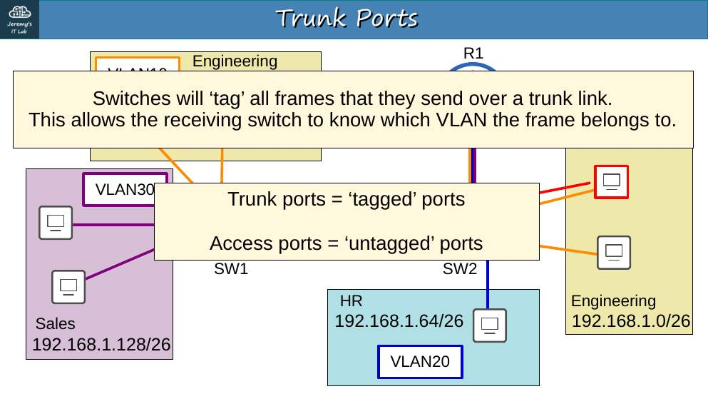<br><sub>p. 8</sub></td><td width="50%">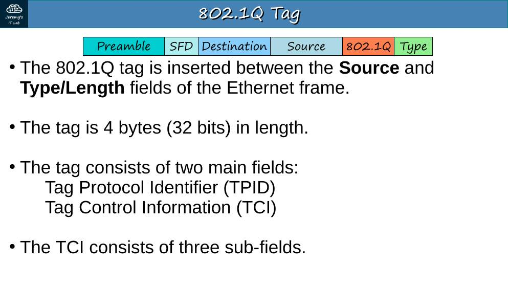<br><sub>p. 13</sub></td></tr><tr><td width="50%">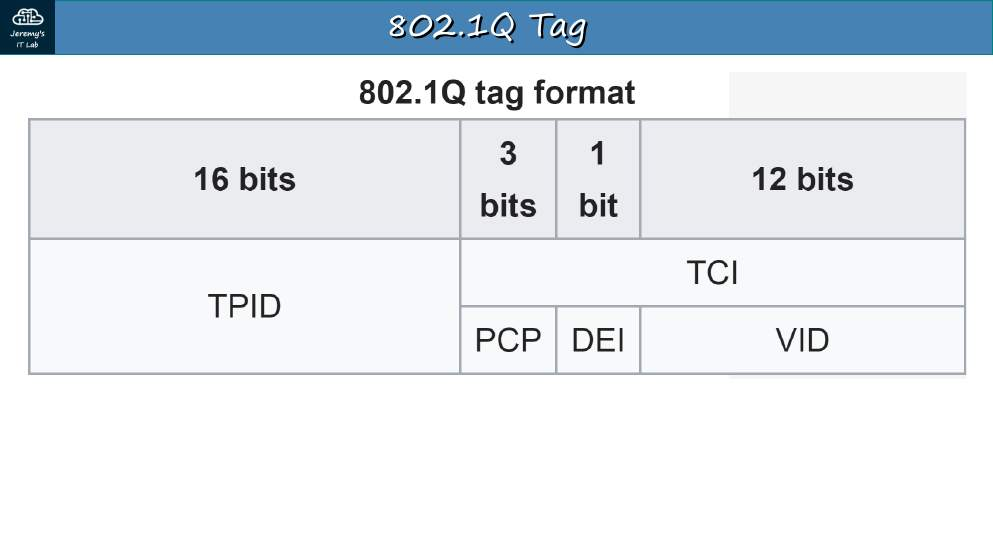<br><sub>p. 14</sub></td><td width="50%">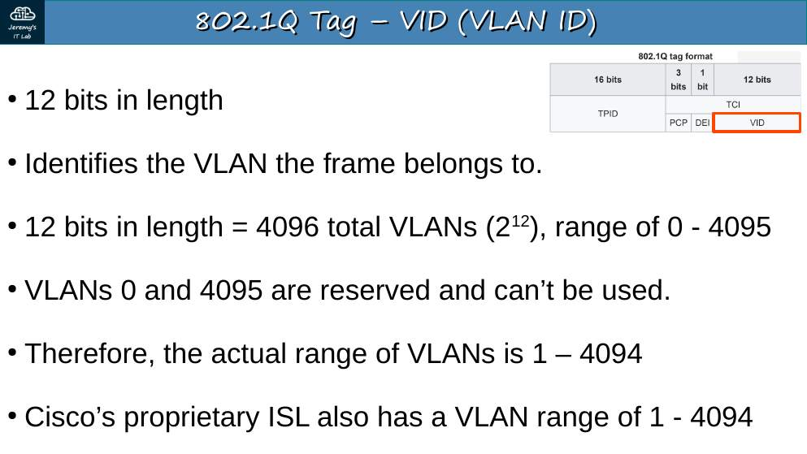<br><sub>p. 18</sub></td></tr><tr><td width="50%">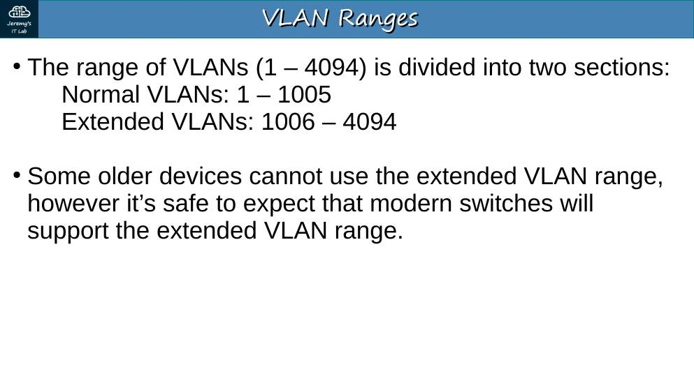<br><sub>p. 20</sub></td><td width="50%">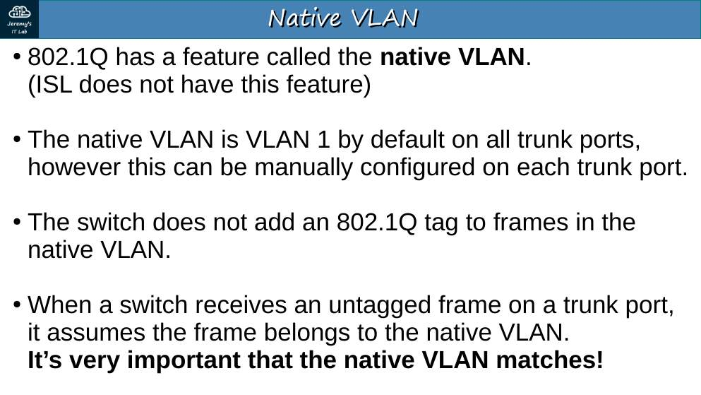<br><sub>p. 22</sub></td></tr><tr><td width="50%">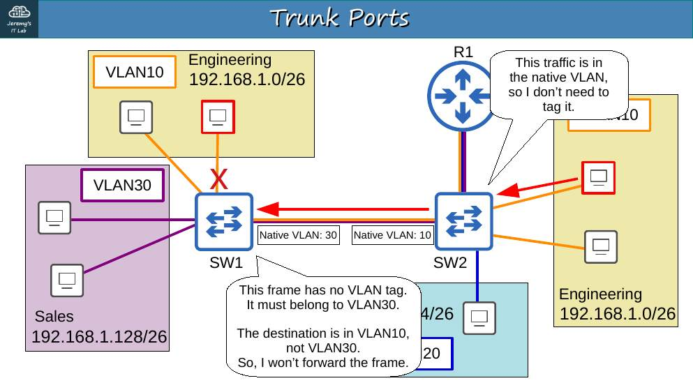<br><sub>p. 24</sub></td><td width="50%">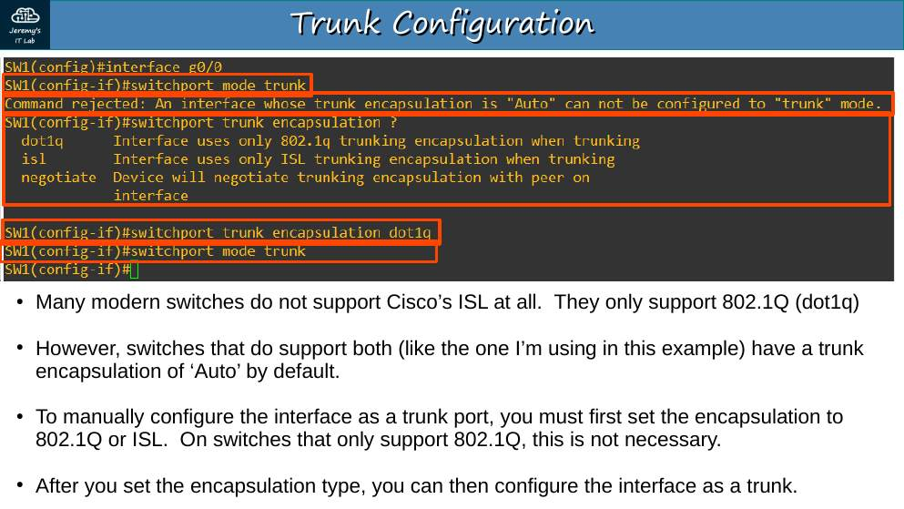<br><sub>p. 27</sub></td></tr><tr><td width="50%">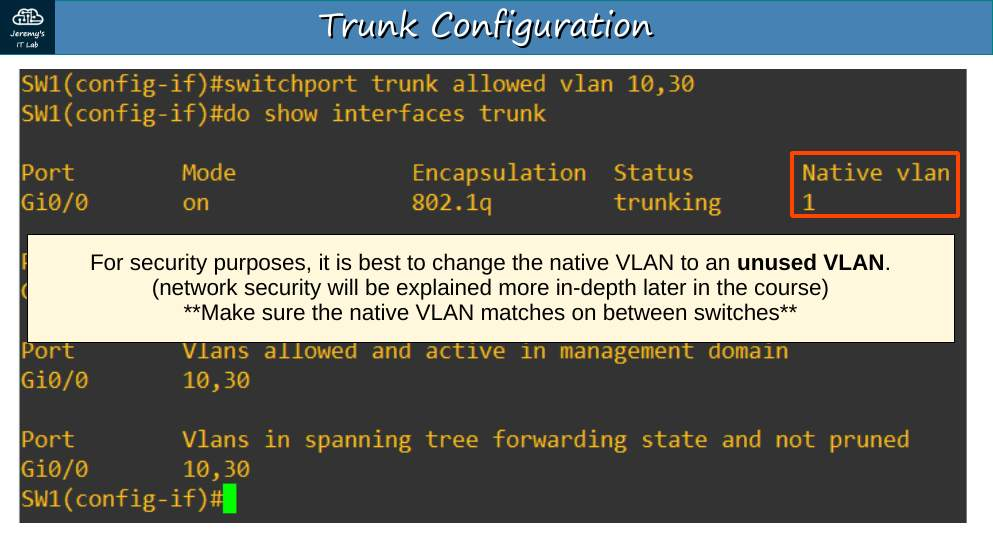<br><sub>p. 43</sub></td><td width="50%">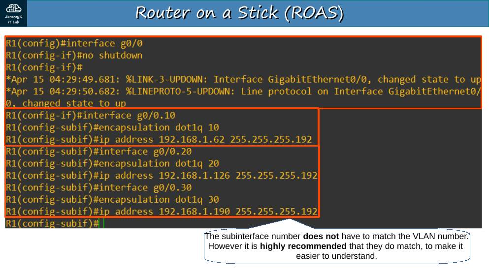<br><sub>p. 51</sub></td></tr><tr><td width="50%">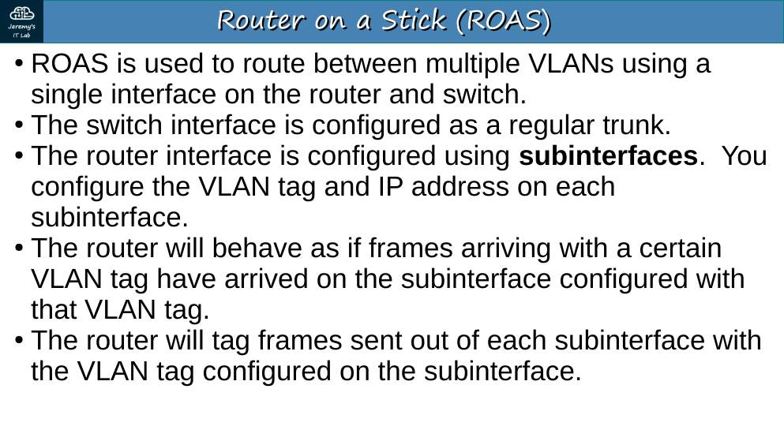<br><sub>p. 54</sub></td></tr></table>


## Apuntes

**Trunk** = un enlace que transporta **varias VLAN**. Las tramas se **etiquetan** para saber a qué VLAN pertenecen.

**Etiqueta 802.1Q** (4 bytes, entre la MAC de origen y el campo Tipo):

| Campo | Bits | Uso |
|---|---|---|
| TPID | 16 | Siempre **0x8100** (indica que la trama está etiquetada) |
| PCP | 3 | Prioridad (CoS, QoS) |
| DEI | 1 | Indica si la trama se puede descartar en congestión |
| **VID** | 12 | **Número de VLAN** → 4096 valores (0 y 4095 reservados → 1–4094) |

- **ISL** era el protocolo propietario de Cisco; hoy se usa **802.1Q**.
- **VLAN nativa** (por defecto 1): sus tramas viajan **sin etiqueta** por el trunk. Debe **coincidir** en los dos extremos; si no, CDP avisa *native VLAN mismatch*. Buena práctica: una **VLAN nativa sin uso**.

```
SW1(config-if)# switchport trunk encapsulation dot1q   ← solo en switches que soportan ISL y 802.1Q
SW1(config-if)# switchport mode trunk
SW1(config-if)# switchport trunk allowed vlan 10,30     ← también: add / remove / all / none / except
SW1(config-if)# switchport trunk native vlan 1001
SW1# show interfaces trunk
```

**Router-on-a-stick (ROAS):** una interfaz física del router hacia un trunk, dividida en **subinterfaces**, una por VLAN.

```
R1(config)# interface g0/0
R1(config-if)# no shutdown
R1(config)# interface g0/0.10
R1(config-subif)# encapsulation dot1q 10
R1(config-subif)# ip address 10.0.0.62 255.255.255.192
R1(config)# interface g0/0.99
R1(config-subif)# encapsulation dot1q 99 native     ← o poner la IP de la nativa en la interfaz física
```

## Trampas de examen

1. VID = **12 bits** → máximo 4094 VLAN utilizables.
2. La VLAN nativa **no** se etiqueta.
3. Con `allowed vlan 10,30` se **sustituye** la lista; `add 20` la amplía.
4. Una VLAN que **cruza** un switch debe existir en ese switch aunque no tenga hosts.

## Laboratorio · VLAN (parte 2)


<p align="center">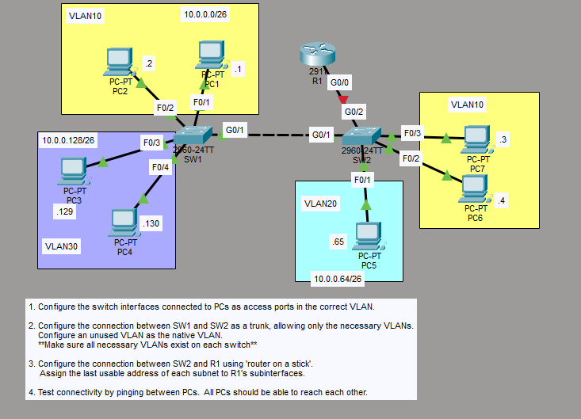<br><sub>Pantallazo del laboratorio (enunciado original de Jeremy)</sub></p>


**Topología:** SW1 F0/1 PC1 .1 y F0/2 PC2 .2 (VLAN10 10.0.0.0/26); F0/3 PC3 .129 y F0/4 PC4 .130 (VLAN30 10.0.0.128/26). SW1 G0/1 – SW2 G0/1. SW2 F0/3 PC7 .3 y F0/2 PC6 .4 (VLAN10); F0/1 PC5 .65 (VLAN20 10.0.0.64/26). SW2 G0/2 – R1 G0/0.

**Tarea 1 · Puertos de los PC como acceso en su VLAN.**

```
SW1(config)# vlan 10
SW1(config-vlan)# vlan 30
SW1(config)# interface range f0/1 - 2
SW1(config-if-range)# switchport mode access
SW1(config-if-range)# switchport access vlan 10
SW1(config)# interface range f0/3 - 4
SW1(config-if-range)# switchport mode access
SW1(config-if-range)# switchport access vlan 30

SW2(config)# vlan 10
SW2(config-vlan)# vlan 20
SW2(config-vlan)# vlan 30          ← necesaria: el tráfico de VLAN30 pasa por SW2 hacia R1
SW2(config)# interface range f0/2 - 3
SW2(config-if-range)# switchport mode access
SW2(config-if-range)# switchport access vlan 10
SW2(config)# interface f0/1
SW2(config-if)# switchport mode access
SW2(config-if)# switchport access vlan 20
```

**Tarea 2 · Trunk SW1–SW2 solo con las VLAN necesarias y una VLAN nativa sin uso** (todas las VLAN deben existir en ambos switches):

```
SW1(config)# vlan 1001
SW1(config)# interface g0/1
SW1(config-if)# switchport mode trunk
SW1(config-if)# switchport trunk allowed vlan 10,30
SW1(config-if)# switchport trunk native vlan 1001
SW2(config)# vlan 1001
SW2(config)# interface g0/1
SW2(config-if)# switchport mode trunk
SW2(config-if)# switchport trunk allowed vlan 10,30
SW2(config-if)# switchport trunk native vlan 1001
```

(VLAN 20 no hace falta en SW1–SW2 porque SW1 no tiene hosts en la VLAN 20.)

**Tarea 3 · ROAS entre SW2 y R1 con la última IP utilizable de cada subred.**

```
SW2(config)# interface g0/2
SW2(config-if)# switchport mode trunk
SW2(config-if)# switchport trunk allowed vlan 10,20,30

R1(config)# interface g0/0
R1(config-if)# no shutdown
R1(config)# interface g0/0.10
R1(config-subif)# encapsulation dot1q 10
R1(config-subif)# ip address 10.0.0.62 255.255.255.192
R1(config)# interface g0/0.20
R1(config-subif)# encapsulation dot1q 20
R1(config-subif)# ip address 10.0.0.126 255.255.255.192
R1(config)# interface g0/0.30
R1(config-subif)# encapsulation dot1q 30
R1(config-subif)# ip address 10.0.0.190 255.255.255.192
```

**Tarea 4 · Probar conectividad.** Todos los PC deben hacerse ping. Verifica con `show interfaces trunk` (SW1, SW2) y `show ip interface brief` (R1).

---

## Rómpelo y arréglalo (48 h después del lab)

| # | Rompe esto | Síntoma | Te delata | Arreglo |
|---|---|---|---|---|
| 1 | Quita la VLAN 30 del trunk SW1–SW2 (`allowed vlan 10`) | PC3/PC4 sin gateway | `show interfaces trunk` → VLAN 30 no permitida | `allowed vlan add 30` |
| 2 | Native VLAN 1001 en SW1 y 1 en SW2 | Mensajes CDP *native VLAN mismatch* | Consola / `show interfaces trunk` | Igualar nativa |
| 3 | En R1 `encapsulation dot1q 20` en G0/0.30 | Rechazado o VLAN 30 sin gateway | `show run \| section interface` | `dot1q 30` |

## Repaso rápido

Intenta responder antes de abrir cada pregunta.

<details><summary>Tamaño de la etiqueta 802.1Q y del campo VID</summary>

4 bytes; VID de 12 bits (VLAN 1–4094).

</details>

<details><summary>Valor del TPID 802.1Q</summary>

0x8100.

</details>

<details><summary>¿Se etiqueta la VLAN nativa en un trunk?</summary>

No.

</details>

<details><summary>Buena práctica con la VLAN nativa</summary>

Usar una VLAN sin uso y que coincida en ambos extremos.

</details>

<details><summary>switchport trunk allowed vlan 10 vs allowed vlan add 10</summary>

El primero reemplaza la lista; add la amplía.

</details>

<details><summary>¿Qué es router-on-a-stick?</summary>

Una interfaz física del router hacia un trunk, con una subinterfaz por VLAN (encapsulation dot1q N).

</details>


---

[⬅ Índice del curso](../../README.md)
