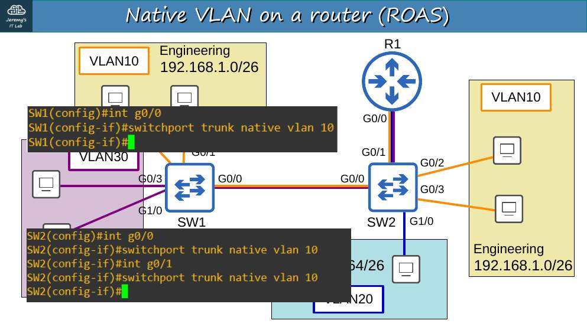
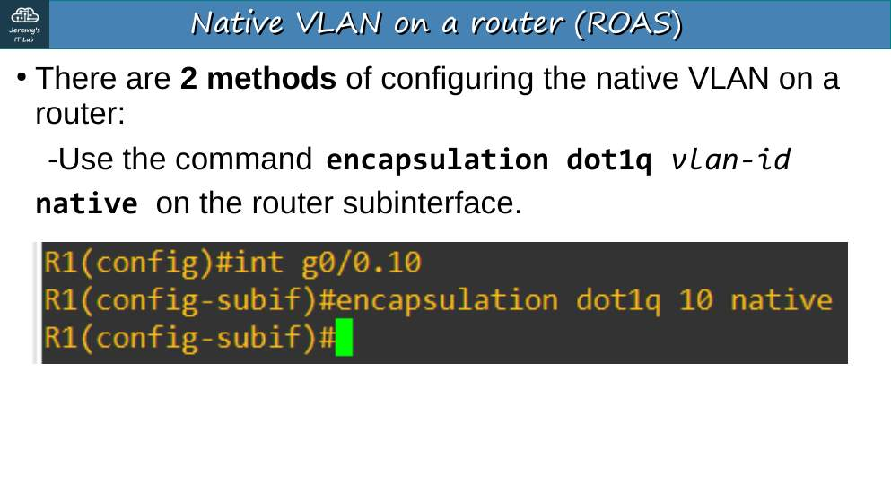
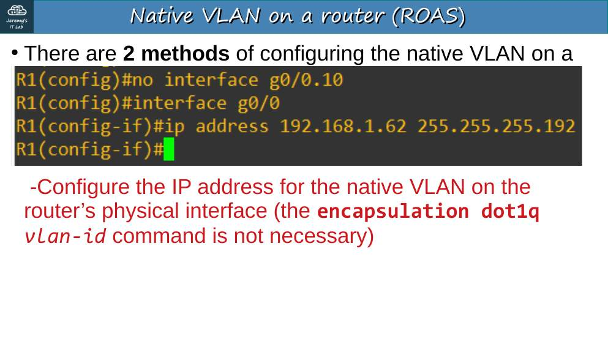
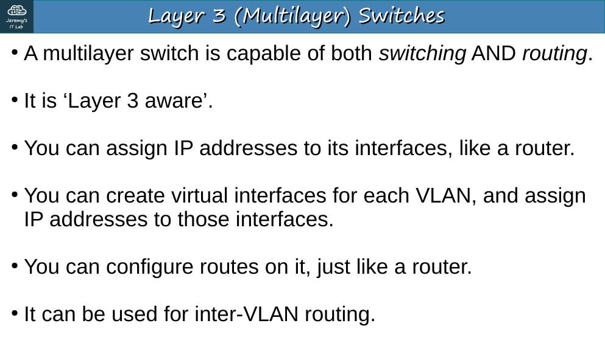
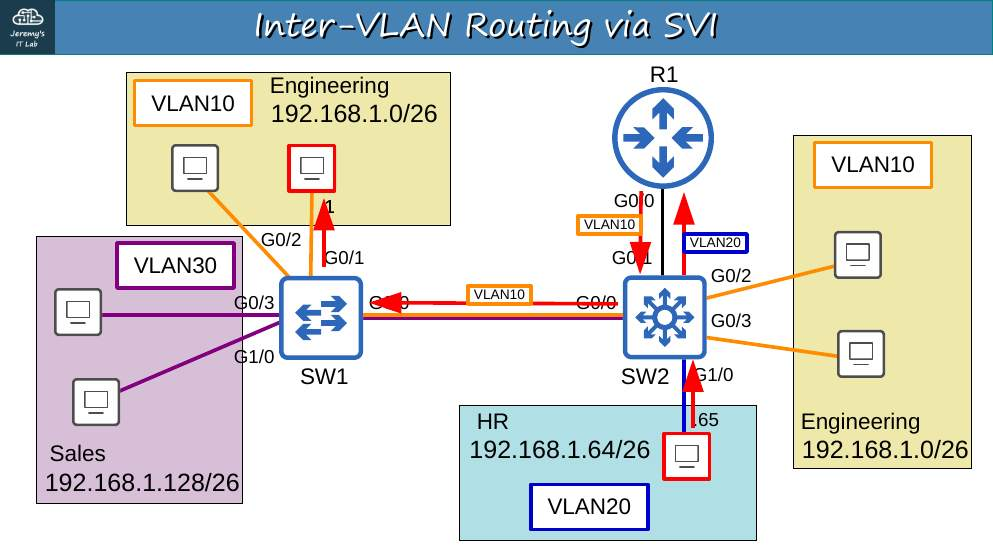
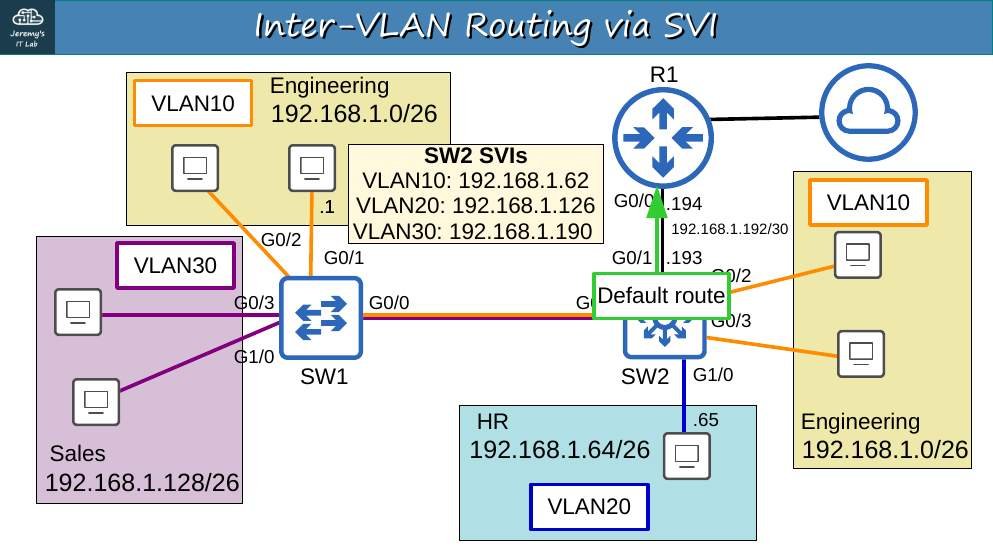
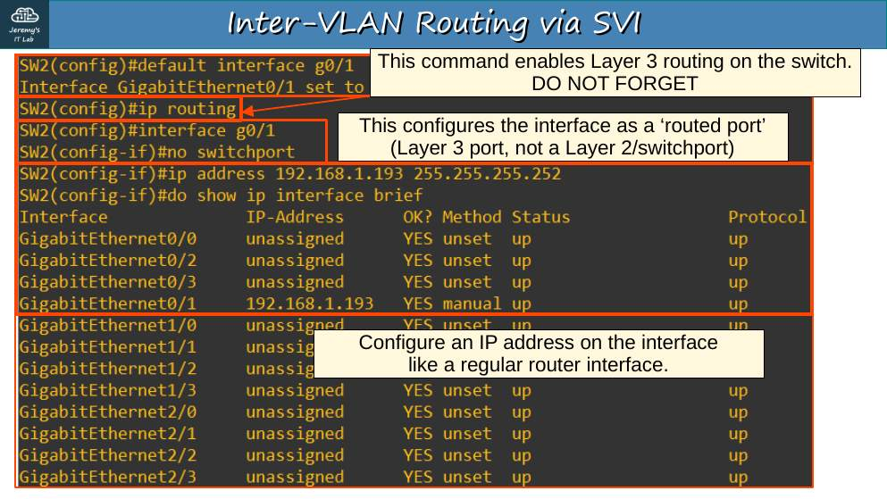
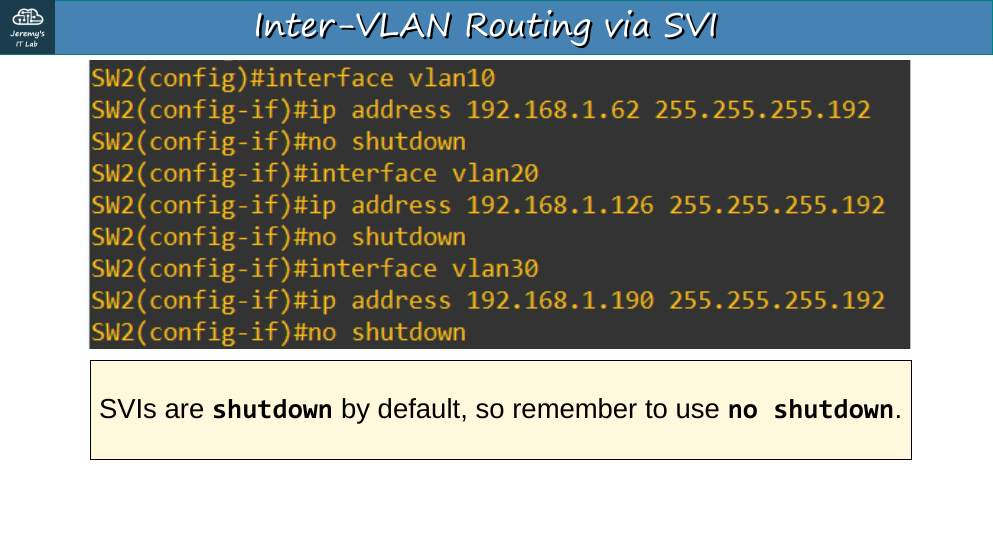
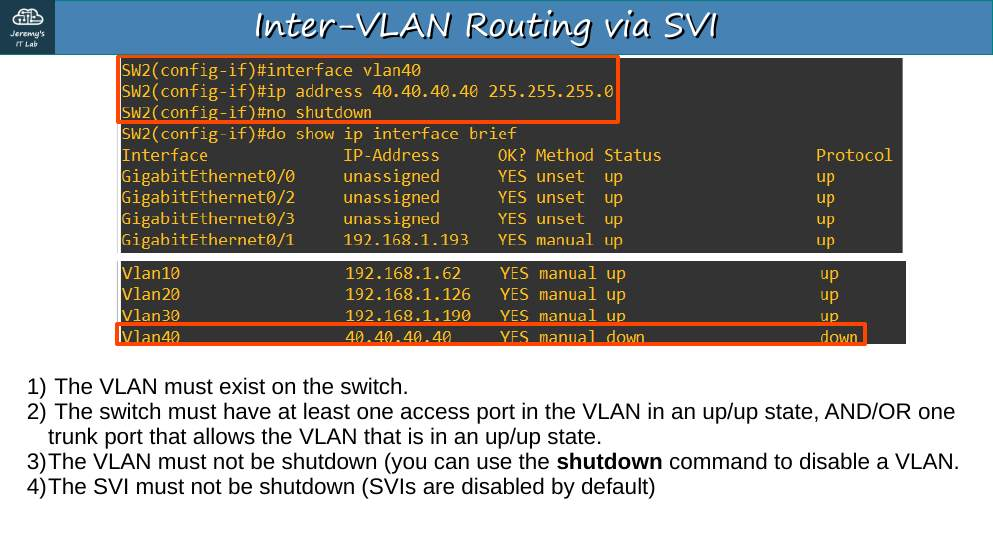
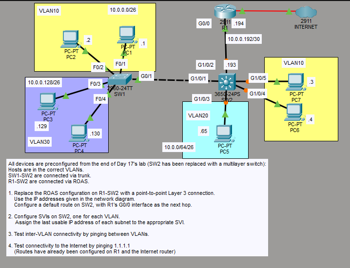

# Día 18 · VLAN (parte 3): VLAN nativa en el router y switch multicapa

> Mis apuntes del Día 18 del curso **CCNA 200-301 de Jeremy's IT Lab**.
> Video del día: [Jeremy's IT Lab en YouTube](https://www.youtube.com/@JeremysITLab).

| | |
|---|---|
| **Estado** | ✅ Estudiado |
| **Lectura Odom 2.ª ed.** | V1 cap. 8 (+18 inter-VLAN) |
| **NetAcad v7** | SRWE 3–4 |
| **Lab extra** | LG 22-1 VLAN and Inter-VLAN |

## Diapositivas clave de Jeremy

**Day 18 Slides - VLANs (Part 3)**

<table><tr><td width="50%"><br><sub>p. 3</sub></td><td width="50%"><br><sub>p. 4</sub></td></tr><tr><td width="50%"><br><sub>p. 10</sub></td><td width="50%"><br><sub>p. 15</sub></td></tr><tr><td width="50%"><br><sub>p. 17</sub></td><td width="50%"><br><sub>p. 21</sub></td></tr><tr><td width="50%"><br><sub>p. 24</sub></td><td width="50%"><br><sub>p. 27</sub></td></tr><tr><td width="50%"><br><sub>p. 28</sub></td></tr></table>


## Apuntes

**VLAN nativa en ROAS** (dos formas):

```
R1(config)# interface g0/0.10
R1(config-subif)# encapsulation dot1q 10 native      ← forma 1
R1(config)# interface g0/0
R1(config-if)# ip address 10.0.0.62 255.255.255.192  ← forma 2: IP en la física = nativa
```

**Switch multicapa (L3):** puede enrutar entre VLAN con **SVI** (*Switched Virtual Interface*, `interface vlan X`) y tener **puertos enrutados** (`no switchport`).

```
SW2(config)# ip routing                          ← ¡imprescindible!
SW2(config)# interface g1/0/2
SW2(config-if)# no switchport                    ← puerto de capa 3
SW2(config-if)# ip address 10.0.0.193 255.255.255.252
SW2(config)# ip route 0.0.0.0 0.0.0.0 10.0.0.194
SW2(config)# interface vlan 10
SW2(config-if)# ip address 10.0.0.62 255.255.255.192
SW2(config-if)# no shutdown                      ← las SVI vienen apagadas
```

**¿Cuándo está up/up una SVI?** La VLAN debe **existir**, no estar en `shutdown`, y tener **al menos un puerto de acceso up/up** en esa VLAN o un **trunk up/up que la permita**, y la SVI no debe tener `shutdown`.

## Trampas de examen

1. Sin `ip routing`, el switch multicapa **no** enruta entre SVI.
2. Las SVI vienen en `shutdown`.
3. `default interface g1/0/2` borra la configuración previa de la interfaz.

## Laboratorio · VLAN (parte 3)


<p align="center"><br><sub>Pantallazo del laboratorio (enunciado original de Jeremy)</sub></p>


**Partida:** viene configurado como el final del Día 17, pero SW2 ahora es un **3650 multicapa**. SW1–SW2 por trunk; R1–SW2 por ROAS. Enlace L3 previsto: SW2 G1/0/2 **10.0.0.193/30** – R1 G0/0 **10.0.0.194/30**. R1 ya tiene rutas hacia INTERNET.

**Tarea 1 · Sustituir el ROAS por un enlace punto a punto de capa 3 y ruta por defecto en SW2 hacia R1 G0/0.**

```
R1(config)# no interface g0/0.10
R1(config)# no interface g0/0.20
R1(config)# no interface g0/0.30
R1(config)# interface g0/0
R1(config-if)# ip address 10.0.0.194 255.255.255.252
R1(config-if)# no shutdown

SW2(config)# ip routing
SW2(config)# default interface g1/0/2
SW2(config)# interface g1/0/2
SW2(config-if)# no switchport
SW2(config-if)# ip address 10.0.0.193 255.255.255.252
SW2(config)# ip route 0.0.0.0 0.0.0.0 10.0.0.194
```

(R1 ya debe tener rutas de vuelta hacia 10.0.0.0/24 vía 10.0.0.193; compruébalo con `show ip route`.)

**Tarea 2 · Una SVI por VLAN con la última IP utilizable.**

```
SW2(config)# interface vlan 10
SW2(config-if)# ip address 10.0.0.62 255.255.255.192
SW2(config-if)# no shutdown
SW2(config)# interface vlan 20
SW2(config-if)# ip address 10.0.0.126 255.255.255.192
SW2(config-if)# no shutdown
SW2(config)# interface vlan 30
SW2(config-if)# ip address 10.0.0.190 255.255.255.192
SW2(config-if)# no shutdown
```

**Tarea 3 · Probar el enrutamiento entre VLAN** con pings entre PC de VLAN distintas. `show ip route` en SW2 debe mostrar las tres C, la C del /30 y la S*.

**Tarea 4 · Probar Internet:** `ping 1.1.1.1` desde un PC.

---

## Rómpelo y arréglalo (48 h después del lab)

| # | Rompe esto | Síntoma | Te delata | Arreglo |
|---|---|---|---|---|
| 1 | `no ip routing` en SW2 | No hay ping entre VLAN | `show ip route` → *IP routing not enabled* | `ip routing` |
| 2 | `shutdown` en interface vlan 20 | PC5 sin gateway | `show ip int brief` → Vlan20 admin down | `no shutdown` |
| 3 | Quita la ruta por defecto de SW2 | Entre VLAN sí, a 1.1.1.1 no | `show ip route` sin S* | Ruta 0.0.0.0/0 vía .194 |

## Repaso rápido

Intenta responder antes de abrir cada pregunta.

<details><summary>Comando imprescindible para enrutar en un switch multicapa</summary>

ip routing

</details>

<details><summary>¿Cómo conviertes un puerto de switch en puerto de capa 3?</summary>

no switchport

</details>

<details><summary>Condiciones para que una SVI esté up/up</summary>

La VLAN existe, la SVI no está en shutdown y hay un puerto de acceso o trunk activo que la lleve.

</details>

<details><summary>Dos formas de configurar la VLAN nativa en ROAS</summary>

encapsulation dot1q N native en la subinterfaz, o la IP en la interfaz física.

</details>


---

[⬅ Índice del curso](../../README.md)
