# Día 19 · DTP y VTP

> Mis apuntes del Día 19 del curso **CCNA 200-301 de Jeremy's IT Lab**.
> Video del día: [Jeremy's IT Lab en YouTube](https://www.youtube.com/@JeremysITLab).

| | |
|---|---|
| **Estado** | ✅ Estudiado |
| **Lectura Odom 2.ª ed.** | V1 cap. 8 (+18 inter-VLAN) |
| **NetAcad v7** | SRWE 3–4 |
| **Lab extra** | LG 22-1 VLAN and Inter-VLAN |

## Diapositivas clave de Jeremy

**Day 19 Slides - DTP & VTP**

<table><tr><td width="50%">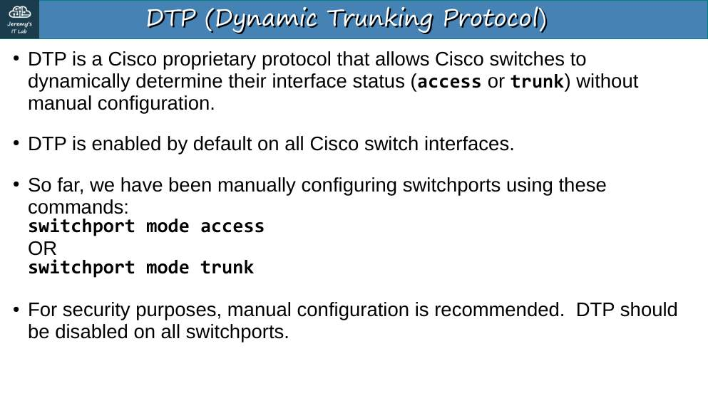<br><sub>p. 3</sub></td><td width="50%">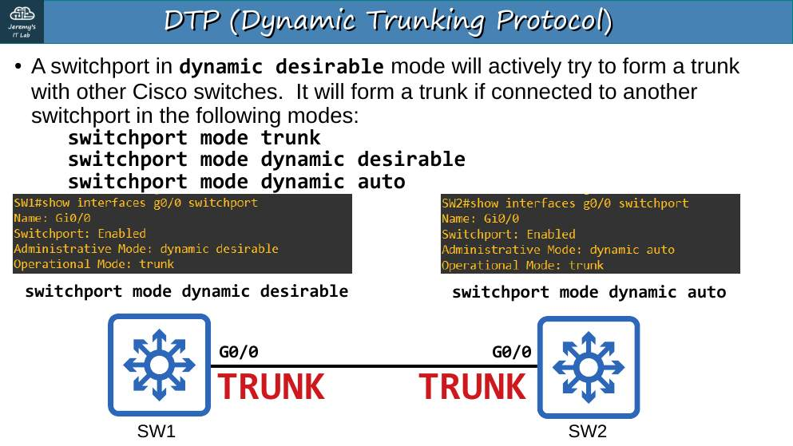<br><sub>p. 7</sub></td></tr><tr><td width="50%">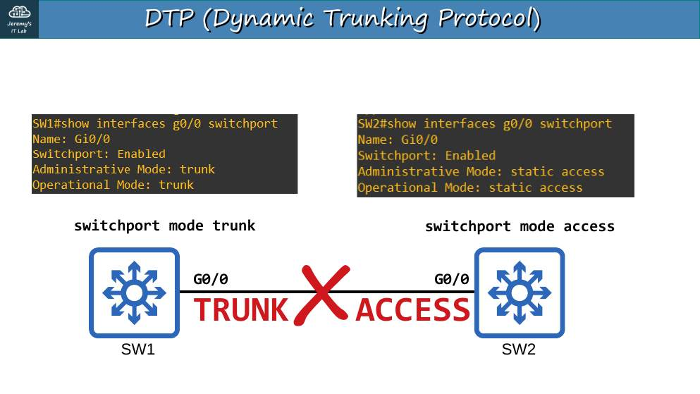<br><sub>p. 13</sub></td><td width="50%">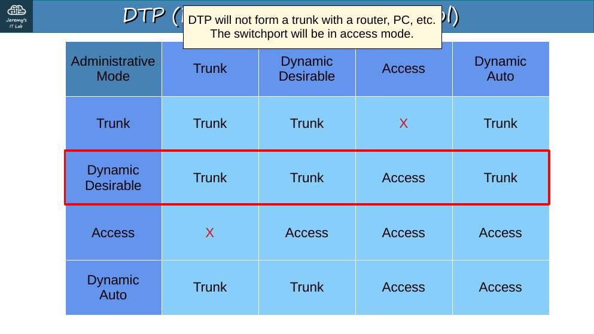<br><sub>p. 14</sub></td></tr><tr><td width="50%">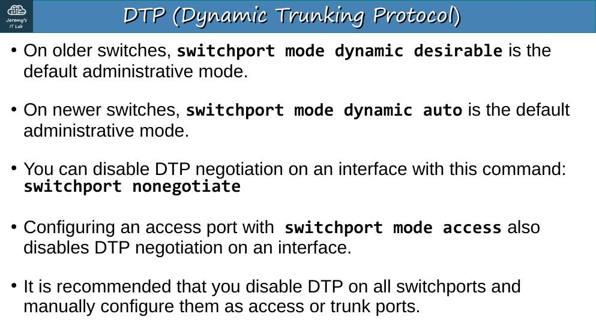<br><sub>p. 15</sub></td><td width="50%">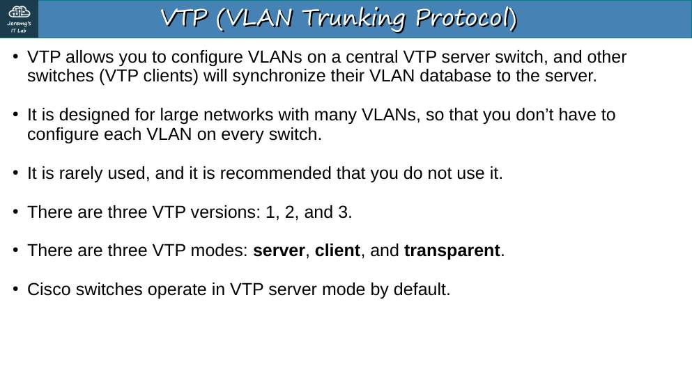<br><sub>p. 18</sub></td></tr><tr><td width="50%">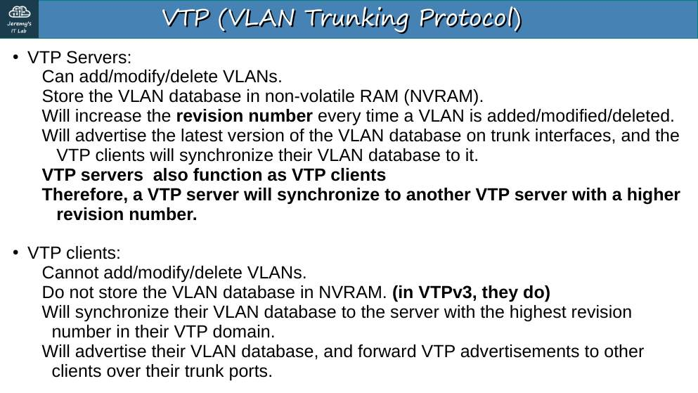<br><sub>p. 19</sub></td><td width="50%">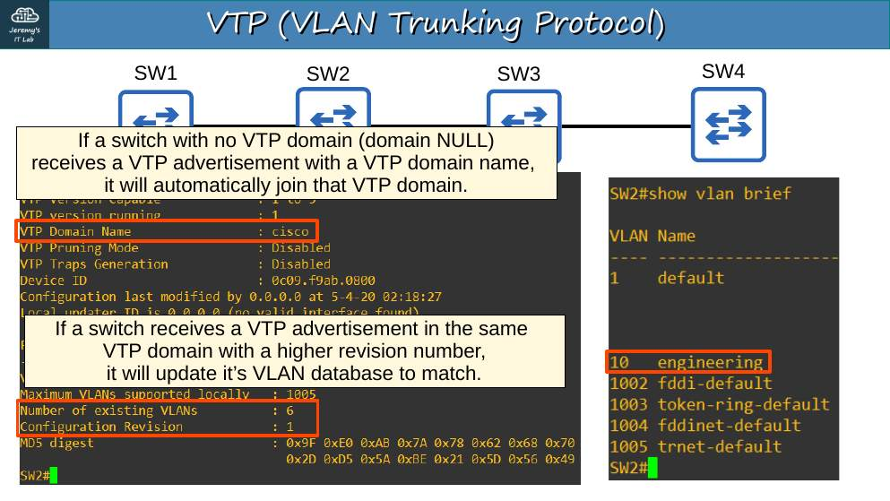<br><sub>p. 24</sub></td></tr><tr><td width="50%">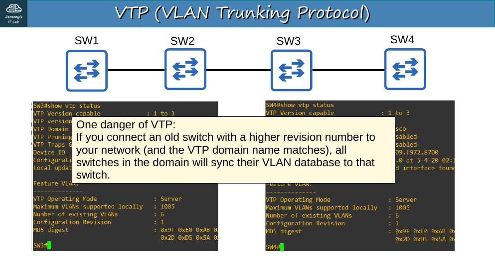<br><sub>p. 26</sub></td><td width="50%">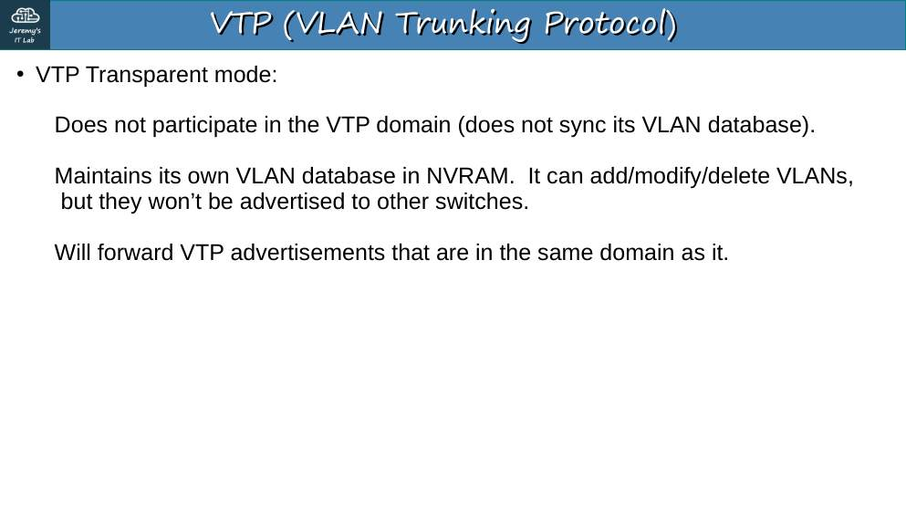<br><sub>p. 28</sub></td></tr></table>


## Apuntes

**DTP (Dynamic Trunking Protocol)** — propietario de Cisco — negocia si un puerto será trunk o acceso.

| | **dynamic auto** | **dynamic desirable** | **trunk** | **access** |
|---|---|---|---|---|
| **dynamic auto** | Access | Trunk | Trunk | Access |
| **dynamic desirable** | Trunk | Trunk | Trunk | Access |
| **trunk** | Trunk | Trunk | Trunk | *Error* |
| **access** | Access | Access | *Error* | Access |

- Por defecto, los switches modernos (2960, 3650) están en **dynamic auto**: dos switches nuevos **no** forman trunk entre sí.
- `switchport nonegotiate` apaga DTP. `switchport mode access` también evita el trunk. **Buena práctica: desactivar DTP** en todos los puertos.
- DTP también negocia la encapsulación (ISL preferida a 802.1Q si ambos soportan).

**VTP (VLAN Trunking Protocol)** sincroniza la base de VLAN entre switches de un mismo **dominio**.

| Modo | Crea/borra VLAN | Sincroniza con otros | Reenvía anuncios |
|---|---|---|---|
| **Server** (por defecto) | Sí | Sí | Sí |
| **Client** | **No** | Sí | Sí |
| **Transparent** | Sí, solo locales | **No** | Sí (si el dominio coincide) |

- Cada cambio incrementa el **número de revisión**; los switches adoptan la base con **revisión más alta**. **Peligro:** conectar un switch viejo con revisión mayor puede **borrar** las VLAN de toda la red.
- Un switch con dominio **NULL** adopta el dominio del primer anuncio que recibe.
- Versiones 1, 2 y 3 (la 3 soporta VLAN extendidas). Para reiniciar la revisión: cambiar a transparent o cambiar el dominio.

```
SW1(config)# vtp domain CCNA
SW1(config)# vtp mode client | server | transparent
SW1# show vtp status
SW1# show interfaces g0/1 switchport   ← Administrative / Operational Mode, Negotiation of Trunking
```

## Trampas de examen

1. auto + auto = **access**. desirable + auto = **trunk**.
2. Client **no** puede crear VLAN.
3. Transparent **reenvía** anuncios VTP pero no los aplica.
4. Revisión más alta gana, aunque tenga menos VLAN.

## Laboratorio · DTP y VTP


<p align="center">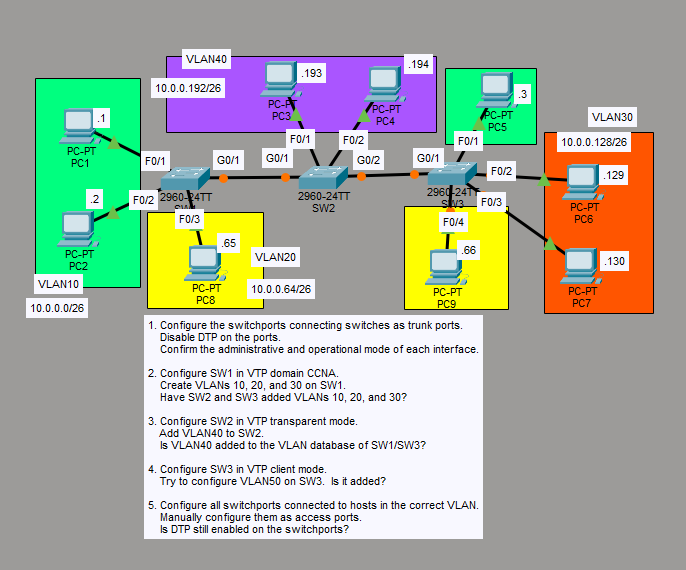<br><sub>Pantallazo del laboratorio (enunciado original de Jeremy)</sub></p>


**Topología:** SW1 G0/1 – SW2 G0/1; SW2 G0/2 – SW3 G0/1. SW1: F0/1 PC1 .1, F0/2 PC2 .2 (VLAN10 10.0.0.0/26), F0/3 PC8 .65 (VLAN20 10.0.0.64/26). SW2: F0/1 PC3 .193, F0/2 PC4 .194 (VLAN40 10.0.0.192/26). SW3: F0/1 PC5 .3 (VLAN10), F0/4 PC9 .66 (VLAN20), F0/2 PC6 .129, F0/3 PC7 .130 (VLAN30 10.0.0.128/26).

**Tarea 1 · Puertos entre switches como trunk, DTP desactivado, y ver modo administrativo y operativo.**

```
SW1(config)# interface g0/1
SW1(config-if)# switchport mode trunk
SW1(config-if)# switchport nonegotiate
SW2(config)# interface range g0/1 - 2
SW2(config-if-range)# switchport mode trunk
SW2(config-if-range)# switchport nonegotiate
SW3(config)# interface g0/1
SW3(config-if)# switchport mode trunk
SW3(config-if)# switchport nonegotiate
SW1# show interfaces g0/1 switchport
Administrative Mode: trunk
Operational Mode: trunk
Negotiation of Trunking: Off
```

**Tarea 2 · SW1 en el dominio VTP `CCNA`; crear VLAN 10, 20 y 30. ¿Las tienen SW2 y SW3?**

```
SW1(config)# vtp domain CCNA
SW1(config)# vlan 10
SW1(config-vlan)# vlan 20
SW1(config-vlan)# vlan 30
SW2# show vlan brief      ← sí aparecen
SW3# show vlan brief      ← sí aparecen
```

**Respuesta: sí.** SW2 y SW3 tenían dominio NULL; al recibir el anuncio de SW1 se unen a `CCNA` y sincronizan (`show vtp status`).

**Tarea 3 · SW2 en transparent y crear VLAN 40. ¿Se añade a SW1/SW3?**

```
SW2(config)# vtp mode transparent
SW2(config)# vlan 40
```

**Respuesta: no.** Un switch transparent mantiene sus VLAN solo localmente, aunque **sigue reenviando** los anuncios de SW1 hacia SW3.

**Tarea 4 · SW3 en client e intentar crear la VLAN 50. ¿Se añade?**

```
SW3(config)# vtp mode client
SW3(config)# vlan 50
VTP VLAN configuration not allowed when device is in CLIENT mode.
```

**Respuesta: no.**

**Tarea 5 · Puertos de hosts como acceso en su VLAN. ¿Sigue DTP activo?**

```
SW1(config)# interface range f0/1 - 2
SW1(config-if-range)# switchport mode access
SW1(config-if-range)# switchport access vlan 10
SW1(config)# interface f0/3
SW1(config-if)# switchport mode access
SW1(config-if)# switchport access vlan 20
SW2(config)# interface range f0/1 - 2
SW2(config-if-range)# switchport mode access
SW2(config-if-range)# switchport access vlan 40
SW3(config)# interface f0/1
SW3(config-if)# switchport mode access
SW3(config-if)# switchport access vlan 10
SW3(config)# interface f0/4
SW3(config-if)# switchport mode access
SW3(config-if)# switchport access vlan 20
SW3(config)# interface range f0/2 - 3
SW3(config-if-range)# switchport mode access
SW3(config-if-range)# switchport access vlan 30
```

**Respuesta:** `show interfaces f0/1 switchport` → *Negotiation of Trunking: On*. Con `mode access` el puerto ya no formará trunk, pero **DTP sigue enviando mensajes**. Para apagarlo del todo: `switchport nonegotiate`.

*(Nota: con SW2 en transparent, el tráfico de VLAN 10/20/30 entre SW1 y SW3 cruza SW2; SW2 conserva las VLAN que ya había aprendido, por eso sigue funcionando.)*

---

## Rómpelo y arréglalo (48 h después del lab)

| # | Rompe esto | Síntoma | Te delata | Arreglo |
|---|---|---|---|---|
| 1 | SW2 G0/1 en `dynamic auto` y SW1 G0/1 en `dynamic auto` | No se forma trunk | `show interfaces g0/1 switchport` → Operational: static access | Uno en trunk |
| 2 | Cambia el dominio VTP de SW3 a `ccna` (minúsculas) | SW3 deja de recibir VLAN nuevas | `show vtp status` → dominio distinto (distingue mayúsculas) | Dominio `CCNA` |
| 3 | Crea VLAN en un switch "nuevo" en modo server con revisión alta y conéctalo | Las VLAN del dominio se reemplazan | `show vtp status` → Configuration Revision | Reset de revisión (modo transparent) antes de conectar |

## Repaso rápido

Intenta responder antes de abrir cada pregunta.

<details><summary>dynamic auto + dynamic auto = ?</summary>

Puerto de acceso (no se forma trunk).

</details>

<details><summary>dynamic desirable + dynamic auto = ?</summary>

Trunk.

</details>

<details><summary>¿Cómo se desactiva DTP?</summary>

switchport nonegotiate (y modo trunk o access fijo).

</details>

<details><summary>¿Un switch VTP client puede crear VLAN?</summary>

No.

</details>

<details><summary>¿Qué hace un switch VTP transparent?</summary>

Mantiene VLAN locales y reenvía los anuncios VTP, sin aplicarlos.

</details>

<details><summary>Peligro de VTP</summary>

Un switch con número de revisión más alto puede sobrescribir las VLAN de todo el dominio.

</details>


---

[⬅ Índice del curso](../../README.md)
