# Día 20 · Spanning Tree Protocol (parte 1)

> Mis apuntes del Día 20 del curso **CCNA 200-301 de Jeremy's IT Lab**.
> Video del día: [Jeremy's IT Lab en YouTube](https://www.youtube.com/@JeremysITLab).

| | |
|---|---|
| **Estado** | ✅ Estudiado |
| **Lectura Odom 2.ª ed.** | V1 caps. 9–10 |
| **NetAcad v7** | SRWE 5 |
| **Lab extra** | LG 25-2 STP |

## Diapositivas clave de Jeremy

**Day 20 Slides - STP (Part 1)**

<table><tr><td width="50%">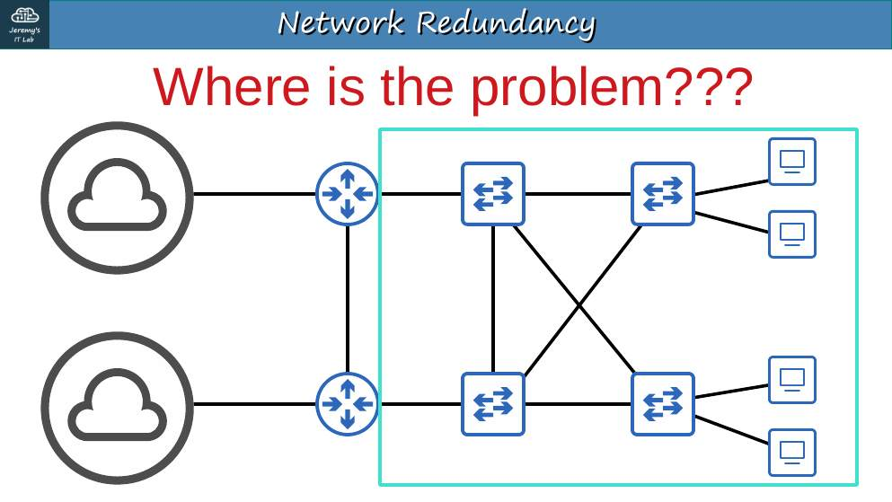<br><sub>p. 11</sub></td><td width="50%">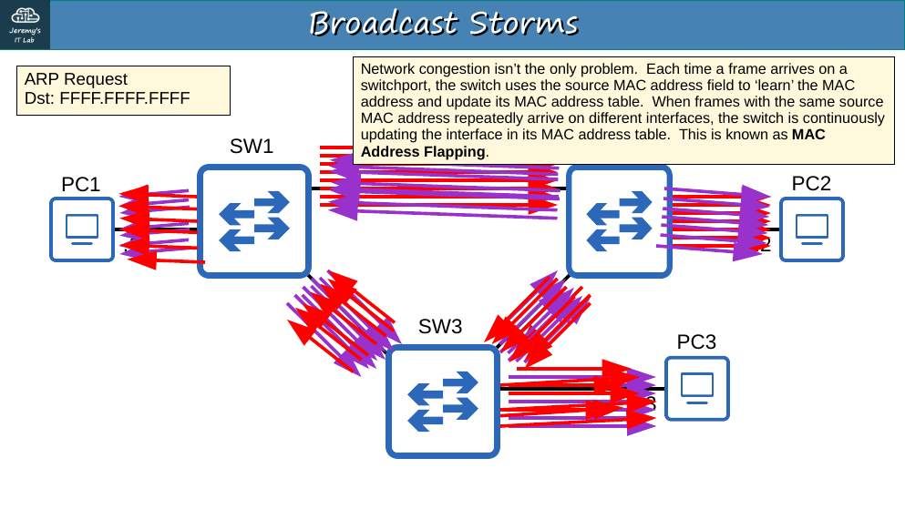<br><sub>p. 15</sub></td></tr><tr><td width="50%">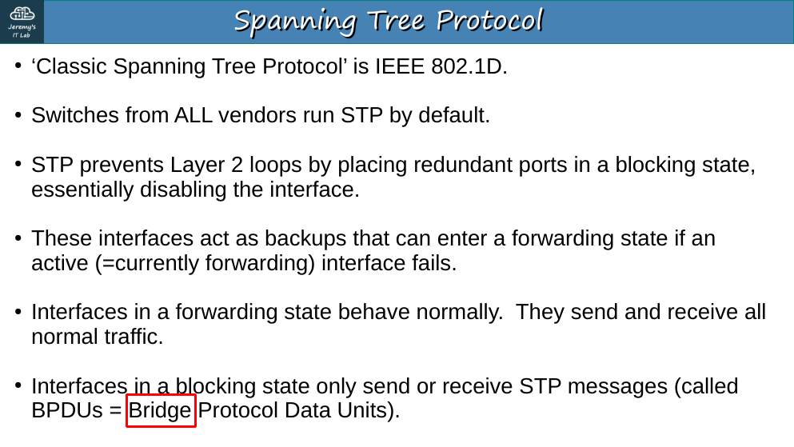<br><sub>p. 16</sub></td><td width="50%">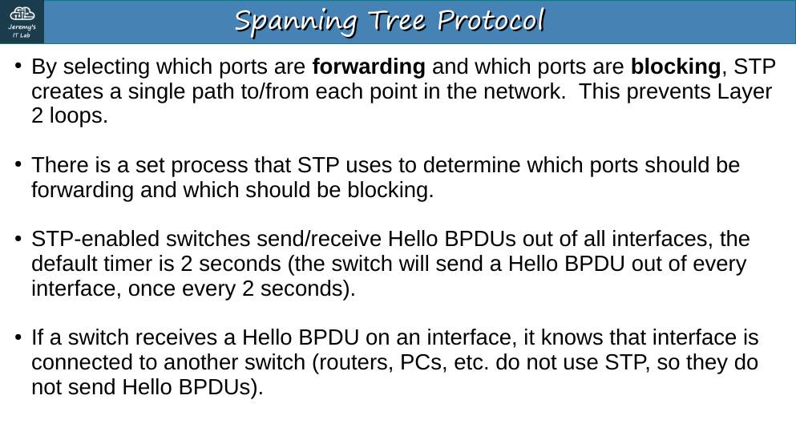<br><sub>p. 21</sub></td></tr><tr><td width="50%">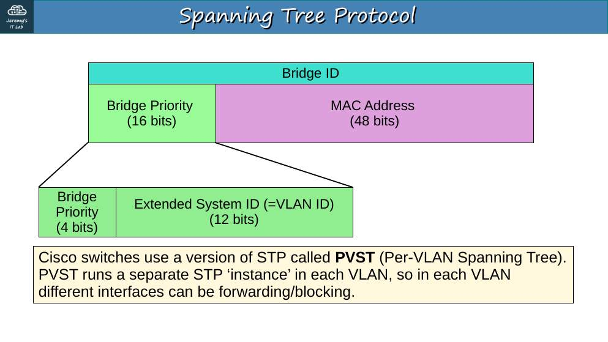<br><sub>p. 26</sub></td><td width="50%">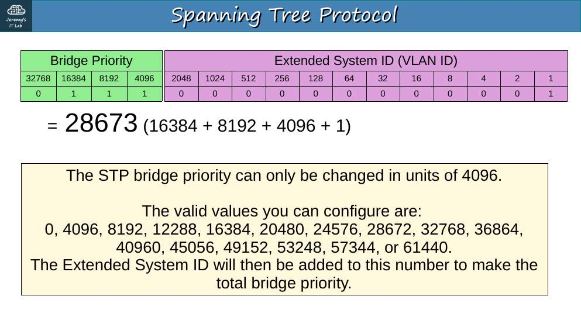<br><sub>p. 29</sub></td></tr><tr><td width="50%">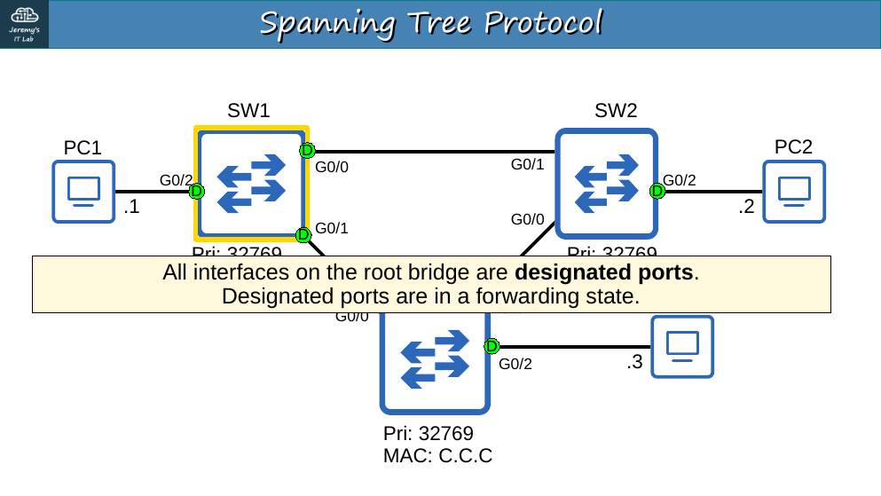<br><sub>p. 30</sub></td><td width="50%">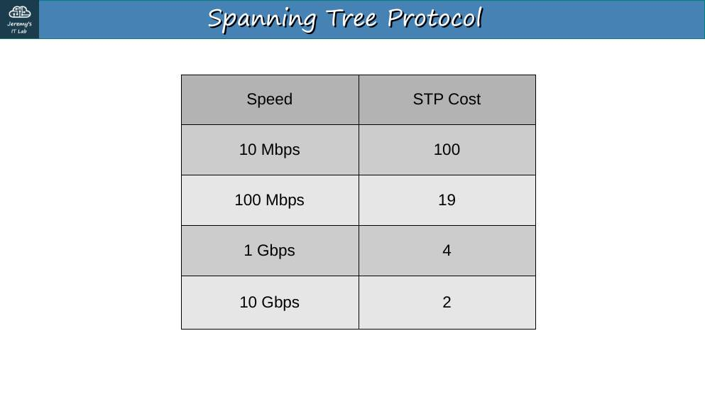<br><sub>p. 35</sub></td></tr><tr><td width="50%">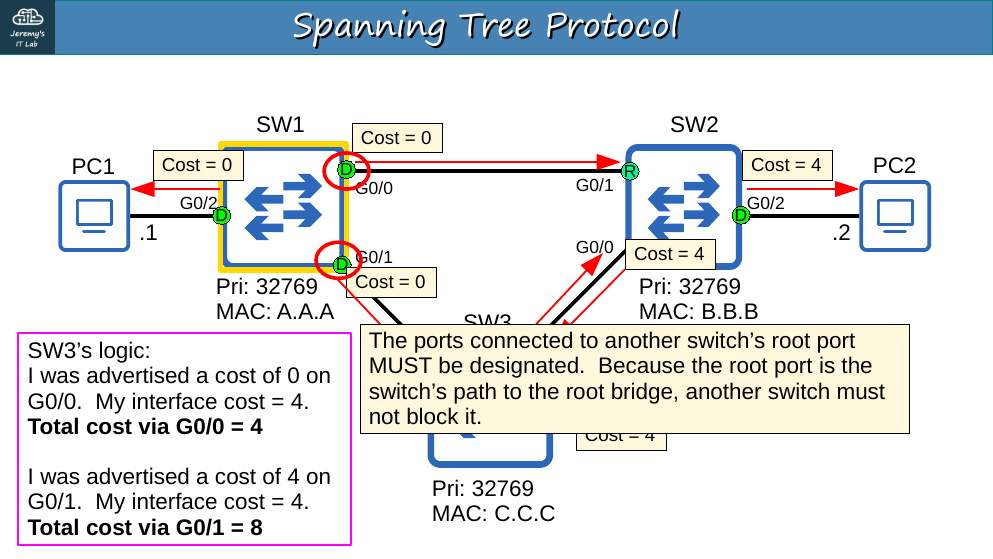<br><sub>p. 37</sub></td><td width="50%">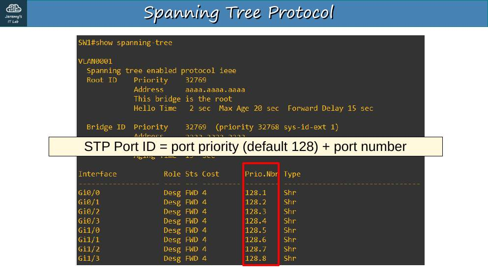<br><sub>p. 41</sub></td></tr><tr><td width="50%">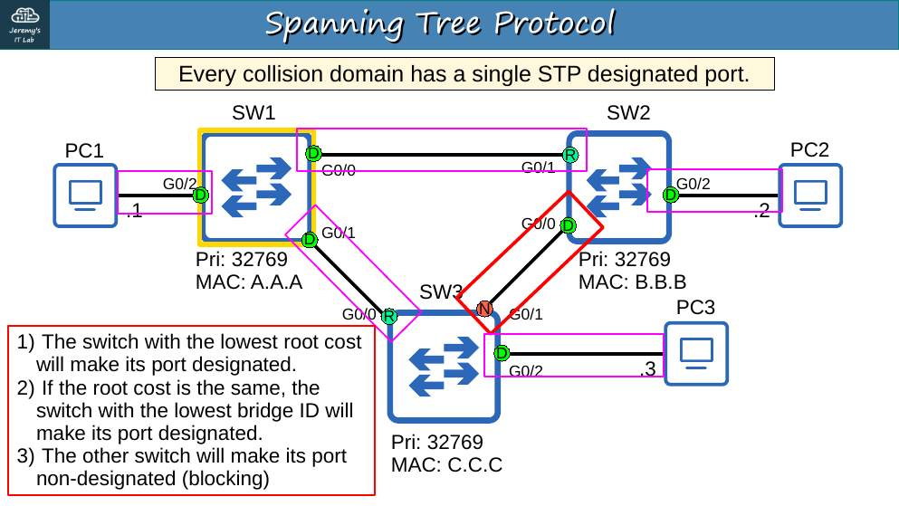<br><sub>p. 44</sub></td><td width="50%">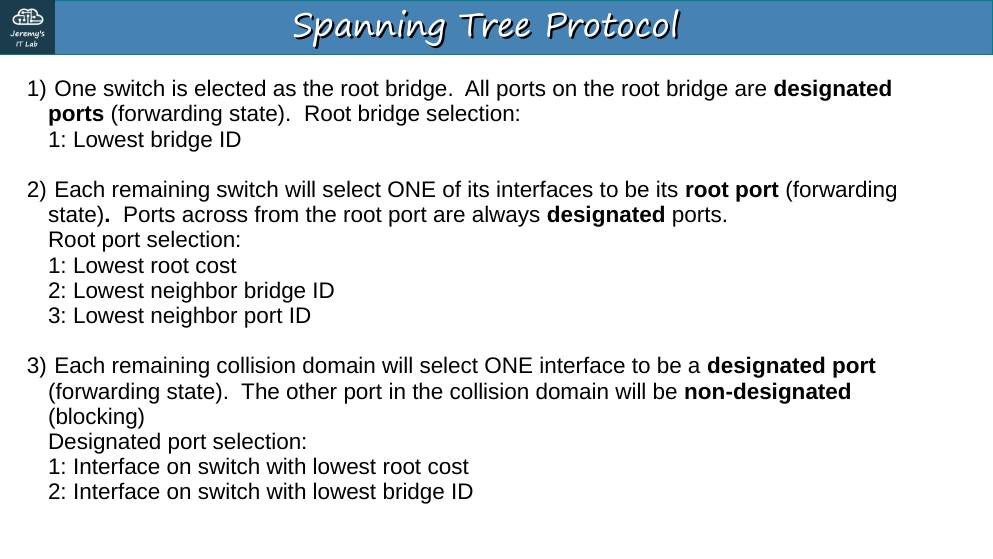<br><sub>p. 45</sub></td></tr></table>


## Apuntes

**El problema:** la redundancia en capa 2 crea **bucles**. La trama Ethernet **no tiene TTL**, así que un broadcast gira para siempre (**tormenta de broadcast**), y la tabla MAC se vuelve inestable (**MAC flapping**).

**STP (802.1D)** bloquea puertos para que quede **un solo camino** y los reactiva si cae un enlace.

**Elección paso a paso:**

1. **Root bridge:** el de **Bridge ID más bajo**. BID = prioridad (por defecto **32768**) + **VLAN ID** (*extended system ID*) + MAC. En VLAN 1 → 32769. La prioridad solo puede cambiar en múltiplos de **4096**. Empate de prioridad → **MAC más baja**. **Todos los puertos del root son designated.**
2. **Root port** (uno por switch no-root): el de **menor costo al root**. Desempates: (a) menor **BID del vecino**, (b) menor **port ID del vecino** (prioridad de puerto 128 + número).
3. **Designated port** (uno por segmento): el del switch con **menor costo al root**; empate → menor BID.
4. El resto: **non-designated** (bloqueado).

| Velocidad | Costo STP |
|---|---|
| 10 Mbps | 100 |
| 100 Mbps | **19** |
| 1 Gbps | **4** |
| 10 Gbps | 2 |

**BPDU Hello**: el root las envía cada **2 s**; los demás las reenvían.

## Trampas de examen

1. Gana el BID **más bajo**, no el más alto.
2. El costo se suma en los puertos **de entrada** (root ports) hacia el root.
3. El desempate final del root port usa el port ID **del vecino**, no el propio.
4. Prioridad válida: múltiplos de 4096 (0–61440).

## Laboratorio · Analizar STP


<p align="center">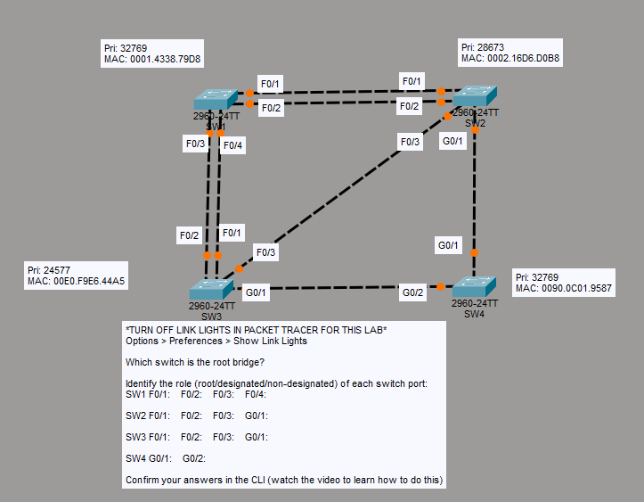<br><sub>Pantallazo del laboratorio (enunciado original de Jeremy)</sub></p>


**Datos:** SW1 prioridad 32769, MAC 0001.4338.79D8; SW2 28673, 0002.16D6.D0B8; SW3 **24577**, 00E0.F9E6.44A5; SW4 32769, 0090.0C01.9587. Enlaces: SW1 F0/1–SW2 F0/1, SW1 F0/2–SW2 F0/2, SW1 F0/3–SW3 F0/2, SW1 F0/4–SW3 F0/1, SW2 F0/3–SW3 F0/3, SW2 G0/1–SW4 G0/1, SW3 G0/1–SW4 G0/2. (Apaga las luces de enlace: *Options → Preferences → Show Link Lights*.)

**Tarea 1 · ¿Cuál es el root bridge?** **SW3**, por tener la prioridad más baja (24577).

**Tarea 2 · Rol de cada puerto.**

Costos al root: SW4 = 4 (G0/2 directo). SW2 = 4 + 4 = **8** por SW4 (menor que 19 por su F0/3). SW1 = 19 directo (por SW2 serían 8 + 19 = 27).

| Puerto | Rol | Motivo |
|---|---|---|
| **SW1 F0/1** | Non-designated | En ese segmento SW2 tiene menor costo (8 < 19) |
| **SW1 F0/2** | Non-designated | Igual que F0/1 |
| **SW1 F0/3** | Non-designated | Segmento con SW3 (root): el puerto del root es designated |
| **SW1 F0/4** | **Root port** | Empata con F0/3 (costo 19, mismo vecino); gana porque llega al **port ID menor del vecino** (SW3 F0/1 < F0/2) |
| **SW2 F0/1** | Designated | Costo 8 < 19 de SW1 |
| **SW2 F0/2** | Designated | Igual |
| **SW2 F0/3** | Non-designated | Segmento con el root |
| **SW2 G0/1** | **Root port** | Costo 8 vía SW4 |
| **SW3 F0/1, F0/2, F0/3, G0/1** | Designated | Es el root |
| **SW4 G0/1** | Designated | SW4 (4) tiene menor costo que SW2 (8) en ese segmento |
| **SW4 G0/2** | **Root port** | Costo 4 directo |

**Tarea 3 · Confirmar en la CLI:**

```
SW1# show spanning-tree
Interface  Role Sts Cost  Prio.Nbr Type
Fa0/1      Altn BLK 19    128.1    P2p
Fa0/4      Root FWD 19    128.4    P2p
```

(PT con PVST+ muestra los non-designated como **Altn BLK**.)

## Rómpelo y arréglalo (48 h después del lab)

| # | Rompe esto | Síntoma | Te delata | Arreglo |
|---|---|---|---|---|
| 1 | Baja la prioridad de SW1 a 4096 | Cambia el root y todos los roles | `show spanning-tree` → *This bridge is the root* en SW1 | Recalcula los roles a mano y compara |
| 2 | Apaga SW4 G0/2 | SW4 y SW2 cambian de root port | `show spanning-tree` | Explica el nuevo camino |
| 3 | Pon costo 2 en SW1 F0/3 | SW1 cambia de root port a F0/3 | `show spanning-tree` (costo) | Quitar el costo |

## Repaso rápido

Intenta responder antes de abrir cada pregunta.

<details><summary>¿Qué causa un bucle de capa 2?</summary>

Tormentas de broadcast y MAC flapping (la trama Ethernet no tiene TTL).

</details>

<details><summary>¿Quién es el root bridge?</summary>

El de bridge ID más bajo (prioridad + VLAN + MAC). Empate: MAC más baja.

</details>

<details><summary>Prioridad STP por defecto y en qué múltiplos cambia</summary>

32768 (+VLAN ID); múltiplos de 4096.

</details>

<details><summary>Costos STP de 100 Mbps, 1 Gbps y 10 Gbps</summary>

19, 4 y 2.

</details>

<details><summary>Orden de desempate del root port</summary>

Menor costo al root, menor BID del vecino, menor port ID del vecino.

</details>

<details><summary>¿Qué rol tienen todos los puertos del root bridge?</summary>

Designated.

</details>


---

[⬅ Índice del curso](../../README.md)
