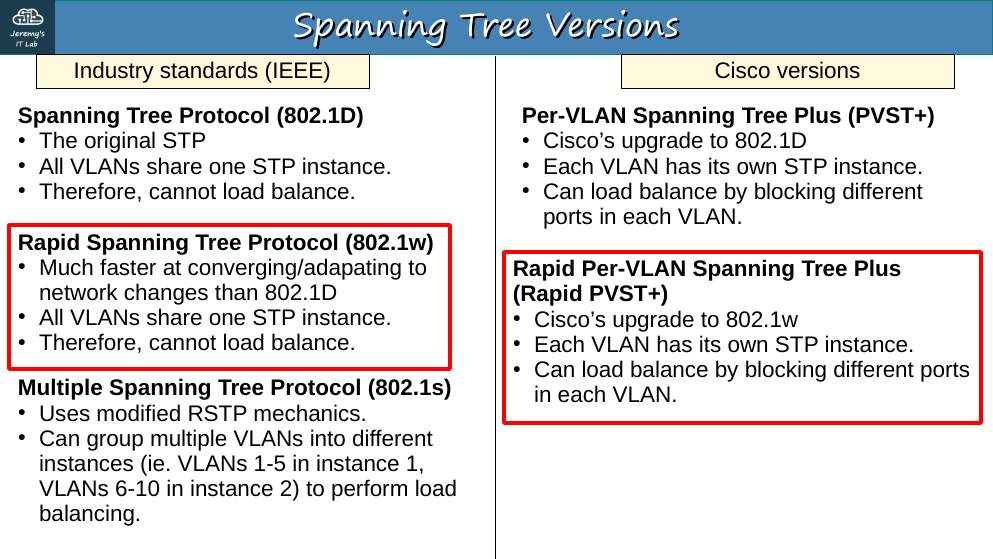
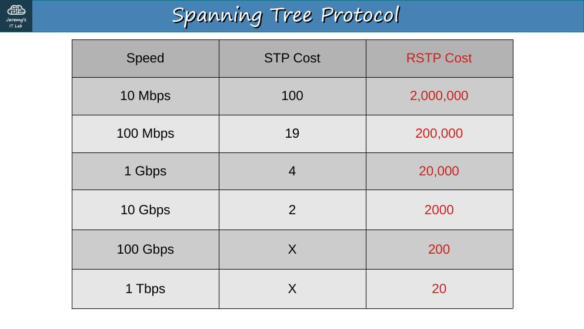
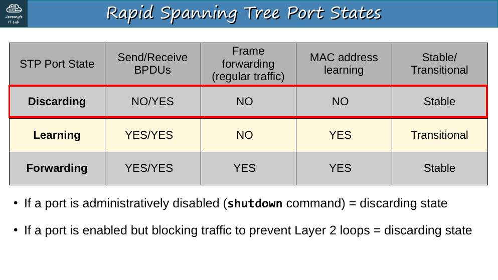
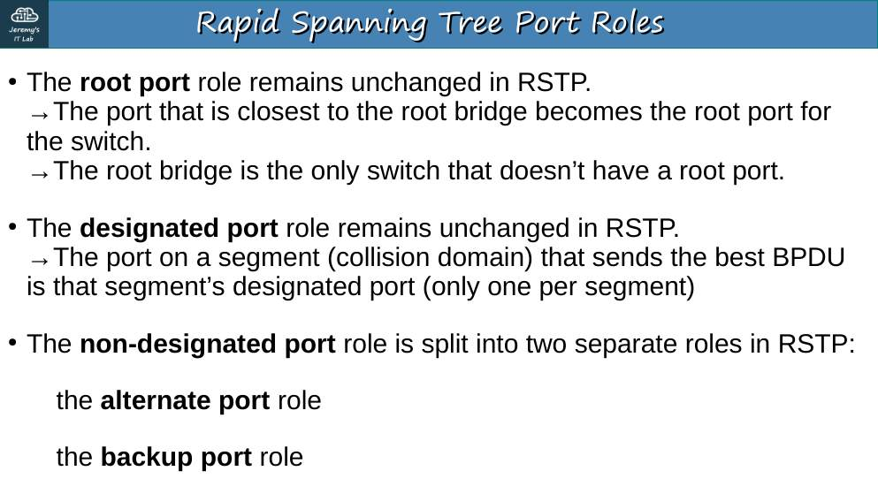
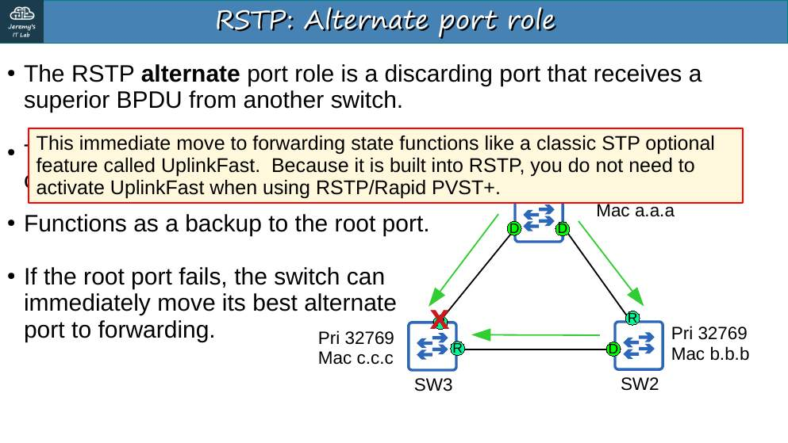
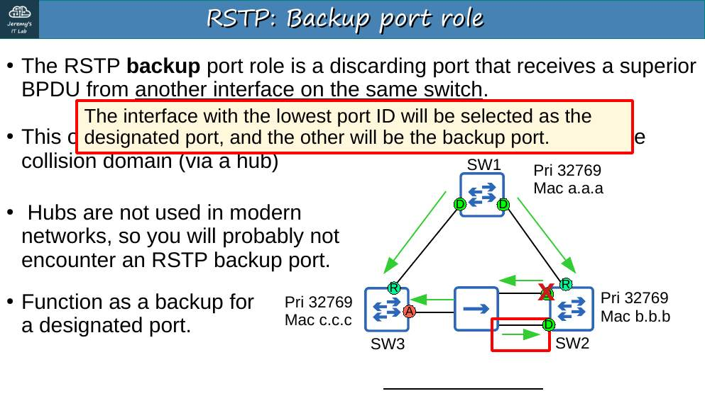
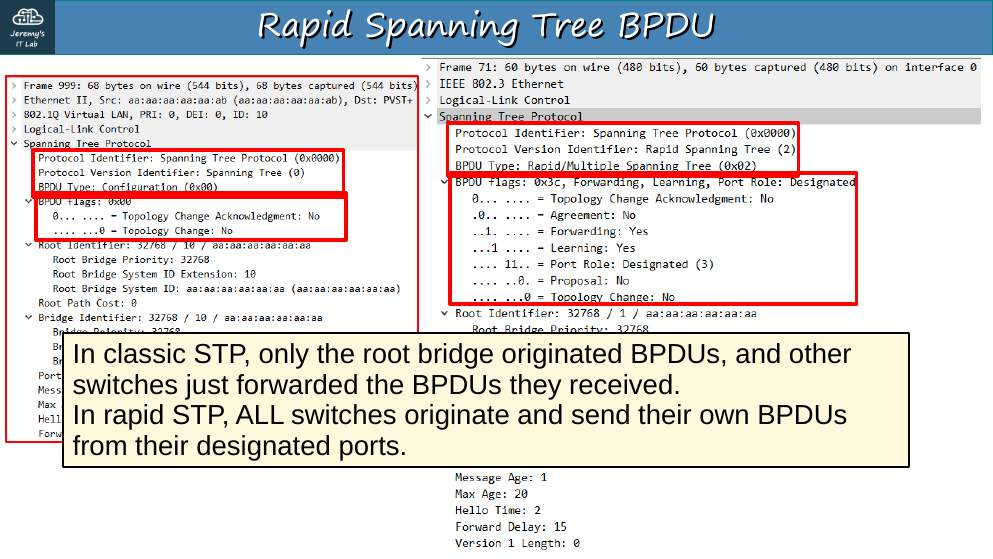
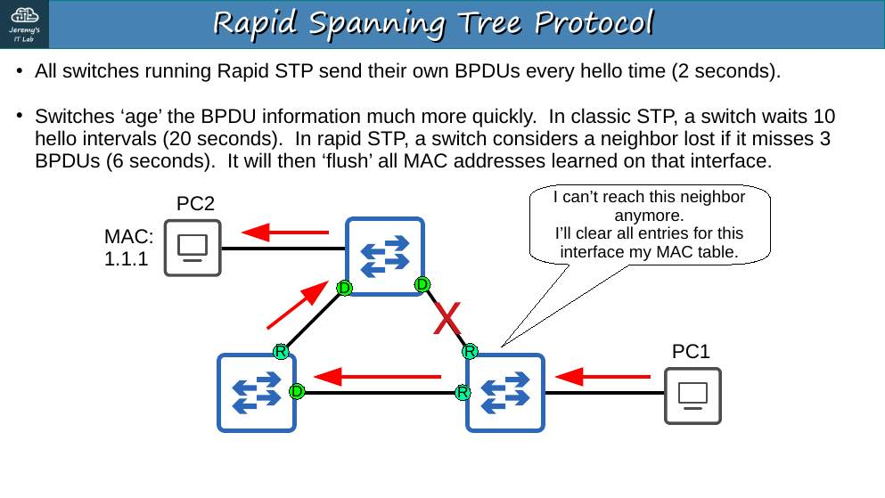
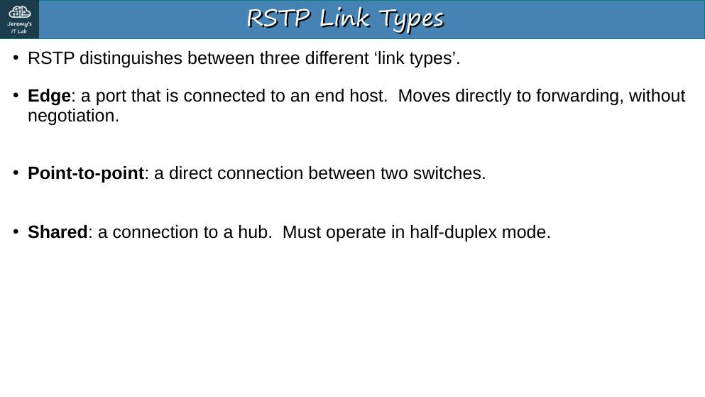
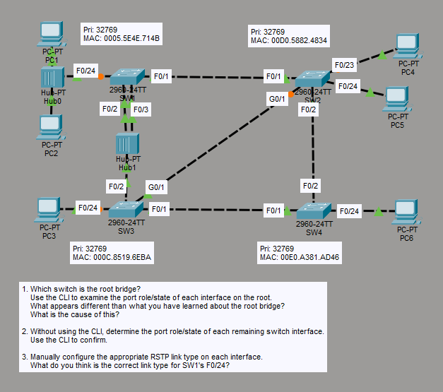

# Día 22 · Rapid Spanning Tree Protocol

> Mis apuntes del Día 22 del curso **CCNA 200-301 de Jeremy's IT Lab**.
> Video del día: [Jeremy's IT Lab en YouTube](https://www.youtube.com/@JeremysITLab).

| | |
|---|---|
| **Estado** | ✅ Estudiado |
| **Lectura Odom 2.ª ed.** | V1 caps. 9–10 |
| **NetAcad v7** | SRWE 5 |
| **Lab extra** | LG 25-2 STP |

## Diapositivas clave de Jeremy

**Day 22 Slides - Rapid STP**

<table><tr><td width="50%"><br><sub>p. 3</sub></td><td width="50%"><br><sub>p. 6</sub></td></tr><tr><td width="50%"><br><sub>p. 8</sub></td><td width="50%"><br><sub>p. 9</sub></td></tr><tr><td width="50%"><br><sub>p. 11</sub></td><td width="50%"><br><sub>p. 15</sub></td></tr><tr><td width="50%"><br><sub>p. 19</sub></td><td width="50%"><br><sub>p. 21</sub></td></tr><tr><td width="50%"><br><sub>p. 22</sub></td></tr></table>


## Apuntes

**RSTP (802.1w)** converge en segundos. En Cisco se usa **Rapid PVST+** (`spanning-tree mode rapid-pvst`). Es compatible con STP clásico (pero ese puerto pierde la rapidez).

**Estados RSTP:** solo tres → **Discarding** (reúne disabled, blocking y listening), **Learning** y **Forwarding**.

**Roles RSTP:**

| Rol | Qué es |
|---|---|
| **Root** | Igual que en STP |
| **Designated** | Igual que en STP |
| **Alternate** | Discarding. Recibe una BPDU **superior de otro switch**: es el **respaldo del root port**; pasa a forwarding al instante si el root port cae (como *UplinkFast*) |
| **Backup** | Discarding. Recibe una BPDU superior **del mismo switch** (dos puertos en el mismo segmento, p. ej. un **hub**): respaldo de un designated |

**Diferencias clave:**

- **Todos** los switches generan BPDU cada 2 s (no solo las reenvían).
- Un vecino se da por perdido tras **3 hellos perdidos (6 s)**, en lugar de max age 20 s.
- Incluye el equivalente a **UplinkFast** y **BackboneFast**.

**Tipos de enlace RSTP:**

| Tipo | Cuándo | Comando |
|---|---|---|
| **Edge** | Hacia hosts (equivale a PortFast) | `spanning-tree portfast` |
| **Point-to-point** | Switch–switch en **full duplex** (automático) | `spanning-tree link-type point-to-point` |
| **Shared** | Hacia un **hub** (half duplex, automático) | `spanning-tree link-type shared` |

## Trampas de examen

1. **Alternate** = respaldo del root port (BPDU de otro switch). **Backup** = respaldo del designated (BPDU del mismo switch, hub).
2. RSTP tiene **3** estados; STP tiene 5 (contando disabled).
3. "Edge" es PortFast.

## Laboratorio · Rapid STP


<p align="center"><br><sub>Pantallazo del laboratorio (enunciado original de Jeremy)</sub></p>


**Datos:** todos con prioridad 32769. SW1 MAC 0005.5E4E.714B, SW2 00D0.5882.4834, SW3 000C.8519.6EBA, SW4 00E0.A381.AD46. SW1 F0/24–Hub0 (PC1, PC2); SW1 F0/1–SW2 F0/1; SW1 F0/2 y F0/3–Hub1; Hub1–SW3 F0/2; SW2 G0/1–SW3 G0/1; SW2 F0/2–SW4 F0/2; SW3 F0/1–SW4 F0/1; SW2 F0/23 PC4, F0/24 PC5; SW3 F0/24 PC3; SW4 F0/24 PC6.

**Tarea 1 · ¿Quién es el root? Rol/estado de cada interfaz del root. ¿Qué es raro y por qué?**

- **Root: SW1** (todas las prioridades iguales → MAC más baja).
- `SW1# show spanning-tree`: F0/1, F0/2 y F0/24 **designated**; **F0/3 backup (BLK/discarding)**.
- **Lo raro:** se supone que todos los puertos del root son designated. **Causa:** F0/2 y F0/3 están conectados al **mismo hub** (mismo segmento). SW1 recibe por F0/3 su propia BPDU enviada por F0/2; F0/2 tiene menor port ID → designated, F0/3 → **backup**.

**Tarea 2 · Sin usar la CLI, roles del resto de interfaces; luego confirmar.**

| Switch | Puerto | Rol |
|---|---|---|
| SW2 | F0/1 | Root (costo 19) |
| SW2 | G0/1 | **Alternate** (empate de costo 19 con SW3; SW3 tiene menor BID: 000C… < 00D0…) |
| SW2 | F0/2 | Designated (19 < 38 de SW4) |
| SW2 | F0/23, F0/24 | Designated (edge) |
| SW3 | F0/2 | Root (vía Hub1, costo 19) |
| SW3 | G0/1, F0/1, F0/24 | Designated |
| SW4 | F0/1 | Root (38 por SW3 = 38 por SW2; desempata BID del vecino: SW3) |
| SW4 | F0/2 | **Alternate** |
| SW4 | F0/24 | Designated (edge) |

**Tarea 3 · Configurar el tipo de enlace RSTP en cada interfaz. ¿Cuál corresponde a SW1 F0/24?**

```
SW1(config)# spanning-tree mode rapid-pvst          ← en los 4 switches
SW1(config)# interface f0/1
SW1(config-if)# spanning-tree link-type point-to-point
SW1(config)# interface range f0/2 - 3
SW1(config-if-range)# spanning-tree link-type shared
SW2(config)# interface range f0/1 - 2 , g0/1
SW2(config-if-range)# spanning-tree link-type point-to-point
SW2(config)# interface range f0/23 - 24
SW2(config-if-range)# spanning-tree portfast
SW3(config)# interface f0/2
SW3(config-if)# spanning-tree link-type shared
SW3(config)# interface range f0/1 , g0/1
SW3(config-if-range)# spanning-tree link-type point-to-point
SW3(config)# interface f0/24
SW3(config-if)# spanning-tree portfast
SW4(config)# interface range f0/1 - 2
SW4(config-if-range)# spanning-tree link-type point-to-point
SW4(config)# interface f0/24
SW4(config-if)# spanning-tree portfast
```

**SW1 F0/24:** va a un **hub** → **shared**. Como detrás solo hay PC, se le puede añadir PortFast y aparece como **"Edge Shr"**:

```
SW1(config)# interface f0/24
SW1(config-if)# spanning-tree link-type shared
SW1(config-if)# spanning-tree portfast
```

---

## Rómpelo y arréglalo (48 h después del lab)

| # | Rompe esto | Síntoma | Te delata | Arreglo |
|---|---|---|---|---|
| 1 | Deja SW4 en `spanning-tree mode pvst` | Convergencia lenta en sus puertos | `show spanning-tree` → protocolo *ieee* | `mode rapid-pvst` |
| 2 | Pon `link-type point-to-point` en SW1 F0/2 (hub) | Puede pasar a forwarding rápido con riesgo de bucle | `show spanning-tree` → tipo P2p | `link-type shared` |
| 3 | Apaga SW2 F0/1 (root port) | G0/1 (alternate) pasa a forwarding casi al instante | `show spanning-tree` | Observa el rol nuevo |

## Repaso rápido

Intenta responder antes de abrir cada pregunta.

<details><summary>Estados de RSTP</summary>

Discarding, Learning y Forwarding.

</details>

<details><summary>Alternate vs Backup port</summary>

Alternate: respaldo del root port (BPDU de otro switch). Backup: respaldo de un designated (BPDU del mismo switch, típico con hub).

</details>

<details><summary>Tipos de enlace RSTP</summary>

Edge (PortFast), point-to-point (full duplex) y shared (half duplex/hub).

</details>

<details><summary>¿Tras cuántos hellos perdidos da RSTP un vecino por caído?</summary>

3 (6 segundos).

</details>


---

[⬅ Índice del curso](../../README.md)
