# Día 23 · EtherChannel

> Mis apuntes del Día 23 del curso **CCNA 200-301 de Jeremy's IT Lab**.
> Video del día: [Jeremy's IT Lab en YouTube](https://www.youtube.com/@JeremysITLab).

| | |
|---|---|
| **Estado** | ✅ Estudiado |
| **Lectura Odom 2.ª ed.** | V1 cap. 10 |
| **NetAcad v7** | SRWE 6 |
| **Lab extra** | LG 26-1 EtherChannel |

## Diapositivas clave de Jeremy

**Day 23 Slides - EtherChannel**

<table><tr><td width="50%">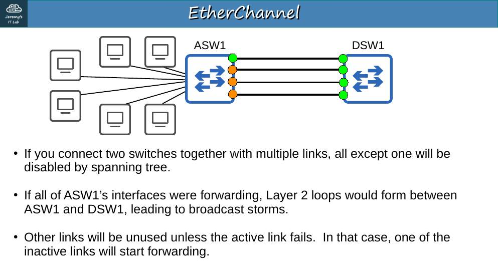<br><sub>p. 6</sub></td><td width="50%">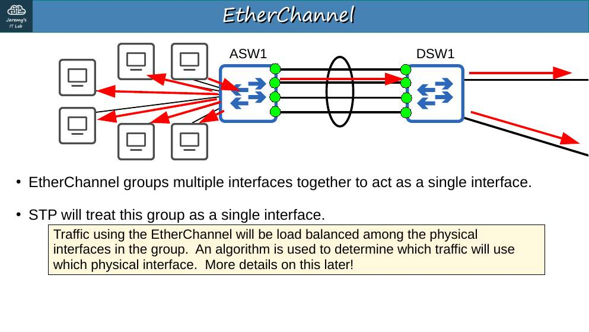<br><sub>p. 7</sub></td></tr><tr><td width="50%">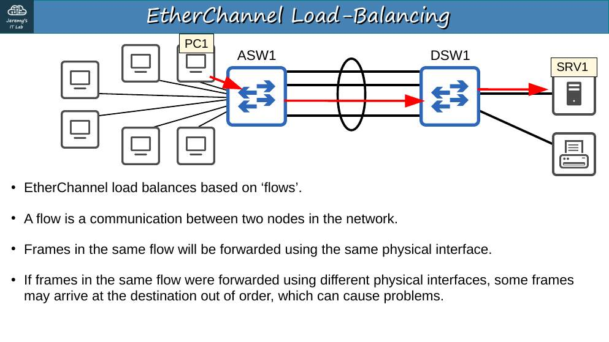<br><sub>p. 10</sub></td><td width="50%">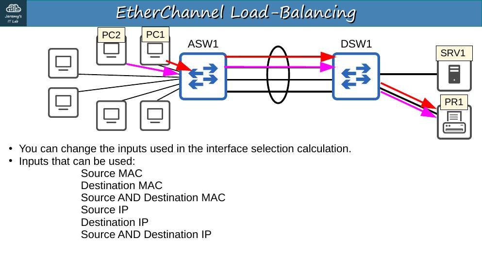<br><sub>p. 11</sub></td></tr><tr><td width="50%">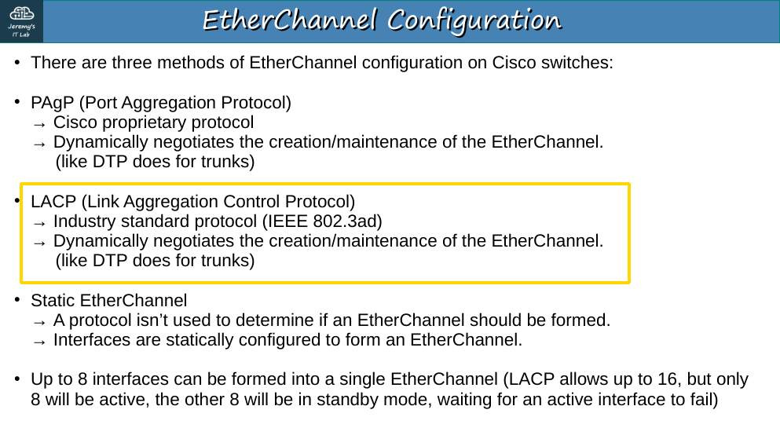<br><sub>p. 13</sub></td><td width="50%">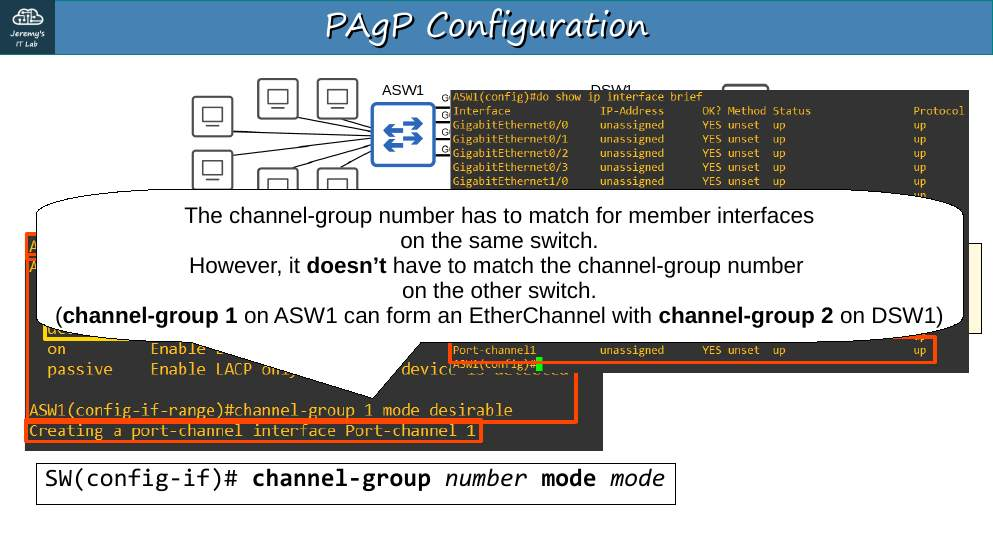<br><sub>p. 15</sub></td></tr><tr><td width="50%">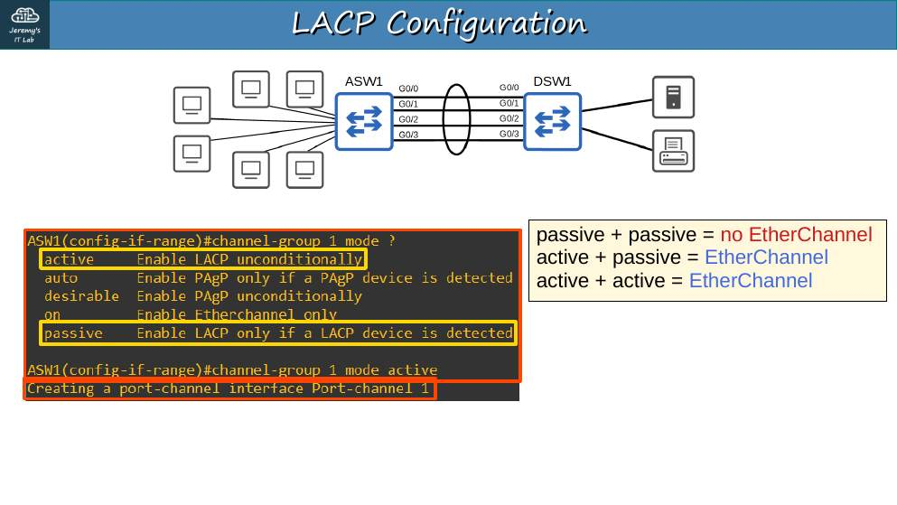<br><sub>p. 16</sub></td><td width="50%">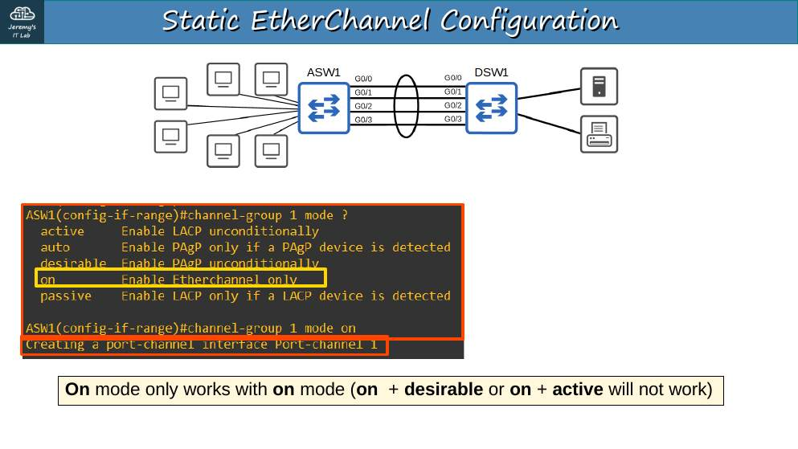<br><sub>p. 17</sub></td></tr><tr><td width="50%">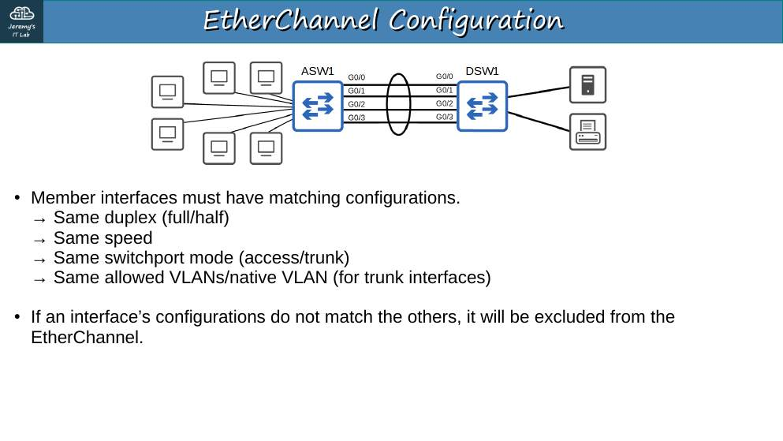<br><sub>p. 20</sub></td><td width="50%">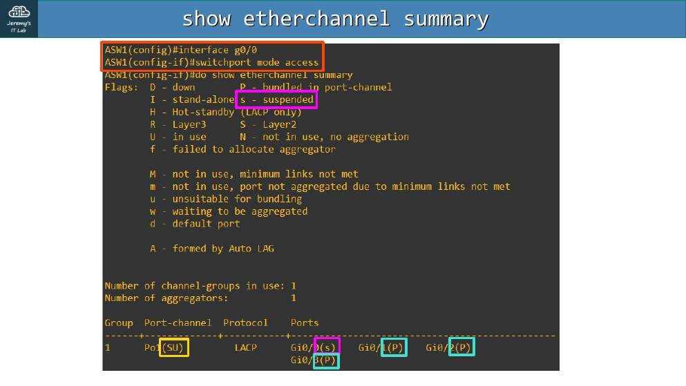<br><sub>p. 23</sub></td></tr><tr><td width="50%">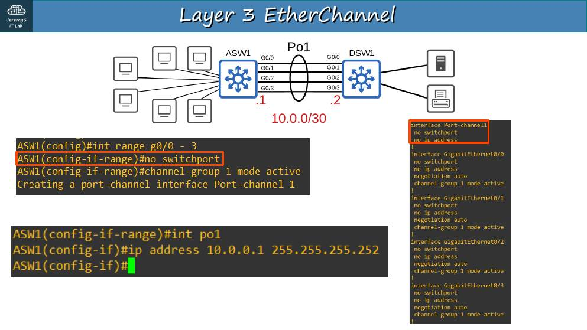<br><sub>p. 27</sub></td><td width="50%">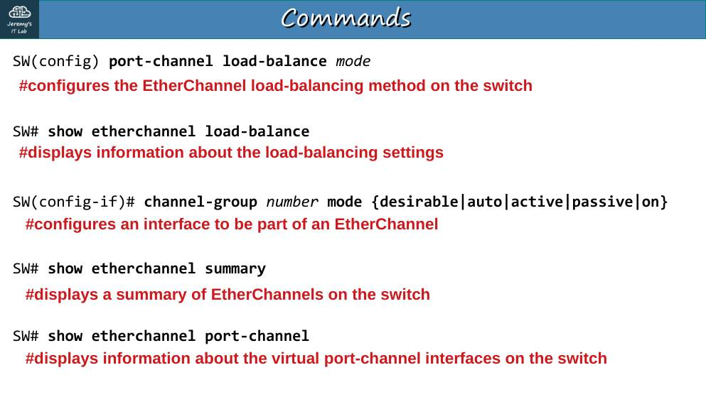<br><sub>p. 30</sub></td></tr></table>


## Apuntes

**EtherChannel** agrupa de 2 a 8 enlaces físicos en **un enlace lógico** (*port-channel*). STP lo ve como **uno solo** → no bloquea ninguno y se suma el ancho de banda. Si cae un miembro, el tráfico sigue por los demás.

**Balanceo de carga:** se hace **por flujo** (no por trama), con un hash de: MAC de origen/destino, IP de origen/destino o ambas.

```
SW1# show etherchannel load-balance
SW1(config)# port-channel load-balance src-dst-ip
```

**Protocolos:**

| Método | Modos | Combinaciones que forman canal |
|---|---|---|
| **PAgP** (Cisco) | **desirable**, **auto** | desirable+desirable, desirable+auto |
| **LACP** (IEEE 802.3ad) | **active**, **passive** | active+active, active+passive |
| **Estático** | **on** | solo on+on |

auto+auto o passive+passive → **no** se forma. Máximo 8 enlaces activos (LACP admite 16, 8 en espera).

**Requisitos para que los puertos se agrupen:** misma velocidad y dúplex, mismo modo (acceso/trunk), misma VLAN de acceso o mismas VLAN permitidas y nativa. Si no coinciden, el puerto queda **suspendido** (s).

```
SW1(config)# interface range g0/1 - 2
SW1(config-if-range)# channel-group 1 mode active
SW1(config)# interface port-channel 1
SW1(config-if)# switchport mode trunk
SW1# show etherchannel summary
SW1# show etherchannel port-channel
```

**EtherChannel de capa 3** (switch multicapa): `no switchport` en los miembros **antes** de `channel-group`, y la IP en `interface port-channel`.

| Bandera de `show etherchannel summary` | Significado |
|---|---|
| **P** | Miembro en el bundle |
| **S / R** | Layer 2 / Layer 3 |
| **U** | En uso |
| **D** | Down · **s** suspendido · **I** individual |

## Trampas de examen

1. auto+auto y passive+passive **no** forman canal.
2. `mode on` no negocia: si el otro lado tiene LACP, **no** funciona.
3. El balanceo es por flujo: un solo flujo grande usa un solo enlace.
4. `SU` = L2 en uso; `RU` = L3 en uso.

## Laboratorio · EtherChannel


<p align="center">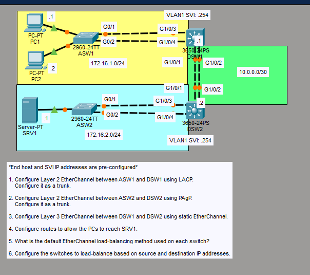<br><sub>Pantallazo del laboratorio (enunciado original de Jeremy)</sub></p>


**Topología:** ASW1 G0/1-2 ↔ DSW1 G1/0/3-4; ASW2 G0/1-2 ↔ DSW2 G1/0/3-4; DSW1 G1/0/1-2 ↔ DSW2 G1/0/1-2 (10.0.0.0/30: DSW1 .1, DSW2 .2). DSW1 SVI VLAN1 172.16.1.254 (PC1 .1, PC2 .2). DSW2 SVI VLAN1 172.16.2.254 (SRV1 .1). Los hosts y las SVI vienen configurados.

**Tarea 1 · EtherChannel L2 ASW1–DSW1 con LACP, como trunk.**

```
ASW1(config)# interface range g0/1 - 2
ASW1(config-if-range)# channel-group 1 mode active
ASW1(config)# interface port-channel 1
ASW1(config-if)# switchport mode trunk
DSW1(config)# interface range g1/0/3 - 4
DSW1(config-if-range)# channel-group 1 mode active
DSW1(config)# interface port-channel 1
DSW1(config-if)# switchport trunk encapsulation dot1q
DSW1(config-if)# switchport mode trunk
```

**Tarea 2 · EtherChannel L2 ASW2–DSW2 con PAgP, como trunk.**

```
ASW2(config)# interface range g0/1 - 2
ASW2(config-if-range)# channel-group 1 mode desirable
ASW2(config)# interface port-channel 1
ASW2(config-if)# switchport mode trunk
DSW2(config)# interface range g1/0/3 - 4
DSW2(config-if-range)# channel-group 1 mode desirable
DSW2(config)# interface port-channel 1
DSW2(config-if)# switchport trunk encapsulation dot1q
DSW2(config-if)# switchport mode trunk
```

**Tarea 3 · EtherChannel L3 estático DSW1–DSW2.**

```
DSW1(config)# interface range g1/0/1 - 2
DSW1(config-if-range)# no switchport
DSW1(config-if-range)# channel-group 2 mode on
DSW1(config)# interface port-channel 2
DSW1(config-if)# no switchport
DSW1(config-if)# ip address 10.0.0.1 255.255.255.252
DSW2(config)# interface range g1/0/1 - 2
DSW2(config-if-range)# no switchport
DSW2(config-if-range)# channel-group 2 mode on
DSW2(config)# interface port-channel 2
DSW2(config-if)# no switchport
DSW2(config-if)# ip address 10.0.0.2 255.255.255.252
```

**Tarea 4 · Rutas para que los PC lleguen a SRV1.**

```
DSW1(config)# ip routing
DSW1(config)# ip route 172.16.2.0 255.255.255.0 10.0.0.2
DSW2(config)# ip routing
DSW2(config)# ip route 172.16.1.0 255.255.255.0 10.0.0.1
```

**Tarea 5 · ¿Método de balanceo por defecto?** `show etherchannel load-balance` → **src-mac** en los cuatro switches.

**Tarea 6 · Balancear por IP de origen y destino.**

```
ASW1(config)# port-channel load-balance src-dst-ip     ← y en ASW2, DSW1, DSW2
```

**Verificación:** `show etherchannel summary` → Po1 **(SU)** con miembros **(P)** y Po2 **(RU)**; ping PC1 → 172.16.2.1.

---

## Rómpelo y arréglalo (48 h después del lab)

| # | Rompe esto | Síntoma | Te delata | Arreglo |
|---|---|---|---|---|
| 1 | ASW1 `mode passive` y DSW1 `mode passive` | No se forma el Po1 | `show etherchannel summary` → miembros (I) o (s) | Uno active |
| 2 | ASW2 G0/2 con `switchport access vlan 10` (distinto del otro miembro) | El puerto queda suspendido | `show etherchannel summary` → (s) | Configurar igual en el Port-channel |
| 3 | DSW2 Po2 sin `no switchport` antes de la IP | IOS rechaza la IP | Mensaje de error | `no switchport` |

## Repaso rápido

Intenta responder antes de abrir cada pregunta.

<details><summary>Combinaciones que forman EtherChannel con PAgP y LACP</summary>

PAgP: desirable+desirable o desirable+auto. LACP: active+active o active+passive.

</details>

<details><summary>¿auto+auto o passive+passive forman canal?</summary>

No.

</details>

<details><summary>Modo estático de EtherChannel</summary>

on (solo con on en el otro lado).

</details>

<details><summary>Requisitos para que los puertos entren al bundle</summary>

Misma velocidad/dúplex, mismo modo, mismas VLAN (acceso o permitidas y nativa).

</details>

<details><summary>SU vs RU en show etherchannel summary</summary>

SU: Port-channel L2 en uso. RU: L3 en uso.

</details>

<details><summary>¿El balanceo es por trama o por flujo?</summary>

Por flujo (hash de MAC/IP de origen/destino).

</details>


---

[⬅ Índice del curso](../../README.md)
