# Día 24 · Enrutamiento dinámico

> Mis apuntes del Día 24 del curso **CCNA 200-301 de Jeremy's IT Lab**.
> Video del día: [Jeremy's IT Lab en YouTube](https://www.youtube.com/@JeremysITLab).

| | |
|---|---|
| **Estado** | ✅ Estudiado |
| **Lectura Odom 2.ª ed.** | V1 cap. 21 (conceptos) |
| **NetAcad v7** | SRWE 14 |
| **Lab extra** | LG 17 Dynamic Routing Protocols |

## Diapositivas clave de Jeremy

**Day 24 Slides - Dynamic Routing**

<table><tr><td width="50%">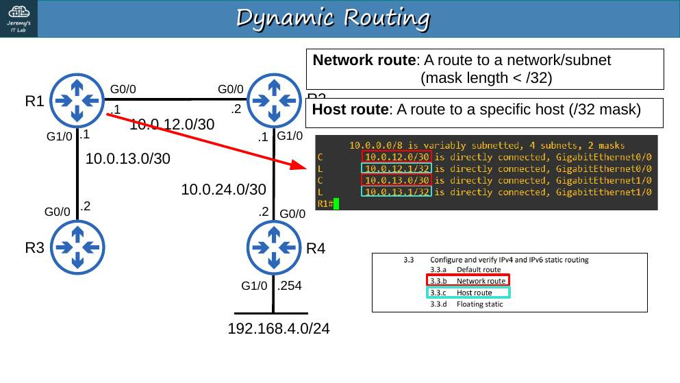<br><sub>p. 3</sub></td><td width="50%">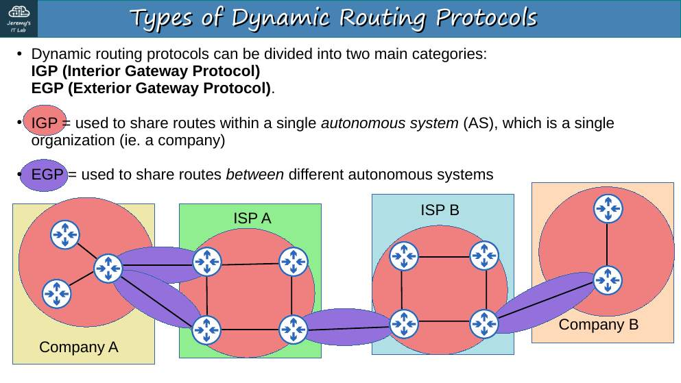<br><sub>p. 10</sub></td></tr><tr><td width="50%">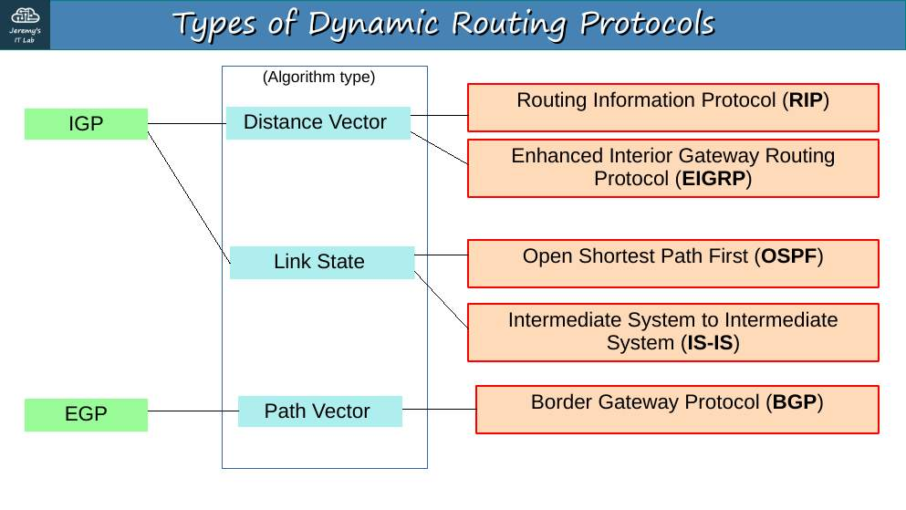<br><sub>p. 11</sub></td><td width="50%">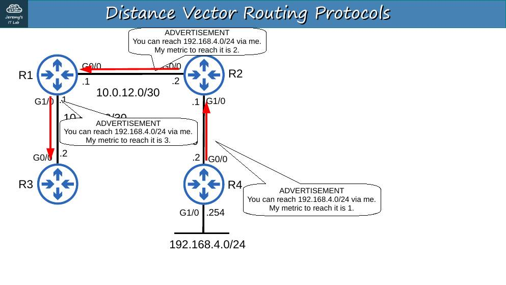<br><sub>p. 13</sub></td></tr><tr><td width="50%">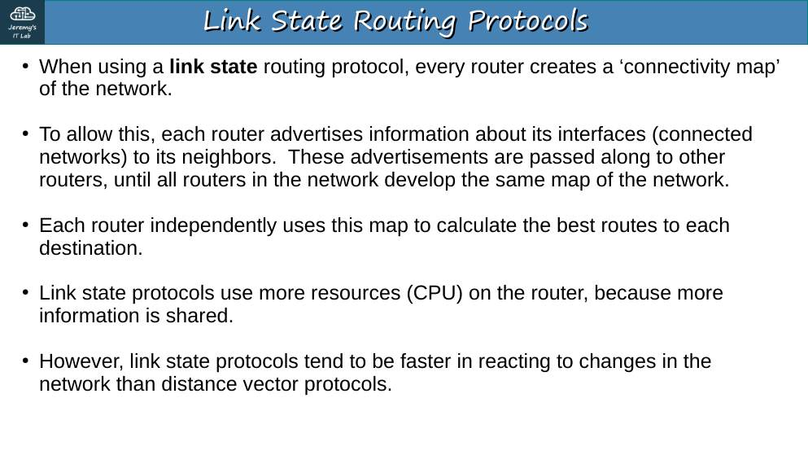<br><sub>p. 14</sub></td><td width="50%">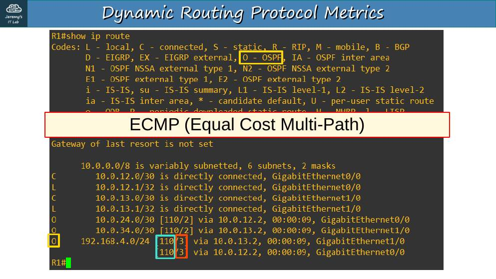<br><sub>p. 18</sub></td></tr><tr><td width="50%">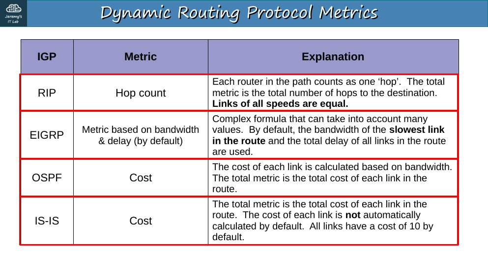<br><sub>p. 20</sub></td><td width="50%">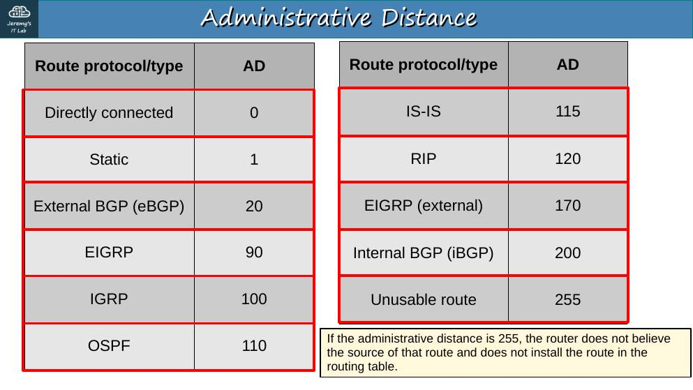<br><sub>p. 23</sub></td></tr><tr><td width="50%">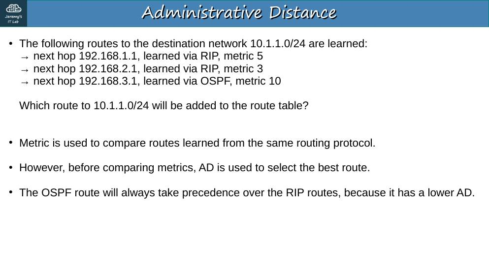<br><sub>p. 24</sub></td><td width="50%">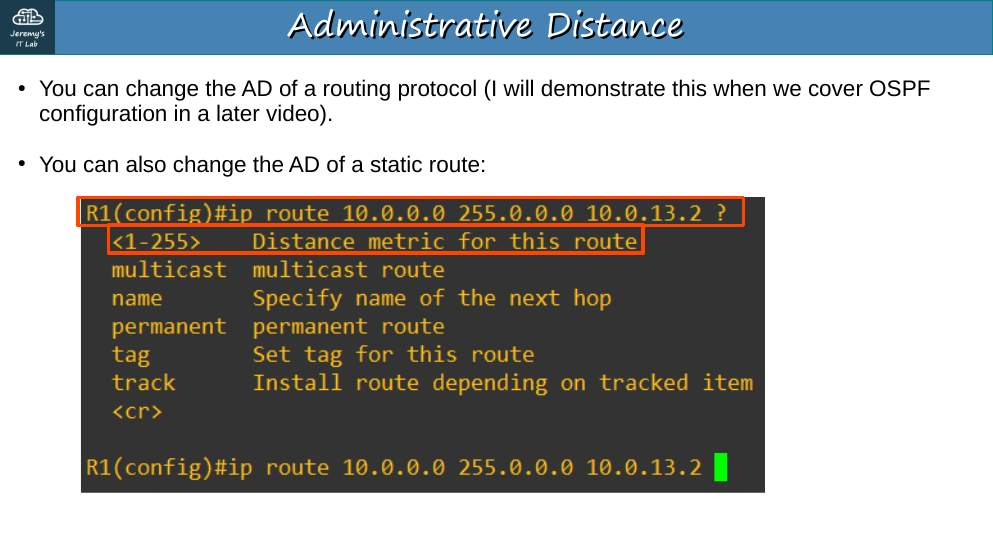<br><sub>p. 27</sub></td></tr><tr><td width="50%">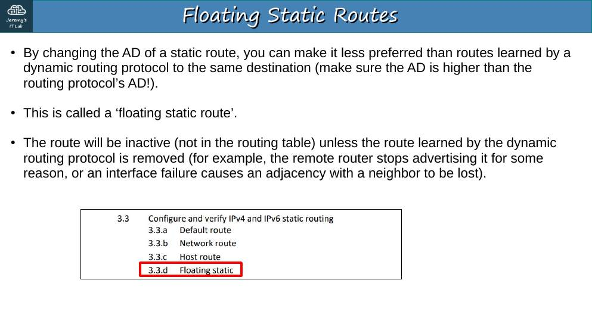<br><sub>p. 29</sub></td></tr></table>


## Apuntes

**Tipos de protocolos de enrutamiento:**

- **IGP** (dentro de un sistema autónomo): RIP, EIGRP, OSPF, IS-IS. **EGP** (entre sistemas autónomos): **BGP**.
- **Vector distancia** (RIP, EIGRP): "enrutamiento por rumor"; cada router conoce lo que le cuentan sus vecinos.
- **Estado de enlace** (OSPF, IS-IS): cada router construye un **mapa completo** de la red y calcula con el algoritmo SPF (Dijkstra).

**Métrica:** valor que compara rutas **del mismo protocolo** (menor = mejor). Si dos rutas empatan → **ECMP** (balanceo de igual costo).

| Protocolo | Métrica |
|---|---|
| RIP | **Saltos** (máx. 15) |
| EIGRP | Ancho de banda mínimo + retardo total |
| OSPF | **Costo** (basado en ancho de banda) |

**Distancia administrativa (AD):** compara rutas al **mismo prefijo** de **protocolos distintos** (menor = más confiable).

| Origen | AD |
|---|---|
| Connected | **0** |
| Static | **1** |
| eBGP | **20** |
| EIGRP | **90** |
| IGRP | 100 |
| OSPF | **110** |
| IS-IS | **115** |
| RIP | **120** |
| EIGRP externo | **170** |
| iBGP | **200** |
| Inalcanzable | 255 |

**Ruta estática flotante:** una estática con AD **mayor** que la del protocolo dinámico → solo entra en la tabla si la ruta dinámica desaparece (respaldo).

```
R1(config)# ip route 10.0.2.0 255.255.255.0 203.0.113.1 111   ← flotante sobre OSPF (110)
```

**Orden de decisión del router:** 1) **prefijo más largo**; 2) si hay empate de prefijo entre protocolos, menor **AD**; 3) dentro del mismo protocolo, menor **métrica**.

## Trampas de examen

1. La AD se compara antes que la métrica, pero **después** del prefijo más largo.
2. EIGRP 90 < OSPF 110 < RIP 120. Externo EIGRP = 170.
3. Una flotante con AD 1 **no** flota: queda activa y gana a OSPF.

## Laboratorio · Rutas estáticas flotantes


<p align="center">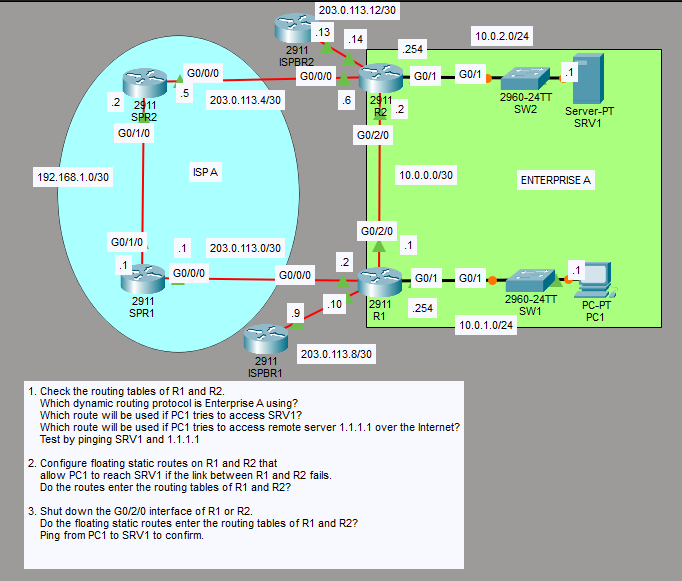<br><sub>Pantallazo del laboratorio (enunciado original de Jeremy)</sub></p>


**Topología (Enterprise A + ISP A):** R1 G0/1 .254 (10.0.1.0/24, PC1 .1); R1 G0/2/0 .1 – R2 G0/2/0 .2 (10.0.0.0/30); R1 G0/0/0 .2 – SPR1 .1 (203.0.113.0/30); R1 .10 – ISPBR1 .9 (203.0.113.8/30). R2 G0/1 .254 (10.0.2.0/24, SRV1 .1); R2 G0/0/0 .6 – SPR2 .5 (203.0.113.4/30); R2 .14 – ISPBR2 .13 (203.0.113.12/30). SPR1–SPR2 192.168.1.0/30.

**Tarea 1 · Revisar las tablas de R1 y R2.**

```
R1# show ip route
R2# show ip route
```

- **¿Qué protocolo usa Enterprise A?** El código de las rutas aprendidas: **O** = OSPF (AD 110), **D** = EIGRP (AD 90). Anota cuál ves, porque define la AD de la ruta flotante de la tarea 2.
- **PC1 → SRV1:** usa la ruta dinámica a 10.0.2.0/24 por el enlace interno R1–R2 (G0/2/0).
- **PC1 → 1.1.1.1:** no hay ruta específica → usa la **ruta por defecto** hacia el ISP de Internet (ISPBR1).
- Prueba: ping a SRV1 y a 1.1.1.1 desde PC1.

**Tarea 2 · Rutas flotantes para llegar a SRV1 vía ISP A si cae el enlace R1–R2. ¿Entran en la tabla?**

```
R1(config)# ip route 10.0.2.0 255.255.255.0 203.0.113.1 111
R2(config)# ip route 10.0.1.0 255.255.255.0 203.0.113.5 111
```

(Si el protocolo es OSPF, la AD debe superar 110; si es EIGRP, basta con 91. Con 111 cubres OSPF; si ves rutas D, puedes usar 91 o cualquier valor mayor que 90.) **No entran:** la ruta OSPF tiene menor AD.

**Tarea 3 · Apagar G0/2/0 de R1 o R2. ¿Entran las flotantes? Probar con ping.**

```
R1(config)# interface g0/2/0
R1(config-if)# shutdown
R1# show ip route static
S    10.0.2.0/24 [111/0] via 203.0.113.1
```

**Sí entran.** El ping PC1 → SRV1 funciona a través de la red de ISP A. Vuelve a hacer `no shutdown` al terminar.

---

## Rómpelo y arréglalo (48 h después del lab)

| # | Rompe esto | Síntoma | Te delata | Arreglo |
|---|---|---|---|---|
| 1 | Flotante con AD 100 (menor que OSPF) | La estática gana aunque el enlace interno funcione | `show ip route` → S en lugar de O | AD > 110 |
| 2 | Flotante con siguiente salto mal escrito | Al fallar el enlace interno no hay respaldo | `show ip route static` vacía | Siguiente salto correcto |
| 3 | Flotante solo en R1 | La ida llega por el ISP; la vuelta no | `tracert` desde SRV1 | Flotante también en R2 |

## Repaso rápido

Intenta responder antes de abrir cada pregunta.

<details><summary>AD de connected, static, eBGP, EIGRP, OSPF, IS-IS, RIP</summary>

0, 1, 20, 90, 110, 115, 120.

</details>

<details><summary>AD de EIGRP externo e iBGP</summary>

170 y 200.

</details>

<details><summary>¿Qué es una ruta estática flotante?</summary>

Una estática con AD mayor que la del protocolo dinámico: solo entra si la ruta dinámica desaparece.

</details>

<details><summary>Orden de decisión del router</summary>

Prefijo más largo → menor AD → menor métrica.

</details>

<details><summary>IGP vs EGP</summary>

IGP dentro de un sistema autónomo (OSPF, EIGRP); EGP entre sistemas autónomos (BGP).

</details>


---

[⬅ Índice del curso](../../README.md)
