# Día 25 · RIP y EIGRP

> Mis apuntes del Día 25 del curso **CCNA 200-301 de Jeremy's IT Lab**.
> Video del día: [Jeremy's IT Lab en YouTube](https://www.youtube.com/@JeremysITLab).

| | |
|---|---|
| **Estado** | ✅ Estudiado |
| **Lectura Odom 2.ª ed.** | V1 cap. 21 (conceptos) |
| **NetAcad v7** | SRWE 14 |
| **Lab extra** | LG 17 Dynamic Routing Protocols |

## Diapositivas clave de Jeremy

**Day 25 Extra Slides - EIGRP Terms**

<table><tr><td width="50%">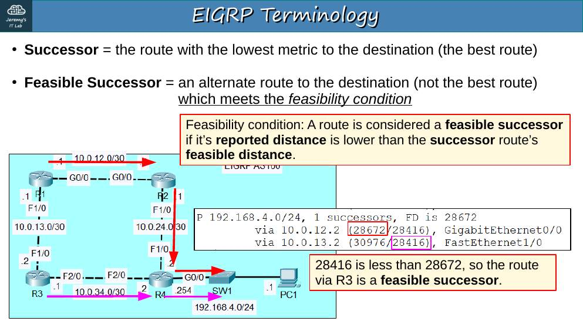<br><sub>p. 3</sub></td><td width="50%">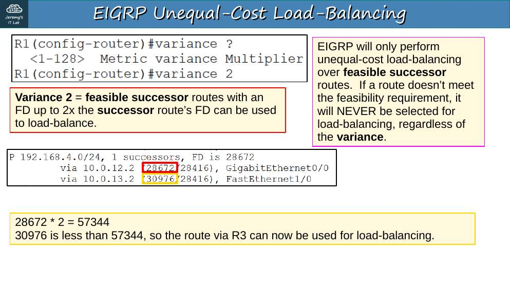<br><sub>p. 5</sub></td></tr><tr><td width="50%">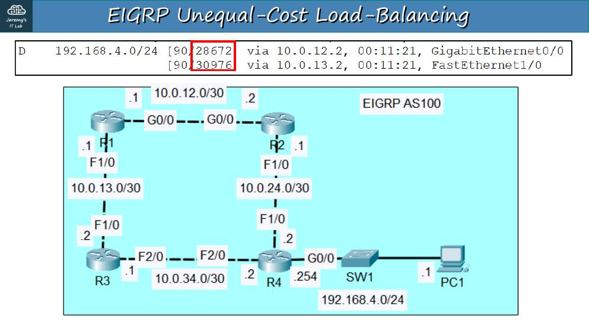<br><sub>p. 6</sub></td></tr></table>

**Day 25 Slides - RIP & EIGRP**

<table><tr><td width="50%">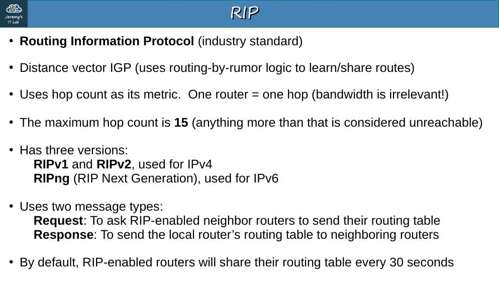<br><sub>p. 3</sub></td><td width="50%">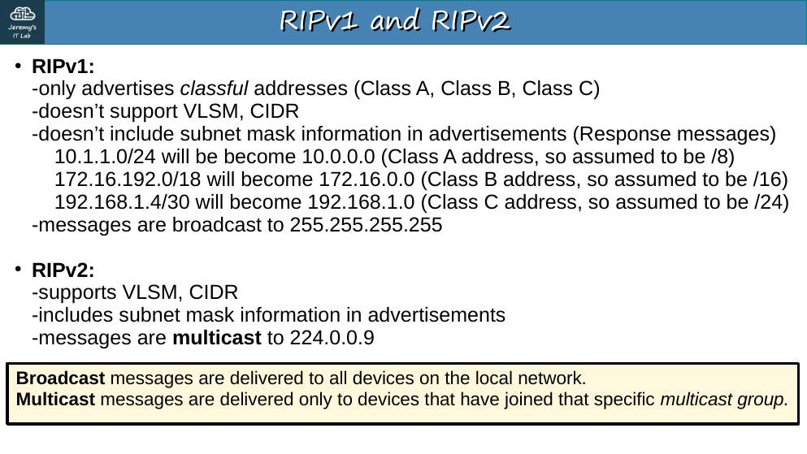<br><sub>p. 4</sub></td></tr><tr><td width="50%">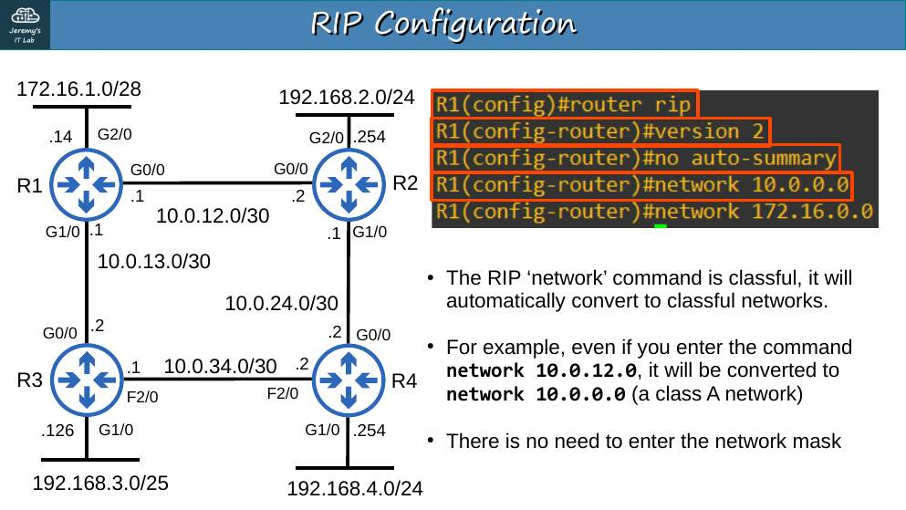<br><sub>p. 5</sub></td><td width="50%">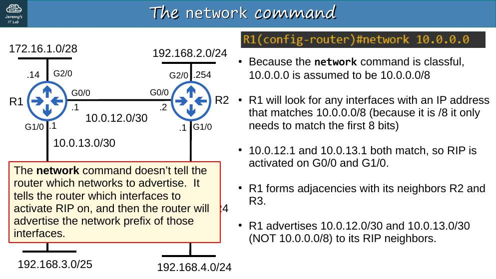<br><sub>p. 7</sub></td></tr><tr><td width="50%">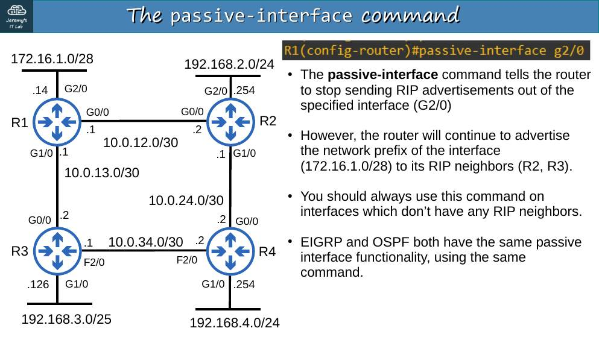<br><sub>p. 9</sub></td><td width="50%">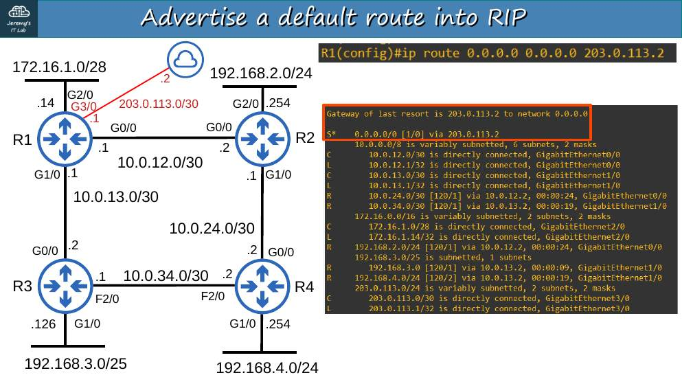<br><sub>p. 10</sub></td></tr><tr><td width="50%">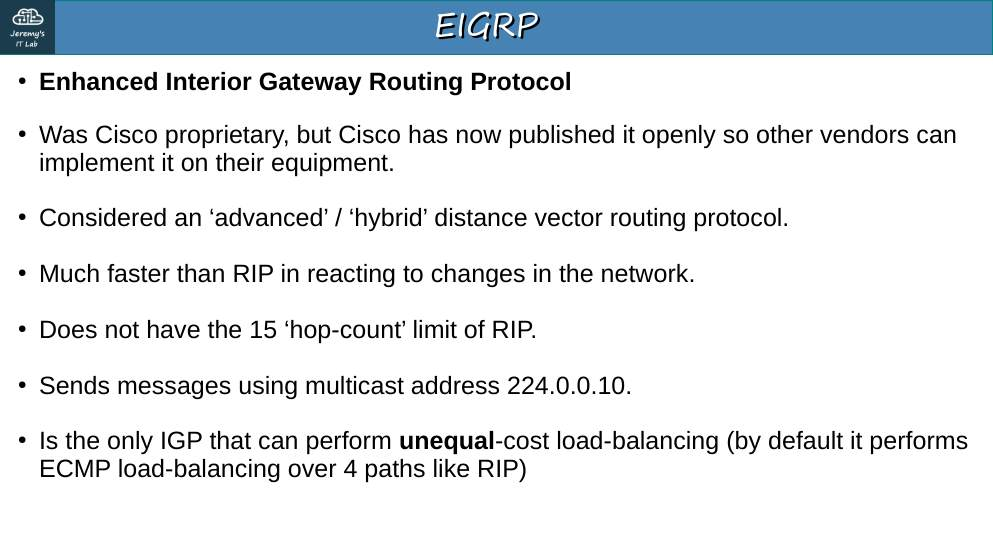<br><sub>p. 13</sub></td><td width="50%">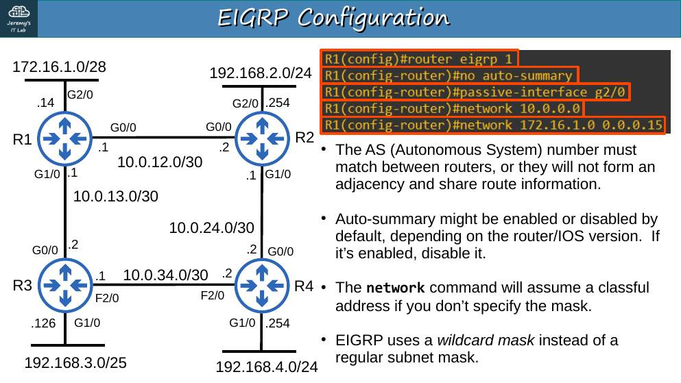<br><sub>p. 14</sub></td></tr><tr><td width="50%">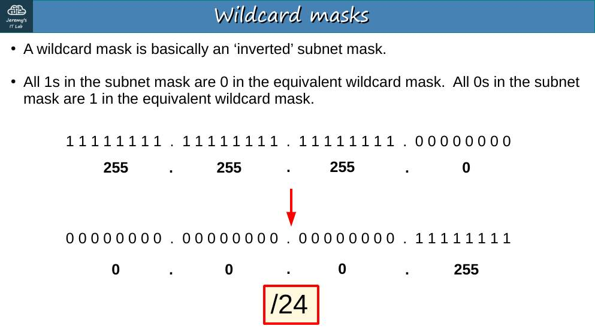<br><sub>p. 15</sub></td><td width="50%">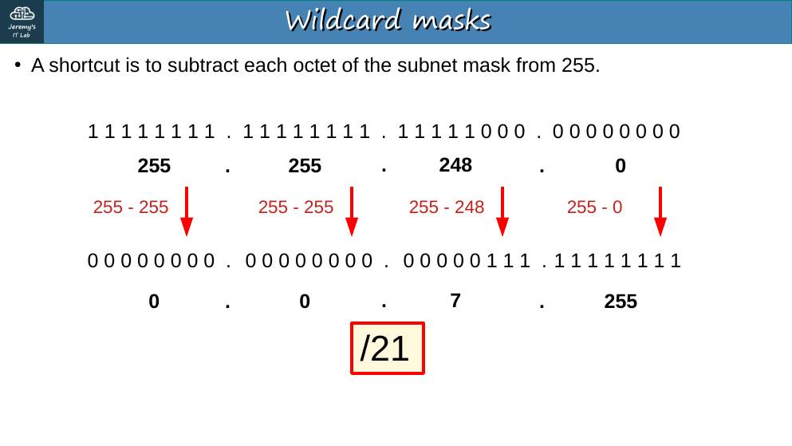<br><sub>p. 22</sub></td></tr><tr><td width="50%">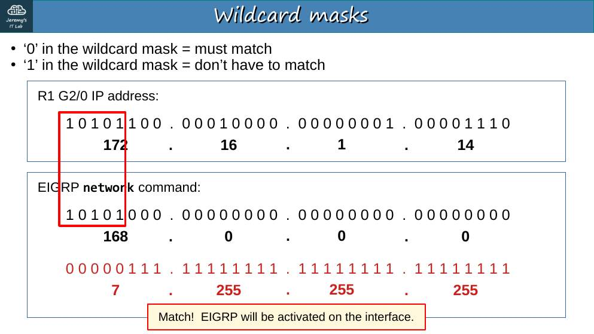<br><sub>p. 26</sub></td><td width="50%">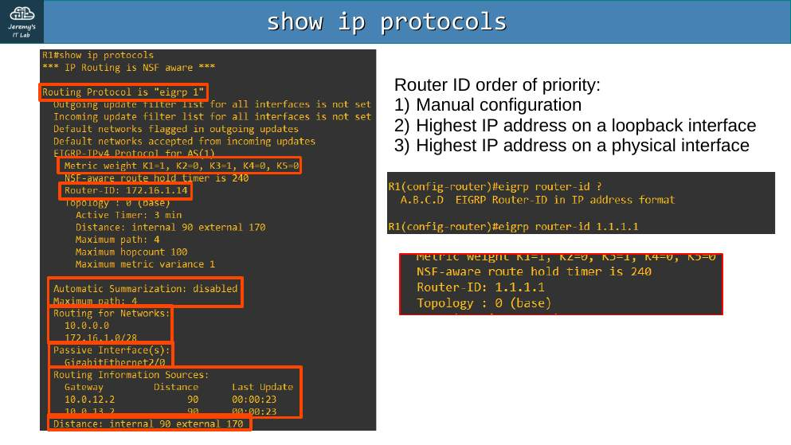<br><sub>p. 28</sub></td></tr></table>


## Apuntes

**RIP (Routing Information Protocol)** — vector distancia, métrica **saltos** (máx. 15; 16 = inalcanzable). Actualizaciones cada **30 s**. RIPv1 (classful, broadcast) y **RIPv2** (classless, multicast **224.0.0.9**). AD **120**.

```
R1(config)# router rip
R1(config-router)# version 2
R1(config-router)# no auto-summary
R1(config-router)# network 10.0.0.0             ← classful: activa RIP en interfaces de esa red
R1(config-router)# passive-interface g0/0
R1(config-router)# default-information originate
```

**EIGRP** — propietario de Cisco (parcialmente abierto), "vector distancia avanzado". Multicast **224.0.0.10**, AD **90** (interno) / 170 (externo). Balancea con **costos distintos** (`variance`).

- **Métrica** (K1 y K3 por defecto) = **256 × (10⁷ / ancho de banda mínimo en kbps + suma de retardos en decenas de µs)**.
- **Feasible Distance (FD):** métrica total de este router al destino.
- **Reported/Advertised Distance (RD/AD):** métrica que **informa el vecino** hasta el destino.
- **Successor:** la mejor ruta (menor FD).
- **Feasible successor:** ruta de respaldo **sin bucles**; condición de factibilidad: **RD del vecino < FD del successor**.
- `variance n`: acepta rutas de feasible successor con FD < n × FD del successor.

```
R1(config)# router eigrp 100                    ← el AS debe coincidir entre vecinos
R1(config-router)# no auto-summary
R1(config-router)# network 10.0.12.0 0.0.0.3    ← wildcard = máscara invertida
R1(config-router)# passive-interface loopback0
R1(config-router)# eigrp router-id 1.1.1.1
R1(config-router)# variance 2
R1# show ip eigrp neighbors / show ip eigrp topology / show ip protocols
```

**Wildcard:** 0 = debe coincidir, 1 = no importa. Máscara 255.255.255.252 → wildcard **0.0.0.3**. Truco: 255.255.255.255 − máscara.

**Router ID** (EIGRP y OSPF): 1) configurado a mano; 2) IP más alta de una **loopback** up; 3) IP más alta de una interfaz física up.

## Trampas de examen

1. **Condición de factibilidad:** RD **<** FD del successor (estrictamente menor).
2. `variance` solo balancea con **feasible successors**.
3. RIP: 16 saltos = inalcanzable. EIGRP AD 90, RIP 120.
4. La wildcard de /30 es 0.0.0.3.

## Laboratorio · Configurar EIGRP


<p align="center">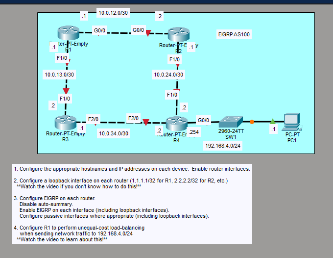<br><sub>Pantallazo del laboratorio (enunciado original de Jeremy)</sub></p>


**Topología (EIGRP AS 100):** R1 G0/0 .1–R2 G0/0 .2 (10.0.12.0/30); R1 F1/0 .1–R3 F1/0 .2 (10.0.13.0/30); R2 F1/0 .1–R4 F1/0 .2 (10.0.24.0/30); R3 F2/0 .1–R4 F2/0 .2 (10.0.34.0/30); R4 G0/0 .254–SW1–PC1 .1 (192.168.4.0/24). Routers vacíos (Router-PT-Empty: agrega módulos si hace falta).

**Tarea 1 · Hostnames, IP y encender interfaces.**

```
R1(config)# interface g0/0
R1(config-if)# ip address 10.0.12.1 255.255.255.252
R1(config-if)# no shutdown
R1(config)# interface f1/0
R1(config-if)# ip address 10.0.13.1 255.255.255.252
R1(config-if)# no shutdown
```

R2: G0/0 10.0.12.2, F1/0 10.0.24.1. R3: F1/0 10.0.13.2, F2/0 10.0.34.1. R4: F1/0 10.0.24.2, F2/0 10.0.34.2, G0/0 192.168.4.254 (todas /30 salvo G0/0 /24). PC1 192.168.4.1/24, gw .254.

**Tarea 2 · Una loopback por router (1.1.1.1/32 en R1, 2.2.2.2/32 en R2, …).**

```
R1(config)# interface loopback0
R1(config-if)# ip address 1.1.1.1 255.255.255.255
```

**Tarea 3 · EIGRP en cada router: sin auto-summary, en todas las interfaces (incluidas loopbacks) e interfaces pasivas donde corresponda.**

```
R1(config)# router eigrp 100
R1(config-router)# no auto-summary
R1(config-router)# network 10.0.12.0 0.0.0.3
R1(config-router)# network 10.0.13.0 0.0.0.3
R1(config-router)# network 1.1.1.1 0.0.0.0
R1(config-router)# passive-interface loopback0

R2(config-router)# network 10.0.12.0 0.0.0.3
R2(config-router)# network 10.0.24.0 0.0.0.3
R2(config-router)# network 2.2.2.2 0.0.0.0
R2(config-router)# passive-interface loopback0
(R3 igual con 10.0.13.0, 10.0.34.0 y 3.3.3.3)

R4(config-router)# network 10.0.24.0 0.0.0.3
R4(config-router)# network 10.0.34.0 0.0.0.3
R4(config-router)# network 192.168.4.0 0.0.0.255
R4(config-router)# network 4.4.4.4 0.0.0.0
R4(config-router)# passive-interface loopback0
R4(config-router)# passive-interface g0/0        ← no hay routers hacia PC1
```

**Tarea 4 · Balanceo de costos distintos en R1 hacia 192.168.4.0/24.**

| Ruta desde R1 | BW mínimo | Retardos | FD | RD del vecino |
|---|---|---|---|---|
| Vía R2 (successor) | 100 Mbps | 10 + 100 + 10 = 120 µs | (100 + 12) × 256 = **28 672** | 26 112 |
| Vía R3 | 100 Mbps | 100 + 100 + 10 = 210 µs | (100 + 21) × 256 = **30 976** | (100 + 11) × 256 = **28 416** |

28 416 < 28 672 → R3 es **feasible successor**. 2 × 28 672 = 57 344 > 30 976 → con `variance 2` entran las dos.

```
R1(config)# router eigrp 100
R1(config-router)# variance 2
R1# show ip route 192.168.4.0     ← dos rutas, con métricas 28672 y 30976
R1# show ip eigrp topology
```

## Rómpelo y arréglalo (48 h después del lab)

| # | Rompe esto | Síntoma | Te delata | Arreglo |
|---|---|---|---|---|
| 1 | `router eigrp 200` en R4 | R4 sin vecinos | `show ip eigrp neighbors` vacío | Mismo AS (100) |
| 2 | `passive-interface f1/0` en R2 | R2–R4 sin adyacencia | `show ip protocols` → Passive Interface(s) | Quitarlo |
| 3 | `variance 1` (o sin variance) | Una sola ruta a 192.168.4.0 | `show ip route 192.168.4.0` | `variance 2` |

---

## Repaso rápido

Intenta responder antes de abrir cada pregunta.

<details><summary>Métrica de RIP y su máximo</summary>

Saltos; máximo 15 (16 = inalcanzable).

</details>

<details><summary>Multicast de RIPv2 y de EIGRP</summary>

224.0.0.9 y 224.0.0.10.

</details>

<details><summary>Condición de factibilidad de EIGRP</summary>

RD del vecino < FD del successor.

</details>

<details><summary>¿Qué hace variance en EIGRP?</summary>

Permite balancear por rutas de feasible successors con FD menor que n × FD del successor.

</details>

<details><summary>Wildcard de una /30</summary>

0.0.0.3.

</details>

<details><summary>Orden de elección del router ID</summary>

Manual → IP más alta de loopback → IP más alta de interfaz física activa.

</details>


---

[⬅ Índice del curso](../../README.md)
