# Día 26 · OSPF (parte 1)

> Mis apuntes del Día 26 del curso **CCNA 200-301 de Jeremy's IT Lab**.
> Video del día: [Jeremy's IT Lab en YouTube](https://www.youtube.com/@JeremysITLab).

| | |
|---|---|
| **Estado** | ✅ Estudiado |
| **Lectura Odom 2.ª ed.** | V1 caps. 21–24 |
| **NetAcad v7** | ENSA 1–2 |
| **Lab extra** | CCNA3 2.x (OSPF) + LG 21-1 |

## Diapositivas clave de Jeremy

**Day 26 Slides - OSPF (Part 1)**

<table><tr><td width="50%">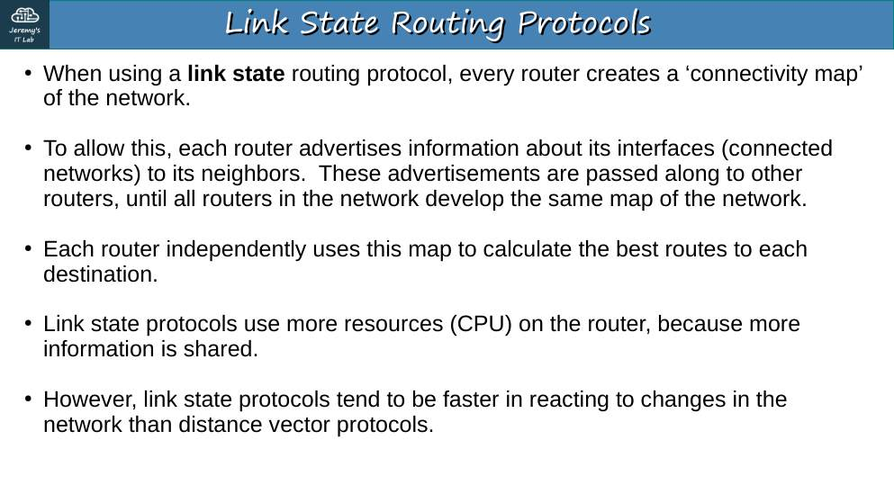<br><sub>p. 4</sub></td><td width="50%">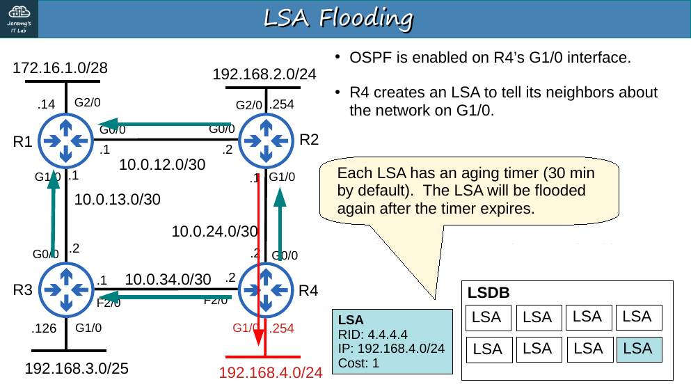<br><sub>p. 6</sub></td></tr><tr><td width="50%">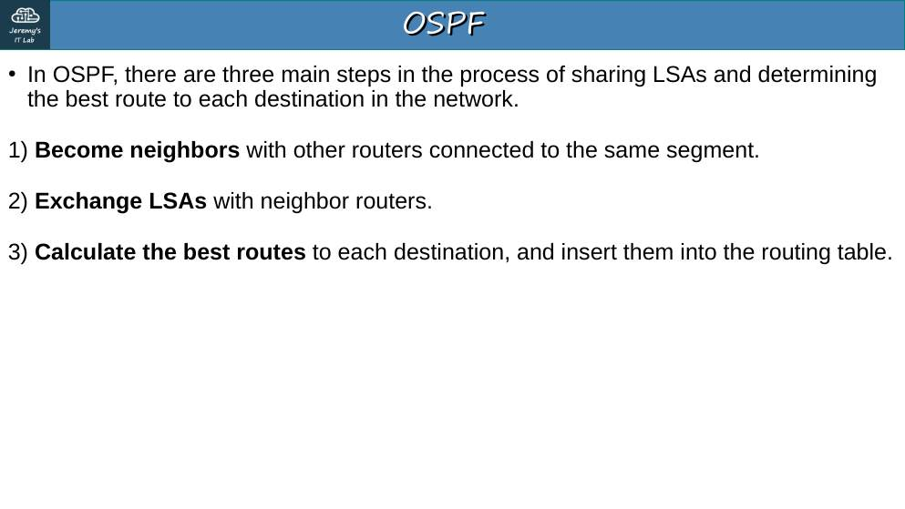<br><sub>p. 7</sub></td><td width="50%">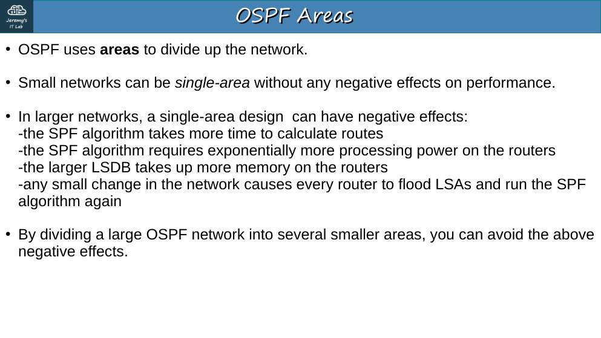<br><sub>p. 8</sub></td></tr><tr><td width="50%">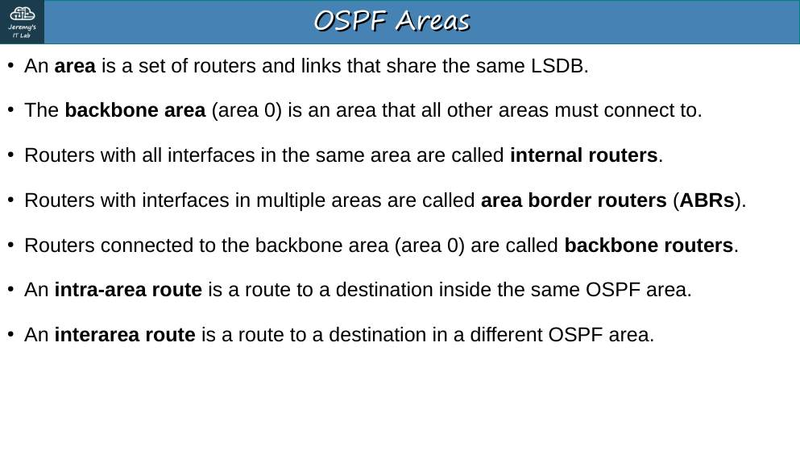<br><sub>p. 26</sub></td><td width="50%">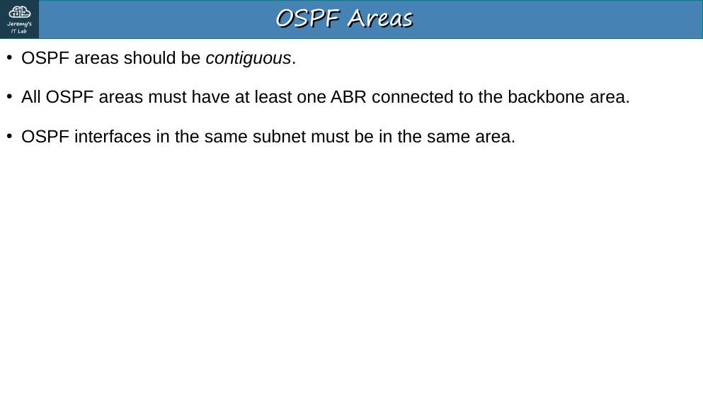<br><sub>p. 37</sub></td></tr><tr><td width="50%">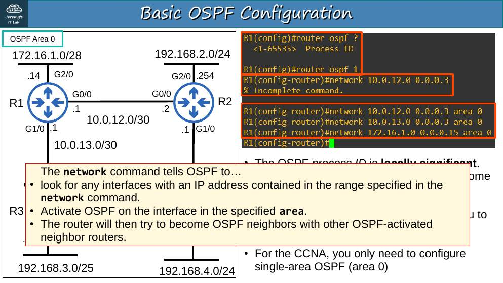<br><sub>p. 39</sub></td><td width="50%">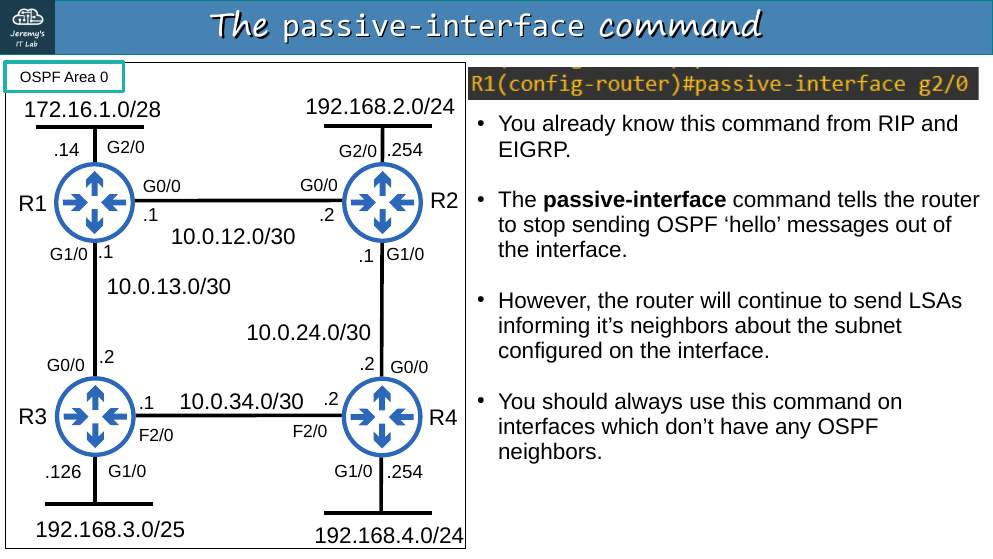<br><sub>p. 40</sub></td></tr><tr><td width="50%">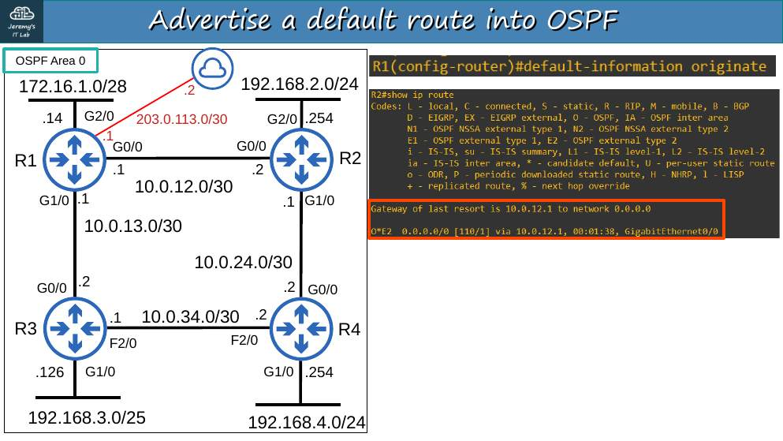<br><sub>p. 42</sub></td><td width="50%">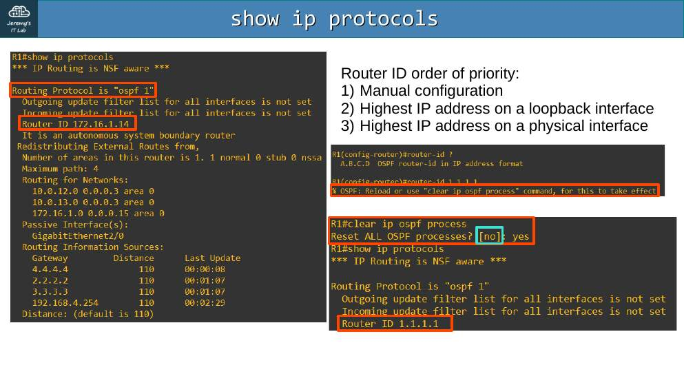<br><sub>p. 43</sub></td></tr><tr><td width="50%">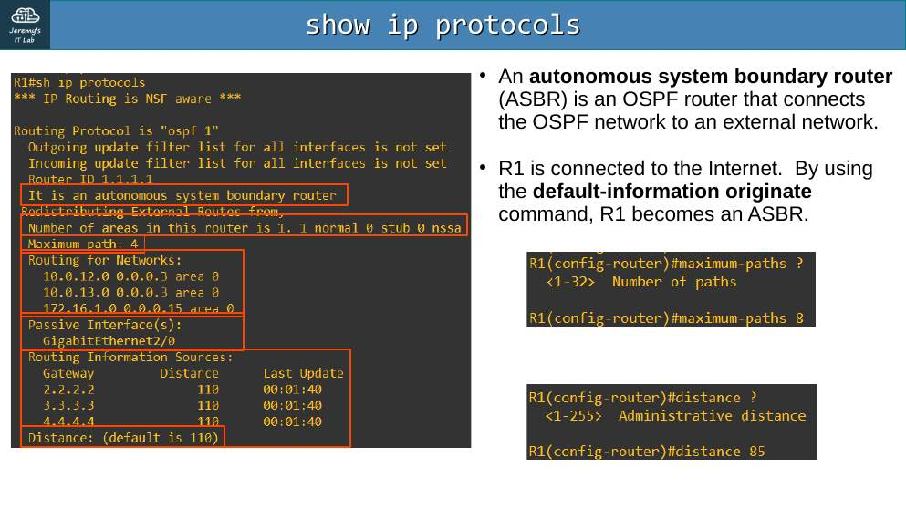<br><sub>p. 44</sub></td></tr></table>


## Apuntes

**OSPF (Open Shortest Path First)** — estado de enlace, estándar abierto. Versiones: **OSPFv2** (IPv4), **OSPFv3** (IPv6, y también IPv4). AD **110**. Multicast **224.0.0.5** (todos los routers OSPF) y **224.0.0.6** (DR/BDR).

**Funcionamiento en tres pasos:**

1. **Descubrir vecinos** con mensajes Hello.
2. **Intercambiar LSA** (*Link-State Advertisements*): cada router inunda los suyos; todos guardan la misma **LSDB** (*Link-State Database*) dentro del área.
3. **Calcular** con **SPF (Dijkstra)** la mejor ruta a cada destino.

**Áreas:** grupo de routers que comparten la misma LSDB. Se usan para escalar (menos LSA, SPF más rápido).

- **Área 0 (backbone):** todas las demás áreas deben conectar con ella.
- **Router interno:** todas sus interfaces en la misma área. **ABR** (*Area Border Router*): interfaces en varias áreas (máx. recomendado 2). **Backbone router:** interfaz en el área 0. **ASBR:** conecta OSPF con una red externa (Internet, otro protocolo).
- Una **red/subred** debe estar en **una sola área**.
- Rutas **intra-área** (O) vs **inter-área** (O IA) vs **externas** (O E1/E2).

**Configuración con `network`** (activa OSPF en las interfaces cuya IP coincide):

```
R1(config)# router ospf 1                        ← el process ID es local (no tiene que coincidir)
R1(config-router)# network 10.0.12.0 0.0.0.3 area 0
R1(config-router)# network 0.0.0.0 255.255.255.255 area 0   ← activa OSPF en todas
R1(config-router)# passive-interface g0/0        ← no envía Hellos, pero anuncia la red
R1(config-router)# passive-interface default     ← todas pasivas; luego "no passive-interface X"
R1(config-router)# default-information originate ← anuncia la ruta por defecto (este router = ASBR)
R1# show ip protocols / show ip ospf neighbor / show ip route ospf
```

**Router ID:** 1) `router-id` manual; 2) IP más alta de loopback up; 3) IP más alta de interfaz física up. Cambiarlo requiere `clear ip ospf process`.

## Trampas de examen

1. El **process ID** no necesita coincidir entre vecinos; el **área** sí.
2. `passive-interface` sigue **anunciando** la red de esa interfaz.
3. `default-information originate` necesita que el router **tenga** una ruta por defecto (salvo `always`).
4. La ruta externa por defecto aparece como **O\*E2**.

## Laboratorio · OSPF (parte 1)


<p align="center">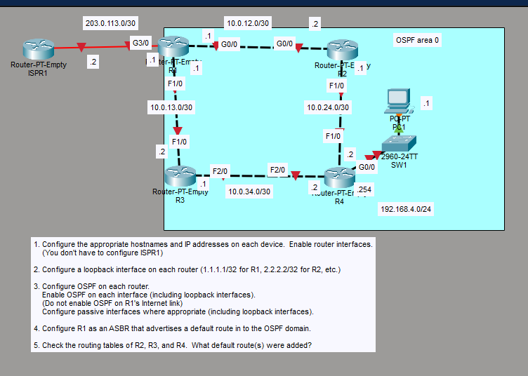<br><sub>Pantallazo del laboratorio (enunciado original de Jeremy)</sub></p>


**Topología (área 0):** igual que el Día 25 más **R1 G3/0 .1 – ISPR1 .2 (203.0.113.0/30)**. R1 G0/0 .1–R2 G0/0 .2 (10.0.12.0/30); R1 F1/0 .1–R3 F1/0 .2 (10.0.13.0/30); R2 F1/0 .1–R4 F1/0 .2 (10.0.24.0/30); R3 F2/0 .1–R4 F2/0 .2 (10.0.34.0/30); R4 G0/0 .254 – SW1 – PC1 .1 (192.168.4.0/24).

**Tarea 1 · Hostnames, IP y encender interfaces (ISPR1 no hace falta).** Como en el Día 25, más:

```
R1(config)# interface g3/0
R1(config-if)# ip address 203.0.113.1 255.255.255.252
R1(config-if)# no shutdown
```

**Tarea 2 · Loopbacks** 1.1.1.1/32 (R1), 2.2.2.2/32 (R2), 3.3.3.3/32 (R3), 4.4.4.4/32 (R4).

**Tarea 3 · OSPF en cada router, en todas las interfaces (incluidas loopbacks) salvo el enlace a Internet; pasivas donde corresponda.**

```
R1(config)# router ospf 1
R1(config-router)# network 10.0.12.0 0.0.0.3 area 0
R1(config-router)# network 10.0.13.0 0.0.0.3 area 0
R1(config-router)# network 1.1.1.1 0.0.0.0 area 0
R1(config-router)# passive-interface loopback0

R2(config)# router ospf 1
R2(config-router)# network 10.0.12.0 0.0.0.3 area 0
R2(config-router)# network 10.0.24.0 0.0.0.3 area 0
R2(config-router)# network 2.2.2.2 0.0.0.0 area 0
R2(config-router)# passive-interface loopback0

R3(config)# router ospf 1
R3(config-router)# network 10.0.13.0 0.0.0.3 area 0
R3(config-router)# network 10.0.34.0 0.0.0.3 area 0
R3(config-router)# network 3.3.3.3 0.0.0.0 area 0
R3(config-router)# passive-interface loopback0

R4(config)# router ospf 1
R4(config-router)# network 10.0.24.0 0.0.0.3 area 0
R4(config-router)# network 10.0.34.0 0.0.0.3 area 0
R4(config-router)# network 192.168.4.0 0.0.0.255 area 0
R4(config-router)# network 4.4.4.4 0.0.0.0 area 0
R4(config-router)# passive-interface loopback0
R4(config-router)# passive-interface g0/0
```

**Tarea 4 · R1 como ASBR que anuncia una ruta por defecto.**

```
R1(config)# ip route 0.0.0.0 0.0.0.0 203.0.113.2
R1(config)# router ospf 1
R1(config-router)# default-information originate
```

**Tarea 5 · ¿Qué rutas por defecto aparecen en R2, R3 y R4?**

```
R2# show ip route
O*E2 0.0.0.0/0 [110/1] via 10.0.12.1, GigabitEthernet0/0
```

- R2 y R3: **O\*E2 0.0.0.0/0** vía R1 (externa tipo 2, métrica 1: no suma costos internos).
- R4: la misma ruta **dos veces** (vía R2 y vía R3) si los costos hasta R1 empatan → ECMP. Si un camino tiene enlaces más lentos, solo verás uno.

---

## Rómpelo y arréglalo (48 h después del lab)

| # | Rompe esto | Síntoma | Te delata | Arreglo |
|---|---|---|---|---|
| 1 | En R3 `network 10.0.34.0 0.0.0.3 area 1` | R3–R4 no son vecinos (área distinta) | `show ip ospf interface f2/0` → Area 1 | Área 0 |
| 2 | Quita `default-information originate` en R1 | R2–R4 sin O*E2 | `show ip route` | Volver a ponerlo |
| 3 | `passive-interface g0/0` en R1 | R1–R2 sin vecindad | `show ip ospf neighbor` | Quitarlo |

## Repaso rápido

Intenta responder antes de abrir cada pregunta.

<details><summary>Multicast de OSPF</summary>

224.0.0.5 (todos los routers OSPF) y 224.0.0.6 (DR/BDR).

</details>

<details><summary>Tres pasos de OSPF</summary>

Descubrir vecinos (Hello), intercambiar LSA (LSDB igual en el área) y calcular SPF.

</details>

<details><summary>ABR vs ASBR</summary>

ABR: conecta áreas. ASBR: conecta OSPF con una red externa.

</details>

<details><summary>¿El process ID de OSPF debe coincidir entre vecinos?</summary>

No; el área sí.

</details>

<details><summary>¿Qué hace passive-interface en OSPF?</summary>

No envía Hellos por esa interfaz, pero sigue anunciando su red.

</details>

<details><summary>¿Cómo aparece una ruta por defecto anunciada con default-information originate?</summary>

O*E2 0.0.0.0/0.

</details>


---

[⬅ Índice del curso](../../README.md)
