# Día 27 · OSPF (parte 2)

> Mis apuntes del Día 27 del curso **CCNA 200-301 de Jeremy's IT Lab**.
> Video del día: [Jeremy's IT Lab en YouTube](https://www.youtube.com/@JeremysITLab).

| | |
|---|---|
| **Estado** | ✅ Estudiado |
| **Lectura Odom 2.ª ed.** | V1 caps. 21–24 |
| **NetAcad v7** | ENSA 1–2 |
| **Lab extra** | CCNA3 2.x (OSPF) + LG 21-1 |

## Diapositivas clave de Jeremy

**Day 27 Slides - OSPF (Part 2)**

<table><tr><td width="50%">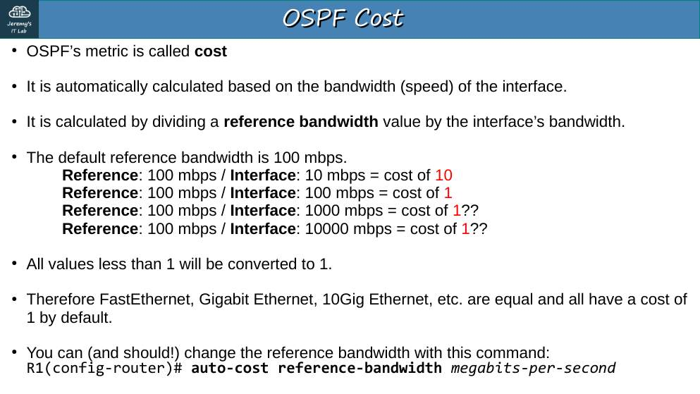<br><sub>p. 6</sub></td><td width="50%">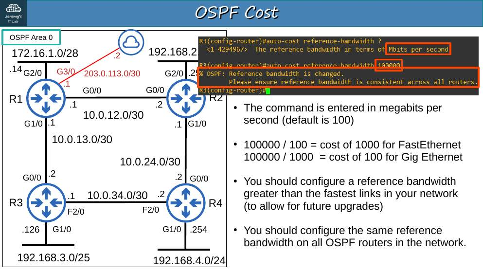<br><sub>p. 7</sub></td></tr><tr><td width="50%">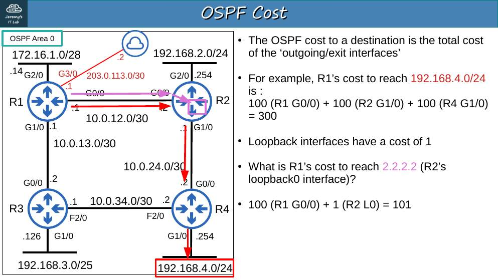<br><sub>p. 8</sub></td><td width="50%">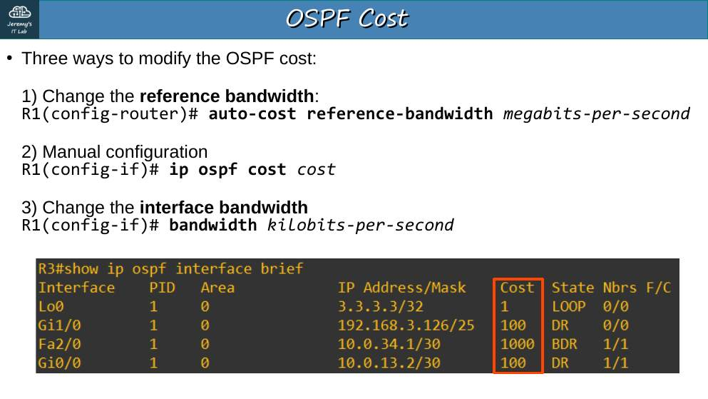<br><sub>p. 13</sub></td></tr><tr><td width="50%">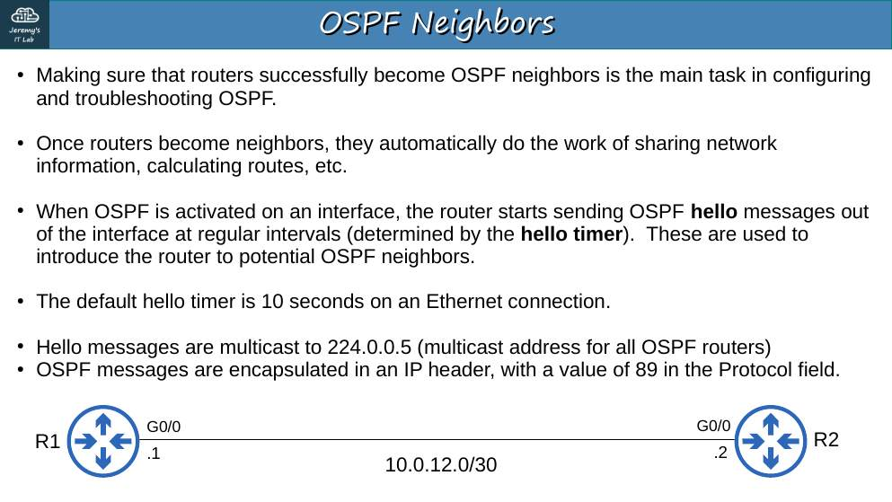<br><sub>p. 14</sub></td><td width="50%">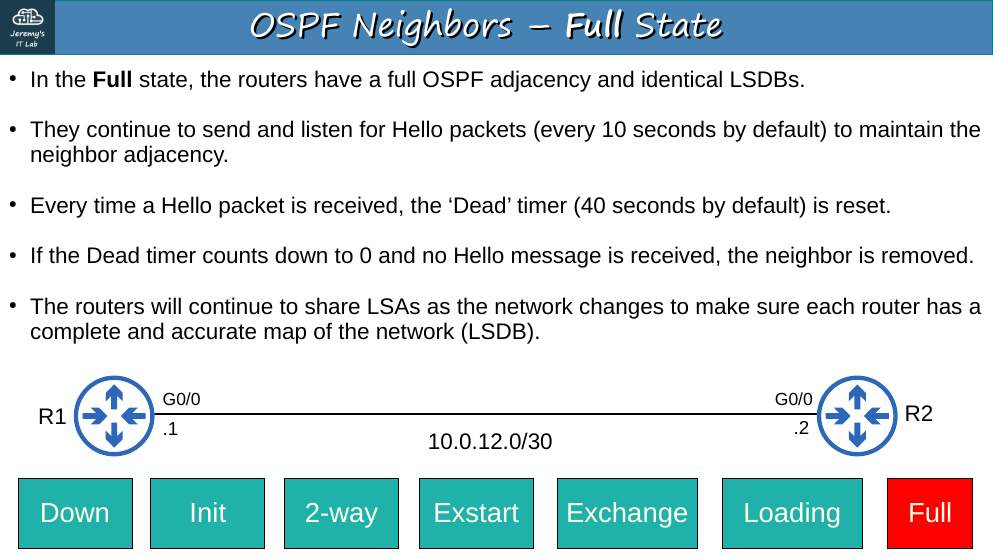<br><sub>p. 22</sub></td></tr><tr><td width="50%">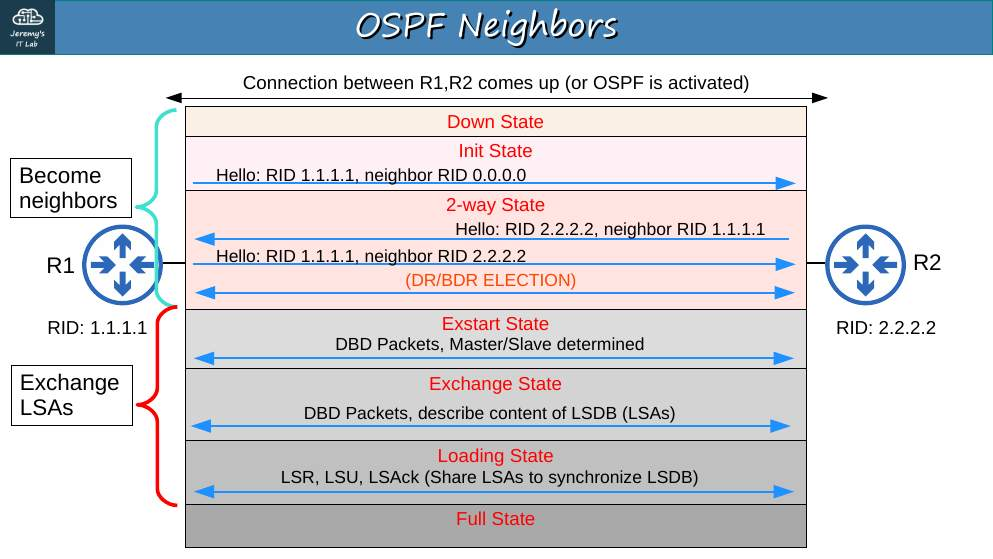<br><sub>p. 25</sub></td><td width="50%">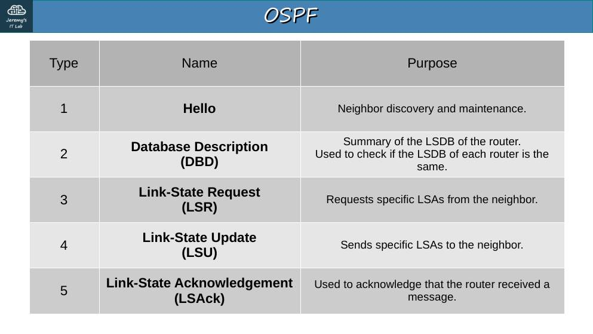<br><sub>p. 26</sub></td></tr><tr><td width="50%">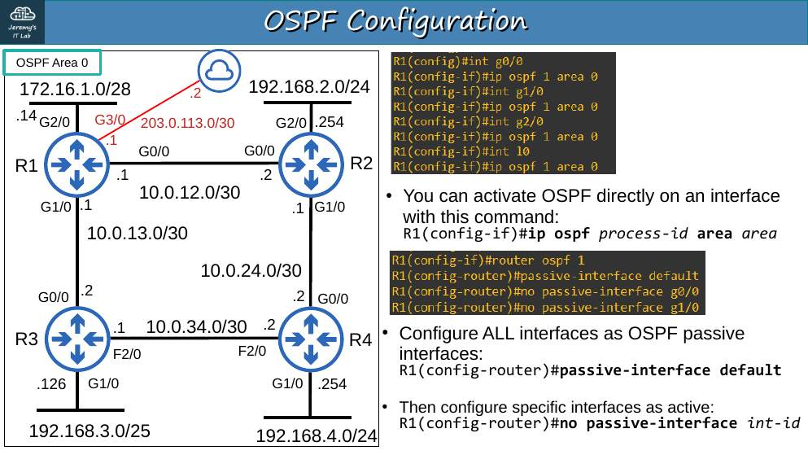<br><sub>p. 28</sub></td><td width="50%">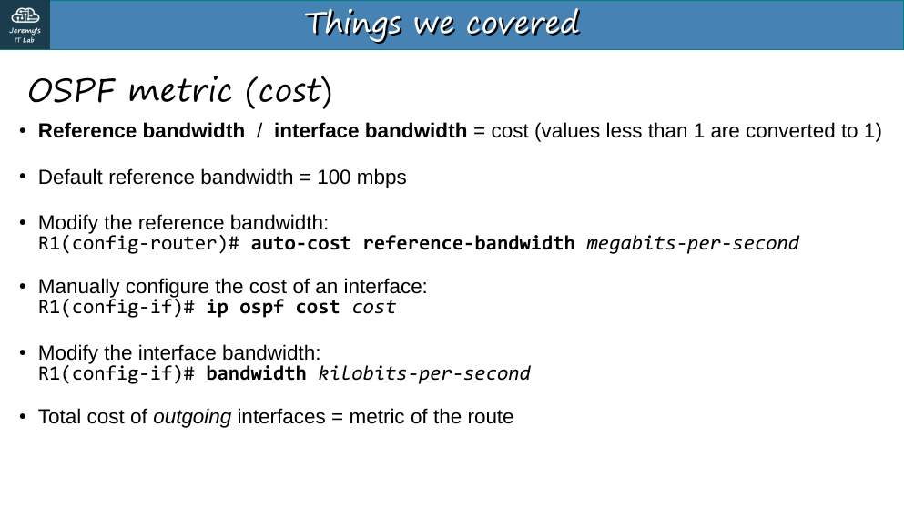<br><sub>p. 30</sub></td></tr></table>


## Apuntes

**Costo OSPF = ancho de banda de referencia / ancho de banda de la interfaz.** Referencia por defecto **100 Mbps** → FastEthernet, Gigabit y 10G cuestan **1** (los valores < 1 se redondean a 1).

```
R1(config-router)# auto-cost reference-bandwidth 100000   ← en Mbps; igual en TODOS los routers
R1(config-if)# ip ospf cost 10                             ← costo manual de una interfaz
R1(config-if)# bandwidth 10000                             ← en kbps; cambia el cálculo (¡no la velocidad real!)
```

Prioridad para elegir el costo: `ip ospf cost` > `bandwidth` > referencia/velocidad real.

**Activar OSPF por interfaz** (sin `network`):

```
R1(config-if)# ip ospf 1 area 0
```

**Estados de vecino:**

| Estado | Qué ocurre |
|---|---|
| **Down** | No hay Hellos |
| **Init** | Recibí un Hello, pero no me incluye en su lista de vecinos |
| **2-Way** | Ambos se ven en el Hello. Aquí se elige **DR/BDR** en redes broadcast. Entre **DROthers** la relación se queda en 2-Way |
| **ExStart** | Se decide quién es maestro (RID mayor) para intercambiar DBD |
| **Exchange** | Intercambian **DBD** (resúmenes de la LSDB) |
| **Loading** | Piden lo que les falta con **LSR**; reciben **LSU** y confirman con **LSAck** |
| **Full** | LSDB sincronizadas: **adyacencia completa** |

**Mensajes OSPF:** 1 Hello, 2 DBD, 3 LSR, 4 LSU, 5 LSAck. Hello cada **10 s**, Dead **40 s** (broadcast y punto a punto).

**Campos del Hello:** Router ID, Area ID, máscara, Hello y Dead intervals, prioridad, DR, BDR, lista de vecinos vistos, autenticación, opciones (flag de área stub).

## Trampas de examen

1. Si cambias la referencia en un router y no en los demás, los costos quedan **inconsistentes**.
2. `bandwidth` **no** cambia la velocidad de la interfaz.
3. DROthers entre sí → **2-Way** (no es un error).
4. El maestro en ExStart es el de **RID mayor**.

## Laboratorio · OSPF (parte 2)


<p align="center">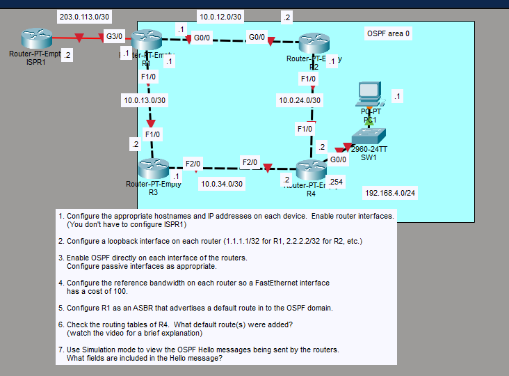<br><sub>Pantallazo del laboratorio (enunciado original de Jeremy)</sub></p>


**Topología:** la misma del Día 26 (ISPR1 en G3/0 de R1).

**Tarea 1 · Hostnames, IP y encender interfaces** (igual que el Día 26).

**Tarea 2 · Loopbacks** (1.1.1.1/32 … 4.4.4.4/32).

**Tarea 3 · OSPF directamente en cada interfaz; pasivas donde corresponda.**

```
R1(config)# interface range g0/0 , f1/0 , loopback0
R1(config-if-range)# ip ospf 1 area 0
R1(config)# router ospf 1
R1(config-router)# passive-interface loopback0
R2(config)# interface range g0/0 , f1/0 , loopback0
R2(config-if-range)# ip ospf 1 area 0
R3(config)# interface range f1/0 , f2/0 , loopback0
R3(config-if-range)# ip ospf 1 area 0
R4(config)# interface range f1/0 , f2/0 , g0/0 , loopback0
R4(config-if-range)# ip ospf 1 area 0
R4(config)# router ospf 1
R4(config-router)# passive-interface loopback0
R4(config-router)# passive-interface g0/0
```

(En R2 y R3 agrega también `passive-interface loopback0`.)

**Tarea 4 · Referencia para que FastEthernet cueste 100.** 100 Mbps × 100 = **10 000 Mbps**:

```
R1(config-router)# auto-cost reference-bandwidth 10000    ← en los cuatro routers
```

Resultado: FastEthernet = 100, GigabitEthernet = 10.

**Tarea 5 · R1 como ASBR.**

```
R1(config)# ip route 0.0.0.0 0.0.0.0 203.0.113.2
R1(config)# router ospf 1
R1(config-router)# default-information originate
```

**Tarea 6 · ¿Qué rutas por defecto ve R4?** `show ip route` → **O\*E2 0.0.0.0/0**. Ahora los costos importan: vía R2 el camino R4→R2 (F, 100) + R2→R1 (G, 10) = 110; vía R3, R4→R3 (F, 100) + R3→R1 (F, 100) = 200. Para E2 la métrica mostrada es 1 en ambos casos, y el desempate usa el **costo hasta el ASBR** → R4 elige **solo la ruta vía R2**.

**Tarea 7 · Ver los Hello en simulación: ¿qué campos tienen?** Filtra por OSPF, abre un Hello: **Router ID, Area ID, Network Mask, Hello Interval (10), Router Priority, Dead Interval (40), DR, BDR, Neighbors, Authentication, Options**.

---

## Rómpelo y arréglalo (48 h después del lab)

| # | Rompe esto | Síntoma | Te delata | Arreglo |
|---|---|---|---|---|
| 1 | `auto-cost reference-bandwidth` solo en R1 | Costos incoherentes; rutas subóptimas | `show ip ospf interface brief` (costos) | Mismo valor en todos |
| 2 | `ip ospf hello-interval 5` en R2 G0/0 | R1–R2 caen tras 40 s | `show ip ospf interface g0/0` (timers) | Igualar timers |
| 3 | R1 y R4 con el mismo `router-id` | Avisos de RID duplicado; rutas raras | Log *Router-ID … duplicate*; `show ip ospf` | RID únicos + `clear ip ospf process` |

## Repaso rápido

Intenta responder antes de abrir cada pregunta.

<details><summary>Fórmula del costo OSPF</summary>

Ancho de banda de referencia / ancho de banda de la interfaz (referencia por defecto 100 Mbps).

</details>

<details><summary>Problema del ancho de banda de referencia por defecto</summary>

FastEthernet, Gigabit y 10G cuestan 1: no se distinguen.

</details>

<details><summary>Estados de vecino OSPF en orden</summary>

Down, Init, 2-Way, ExStart, Exchange, Loading, Full.

</details>

<details><summary>Hello y Dead por defecto en Ethernet</summary>

10 y 40 segundos.

</details>

<details><summary>¿En qué estado se quedan dos DROther?</summary>

2-Way (es normal).

</details>

<details><summary>Activar OSPF directamente en la interfaz</summary>

ip ospf 1 area 0

</details>


---

[⬅ Índice del curso](../../README.md)
