# Día 28 · OSPF (parte 3)

> Mis apuntes del Día 28 del curso **CCNA 200-301 de Jeremy's IT Lab**.
> Video del día: [Jeremy's IT Lab en YouTube](https://www.youtube.com/@JeremysITLab).

| | |
|---|---|
| **Estado** | ✅ Estudiado |
| **Lectura Odom 2.ª ed.** | V1 caps. 21–24 |
| **NetAcad v7** | ENSA 1–2 |
| **Lab extra** | CCNA3 2.x (OSPF) + LG 21-1 |

## Diapositivas clave de Jeremy

**Day 28 Slides - OSPF (Part 3)**

<table><tr><td width="50%">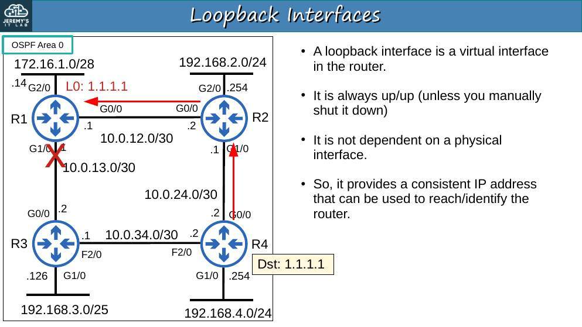<br><sub>p. 5</sub></td><td width="50%">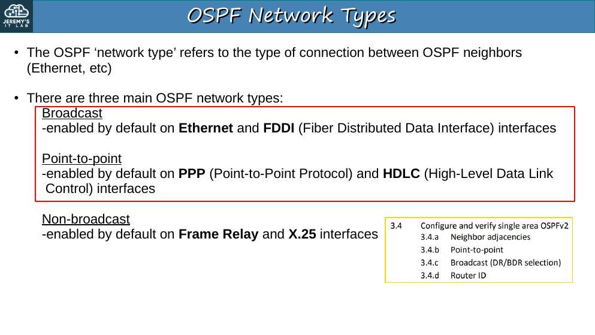<br><sub>p. 6</sub></td></tr><tr><td width="50%">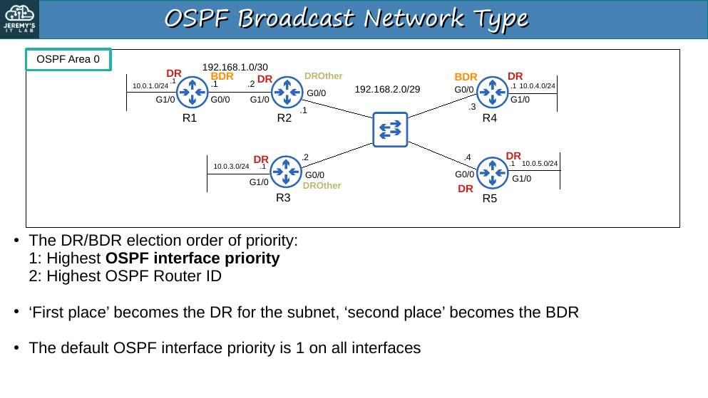<br><sub>p. 8</sub></td><td width="50%">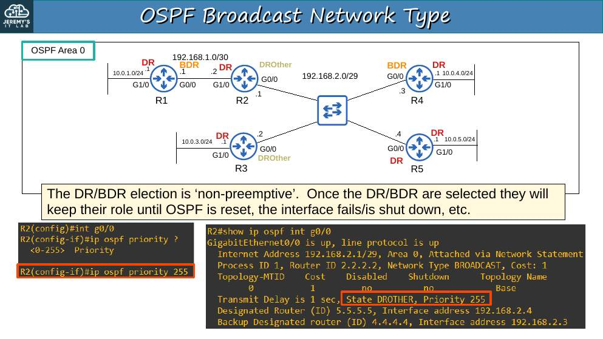<br><sub>p. 11</sub></td></tr><tr><td width="50%">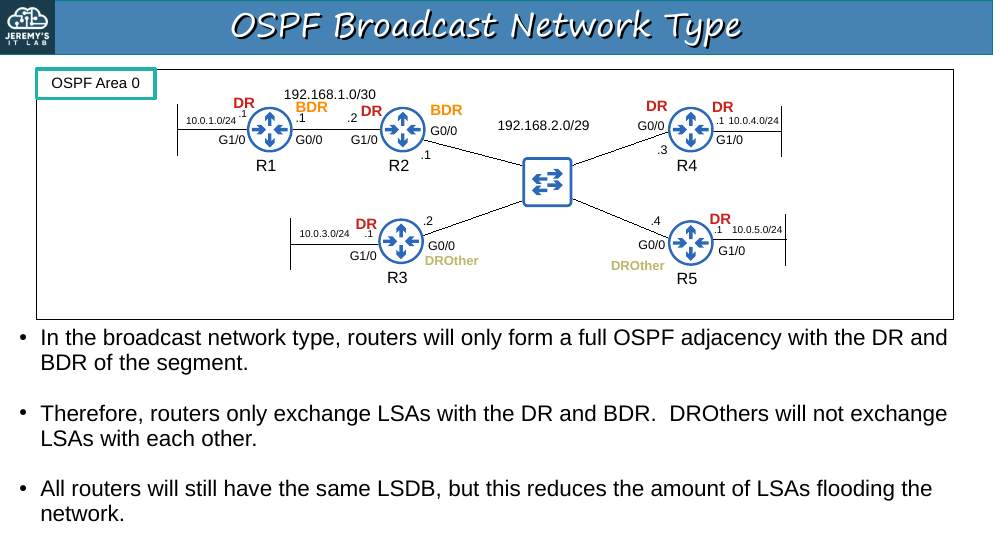<br><sub>p. 14</sub></td><td width="50%">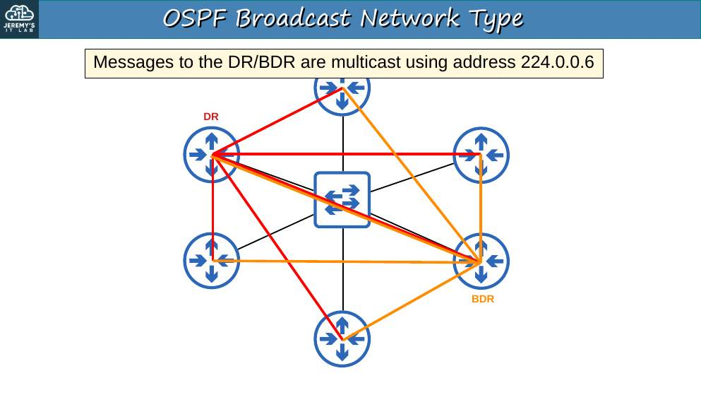<br><sub>p. 16</sub></td></tr><tr><td width="50%">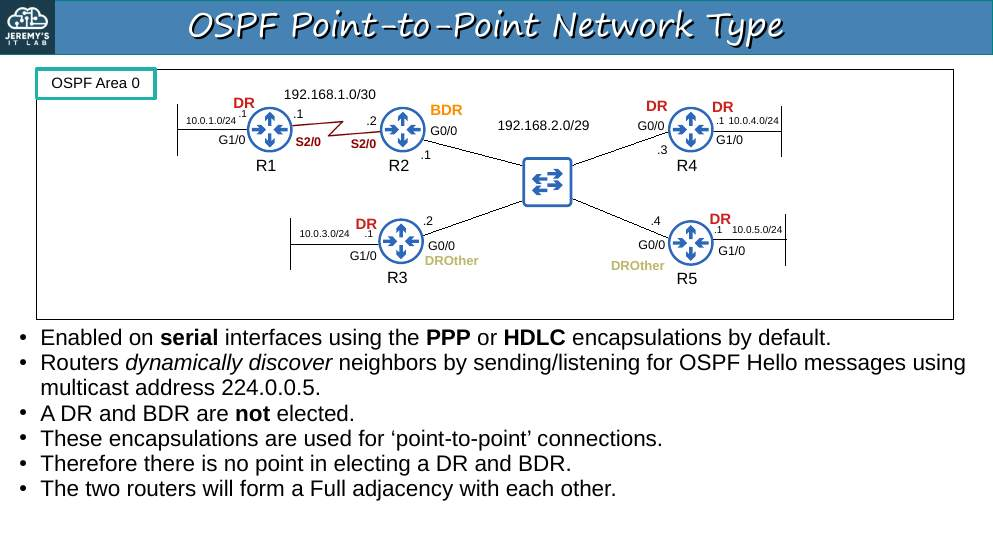<br><sub>p. 20</sub></td><td width="50%">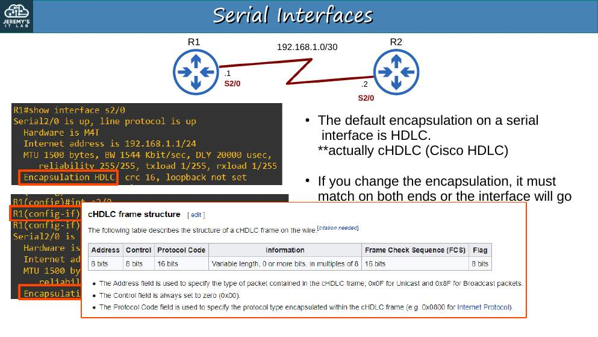<br><sub>p. 24</sub></td></tr><tr><td width="50%">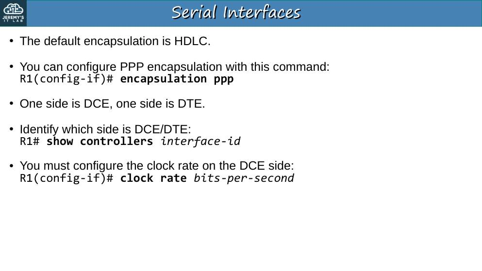<br><sub>p. 27</sub></td><td width="50%">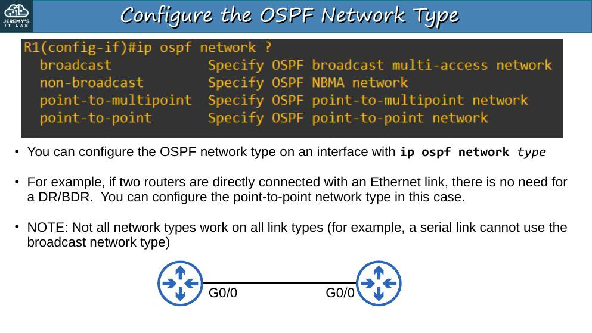<br><sub>p. 29</sub></td></tr><tr><td width="50%">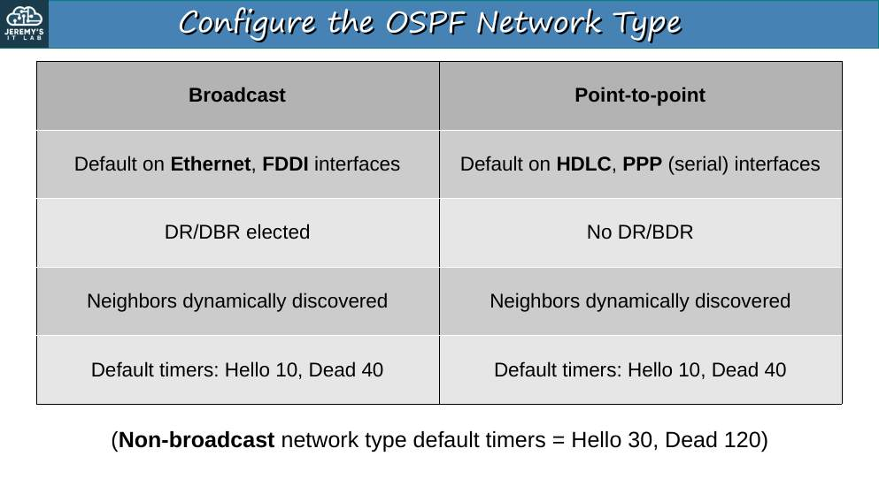<br><sub>p. 30</sub></td><td width="50%">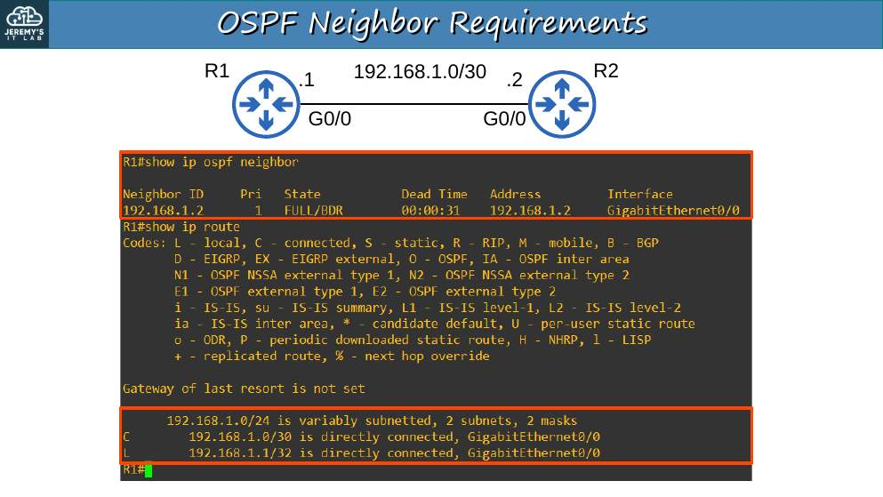<br><sub>p. 49</sub></td></tr><tr><td width="50%">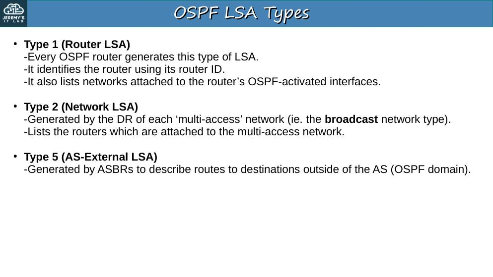<br><sub>p. 52</sub></td></tr></table>


## Apuntes

**Tipos de red OSPF:**

| Tipo | Dónde | DR/BDR | Hello/Dead | Vecinos |
|---|---|---|---|---|
| **Broadcast** | Ethernet (por defecto) | **Sí** | 10/40 | Automáticos |
| **Point-to-point** | Serial (HDLC/PPP) por defecto; Ethernet si se configura | No | 10/40 | Automáticos |
| Non-broadcast (NBMA) | Frame Relay | Sí | 30/120 | Manuales (`neighbor`) |

```
R1(config-if)# ip ospf network point-to-point     ← útil en enlaces Ethernet entre solo 2 routers
R1(config-if)# ip ospf priority 255               ← 0 = nunca DR/BDR; por defecto 1
```

**Elección del DR/BDR** (en cada segmento broadcast): 1) **mayor prioridad**; 2) **mayor Router ID**. **No es preemptivo**: un router con mayor prioridad que llega después no quita al DR. Para forzar: `clear ip ospf process`. Los DROthers solo forman adyacencia **Full** con el DR y el BDR (por **224.0.0.6**).

**Serial (HDLC/PPP):** en el extremo **DCE** se configura `clock rate`. `show controllers s0/0/0` dice si es DCE o DTE. Encapsulación por defecto en Cisco: **HDLC**; `encapsulation ppp` para PPP.

**Requisitos para ser vecinos OSPF:**

1. Misma **subred** (y máscara).
2. Misma **área**.
3. Mismos **Hello y Dead**.
4. **Router ID único**.
5. Misma **autenticación**.
6. Mismo **flag de área stub**.
7. Interfaces **no pasivas** y OSPF activo.
8. Misma **MTU** (si no, se quedan en ExStart/Exchange).
9. Mismo **tipo de red** (si uno es broadcast y otro punto a punto pueden hacerse vecinos pero no funcionar bien).

**Tipos de LSA del CCNA:**

| Tipo | Nombre | Quién lo genera |
|---|---|---|
| **1** | Router LSA | **Cada router** (sus interfaces y vecinos) |
| **2** | Network LSA | El **DR** de cada segmento broadcast con vecinos |
| **5** | AS External LSA | El **ASBR** (rutas externas, como la por defecto) |

LSA se refresca cada **30 min**; *max age* 60 min.

## Trampas de examen

1. DR/BDR: mayor prioridad, luego **mayor** RID. Prioridad 0 = nunca.
2. La elección **no** es preemptiva.
3. MTU distinta → vecinos atascados en ExStart/Exchange.
4. En un enlace serial no hay DR/BDR ni LSA tipo 2.

## Laboratorio · OSPF (parte 3)


<p align="center">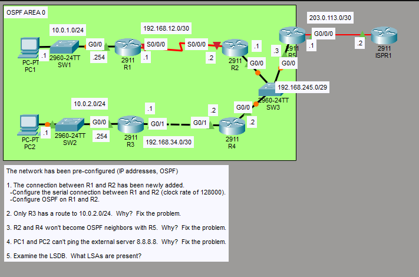<br><sub>Pantallazo del laboratorio (enunciado original de Jeremy)</sub></p>


**Topología (preconfigurada con IP y OSPF):** PC1 .1 – SW1 – R1 G0/0 .254 (10.0.1.0/24); R1 S0/0/0 .1 – R2 S0/0/0 .2 (192.168.12.0/30, **nuevo**); R2 G0/0 .1, R4 G0/0 .2 y R5 G0/0 .3 en SW3 (192.168.245.0/29); R5 G0/0/0 .1 – ISPR1 .2 (203.0.113.0/30); R4 G0/1 .2 – R3 G0/1 .1 (192.168.34.0/30); R3 G0/0 .254 – SW2 – PC2 .1 (10.0.2.0/24).

**Tarea 1 · Configurar el enlace serial R1–R2 (clock rate 128000) y OSPF en R1 y R2.**

```
R1# show controllers s0/0/0          ← busca "DCE V.35" para saber dónde va el clock rate
R1(config)# interface s0/0/0
R1(config-if)# ip address 192.168.12.1 255.255.255.252
R1(config-if)# clock rate 128000     ← solo en el extremo DCE
R1(config-if)# no shutdown
R1(config)# router ospf 1
R1(config-router)# network 192.168.12.0 0.0.0.3 area 0
R2(config)# interface s0/0/0
R2(config-if)# ip address 192.168.12.2 255.255.255.252
R2(config-if)# no shutdown
R2(config)# router ospf 1
R2(config-router)# network 192.168.12.0 0.0.0.3 area 0
```

**Tarea 2 · Solo R3 tiene ruta a 10.0.2.0/24. ¿Por qué? Arréglalo.** La red solo la conoce R3 porque es **conectada**; R3 no la está compartiendo. Diagnóstico:

```
R3# show ip ospf neighbor              ← ¿hay vecino con R4 por G0/1?
R3# show ip ospf interface brief       ← ¿G0/1 está en OSPF? ¿área 0?
R3# show ip protocols                  ← "Passive Interface(s)" y redes anunciadas
R4# show ip ospf interface g0/1        ← compara área, timers y máscara con R3
```

Causa típica: **G0/1 de R3 configurada como `passive-interface`** (no forma vecindad con R4), o la red 192.168.34.0/30 fuera de OSPF/área distinta. Arreglo: `no passive-interface g0/1` (o corregir el `network`/área).

**Tarea 3 · R2 y R4 no son vecinos de R5. ¿Por qué? Arréglalo.**

```
R5# show ip ospf interface g0/0        ← Hello/Dead, área, prioridad
R2# show ip ospf interface g0/0        ← compara
R5# show running-config | section ospf|interface GigabitEthernet0/0
```

Causa típica: R5 G0/0 con **timers Hello/Dead distintos** (`ip ospf hello-interval` / `dead-interval`), **área distinta** o **máscara distinta** del /29. Arreglo: igualar a los de R2/R4 (por ejemplo `no ip ospf hello-interval`, `no ip ospf dead-interval`).

**Tarea 4 · PC1 y PC2 no llegan a 8.8.8.8. ¿Por qué? Arréglalo.** R5 es el ASBR pero no anuncia la ruta por defecto al dominio OSPF:

```
R5# show ip route                      ← ¿tiene S* 0.0.0.0/0 vía 203.0.113.2?
R5(config)# ip route 0.0.0.0 0.0.0.0 203.0.113.2     ← si faltara
R5(config)# router ospf 1
R5(config-router)# default-information originate
```

Comprueba en R1/R3: `O*E2 0.0.0.0/0`.

**Tarea 5 · Examinar la LSDB: ¿qué LSA hay?**

```
R1# show ip ospf database
```

- **Tipo 1 (Router):** uno por cada router (R1–R5).
- **Tipo 2 (Network):** generados por el **DR** de 192.168.245.0/29 y de 192.168.34.0/30 (segmentos broadcast con vecinos). No hay en el enlace serial ni en las LAN de los PC.
- **Tipo 5 (External):** la ruta por defecto que anuncia R5.

---

## Rómpelo y arréglalo (48 h después del lab)

| # | Rompe esto | Síntoma | Te delata | Arreglo |
|---|---|---|---|---|
| 1 | Quita `clock rate` en el extremo DCE | Serial up/down | `show controllers s0/0/0`; `show ip int brief` | `clock rate 128000` |
| 2 | `ip ospf priority 0` en R2, R4 y R5 G0/0 | Sin DR en el /29: vecinos en 2-Way, sin rutas | `show ip ospf neighbor` | Al menos uno con prioridad > 0 |
| 3 | MTU distinta en R5 G0/0 (`ip mtu 1400`) | Vecino atascado en ExStart/Exchange | `show ip ospf neighbor` | Igualar MTU |

## Repaso rápido

Intenta responder antes de abrir cada pregunta.

<details><summary>¿Cómo se elige el DR?</summary>

Mayor prioridad de interfaz; empate: mayor router ID. No es preemptivo.

</details>

<details><summary>¿Qué significa prioridad OSPF 0?</summary>

Nunca será DR ni BDR.

</details>

<details><summary>Síntoma de MTU distinta entre vecinos OSPF</summary>

Se quedan en ExStart/Exchange.

</details>

<details><summary>LSA tipo 1, 2 y 5</summary>

1 Router (todos), 2 Network (el DR), 5 External (el ASBR).

</details>

<details><summary>Requisitos para ser vecinos OSPF</summary>

Misma subred, área, timers, autenticación, flag stub; RID único; no pasiva; misma MTU.

</details>

<details><summary>¿Dónde va el clock rate en un enlace serial?</summary>

En el extremo DCE (show controllers).

</details>


---

[⬅ Índice del curso](../../README.md)
